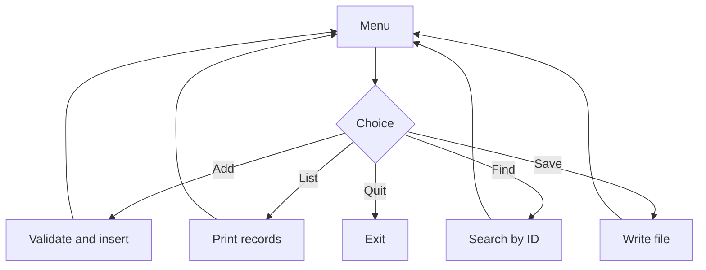

# C Programming: Zero to Hero

**A practical, self-paced handbook for complete beginners through advanced foundations**  
**Author:** Engr. Amarachi Crystal Omereife  
**Publisher:** Opsfuxion Technologies Limited  
**Edition:** October 2026

> **How to use this book:** Read the explanation, type the example yourself, predict its output, compile and run it, then attempt the exercise **before** opening the solution. The book teaches standard C17; some advanced chapters also introduce POSIX APIs that work on macOS/Linux but are not ISO C.

## Contents

1. Getting started and your first program
2. Variables, types and formatted input/output
3. Operators and expressions
4. Decisions and Boolean logic
5. Loops
6. Functions, prototypes and scope
7. Arrays and strings
8. Pointers and addresses
9. Dynamic memory
10. Structures, enums and typedef
11. Files and error handling
12. Header files, modular programs and the build process
13. Recursion and algorithmic complexity
14. Searching and sorting
15. Linked lists and data structures
16. Bitwise operations and low-level reasoning
17. Defensive C, sanitizers and debugging
18. Command-line arguments and portable utilities
19. Capstone: Student Records Manager
20. Practice roadmap, glossary and author

## Before you begin: environment and learning method

**What is C?** C is a compiled, procedural programming language used in operating systems, embedded devices, databases, tools and performance-sensitive software. C gives you considerable control over memory, which is powerful but means you must prevent invalid access and resource leaks yourself.

**Install a compiler:** On macOS, run `xcode-select --install` for Apple Clang. On Ubuntu/Debian, run `sudo apt update && sudo apt install build-essential gdb`. On Windows, use WSL with Ubuntu, or a correctly configured GCC/Clang toolchain. Check with `cc --version`. Use VS Code with the C/C++ extension or any plain-text editor.

**Create a project:** `mkdir c-zero-to-hero && cd c-zero-to-hero`. Save each chapter's example in a separate `.c` file. Compile with `cc -std=c17 -Wall -Wextra -Wpedantic -g example.c -o example` and run `./example` (on Windows without WSL, `example.exe`). Warnings are not decorations: investigate them.

**Mental model:** source `.c` → preprocessing → compilation → linking → executable. A compile-time error prevents building; a runtime error happens while the program runs; a logic error produces the wrong answer despite compiling.

### C program anatomy

```c
#include <stdio.h>   // declaration of printf
int main(void) {     // program entry point
    printf("Hello, world!\n");
    return 0;        // success status
}
```

`#include` imports declarations, braces define blocks, semicolons end statements, and `\n` means a newline. `main` returns an integer exit status to the operating system.


---

## Chapter 1: Your first compiled program

**By the end of this chapter:** compile, execute and modify a C program.

### Understand the idea

Unlike an interpreted shell script, a C source file must normally be compiled into machine code. The compiler can catch syntax/type mistakes, but it cannot guarantee that your logic is correct. Keep source files and generated binaries separate.

### Follow-along example

```c
#include <stdio.h>
int main(void) {
    puts("Welcome to C!");
    puts("One step at a time.");
    return 0;
}
```

```bash
cc -std=c17 -Wall -Wextra -Wpedantic hello.c -o hello
./hello
```

### How it works, step by step

1. `stdio.h` declares standard input/output functions. 2. `puts` writes text followed by a newline. 3. The shell runs the compiled executable. 4. A zero return value conventionally signals success.

### Try it yourself

Change the program to print your name and two learning goals on separate lines.

<details><summary><strong>Show a worked solution</strong></summary>

```c
#include <stdio.h>
int main(void) {
    puts("Name: Ada");
    puts("Goal 1: Understand memory");
    puts("Goal 2: Build useful tools");
    return 0;
}
```

</details>

### Common mistakes and good habits

If `cc` is not found, install a compiler; if the executable is missing, check that compilation succeeded and the output name matches.

---

## Chapter 2: Variables, types and input/output

**By the end of this chapter:** store numbers/text and read input safely.

### Understand the idea

A variable has a declared type. `int` stores whole numbers, `double` fractional numbers, `char` one character, and `_Bool` or `bool` (via `<stdbool.h>`) Boolean values. `printf` uses format specifiers such as `%d`, `%.2f`, `%c` and `%s`. The specifier must match the argument type. Avoid unchecked `scanf` for user-facing programs; read a line with `fgets` and parse it.

### Follow-along example

```c
#include <stdio.h>
#include <stdlib.h>
int main(void) {
    char line[64];
    int age = 0;
    printf("Enter your age: ");
    if (!fgets(line, sizeof line, stdin)) return 1;
    char *end;
    long parsed = strtol(line, &end, 10);
    if (end == line || (*end != '\n' && *end != '\0') || parsed < 0 || parsed > 150) {
        puts("Invalid age"); return 1;
    }
    age = (int)parsed;
    printf("Next year: %d\n", age + 1);
    return 0;
}
```

### How it works, step by step

`fgets` prevents writing beyond the buffer. `strtol` converts text to a number; `end` tells us where parsing stopped. The example rejects missing, negative and implausible ages. For full numeric robustness, also check `errno == ERANGE` before narrowing.

### Try it yourself

Read a price as a `double` and print it with two decimal places. What should happen if input is invalid?

<details><summary><strong>Show a worked solution</strong></summary>

```c
#include <stdio.h>
#include <stdlib.h>
int main(void) {
    char line[80], *end;
    printf("Price: ");
    if (!fgets(line, sizeof line, stdin)) return 1;
    double price = strtod(line, &end);
    if (end == line || (*end != '\n' && *end != '\0') || price < 0) {
        puts("Invalid price"); return 1;
    }
    printf("Price: %.2f\n", price);
    return 0;
}
```

</details>

### Common mistakes and good habits

`sizeof` measures bytes; types have implementation-dependent sizes. Never assume all machines use the same `int` width. Floating-point values are approximate.

---

## Chapter 3: Operators and expressions

**By the end of this chapter:** calculate results and understand precedence.

### Understand the idea

Arithmetic operators include `+`, `-`, `*`, `/`, `%`. Integer division truncates toward zero: `7 / 2` is `3`. `%` computes an integer remainder. Use parentheses when precedence might confuse a reader. `++` and `--` change a variable; avoid multiple modifications to the same variable within one expression.

### Follow-along example

```c
#include <stdio.h>
int main(void) {
    int items = 7, boxes = 3;
    printf("Full per box: %d\n", items / boxes);
    printf("Left over: %d\n", items % boxes);
    printf("Average: %.2f\n", (double)items / boxes);
    return 0;
}
```

### How it works, step by step

The cast `(double)` converts one operand before division. Without it, the fractional part is lost before assignment or printing.

### Try it yourself

Calculate a 7.5% sales tax on an item costing 200 and print the total.

<details><summary><strong>Show a worked solution</strong></summary>

```c
#include <stdio.h>
int main(void) {
    double price = 200.0, tax_rate = 0.075;
    printf("Total: %.2f\n", price * (1.0 + tax_rate));
    return 0;
}
```

</details>

### Common mistakes and good habits

Never divide by zero. Integer overflow can be undefined behavior for signed types. Use appropriately sized types and check ranges.

---

## Chapter 4: Decisions and Boolean logic

**By the end of this chapter:** express branching requirements precisely.

### Understand the idea

Use `if`, `else if`, `else` to choose actions. Comparisons are `==`, `!=`, `<`, `<=`, `>` and `>=`; `=` is assignment, not equality. Combine conditions using `&&` (and), `||` (or), and `!` (not). Short-circuit evaluation can avoid unsafe operations, e.g. check a pointer before dereferencing.

### Follow-along example

```c
#include <stdio.h>
int main(void) {
    int score = 82;
    if (score < 0 || score > 100) puts("Invalid score");
    else if (score >= 70) puts("Distinction");
    else if (score >= 50) puts("Pass");
    else puts("Try again");
    return 0;
}
```

### How it works, step by step

Check invalid input first. Only one branch runs. The order of thresholds matters: check the highest threshold before lower ones.

### Try it yourself

Create a ticket eligibility rule: age must be at least 18 and a ticket must be available.

<details><summary><strong>Show a worked solution</strong></summary>

```c
#include <stdio.h>
int main(void) {
    int age = 20, has_ticket = 1;
    if (age >= 18 && has_ticket) puts("Admit");
    else puts("Do not admit");
    return 0;
}
```

</details>

### Common mistakes and good habits

Test boundary cases: 17, 18 and 19; ticket present and absent. Always make input assumptions explicit.

---

## Chapter 5: Loops

**By the end of this chapter:** repeat tasks and stop at the right moment.

### Understand the idea

A `for` loop is ideal when the number of repetitions is known. A `while` loop repeats while a condition remains true. A `do ... while` loop executes at least once. `break` exits the nearest loop; `continue` skips to the next iteration. Every loop needs a termination argument to avoid running forever.

### Follow-along example

```c
#include <stdio.h>
int main(void) {
    int sum = 0;
    for (int i = 1; i <= 5; ++i) {
        sum += i;
        printf("i=%d sum=%d\n", i, sum);
    }
    return 0;
}
```

### How it works, step by step

The loop starts at 1, continues through 5 and increments once each iteration. The running sum evolves 1, 3, 6, 10, 15.

### Try it yourself

Print the multiplication table for 7 from 1 to 12.

<details><summary><strong>Show a worked solution</strong></summary>

```c
#include <stdio.h>
int main(void) {
    for (int i = 1; i <= 12; ++i) printf("7 x %d = %d\n", i, 7 * i);
    return 0;
}
```

</details>

### Common mistakes and good habits

An off-by-one error is common: `i < 12` stops at 11; `i <= 12` includes 12.

---

## Chapter 6: Functions, prototypes and scope

**By the end of this chapter:** split a program into testable parts.

### Understand the idea

A function takes parameters and optionally returns a value. A prototype declares its signature before use. Local variables belong to their block; do not return a pointer to a local variable. Pass values explicitly instead of relying on mutable global state.

### Follow-along example

```c
#include <stdio.h>
int square(int n);
int main(void) {
    printf("%d\n", square(9));
    return 0;
}
int square(int n) { return n * n; }
```

### How it works, step by step

The compiler checks the call against the prototype. `square` receives a copy of `n` and returns a result. The caller decides how to use it.

### Try it yourself

Write `int max_of_three(int a, int b, int c)` and test it with negative values.

<details><summary><strong>Show a worked solution</strong></summary>

```c
#include <stdio.h>
int max_of_three(int a, int b, int c) {
    int best = a > b ? a : b;
    return best > c ? best : c;
}
int main(void) {
    printf("%d\n", max_of_three(-9, -2, -5));
    return 0;
}
```

</details>

### Common mistakes and good habits

Use descriptive function names and keep each function responsible for one clear task.

---

## Chapter 7: Arrays and strings

**By the end of this chapter:** work with sequences safely.

### Understand the idea

An array stores fixed-size elements of the same type. C does not automatically check array bounds. A C string is a `char` array terminated by `\0`; `strlen` counts characters before the terminator, not the storage capacity. Prefer `fgets` to unsafe unbounded input.

### Follow-along example

```c
#include <stdio.h>
#include <string.h>
int main(void) {
    int scores[] = {65, 81, 92, 74};
    size_t count = sizeof scores / sizeof scores[0];
    int total = 0;
    for (size_t i = 0; i < count; ++i) total += scores[i];
    printf("Average: %.2f\n", (double)total / count);
    char name[] = "Uzoamaka";
    printf("Name length: %zu\n", strlen(name));
    return 0;
}
```

### How it works, step by step

The array has four elements indexed 0–3. `size_t` is the standard unsigned type for object sizes. `strlen` does not count the null terminator.

### Try it yourself

Find the highest number in `{3, 9, 4, 8}` without using a sorting function.

<details><summary><strong>Show a worked solution</strong></summary>

```c
#include <stdio.h>
int main(void) {
    int a[] = {3, 9, 4, 8};
    int best = a[0];
    for (size_t i = 1; i < sizeof a / sizeof a[0]; ++i)
        if (a[i] > best) best = a[i];
    printf("Max: %d\n", best);
    return 0;
}
```

</details>

### Common mistakes and good habits

Never access `a[count]`; the last valid index is `count - 1`. A pointer parameter does not preserve an array's length—pass length separately.

---

## Chapter 8: Pointers and addresses

**By the end of this chapter:** explain dereferencing and use pointer parameters.

### Understand the idea

A pointer holds an address. `&x` takes the address of `x`; `*p` accesses the pointed-to object. A pointer must refer to a valid live object before dereferencing. `NULL` represents no target. Pointer arithmetic is only valid within an array object (or one past its end, without dereferencing).

### Follow-along example

```c
#include <stdio.h>
void swap(int *a, int *b) {
    int temp = *a; *a = *b; *b = temp;
}
int main(void) {
    int x = 4, y = 7;
    swap(&x, &y);
    printf("x=%d y=%d\n", x, y);
    return 0;
}
```

### How it works, step by step

`swap` receives addresses so it can modify the caller's variables. `*a` reads or writes the integer stored at the address in `a`.

### Try it yourself

Write `void double_value(int *p)` that doubles a caller-owned integer.

<details><summary><strong>Show a worked solution</strong></summary>

```c
#include <stdio.h>
void double_value(int *p) { if (p) *p *= 2; }
int main(void) {
    int value = 12; double_value(&value);
    printf("%d\n", value);
    return 0;
}
```

</details>

### Common mistakes and good habits

Never return the address of a local stack variable; it stops being valid after the function returns.

---

## Chapter 9: Dynamic memory and ownership

**By the end of this chapter:** allocate and free heap memory correctly.

### Understand the idea

`malloc` allocates uninitialised storage; `calloc` allocates and zero-initialises bytes; `realloc` resizes an allocation. Every successful allocation must have an ownership plan and be released with `free`. Use `size_t` for sizes and check multiplication for overflow before allocating arrays.

### Follow-along example

```c
#include <stdio.h>
#include <stdlib.h>
int main(void) {
    size_t n = 5;
    int *scores = calloc(n, sizeof *scores);
    if (!scores) { perror("calloc"); return 1; }
    for (size_t i = 0; i < n; ++i) scores[i] = (int)(i * 10);
    for (size_t i = 0; i < n; ++i) printf("%d ", scores[i]);
    putchar('\n');
    free(scores);
    scores = NULL;
    return 0;
}
```

### How it works, step by step

`calloc` returns allocated memory or `NULL`. `free` ends the allocation lifetime. Setting the local pointer to `NULL` helps prevent accidental reuse in that scope.

### Try it yourself

Allocate an array of 3 integers, populate it with 2, 4, 6, print their sum and free the array.

<details><summary><strong>Show a worked solution</strong></summary>

```c
#include <stdio.h>
#include <stdlib.h>
int main(void) {
    int *a = malloc(3 * sizeof *a);
    if (!a) return 1;
    a[0]=2; a[1]=4; a[2]=6;
    printf("%d\n", a[0]+a[1]+a[2]);
    free(a);
    return 0;
}
```

</details>

### Common mistakes and good habits

Do not free memory twice, dereference after `free`, or overwrite the only pointer to an allocation before freeing it.

---

## Chapter 10: Structures, enums and typedef

**By the end of this chapter:** model application entities with custom types.

### Understand the idea

A `struct` groups related fields. `enum` gives meaningful names to integer states. `typedef` provides a type alias; it does not create a distinct runtime type. Use `.` for a structure value and `->` for a pointer to a structure.

### Follow-along example

```c
#include <stdio.h>
typedef enum { ACTIVE, INACTIVE } Status;
typedef struct {
    int id;
    char name[40];
    Status status;
} Student;
int main(void) {
    Student s = {101, "Ada", ACTIVE};
    printf("%d %s %s\n", s.id, s.name,
           s.status == ACTIVE ? "active" : "inactive");
    return 0;
}
```

### How it works, step by step

The initializer fills fields in declaration order. The enum makes code easier to understand than using unexplained numeric flags.

### Try it yourself

Define a `Book` struct with title, pages and price, then print one record.

<details><summary><strong>Show a worked solution</strong></summary>

```c
#include <stdio.h>
typedef struct { char title[60]; int pages; double price; } Book;
int main(void) {
    Book b = {"C Basics", 240, 19.99};
    printf("%s: %d pages, %.2f\n", b.title, b.pages, b.price);
    return 0;
}
```

</details>

### Common mistakes and good habits

For user-entered text, check buffer lengths. For larger strings, consider dynamically allocated storage with explicit ownership.

---

## Chapter 11: Files and errors

**By the end of this chapter:** read and write text files responsibly.

### Understand the idea

`fopen` opens a stream, `fprintf` writes formatted text, `fgets` reads a line, and `fclose` releases the resource. Always check open failures. File paths are relative to the current working directory, not necessarily the source file location. Text formats require a documented schema and parsing strategy.

### Follow-along example

```c
#include <stdio.h>
int main(void) {
    FILE *fp = fopen("notes.txt", "w");
    if (!fp) { perror("notes.txt"); return 1; }
    if (fprintf(fp, "Study pointers\n") < 0) {
        perror("write"); fclose(fp); return 1;
    }
    if (fclose(fp) == EOF) { perror("close"); return 1; }
    return 0;
}
```

### How it works, step by step

Opening with `w` truncates an existing file. `fprintf` may fail. Closing flushes buffered data, and even `fclose` can report errors.

### Try it yourself

Append a new line to a study log without deleting previous content.

<details><summary><strong>Show a worked solution</strong></summary>

```c
#include <stdio.h>
int main(void) {
    FILE *f = fopen("study.log", "a");
    if (!f) { perror("study.log"); return 1; }
    if (fputs("Completed Chapter 11\n", f) == EOF) {
        perror("write"); fclose(f); return 1;
    }
    return fclose(f) == 0 ? 0 : 1;
}
```

</details>

### Common mistakes and good habits

Avoid writing raw structs directly as portable file formats: padding, endianness and type sizes vary.

---

## Chapter 12: Modular programs and the build process

**By the end of this chapter:** split code into headers and implementation files.

### Understand the idea

A header `.h` declares a public interface; a `.c` file defines functions. Include guards prevent duplicate declarations in one translation unit. Compile all source files together or build object files separately. The linker resolves cross-file references.

### Follow-along example

**math_utils.h**
```c
#ifndef MATH_UTILS_H
#define MATH_UTILS_H
int add(int a, int b);
#endif
```
**math_utils.c**
```c
#include "math_utils.h"
int add(int a, int b) { return a + b; }
```
**main.c**
```c
#include <stdio.h>
#include "math_utils.h"
int main(void) { printf("%d\n", add(3, 4)); return 0; }
```
**Build:** `cc -std=c17 -Wall -Wextra main.c math_utils.c -o app`

### How it works, step by step

The header tells callers what exists; the `.c` file supplies the implementation. Both must agree on parameter and return types.

### Try it yourself

Add `int subtract(int a, int b)` to the module and call it from `main`.

<details><summary><strong>Show a worked solution</strong></summary>

**Add to math_utils.h:** `int subtract(int a, int b);`  
**Add to math_utils.c:** `int subtract(int a, int b) { return a - b; }`  
**Call in main:** `printf("%d\n", subtract(9, 4));`  
Recompile both `.c` files.

</details>

### Common mistakes and good habits

Never `#include` a `.c` file in normal modular projects. Use `.h` declarations and link the implementations.

---

## Chapter 13: Recursion and complexity

**By the end of this chapter:** identify base cases and estimate growth.

### Understand the idea

Recursion means a function calls itself on a smaller problem. A correct recursive function needs a base case and progress toward it. Complexity describes how resource use grows with input size: O(1), O(log n), O(n), O(n log n), O(n²). Big-O describes an upper growth class, not exact runtime.

### Follow-along example

```c
#include <stdio.h>
unsigned long long factorial(unsigned n) {
    if (n <= 1) return 1;
    return n * factorial(n - 1);
}
int main(void) {
    printf("%llu\n", factorial(5));
    return 0;
}
```

### How it works, step by step

`factorial(5)` calls `factorial(4)` and so on until 1; the returns multiply back to 120. Factorials overflow quickly; this example is for small inputs only.

### Try it yourself

Write a recursive function that sums integers from 1 to n, for n >= 0.

<details><summary><strong>Show a worked solution</strong></summary>

```c
#include <stdio.h>
unsigned sum_to(unsigned n) {
    if (n == 0) return 0;
    return n + sum_to(n - 1);
}
int main(void) { printf("%u\n", sum_to(5)); return 0; }
```

</details>

### Common mistakes and good habits

Recursive depth consumes stack space. For large `n`, an iterative loop may be safer.

---

## Chapter 14: Searching and sorting

**By the end of this chapter:** compare linear and binary search and implement sorting.

### Understand the idea

Linear search checks elements one by one: O(n). Binary search halves the search interval: O(log n), but requires sorted input. Bubble sort repeatedly swaps adjacent out-of-order items: O(n²), useful for teaching but not generally the best production algorithm.

### Follow-along example

```c
#include <stdio.h>
int binary_search(const int a[], size_t n, int target) {
    size_t lo = 0, hi = n;
    while (lo < hi) {
        size_t mid = lo + (hi - lo) / 2;
        if (a[mid] == target) return (int)mid;
        if (a[mid] < target) lo = mid + 1;
        else hi = mid;
    }
    return -1;
}
int main(void) {
    int a[] = {2, 4, 7, 10, 15};
    printf("Index: %d\n", binary_search(a, 5, 10));
    return 0;
}
```

### How it works, step by step

The search interval is half-open `[lo, hi)`. The midpoint calculation avoids adding two potentially large indices. The returned `int` assumes the array length fits within `INT_MAX`.

### Try it yourself

Implement linear search for the first occurrence of a target.

<details><summary><strong>Show a worked solution</strong></summary>

```c
#include <stdio.h>
int linear_search(const int a[], size_t n, int x) {
    for (size_t i=0; i<n; ++i) if (a[i] == x) return (int)i;
    return -1;
}
int main(void) {
    int a[] = {8, 3, 8, 1};
    printf("%d\n", linear_search(a, 4, 8));
    return 0;
}
```

</details>

### Common mistakes and good habits

Do not use binary search on unsorted data. For production, consider the standard `qsort` and `bsearch` functions and their comparator requirements.

---

## Chapter 15: Linked lists

**By the end of this chapter:** create and traverse a dynamically allocated chain.

### Understand the idea

A singly linked list stores each item in a node containing data and a pointer to the next node. Unlike an array, nodes need not be adjacent in memory. Prepending is O(1); finding an arbitrary item is O(n). Every node must eventually be freed.

### Follow-along example

```c
#include <stdio.h>
#include <stdlib.h>
typedef struct Node { int value; struct Node *next; } Node;
int main(void) {
    Node *head = NULL;
    for (int i=3; i>=1; --i) {
        Node *node = malloc(sizeof *node);
        if (!node) {
            while (head) { Node *next=head->next; free(head); head=next; }
            return 1;
        }
        node->value = i; node->next = head; head = node;
    }
    for (Node *p=head; p; p=p->next) printf("%d ", p->value);
    putchar('\n');
    while (head) { Node *next=head->next; free(head); head=next; }
    return 0;
}
```

### How it works, step by step

Each insertion links a new node to the old head. Traversal stops at `NULL`. Freeing requires saving `next` before releasing the current node.

### Try it yourself

Modify the traversal to count how many nodes are in the list.

<details><summary><strong>Show a worked solution</strong></summary>

```c
size_t count = 0;
for (Node *p = head; p != NULL; p = p->next) ++count;
printf("Nodes: %zu\n", count);
```
Insert this before the cleanup loop in the example.

</details>

### Common mistakes and good habits

A lost pointer to allocated nodes causes leaks. A cycle in a list can make traversal infinite unless detected.

---

## Chapter 16: Bits and low-level operations

**By the end of this chapter:** use bit masks intentionally.

### Understand the idea

Bitwise operators work on individual bits: `&`, `|`, `^`, `~`, `<<`, `>>`. They are useful for flags, embedded registers and compact representations. Prefer unsigned integer types for shifts and masks, and ensure shift counts are within the type width.

### Follow-along example

```c
#include <stdio.h>
int main(void) {
    unsigned permissions = 0;
    const unsigned READ = 1u << 0;
    const unsigned WRITE = 1u << 1;
    permissions |= READ;
    permissions |= WRITE;
    printf("Can read: %s\n", (permissions & READ) ? "yes" : "no");
    permissions &= ~WRITE;
    printf("Can write: %s\n", (permissions & WRITE) ? "yes" : "no");
    return 0;
}
```

### How it works, step by step

OR sets a flag; AND checks a flag; AND with a complemented mask clears a flag. These are bit operations, not Boolean `&&`/`||`.

### Try it yourself

Add an EXECUTE permission flag and turn it on.

<details><summary><strong>Show a worked solution</strong></summary>

```c
const unsigned EXECUTE = 1u << 2;
permissions |= EXECUTE;
printf("Can execute: %s\n", (permissions & EXECUTE) ? "yes" : "no");
```

</details>

### Common mistakes and good habits

Never shift by a negative count or by a count equal to/exceeding the number of bits in the promoted left operand.

---

## Chapter 17: Debugging, sanitizers and defensive C

**By the end of this chapter:** diagnose memory and logic bugs systematically.

### Understand the idea

Debugging starts by reproducing a failure with a small test. Compiler warnings, assertions, unit tests and sanitizers catch different classes of problems. AddressSanitizer helps detect out-of-bounds access and use-after-free; UndefinedBehaviorSanitizer detects many undefined operations. Neither proves a program correct.

### Follow-along example

```c
#include <assert.h>
#include <stdio.h>
int abs_diff(int a, int b) {
    // Safe for the restricted test values below.
    return a > b ? a - b : b - a;
}
int main(void) {
    assert(abs_diff(5, 2) == 3);
    assert(abs_diff(2, 5) == 3);
    puts("Tests passed");
    return 0;
}
```

```bash
cc -std=c17 -Wall -Wextra -Wpedantic -g -fsanitize=address,undefined tests.c -o tests
./tests
```

### How it works, step by step

Assertions document assumptions in development. Sanitizer instrumentation adds runtime checks. `assert` may be disabled with `NDEBUG`, so it must not replace production input validation.

### Try it yourself

Add tests for equal values and negative values to `abs_diff`.

<details><summary><strong>Show a worked solution</strong></summary>

```c
assert(abs_diff(4, 4) == 0);
assert(abs_diff(-2, 3) == 5);
```
Note: subtraction can overflow for extreme `int` values; a production implementation must account for that.

</details>

### Common mistakes and good habits

Test empty input, boundaries and failure paths. Never treat warnings as harmless by default.

---

## Chapter 18: Command-line arguments and useful utilities

**By the end of this chapter:** write a small reusable command-line program.

### Understand the idea

`main(int argc, char *argv[])` receives the command-line argument count and values. `argv[0]` conventionally names the program. Validate argument counts, parse numbers with `strtol`/`strtod`, and return meaningful exit statuses. Never trust external input.

### Follow-along example

```c
#include <stdio.h>
#include <stdlib.h>
int main(int argc, char *argv[]) {
    if (argc != 3) {
        fprintf(stderr, "Usage: %s NUMBER NUMBER\n", argv[0]);
        return 2;
    }
    char *end1, *end2;
    double a = strtod(argv[1], &end1);
    double b = strtod(argv[2], &end2);
    if (end1 == argv[1] || *end1 != '\0' ||
        end2 == argv[2] || *end2 != '\0') {
        fputs("Invalid number\n", stderr); return 2;
    }
    printf("Sum: %.2f\n", a + b);
    return 0;
}
```

`./app 4.5 3.2`

### How it works, step by step

The shell splits command-line arguments. The program rejects missing/extra arguments and invalid numeric suffixes. A production parser should also check `errno` for range errors and decide whether infinities/NaNs are allowed.

### Try it yourself

Change the tool to print the product of the two numbers.

<details><summary><strong>Show a worked solution</strong></summary>

Replace the output expression with `a * b`: `printf("Product: %.2f\n", a * b);`. Test positive, negative, zero and invalid inputs.

</details>

### Common mistakes and good habits

Print error messages to `stderr` and use nonzero exit statuses for failures so scripts can detect them.

---

## Chapter 19: Capstone — Student Records Manager (C17)

**Goal:** Combine structures, arrays, functions, input validation, file storage and sorting into a useful terminal application. This first complete version keeps a fixed maximum number of students to focus on fundamentals; an advanced extension replaces it with dynamic allocation.

### Requirements

- Add a student with a unique numeric ID, name and score from 0 to 100.
- List students, find by ID and compute the class average.
- Save and reload a simple text file.
- Reject duplicate IDs, invalid scores and capacity overflow.
- Keep functions small; test normal, empty, boundary and malformed-input cases.

### Architecture



### Complete reference implementation

```c
#include <stdio.h>
#include <stdlib.h>
#include <string.h>
#include <errno.h>

#define MAX_STUDENTS 100
#define NAME_SIZE 64

typedef struct { int id; char name[NAME_SIZE]; double score; } Student;
static Student students[MAX_STUDENTS];
static size_t count = 0;

static int read_line(char *buf, size_t size) {
    if (!fgets(buf, (int)size, stdin)) return 0;
    size_t n = strlen(buf);
    if (n && buf[n-1] == '\n') buf[n-1] = '\0';
    else {
        int ch; while ((ch = getchar()) != '\n' && ch != EOF) {}
        return 0; // input too long for this field
    }
    return 1;
}
static int parse_int(const char *s, int *out) {
    char *end; errno = 0; long v = strtol(s, &end, 10);
    if (errno || end == s || *end || v < 0 || v > 1000000) return 0;
    *out = (int)v; return 1;
}
static int parse_score(const char *s, double *out) {
    char *end; errno = 0; double v = strtod(s, &end);
    if (errno || end == s || *end || !(v >= 0 && v <= 100)) return 0;
    *out = v; return 1;
}
static int find_index(int id) {
    for (size_t i=0; i<count; ++i) if (students[i].id == id) return (int)i;
    return -1;
}
static void add_student(void) {
    char line[128]; int id; double score;
    if (count >= MAX_STUDENTS) { puts("Database full"); return; }
    printf("ID: ");
    if (!read_line(line, sizeof line) || !parse_int(line, &id) || find_index(id) >= 0) {
        puts("Invalid or duplicate ID"); return;
    }
    Student s = {0}; s.id = id;
    printf("Name: ");
    if (!read_line(s.name, sizeof s.name) || !s.name[0] || strchr(s.name, '|')) {
        puts("Invalid name"); return;
    }
    printf("Score (0-100): ");
    if (!read_line(line, sizeof line) || !parse_score(line, &score)) {
        puts("Invalid score"); return;
    }
    s.score = score; students[count++] = s; puts("Added");
}
static void list_students(void) {
    if (!count) { puts("No records"); return; }
    double total = 0;
    for (size_t i=0; i<count; ++i) {
        printf("%d | %s | %.1f\n", students[i].id, students[i].name, students[i].score);
        total += students[i].score;
    }
    printf("Average: %.2f\n", total / count);
}
static void find_student(void) {
    char line[128]; int id;
    printf("ID to find: ");
    if (!read_line(line, sizeof line) || !parse_int(line, &id)) { puts("Invalid ID"); return; }
    int index = find_index(id);
    if (index < 0) puts("Not found");
    else printf("%s | %.1f\n", students[index].name, students[index].score);
}
static void save_students(void) {
    FILE *f = fopen("students.txt", "w");
    if (!f) { perror("save"); return; }
    int ok = 1;
    for (size_t i=0; i<count; ++i)
        if (fprintf(f, "%d|%s|%.17g\n", students[i].id, students[i].name, students[i].score) < 0) ok = 0;
    if (fclose(f) != 0) ok = 0;
    puts(ok ? "Saved" : "Save failed");
}
static void load_students(void) {
    FILE *f = fopen("students.txt", "r");
    if (!f) return; // no existing file is fine on first run
    char line[256];
    while (count < MAX_STUDENTS && fgets(line, sizeof line, f)) {
        char *first = strchr(line, '|');
        if (!first) continue; *first++ = '\0';
        char *second = strchr(first, '|');
        if (!second) continue; *second++ = '\0';
        second[strcspn(second, "\r\n")] = '\0';
        Student s = {0};
        if (!parse_int(line, &s.id) || find_index(s.id) >= 0 ||
            strlen(first) >= NAME_SIZE || !first[0] ||
            !parse_score(second, &s.score)) continue;
        strcpy(s.name, first); students[count++] = s;
    }
    fclose(f);
}
int main(void) {
    char choice[32]; load_students();
    for (;;) {
        puts("\n1 Add  2 List  3 Find  4 Save  5 Quit");
        printf("Choice: ");
        if (!read_line(choice, sizeof choice)) break;
        if (!strcmp(choice, "1")) add_student();
        else if (!strcmp(choice, "2")) list_students();
        else if (!strcmp(choice, "3")) find_student();
        else if (!strcmp(choice, "4")) save_students();
        else if (!strcmp(choice, "5")) break;
        else puts("Unknown choice");
    }
    return 0;
}
```

Compile: `cc -std=c17 -Wall -Wextra -Wpedantic -g -fsanitize=address,undefined students.c -o students`. Some compilers may warn about multiple statements on one line; split them if your coding standard requires. The text format is intentionally simple, not a production-safe database. `save_students` truncates the existing file before writing; for production, use a temporary file and an atomic replace where supported.

### Capstone exercises and solution guidance

1. **Add deletion.** Find the index; if found, shift subsequent array elements left by one and decrement `count`.
2. **Sort by score.** Write a comparison function and call `qsort(students, count, sizeof students[0], compare_scores)`; avoid subtracting floating-point scores to produce a comparator result.
3. **Add tests.** Extract parsing and searching into a module and assert duplicate IDs are rejected.
4. **Improve storage.** Define a file version header, use escaping for delimiters, write to a temporary file and rename on success.
5. **Replace fixed array.** Track `capacity` and grow with `realloc` while preserving the original pointer on failure.

**Model deletion logic:**

```c
static int delete_by_id(int id) {
    int pos = find_index(id);
    if (pos < 0) return 0;
    for (size_t i=(size_t)pos; i+1<count; ++i) students[i] = students[i+1];
    --count; return 1;
}
```

**Model sorting comparator:**

```c
static int compare_scores(const void *a, const void *b) {
    const Student *x = a, *y = b;
    return (x->score > y->score) - (x->score < y->score);
}
```

### Capstone rubric (100 points)

| Area | Points |
|---|---:|
| Correct operations and requirements | 30 |
| Input validation and error handling | 20 |
| Memory/file safety | 20 |
| Code structure and readability | 15 |
| Tests, README and demonstration | 15 |

---

## Chapter 20: Mastery roadmap and further practice

**Beginner:** Can compile C17 programs; explain types, control flow, functions, arrays and strings. **Intermediate:** Can reason about pointer lifetime, allocate/free memory, write modular programs and handle files. **Advanced foundation:** Can implement data structures, explain complexity, debug memory faults and design safe interfaces.

**Additional challenges:** (1) Celsius/Fahrenheit converter; (2) prime checker; (3) palindrome detector; (4) word frequency counter; (5) dynamic vector; (6) linked-list delete; (7) CSV reader with quoted fields; (8) merge sort; (9) stack using a dynamic array; (10) simple command-line todo application. For each: write a problem statement, assumptions, pseudocode, tests and a README before coding.

**Glossary:** *Compiler* translates source to executable code; *pointer* stores an address; *lifetime* is the period an object exists; *undefined behavior* means the C standard places no requirements on the result; *heap allocation* is dynamic storage managed by allocation/free calls; *linker* combines compiled objects; *segmentation fault* is a common OS symptom of invalid memory access, but not all memory errors crash; *invariant* is a property maintained throughout an algorithm.

**Next steps:** Learn Make or CMake, `gdb`/`lldb`, Valgrind where available, platform APIs, concurrency, and secure coding guidelines. Read the C standard/library documentation and review established open-source C projects.

## About the author

**Engr. Amarachi Crystal Omereife** is a software engineer, technology entrepreneur and technical mentor with a Master's degree in Computer Science (Software Engineering). She leads **Opsfuxion Technologies Limited**, focusing on software development, cloud computing, DevOps, DevSecOps, technical documentation and practical technology training. Her professional background includes backend engineering, cloud infrastructure, automation and mentoring emerging developers. Through these handbooks, she aims to make rigorous software engineering concepts accessible through step-by-step explanations and hands-on practice.

**Opsfuxion Technologies Limited** — *Orchestrate intelligence, deliver with precision.*
