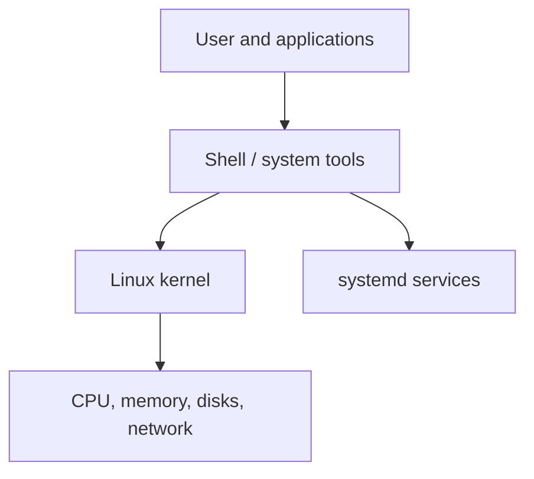
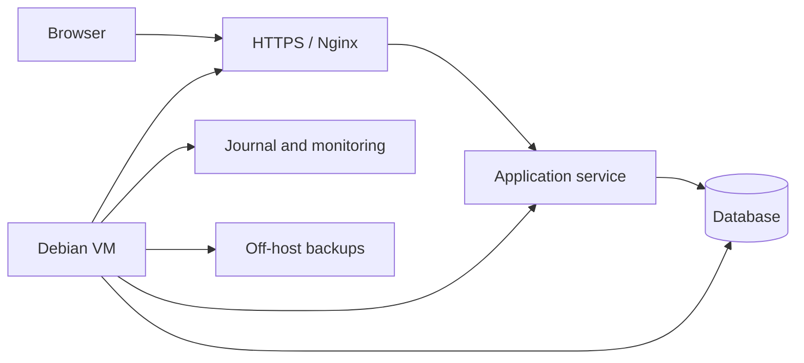

# Debian Linux — Beginner to Advanced

> **A hands-on, self-study handbook for installing, using, securing and administering Debian Linux on desktops, servers and cloud virtual machines.**

**Author:** Engr. Amarachi Crystal Omereife  
**Publisher:** Opsfuxion Technologies Limited  
**Audience:** Beginners, software developers, system administrators and aspiring DevOps engineers

## How to study

Read a concept, execute its commands in a **disposable Debian virtual machine**, explain the output, then attempt the exercise before opening the answer. Commands marked `sudo` change the system; understand each one before running it. Do not test firewall rules, disk formatting or account changes on a production host.

**Recommended lab:** a Debian stable VM with at least 2 CPU cores, 2–4 GB RAM, 20 GB storage, a non-root user with `sudo`, and VM snapshots. Debian release names and package versions change: use the current stable release from the official Debian website and verify commands against its documentation. Some commands require installation of optional packages.

**Safety rules:** keep backups; use snapshots before risky experiments; never paste random commands into a root shell; do not expose SSH to the internet without hardening; and do not delete or format disks unless you have verified the target device.

## Roadmap

| Level | Focus | Practical outcome |
|---|---|---|
| Beginner | Installation, terminal, files, permissions | Confident CLI navigation |
| Intermediate | Packages, users, processes, services, networking | Manage a development server |
| Advanced | Storage, security, firewalls, backups, automation | Harden and operate a VM |
| Production readiness | Logging, monitoring, deployment, recovery | Documented runbook |

## The Linux architecture in one picture



Debian is a **Linux distribution**: it combines the Linux kernel with package management, system utilities, configuration and an extensive software repository. `apt` manages Debian packages; `systemd` commonly manages services and boot.

---

## 1. Installing Debian safely in a virtual machine

### Understand the concept

A virtual machine (VM) emulates a computer and lets you practise without modifying your host OS. Download a Debian installer image from the official Debian project. Verify the published checksum and, for stronger assurance, signature information. Create a VM, attach the installer ISO, follow the installer, create a non-root user, and install SSH only if you need remote access.

### Follow along: working example

After installation, open a terminal:

```bash
cat /etc/os-release
uname -r
whoami
id
hostnamectl
```

Optional snapshot: use your hypervisor's snapshot feature before beginning configuration labs.

### What happened, step by step

`/etc/os-release` identifies the distribution, `uname -r` prints the kernel release, `whoami` shows your current username, `id` shows identity/groups, and `hostnamectl` displays host information. A snapshot lets you roll back experiments.

### Try it yourself

Record your Debian version, kernel version, current username, and VM hostname in a `lab-notes.md` file.

<details><summary><strong>Worked solution — open only after attempting the exercise</strong></summary>

```markdown
# Debian lab baseline
- OS: output of `cat /etc/os-release`
- Kernel: output of `uname -r`
- User: output of `whoami`
- Hostname: output of `hostnamectl`
```

</details>


---

## 2. The terminal, shell, paths and help system

### Understand the concept

A **shell** interprets commands. Bash is common on Debian. Paths beginning with `/` are absolute; paths without it are relative to the current directory. Linux filenames are case-sensitive. Use `man`, `--help` and `type` to investigate commands before using them.

### Follow along: working example

```bash
pwd
ls -lah
cd /tmp
pwd
cd ~
type ls
man ls
```

### What happened, step by step

`pwd` prints the current directory; `ls -lah` lists files with details; `cd` changes directories; `~` refers to the home directory. Exit a manual page with `q`. `Ctrl+C` interrupts a foreground command; `Ctrl+L` clears the screen.

### Try it yourself

Navigate to `/etc`, list files beginning with `host`, then return to your home directory.

<details><summary><strong>Worked solution — open only after attempting the exercise</strong></summary>

```bash
cd /etc
ls -l host*
cd ~
```

</details>


---

## 3. Files, directories, viewing and searching

### Understand the concept

Linux organizes files in one directory tree. `/home` stores user home directories; `/etc` stores configuration; `/var/log` stores many logs; `/usr` contains programs and shared data; `/tmp` holds temporary files. Learn to copy, move, rename and inspect files before automating anything.

### Follow along: working example

```bash
mkdir -p ~/debian-lab/notes
printf 'hello Debian\n' > ~/debian-lab/notes/hello.txt
cat ~/debian-lab/notes/hello.txt
cp ~/debian-lab/notes/hello.txt ~/debian-lab/notes/copy.txt
mv ~/debian-lab/notes/copy.txt ~/debian-lab/notes/renamed.txt
find ~/debian-lab -type f -name '*.txt'
wc -l ~/debian-lab/notes/hello.txt
```

### What happened, step by step

`>` overwrites a file; `>>` appends. `cp` duplicates; `mv` moves or renames; `find` searches the filesystem; `wc -l` counts lines. `rm` deletes without a recycle bin in most CLI workflows; double-check paths.

### Try it yourself

Create `~/debian-lab/projects`, copy `hello.txt` into it, then display both files.

<details><summary><strong>Worked solution — open only after attempting the exercise</strong></summary>

```bash
mkdir -p ~/debian-lab/projects
cp ~/debian-lab/notes/hello.txt ~/debian-lab/projects/
cat ~/debian-lab/notes/hello.txt
cat ~/debian-lab/projects/hello.txt
```

</details>


---

## 4. Users, groups and file permissions

### Understand the concept

Linux uses user and group identities to control access. Permissions are shown as read (`r`), write (`w`) and execute (`x`) for owner, group and others. `chmod` changes permission bits; `chown` changes ownership. Use least privilege: only grant the access actually needed.

### Follow along: working example

```bash
ls -l ~/debian-lab/notes/hello.txt
chmod 600 ~/debian-lab/notes/hello.txt
ls -l ~/debian-lab/notes/hello.txt
id
getent group sudo
```

A private file typically shows `-rw-------` after `chmod 600`.

### What happened, step by step

`600` means owner read/write, no group or other access. Directory execute permission means traversal, not execution of a program. `sudo` temporarily runs an authorized command with elevated privileges; it is not a substitute for understanding the command.

### Try it yourself

Set a shell script file `demo.sh` to be readable and executable by the owner, but inaccessible to others.

<details><summary><strong>Worked solution — open only after attempting the exercise</strong></summary>

```bash
chmod 700 demo.sh
```

This also gives owner write permission; use `chmod 500 demo.sh` if you want owner read/execute but no write.

</details>


---

## 5. Package management with APT and dpkg

### Understand the concept

Debian software usually comes from signed repositories. `apt update` refreshes package metadata; `apt install` installs packages; `apt upgrade` updates installed packages. `dpkg` works with local `.deb` packages but does not resolve dependencies as conveniently as APT. Avoid mixing incompatible releases or untrusted repositories.

### Follow along: working example

```bash
sudo apt update
apt policy curl
sudo apt install curl
curl --version
apt list --installed 2>/dev/null | grep '^curl/'
sudo apt upgrade
```

### What happened, step by step

`apt policy` shows candidate versions and repository origins. `apt update` does not itself upgrade software. For servers, review proposed package changes, schedule maintenance, and keep a rollback plan.

### Try it yourself

Install `tree`, use it to display your `~/debian-lab` folder, and show the package's installed version.

<details><summary><strong>Worked solution — open only after attempting the exercise</strong></summary>

```bash
sudo apt install tree
tree ~/debian-lab
apt policy tree
```

</details>


---

## 6. Processes, signals and system resources

### Understand the concept

A **process** is a running program with a PID. `ps` shows process information, `top` monitors usage, and `kill` sends signals. `SIGTERM` asks a process to stop gracefully; `SIGKILL` forces termination and should be a last resort. `free`, `df` and `du` report different resource measurements.

### Follow along: working example

```bash
ps aux | head
free -h
df -h
du -sh ~/debian-lab
sleep 300 &
echo $!
# Replace PID with the number printed by the shell
kill -TERM PID
```

### What happened, step by step

`&` starts a background job. `$!` contains its PID in the current shell. `free -h` shows RAM; `df -h` shows filesystem capacity; `du -sh` estimates directory usage. Do not indiscriminately kill system processes.

### Try it yourself

Start `sleep 120` in the background, inspect it with `ps`, then stop it cleanly.

<details><summary><strong>Worked solution — open only after attempting the exercise</strong></summary>

```bash
sleep 120 &
pid=$!
ps -p "$pid" -o pid,cmd
kill -TERM "$pid"
```

</details>


---

## 7. systemd services and boot management

### Understand the concept

`systemd` starts and supervises services. A service unit describes how a daemon runs and restarts. `systemctl status` shows service state; `journalctl` reads logs. Be cautious when enabling or disabling critical services on remote servers.

### Follow along: working example

```bash
systemctl --failed
systemctl status ssh --no-pager
journalctl -b -n 30 --no-pager
systemctl list-unit-files --type=service | head
```

If `ssh` is not installed, the status command may report that the unit does not exist.

### What happened, step by step

`systemctl` manages services; `journalctl -b` shows logs from the current boot. `enable` configures startup at boot; `start` launches immediately; `enable --now` does both.

### Try it yourself

Explain the difference between `systemctl start nginx` and `systemctl enable nginx`.

<details><summary><strong>Worked solution — open only after attempting the exercise</strong></summary>

`start` runs the service now; `enable` configures it to start automatically on future boots. They are separate operations.

</details>


---

## 8. Networking fundamentals and troubleshooting

### Understand the concept

A network interface has addresses and routes. DNS maps names to addresses. `ip` inspects interfaces/routes; `ss` shows sockets; `getent hosts` checks name resolution; `curl` makes HTTP requests. Diagnose systematically: interface → address → route → DNS → service → firewall.

### Follow along: working example

```bash
ip -brief address
ip route
getent hosts debian.org
ss -tuln
curl -I https://www.debian.org/
```

### What happened, step by step

`ip -brief address` shows interface addresses, `ip route` displays routes, `ss -tuln` lists listening TCP/UDP sockets, and `curl -I` fetches HTTP response headers. If DNS fails, test local networking separately before changing resolvers.

### Try it yourself

A web service is unreachable. Write a five-step diagnostic plan without changing any configuration.

<details><summary><strong>Worked solution — open only after attempting the exercise</strong></summary>

Check the interface (`ip -brief address`), route (`ip route`), DNS (`getent hosts host`), local listener (`ss -tuln`), and HTTP response (`curl -I URL`). Review logs and firewall rules if these indicate a problem.

</details>


---

## 9. SSH remote access and key-based login

### Understand the concept

SSH provides encrypted remote terminal access. Public-key authentication is generally preferable to passwords for servers. Generate a key on your **client**, keep the private key private, and install only the public key on the server. Test a new login session before disabling password authentication.

### Follow along: working example

```bash
# Run on your own laptop/client, not inside an existing production server session
ssh-keygen -t ed25519 -C 'debian-lab'
ssh-copy-id user@server-ip
ssh user@server-ip
```

On the Debian server, if SSH server is needed:

```bash
sudo apt install openssh-server
sudo systemctl enable --now ssh
```

### What happened, step by step

`ssh-keygen` creates a key pair. `ssh-copy-id` appends the public key to the remote account's authorized keys. Before tightening `sshd_config`, keep an existing session open and verify a second key-based login works.

### Try it yourself

Why must you never share `~/.ssh/id_ed25519`?

<details><summary><strong>Worked solution — open only after attempting the exercise</strong></summary>

It is the private key used to prove your identity. Sharing it can allow impersonation. Share only the corresponding `.pub` public key.

</details>


---

## 10. Shell scripting and scheduled tasks

### Understand the concept

A shell script collects commands into a repeatable program. Use `#!/usr/bin/env bash`, quote variables, check command failures and avoid parsing filenames unsafely. Cron schedules recurring jobs, while systemd timers offer richer logging and service integration. Test scripts manually before scheduling them.

### Follow along: working example

Create `~/debian-lab/report.sh`:

```bash
#!/usr/bin/env bash
set -euo pipefail
printf 'Report generated: %s\n' "$(date -Is)"
df -h /
free -h
```

```bash
chmod +x ~/debian-lab/report.sh
~/debian-lab/report.sh
crontab -l
```

### What happened, step by step

`set -euo pipefail` helps detect many failures, but it does not make every shell program automatically safe. `date -Is` prints an ISO-style timestamp. Cron runs with a limited environment; use absolute paths and log errors.

### Try it yourself

Extend the report to include the hostname.

<details><summary><strong>Worked solution — open only after attempting the exercise</strong></summary>

```bash
printf 'Hostname: %s\n' "$(hostname)"
```

</details>


---

## 11. Storage, partitions and filesystems

### Understand the concept

A physical or virtual disk can contain partitions and filesystems. `lsblk` lists block devices; `blkid` reports filesystem IDs; `mount` attaches filesystems to the directory tree. `/etc/fstab` controls persistent mounts. Formatting destroys data: **do not run `mkfs` on a device unless you have independently verified it is disposable and backed up.**

### Follow along: working example

Read-only inspection:

```bash
lsblk -f
findmnt
blkid
df -hT
```

Safe filesystem experiment using a directory (no disk formatting):

```bash
mkdir -p ~/debian-lab/storage
dd if=/dev/zero of=~/debian-lab/storage/test.img bs=1M count=8 status=none
ls -lh ~/debian-lab/storage/test.img
```

### What happened, step by step

`lsblk -f` maps devices to filesystems; `findmnt` lists mounts; `df -hT` reports filesystem type and usage. The sample `dd` command creates an ordinary 8 MiB file in your home directory; it does not format or mount a disk.

### Try it yourself

Explain the difference between `df -h` and `du -sh ~/debian-lab`.

<details><summary><strong>Worked solution — open only after attempting the exercise</strong></summary>

`df` reports filesystem-wide available/used capacity. `du` estimates disk space consumed by a particular directory tree.

</details>


---

## 12. Logs, journald and troubleshooting workflow

### Understand the concept

Logs provide evidence of failures. Debian services may log to the systemd journal, `/var/log`, or application-specific paths. Follow a repeatable process: reproduce, record the error, inspect logs, form a hypothesis, change one thing, test and document.

### Follow along: working example

```bash
journalctl -p warning -b --no-pager | tail -n 30
journalctl -u ssh -n 40 --no-pager
sudo ls -lah /var/log | head
dmesg | tail -n 20
```

### What happened, step by step

The journal can be filtered by boot, service and severity. Some kernel log commands require elevated privileges. Log timestamps and timezone matter when correlating events.

### Try it yourself

A service fails to start. List the first four commands you would run.

<details><summary><strong>Worked solution — open only after attempting the exercise</strong></summary>

```bash
systemctl status SERVICE --no-pager
journalctl -u SERVICE -n 100 --no-pager
systemctl cat SERVICE
systemctl --failed
```

Replace `SERVICE` with the actual unit name.

</details>


---

## 13. Firewall fundamentals with nftables and UFW

### Understand the concept

A firewall controls network traffic. Debian commonly uses nftables underneath modern firewall tools. UFW is an optional simpler interface. **Remote lockout warning:** allow and verify SSH before enabling a default-deny firewall on a remote server. Prefer provider-level network controls plus host firewall rules.

### Follow along: working example

Read-only inspection:

```bash
sudo nft list ruleset
ss -tuln
```

Illustrative UFW sequence for a disposable VM with console access:

```bash
sudo apt install ufw
sudo ufw allow OpenSSH
sudo ufw allow 80/tcp
sudo ufw allow 443/tcp
sudo ufw status verbose
# Enable ONLY after confirming console/recovery access and SSH rules:
# sudo ufw enable
```

### What happened, step by step

The allow rules specify intended traffic. Listing rules does not change the firewall. Do not enable a firewall blindly on a server reachable only by SSH; cloud network firewalls and other nftables rules may interact with UFW.

### Try it yourself

Which ports are commonly used by HTTP, HTTPS and SSH?

<details><summary><strong>Worked solution — open only after attempting the exercise</strong></summary>

HTTP: TCP 80; HTTPS: TCP 443; SSH: TCP 22 by default (though SSH can be configured differently).

</details>


---

## 14. Linux security hardening and updates

### Understand the concept

Hardening reduces attack surface. Apply supported security updates, remove unnecessary services, limit privileged access, use SSH keys, monitor authentication events, secure secrets and audit exposed ports. Security is ongoing maintenance, not a one-time script.

### Follow along: working example

```bash
sudo apt update
apt list --upgradable
ss -tulpen
sudo systemctl --failed
sudo journalctl -u ssh -n 50 --no-pager
```

Optional unattended updates:

```bash
sudo apt install unattended-upgrades
```

### What happened, step by step

Review available upgrades and reboot requirements. Automatic security updates need a maintenance and monitoring plan; unattended updates do not replace backups or patch testing. Keep least-privilege accounts and document emergency access.

### Try it yourself

Create a security checklist for a new Debian web server.

<details><summary><strong>Worked solution — open only after attempting the exercise</strong></summary>

Checklist: supported stable release, updates installed, SSH key login tested, minimal sudo users, unnecessary services disabled, firewall configured, HTTPS, least-privilege service accounts, logs monitored, backups tested, recovery access documented.

</details>


---

## 15. Backups, verification and restore drills

### Understand the concept

A backup is useful only if you can restore it. Define recovery point objective (RPO) and recovery time objective (RTO), keep copies outside the host, encrypt sensitive backups and periodically perform restore drills. `tar` packages files; `sha256sum` detects accidental changes but does not itself prove authenticity.

### Follow along: working example

```bash
mkdir -p ~/debian-lab/backups
tar -czf ~/debian-lab/backups/notes.tar.gz -C ~/debian-lab notes
sha256sum ~/debian-lab/backups/notes.tar.gz > ~/debian-lab/backups/notes.tar.gz.sha256
cd ~/debian-lab/backups
sha256sum -c notes.tar.gz.sha256
mkdir -p ~/debian-lab/restore-test
tar -xzf notes.tar.gz -C ~/debian-lab/restore-test
find ~/debian-lab/restore-test -type f
```

### What happened, step by step

The archive contains the `notes` directory. The checksum verifies the archive against the recorded hash. Extraction into a separate directory tests whether the archive can be read; a full restore drill should verify actual application data and permissions.

### Try it yourself

Create a backup of `~/debian-lab/projects` and restore it into a new folder.

<details><summary><strong>Worked solution — open only after attempting the exercise</strong></summary>

```bash
tar -czf ~/debian-lab/backups/projects.tar.gz -C ~/debian-lab projects
mkdir -p ~/debian-lab/restore-projects
tar -xzf ~/debian-lab/backups/projects.tar.gz -C ~/debian-lab/restore-projects
```

</details>


---

## 16. Hosting a simple web application with Nginx

### Understand the concept

Nginx can serve static websites and reverse-proxy backend applications. Debian installs Nginx as a systemd-managed service. Before exposing a service publicly, plan HTTPS, firewall rules, DNS, logs and updates.

### Follow along: working example

```bash
sudo apt update
sudo apt install nginx
sudo systemctl enable --now nginx
systemctl status nginx --no-pager
curl -I http://127.0.0.1/
```

Example server block:

```nginx
server {
    listen 80;
    server_name example.test;
    root /var/www/example;
    index index.html;
    location / { try_files $uri $uri/ =404; }
}
```

### What happened, step by step

Nginx listens on port 80 and serves files from the configured root. On an internet-facing domain, configure TLS and redirect HTTP to HTTPS. Test config syntax with `sudo nginx -t` before reloading.

### Try it yourself

What command validates Nginx configuration syntax before applying changes?

<details><summary><strong>Worked solution — open only after attempting the exercise</strong></summary>

```bash
sudo nginx -t
```

</details>


---

## 17. Containers and Debian-based images

### Understand the concept

Containers share the host kernel while packaging an application's userspace dependencies. A Debian-based image is not a full virtual machine; systemd and a kernel are not usually running inside it. Use minimal images, pinned versions, non-root users and image vulnerability scanning.

### Follow along: working example

Illustrative Dockerfile (requires a working Docker environment):

```dockerfile
FROM debian:stable-slim
RUN apt-get update && apt-get install -y --no-install-recommends ca-certificates \
    && rm -rf /var/lib/apt/lists/*
RUN useradd --create-home appuser
USER appuser
WORKDIR /home/appuser
CMD ["/bin/sh", "-c", "echo Hello from Debian container"]
```

### What happened, step by step

`stable-slim` tracks Debian stable and can change over time. For reproducible production builds, pin a specific release and ideally a digest. Removing APT lists reduces image size. Running as a non-root user limits some damage if a process is compromised.

### Try it yourself

Why should production container images be pinned instead of using a moving tag indefinitely?

<details><summary><strong>Worked solution — open only after attempting the exercise</strong></summary>

Pinned images are reproducible and make rollbacks, testing and vulnerability tracking easier. Update them deliberately as part of patch management.

</details>


---

## 18. Automation and configuration management concepts

### Understand the concept

Manual server changes are hard to reproduce. Configuration management tools such as Ansible describe a desired state and can apply it repeatedly. Idempotence means running the automation twice should not keep creating duplicate changes. Start with safe read-only automation before managing privileged resources.

### Follow along: working example

Example Ansible playbook (run from a controller with Ansible installed):

```yaml
---
- name: Inspect Debian host
  hosts: debian_lab
  gather_facts: true
  tasks:
    - name: Show distribution
      ansible.builtin.debug:
        msg: "{{ ansible_distribution }} {{ ansible_distribution_version }}"
```

Example inventory:

```ini
[debian_lab]
lab-vm ansible_host=192.0.2.10 ansible_user=student
```

### What happened, step by step

The inventory identifies a target host; the playbook gathers facts and prints the OS version. `192.0.2.10` is a documentation-only example address. For privileged changes, plan SSH access, `become`, secrets management, testing and rollback.

### Try it yourself

Define idempotence in your own words and give an example.

<details><summary><strong>Worked solution — open only after attempting the exercise</strong></summary>

Idempotence means repeating an operation has the same intended end state. For example, “ensure package `nginx` is installed” should not install duplicate copies each run.

</details>


---

## 19. Final capstone — Build and operate a Debian application server

**Scenario:** A small training organization needs a Debian VM to host a website and an internal application. Your assignment is to build a documented, recoverable server with appropriate security controls.

### Architecture



### Deliverables

1. Debian stable VM with a non-root sudo administrator.
2. Documented baseline: OS, kernel, hostname, IP configuration and open ports.
3. System updates and a documented patch process.
4. SSH key authentication tested from a second terminal.
5. Nginx serving a simple site or reverse proxying an application.
6. A firewall policy designed and verified without losing SSH access.
7. A systemd service definition for the application, if applicable.
8. Logs and health checks that explain how to diagnose failure.
9. Backup job and successful **restore test**.
10. A `README.md` runbook with setup, verification, rollback and incident steps.

### Example verification script

```bash
#!/usr/bin/env bash
set -euo pipefail
printf '%s\n' '=== Host ==='
hostnamectl
printf '%s\n' '=== OS ==='
cat /etc/os-release
printf '%s\n' '=== Storage ==='
df -h /
printf '%s\n' '=== Memory ==='
free -h
printf '%s\n' '=== Listening ports ==='
ss -tuln
printf '%s\n' '=== Failed services ==='
systemctl --failed --no-pager
```

### Assessment rubric (100 points)

| Criterion | Points |
|---|---:|
| Correct Debian setup and documentation | 15 |
| Users, permissions and SSH access | 15 |
| Packages, services and application hosting | 20 |
| Networking and firewall reasoning | 15 |
| Logs and troubleshooting | 10 |
| Backups and restore verification | 15 |
| Runbook clarity and safety | 10 |

## 20. Troubleshooting quick reference

| Problem | Investigation |
|---|---|
| Package cannot be found | `sudo apt update`, `apt policy PACKAGE`, sources |
| Permission denied | `id`, `ls -ld`, ownership and mode bits |
| Disk full | `df -h`, `du -sh`, log rotation |
| Service not starting | `systemctl status`, `journalctl -u SERVICE` |
| DNS lookup fails | `getent hosts`, resolver configuration, routes |
| SSH connection refused | SSH service, listening socket, firewall |
| Website gives 502 | Reverse proxy target, app process, logs |
| High memory usage | `free -h`, `ps aux --sort=-%mem` |
| Cannot mount filesystem | `lsblk -f`, `findmnt`, `/etc/fstab` |

## 21. Independent challenges and solution directions

1. **Create a project user:** use `adduser`, then inspect `id`; grant sudo only if genuinely required.
2. **Private workspace:** create a directory with mode `700` and test another user's access.
3. **Package audit:** list installed packages and identify packages with available updates.
4. **Service health report:** write a Bash script that prints failed systemd services and disk usage.
5. **Web check:** use `curl -I` to verify an Nginx response code.
6. **Log investigation:** identify the last five errors for a chosen service.
7. **Backup automation:** schedule a daily archive, add retention and verify restore.
8. **Network inventory:** record interfaces, routes and listening ports.
9. **Access review:** list sudo-capable users and explain each privilege.
10. **Disaster rehearsal:** restore your VM snapshot and reapply configuration from the runbook.

## 22. Mastery checklist

- [ ] Install Debian safely and verify its version.
- [ ] Navigate, create, search and inspect files confidently.
- [ ] Explain ownership and permission bits.
- [ ] Install and update software from trusted repositories.
- [ ] Inspect processes, services and logs.
- [ ] Diagnose network, DNS and listening-port problems.
- [ ] Use SSH keys without exposing private keys.
- [ ] Explain safe firewall changes on remote systems.
- [ ] Describe filesystems, mounts and storage capacity.
- [ ] Write simple Bash maintenance scripts.
- [ ] Create backups and prove they can be restored.
- [ ] Deploy and document a small web service.

## Official references

- Debian project: https://www.debian.org/
- Debian administrator's handbook: https://debian-handbook.info/
- Debian documentation: https://www.debian.org/doc/
- Debian security: https://www.debian.org/security/
- systemd manual pages: https://www.freedesktop.org/software/systemd/man/
- Nginx documentation: https://nginx.org/en/docs/

## About the author

**Engr. Amarachi Crystal Omereife** is a software engineer and technology entrepreneur with a Master's degree in Computer Science (Software Engineering). She leads **Opsfuxion Technologies Limited**, specializing in cloud and DevOps engineering, DevSecOps, software development, technical training and mentorship. Her work includes Linux, cloud infrastructure, containerization, CI/CD, backend development and secure software delivery. She creates practical training materials to help aspiring technologists build job-relevant skills.

**Opsfuxion Technologies Limited** — *Orchestrate intelligence, deliver with precision.*
