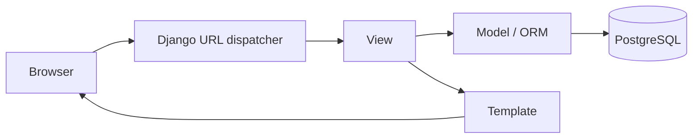

# Django Web Development — Zero to Advanced

> **A practical, beginner-friendly, self-study handbook for building, securing, testing, and deploying database-backed web applications with Python and Django.**

**Author:** Engr. Amarachi Crystal Omereife  
**Publisher:** Opsfuxion Technologies Limited  
**Learning pathway:** Beginner → Intermediate → Advanced → Production readiness  
**Companion technologies:** Python, PostgreSQL, HTML/CSS, Git, Linux, Gunicorn and Nginx

## How to use this handbook

Work through chapters in order. Type commands rather than merely reading them. Each chapter includes an explanation, a runnable example, a practice task, and a worked answer hidden in a collapsible section. A single **CourseHub** project grows throughout the book: courses, instructors, enrolments, accounts, permissions and a production deployment. Commands use macOS/Linux shells; Windows users can use WSL. Django's exact supported Python versions depend on the installed Django release: consult the official release notes when selecting versions.

**Prerequisites:** Basic Python variables, functions, classes and dictionaries; elementary HTML; command-line navigation. New to these? Complete the Python fundamentals material first.

**Safety:** All credentials, domains and sample users in this book are illustrative. Never put production passwords or API keys into Git. `runserver` is for development, not production.

## Roadmap

| Stage | Topics | Evidence of mastery |
|---|---|---|
| Foundations | Python environments, Django project structure, routing | Working homepage |
| Web basics | Views, templates, static files, forms | Searchable course pages |
| Data | ORM, migrations, PostgreSQL, relations | Persistent enrolments |
| Users | Authentication, authorization, sessions | Secure student dashboard |
| Engineering | Testing, performance, APIs, security | Tested maintainable application |
| Operations | Deployment, observability, backups | Production-readiness checklist |

## Initial setup: a reproducible workspace

```bash
mkdir coursehub && cd coursehub
python3 -m venv .venv
source .venv/bin/activate
python -m pip install --upgrade pip
python -m pip install 'Django>=5.2,<6' 'psycopg[binary]>=3,<4' gunicorn
python -m django --version
django-admin startproject config .
python manage.py startapp courses
python manage.py runserver
```

Open `http://127.0.0.1:8000/`. The version range above is a **training example**, not a claim that it is the newest Django version. For a new real project, select a currently supported Django version compatible with your Python installation, and pin exact versions in a lockfile. Create `.gitignore` with `.venv/`, `.env`, `__pycache__/`, `*.pyc`, `db.sqlite3` (if local test data is disposable), and local secrets.



---

## 1. What Django does and how requests flow

### Understand the concept

Django is a Python web framework: it provides reusable tools for URL routing, request handling, HTML rendering, database access, authentication and security. A browser sends an HTTP request; Django resolves the URL to a view; the view returns an HTTP response. Django's usual architecture is described as **model–template–view (MTV)**. A **model** describes data, a **template** describes presentation, and a **view** handles the request and decides what response to return.

### Follow along: working example

In `courses/views.py`:

```python
from django.http import HttpResponse

def home(request):
    return HttpResponse("Welcome to CourseHub!")
```

In `courses/urls.py` (create this file):

```python
from django.urls import path
from . import views
urlpatterns = [path("", views.home, name="home")]
```

In `config/urls.py`:

```python
from django.contrib import admin
from django.urls import include, path
urlpatterns = [
    path("admin/", admin.site.urls),
    path("", include("courses.urls")),
]
```

### What happened, step by step

1. The browser requests `/`. 2. `config/urls.py` delegates to `courses.urls`. 3. The empty path matches `home`. 4. `home()` constructs an HTTP response. 5. The browser displays the text. `name="home"` allows links to refer to the route by name.

### Try it yourself

Add a `/health/` route that responds with `OK`. Test both URLs in a browser.

<details><summary><strong>Worked solution — open only after attempting the exercise</strong></summary>

```python
# courses/views.py
def health(request):
    return HttpResponse("OK")

# courses/urls.py: add inside urlpatterns
path("health/", views.health, name="health"),
```

</details>

**Check:** Why should URL names be preferred over hard-coded paths? Because they let you change paths without changing every template and redirect.

---

## 2. Project structure, apps and settings

### Understand the concept

A **project** contains configuration; an **app** groups a feature. `manage.py` runs management commands. `config/settings.py` configures installed apps, middleware, templates and databases. Apps must be listed in `INSTALLED_APPS` for Django to discover their models and other components.

### Follow along: working example

In `config/settings.py`, append:

```python
INSTALLED_APPS += ["courses"]
```

Useful inspection commands:

```bash
python manage.py check
python manage.py showmigrations
python manage.py help
```

### What happened, step by step

`check` catches many configuration issues. `showmigrations` shows the database migration state. An app should focus on a coherent responsibility; a large application can have `courses`, `accounts`, `billing` and other apps.

### Try it yourself

Explain the difference between `config/urls.py`, `courses/views.py`, and `courses/models.py` in your own words.

<details><summary><strong>Worked solution — open only after attempting the exercise</strong></summary>

`config/urls.py` maps URL patterns to views or app URL modules; `courses/views.py` contains request-handling functions or classes; `courses/models.py` defines database-backed Python model classes.

</details>


---

## 3. Templates, inheritance and static CSS

### Understand the concept

Templates separate page structure from Python logic. Django's template language supports variables, loops and tags. **Template inheritance** prevents copying headers and footers into every page. Static assets include CSS, JavaScript and images.

### Follow along: working example

Create `courses/templates/courses/base.html`:

```html

<!doctype html>
<html lang="en"><head>
  <meta charset="utf-8">
  <meta name="viewport" content="width=device-width, initial-scale=1">
  <title>CourseHub</title>
  <link rel="stylesheet" href="">
</head><body>
<header><a href="">CourseHub</a></header>
<main></main>
</body></html>
```

Create `courses/templates/courses/home.html`:

```html

Welcome | CourseHub
<h1>Learn with us</h1>
```

Create `courses/static/courses/site.css`:

```css
body { font-family: system-ui, sans-serif; max-width: 64rem; margin: 2rem auto; }
```

Replace `home` view:

```python
from django.shortcuts import render
def home(request):
    return render(request, "courses/home.html")
```

### What happened, step by step

`` activates static asset URLs. `` selects the parent layout. Blocks let a child replace sections. Django templates escape variables by default; do not casually mark untrusted HTML as safe.

### Try it yourself

Create an `about.html` page that extends `base.html` and has its own title and paragraph.

<details><summary><strong>Worked solution — open only after attempting the exercise</strong></summary>

```html

About | CourseHub
<h1>About us</h1><p>Practical software courses.</p>
```

Add a corresponding `about` view and URL using the same pattern as Chapter 1.

</details>


---

## 4. Models, migrations and database relationships

### Understand the concept

Models describe tables and relationships using Python classes. `makemigrations` creates versioned schema changes; `migrate` applies them. Common field types include `CharField`, `TextField`, `DecimalField`, `DateTimeField`, `BooleanField`, and `ForeignKey`. A foreign key links many records to one parent record.

### Follow along: working example

In `courses/models.py`:

```python
from django.conf import settings
from django.db import models

class Course(models.Model):
    title = models.CharField(max_length=160)
    slug = models.SlugField(unique=True)
    description = models.TextField(blank=True)
    published = models.BooleanField(default=False)
    created_at = models.DateTimeField(auto_now_add=True)

    def __str__(self):
        return self.title

class Enrollment(models.Model):
    student = models.ForeignKey(settings.AUTH_USER_MODEL, on_delete=models.CASCADE)
    course = models.ForeignKey(Course, on_delete=models.CASCADE, related_name="enrollments")
    joined_at = models.DateTimeField(auto_now_add=True)

    class Meta:
        constraints = [models.UniqueConstraint(
            fields=["student", "course"], name="unique_student_course"
        )]
```

```bash
python manage.py makemigrations
python manage.py migrate
python manage.py shell
```

```python
from courses.models import Course
Course.objects.create(title="Python Basics", slug="python-basics", published=True)
```

### What happened, step by step

Each model maps to a database table. `ForeignKey` creates a relational link. The uniqueness constraint prevents a student enrolling twice in the same course even under concurrent requests. A migration is a tracked schema change; review it before applying in production.

### Try it yourself

Add a `duration_hours` field to `Course`, defaulting to 1, and create a migration.

<details><summary><strong>Worked solution — open only after attempting the exercise</strong></summary>

```python
# Inside Course
duration_hours = models.PositiveIntegerField(default=1)
```

Run `python manage.py makemigrations` then `python manage.py migrate`.

</details>

**Design caution:** Changing a model class does not alter the database until the migration is applied. For deployed systems, plan backwards-compatible schema changes.

---

## 5. QuerySets, filtering and efficient relationships

### Understand the concept

A QuerySet represents a database query and is usually lazy: it runs when evaluated. Use `filter`, `exclude`, `order_by`, `get`, `exists`, `count`, and `select_related` / `prefetch_related`. Do not load all rows just to count them. Use indexed fields for common lookup patterns.

### Follow along: working example

```python
from courses.models import Course, Enrollment
Course.objects.filter(published=True).order_by("title")
Course.objects.filter(title__icontains="python")
Course.objects.filter(published=True).count()
Enrollment.objects.select_related("student", "course").all()
```

A list view:

```python
from courses.models import Course
from django.shortcuts import render

def course_list(request):
    q = request.GET.get("q", "").strip()
    courses = Course.objects.filter(published=True)
    if q:
        courses = courses.filter(title__icontains=q)
    return render(request, "courses/list.html", {"courses": courses, "q": q})
```

### What happened, step by step

`icontains` performs a case-insensitive substring match. ORM parameterization avoids constructing raw SQL from user input. `select_related` is useful for foreign-key relationships and avoids the N+1 query pattern. For large lists, add pagination.

### Try it yourself

Find published courses containing `data` in the title and order them newest first.

<details><summary><strong>Worked solution — open only after attempting the exercise</strong></summary>

```python
Course.objects.filter(published=True, title__icontains="data").order_by("-created_at")
```

</details>


---

## 6. Django admin and data management

### Understand the concept

Django admin provides a staff-only interface for managing model records. It is a powerful internal tool, not automatically a public-facing customer dashboard. Restrict staff access, use strong authentication, and register models with helpful display and search options.

### Follow along: working example

In `courses/admin.py`:

```python
from django.contrib import admin
from .models import Course, Enrollment

@admin.register(Course)
class CourseAdmin(admin.ModelAdmin):
    list_display = ("title", "published", "created_at")
    list_filter = ("published",)
    search_fields = ("title", "description")
    prepopulated_fields = {"slug": ("title",)}

@admin.register(Enrollment)
class EnrollmentAdmin(admin.ModelAdmin):
    list_display = ("student", "course", "joined_at")
```

```bash
python manage.py createsuperuser
python manage.py runserver
```

### What happened, step by step

Visit `/admin/` and log in with the superuser you created. Admin model options affect how records are listed, filtered and edited. A superuser has broad privileges: do not use that account for everyday operations.

### Try it yourself

Add a `search_fields` setting to `EnrollmentAdmin` so admins can search by course title.

<details><summary><strong>Worked solution — open only after attempting the exercise</strong></summary>

```python
search_fields = ("course__title", "student__username")
```

If your custom user model does not have `username`, search an appropriate field instead.

</details>


---

## 7. Forms, validation and CSRF protection

### Understand the concept

A form converts submitted text into validated Python values. `ModelForm` can generate fields from a model, but you must explicitly choose editable fields. A POST form that changes state needs a CSRF token. Validation belongs on the server even when browser validation exists.

### Follow along: working example

In `courses/forms.py`:

```python
from django import forms
from .models import Course

class CourseForm(forms.ModelForm):
    class Meta:
        model = Course
        fields = ["title", "slug", "description"]

    def clean_title(self):
        title = self.cleaned_data["title"].strip()
        if len(title) < 5:
            raise forms.ValidationError("Use at least five characters.")
        return title
```

Example template fragment:

```html
<form method="post">
  
  {{ form.as_p }}
  <button type="submit">Save</button>
</form>
```

### What happened, step by step

`is_valid()` populates `cleaned_data` or errors. `save()` persists a valid `ModelForm`. A view must verify the user's authorization before allowing course creation; form validation alone does not enforce permissions.

### Try it yourself

Write the POST/GET flow for a form view in pseudocode, including authorization and redirect after success.

<details><summary><strong>Worked solution — open only after attempting the exercise</strong></summary>

```text
IF user is not staff: deny access
IF request method is POST:
    bind form to submitted data
    IF form is valid:
        save record
        redirect to success page
ELSE:
    create empty form
render template with form
```

</details>


---

## 8. Authentication, sessions and authorization

### Understand the concept

**Authentication** asks who the user is; **authorization** asks what the user is allowed to do. Django provides login, logout, password hashing, sessions and permissions. Never store raw passwords. Use `login_required` for private pages and check ownership for individual records. A logged-in user is not necessarily authorized to modify another user's enrolment.

### Follow along: working example

```python
from django.contrib.auth.decorators import login_required
from django.shortcuts import render
from .models import Enrollment

@login_required
def my_courses(request):
    enrollments = (Enrollment.objects
        .filter(student=request.user)
        .select_related("course"))
    return render(request, "courses/my_courses.html", {"enrollments": enrollments})
```

In `config/urls.py` add:

```python
path("accounts/", include("django.contrib.auth.urls")),
```

Create `registration/login.html` in a configured template directory; Django's built-in auth views do not supply your site's visual templates.

### What happened, step by step

The decorator redirects unauthenticated visitors to the login page. Filtering by `student=request.user` prevents a student from viewing everyone else's enrolments. A stronger system also checks permissions before editing or deleting a specific object.

### Try it yourself

Why is `@login_required` alone insufficient for an endpoint that edits a course belonging to a particular instructor?

<details><summary><strong>Worked solution — open only after attempting the exercise</strong></summary>

Because any authenticated user could potentially reach the endpoint. The view must also verify the user owns the course or has the appropriate staff/permission role.

</details>


---

## 9. PostgreSQL configuration and transactions

### Understand the concept

SQLite is useful for the first lesson, but PostgreSQL is an excellent production-oriented relational database. Create a dedicated database and role; use environment variables for secrets. Transactions ensure multiple related writes either all succeed or all roll back. Use database constraints in addition to application validation.

### Follow along: working example

```sql
-- Execute as a PostgreSQL administrator, using your own secure password.
CREATE ROLE coursehub_app LOGIN PASSWORD 'replace-with-secure-secret';
CREATE DATABASE coursehub OWNER coursehub_app;
```

Example `config/settings.py` (environment variables supplied by your shell or secret manager):

```python
import os
DATABASES = {
    "default": {
        "ENGINE": "django.db.backends.postgresql",
        "NAME": os.environ["DB_NAME"],
        "USER": os.environ["DB_USER"],
        "PASSWORD": os.environ["DB_PASSWORD"],
        "HOST": os.environ.get("DB_HOST", "127.0.0.1"),
        "PORT": os.environ.get("DB_PORT", "5432"),
    }
}
```

```python
from django.db import transaction
from .models import Enrollment

def enroll(student, course):
    with transaction.atomic():
        enrollment, created = Enrollment.objects.get_or_create(
            student=student, course=course
        )
    return enrollment, created
```

### What happened, step by step

Export `DB_NAME`, `DB_USER` and `DB_PASSWORD` in the environment before running migrations. `atomic()` makes the enclosed operations transactional. `get_or_create()` combined with a database uniqueness constraint helps prevent duplicates. For high-concurrency workflows, learn row locks, isolation levels and idempotency.

### Try it yourself

Explain what happens if a transaction raises an exception before completion.

<details><summary><strong>Worked solution — open only after attempting the exercise</strong></summary>

Django rolls back the transaction's database writes (assuming the exception propagates out of the `atomic` block). This prevents partial updates.

</details>

**Important:** Migrate an existing SQLite project to PostgreSQL deliberately; changing `DATABASES` does not automatically copy your SQLite records.

---

## 10. Class-based views and pagination

### Understand the concept

Function-based views are straightforward; class-based views provide reusable patterns such as `ListView`, `DetailView`, `CreateView` and `UpdateView`. Pagination avoids sending thousands of rows to the browser. Choose whichever style keeps the code understandable and permissions explicit.

### Follow along: working example

```python
from django.views.generic import ListView
from .models import Course

class CourseListView(ListView):
    model = Course
    template_name = "courses/list.html"
    context_object_name = "courses"
    paginate_by = 10

    def get_queryset(self):
        return Course.objects.filter(published=True).order_by("title")
```

In `courses/urls.py`:

```python
path("courses/", CourseListView.as_view(), name="course-list"),
```

### What happened, step by step

The class produces a page of records and provides pagination metadata through the template context. For write views, apply login/permission mixins and verify object-level access.

### Try it yourself

Change the page size to five courses and order by newest first.

<details><summary><strong>Worked solution — open only after attempting the exercise</strong></summary>

```python
paginate_by = 5

def get_queryset(self):
    return Course.objects.filter(published=True).order_by("-created_at")
```

</details>


---

## 11. Building JSON endpoints and API fundamentals

### Understand the concept

A web frontend or mobile application often communicates with a backend over JSON/HTTP. Django can return JSON directly. For large APIs, Django REST Framework is commonly used, but it is a separate package with its own version compatibility and security configuration. API endpoints still need validation, authorization, pagination and throttling where appropriate.

### Follow along: working example

```python
from django.http import JsonResponse
from .models import Course

def public_courses_api(request):
    if request.method != "GET":
        return JsonResponse({"error": "Method not allowed"}, status=405)
    rows = list(Course.objects.filter(published=True)
        .values("id", "title", "slug")[:50])
    return JsonResponse({"results": rows})
```

### What happened, step by step

`values()` selects only the intended fields. Returning 405 for other methods makes the contract clear. Never expose password hashes, secret tokens or private user information. Production APIs should use deliberate authentication, permissions, input schemas and rate controls.

### Try it yourself

Add a `count` key that reports how many items are in the returned page.

<details><summary><strong>Worked solution — open only after attempting the exercise</strong></summary>

```python
return JsonResponse({"count": len(rows), "results": rows})
```

</details>


---

## 12. Testing, fixtures and quality checks

### Understand the concept

Tests make refactoring safer. Django's `TestCase` creates an isolated test database and rolls back changes between tests. Test happy paths, invalid inputs, permissions, database constraints and edge cases. Use `reverse()` to refer to routes by name.

### Follow along: working example

In `courses/tests.py`:

```python
from django.test import TestCase
from django.urls import reverse
from .models import Course

class CourseTests(TestCase):
    def test_home_page(self):
        response = self.client.get(reverse("home"))
        self.assertEqual(response.status_code, 200)

    def test_course_is_unpublished_by_default(self):
        course = Course.objects.create(title="Testing", slug="testing")
        self.assertFalse(course.published)
```

```bash
python manage.py test
python manage.py check
```

### What happened, step by step

The test client simulates HTTP requests without running a separate server. Test assertions express expected behaviour. Add negative tests, such as an anonymous user being redirected from `my_courses`.

### Try it yourself

Write a test that checks a published course can be queried.

<details><summary><strong>Worked solution — open only after attempting the exercise</strong></summary>

```python
def test_published_course_query(self):
    Course.objects.create(title="Databases", slug="databases", published=True)
    self.assertEqual(Course.objects.filter(published=True).count(), 1)
```

</details>


---

## 13. Performance, caching and background work

### Understand the concept

Performance begins with measuring. Watch query counts and N+1 patterns, add indexes where justified, paginate large result sets and cache carefully. Use background jobs for slow external work such as email sending or video processing. Django alone does not provide a durable distributed job queue; a separate worker/queue system may be needed.

### Follow along: working example

```python
# courses/models.py — index a frequently filtered field
class Course(models.Model):
    # ... existing fields ...
    class Meta:
        indexes = [models.Index(fields=["published", "created_at"])]
```

```bash
python manage.py makemigrations
python manage.py migrate
```

### What happened, step by step

The database index can speed some queries but costs storage and write overhead. Examine real query plans rather than adding indexes everywhere. Cache only data whose freshness requirements you understand.

### Try it yourself

List three ways to improve a page that loads 2,000 enrolments and performs a query for each course.

<details><summary><strong>Worked solution — open only after attempting the exercise</strong></summary>

Paginate enrolments, use `select_related("course")` to avoid repeated queries, and retrieve only required fields. Measure before and after.

</details>


---

## 14. Security essentials for real applications

### Understand the concept

Security is part of design. Django provides protections against many common attacks, but safe defaults depend on correct configuration. Key risks: cross-site scripting (XSS), cross-site request forgery (CSRF), SQL injection, broken authorization, unsafe file uploads, exposed secrets and insecure deployment. Django ORM parameterizes ordinary lookups; never concatenate untrusted input into raw SQL.

### Follow along: working example

```python
# Example production settings (supply real values through environment)
import os
DEBUG = False
SECRET_KEY = os.environ["DJANGO_SECRET_KEY"]
ALLOWED_HOSTS = os.environ["DJANGO_ALLOWED_HOSTS"].split(",")
CSRF_TRUSTED_ORIGINS = os.environ["DJANGO_CSRF_TRUSTED_ORIGINS"].split(",")
SESSION_COOKIE_SECURE = True
CSRF_COOKIE_SECURE = True
SECURE_SSL_REDIRECT = True
```

```bash
python manage.py check --deploy
```

### What happened, step by step

Enable these secure settings only when HTTPS and your proxy are correctly configured. Trust forwarded HTTPS headers only from a properly controlled reverse proxy. The deployment check is useful but not a substitute for threat modelling, dependency patching, permission tests or security review.

### Try it yourself

Identify the flaw: a view uses `Enrollment.objects.get(pk=pk)` and lets any logged-in user delete it.

<details><summary><strong>Worked solution — open only after attempting the exercise</strong></summary>

It lacks an ownership or role check. Scope the query to `student=request.user` (for student-owned records) or check a privileged permission before deletion.

</details>


---

## 15. Production deployment and operations

### Understand the concept

A production stack typically includes a reverse proxy (Nginx), an application server (Gunicorn), Django, PostgreSQL, HTTPS, logs and a backup system. Static assets are collected and served separately from dynamic requests. The development server is not designed for production use.

### Follow along: working example

```bash
python manage.py check --deploy
python manage.py migrate --noinput
python manage.py collectstatic --noinput
gunicorn config.wsgi:application --bind 127.0.0.1:8000 --workers 3
```

Example Nginx fragment (adapt host, certificate and static directory):

```nginx
server {
    listen 443 ssl;
    server_name example.com;
    ssl_certificate /etc/letsencrypt/live/example.com/fullchain.pem;
    ssl_certificate_key /etc/letsencrypt/live/example.com/privkey.pem;
    location /static/ { alias /srv/coursehub/staticfiles/; }
    location / {
        proxy_set_header Host $host;
        proxy_set_header X-Forwarded-For $proxy_add_x_forwarded_for;
        proxy_pass http://127.0.0.1:8000;
    }
}
```

### What happened, step by step

Configure `STATIC_ROOT` to match the Nginx static directory, set directory ownership, use a process supervisor (such as systemd), terminate HTTPS securely, and restrict PostgreSQL network access. Back up the database and **test restoration**. Deploy migrations with a rollback plan and monitor errors and response times.

### Try it yourself

Write a production launch checklist with at least eight items.

<details><summary><strong>Worked solution — open only after attempting the exercise</strong></summary>

Example: supported versions pinned; tests pass; secrets managed; `DEBUG=False`; correct hosts and HTTPS; migrations reviewed; static files collected; database backups tested; least-privilege DB account; logging/monitoring; health check; rollback plan.

</details>


---

## 16. Complete capstone — CourseHub learning platform

**Brief:** Build a multi-user course catalogue and enrolment system for desktop and mobile browsers. Students can register/login, browse published courses, enrol once per course and see their own enrolments. Staff can create and publish courses.

### Requirements and acceptance criteria

1. Public course catalogue supports search and pagination.
2. A student cannot enrol twice in the same course (enforced at database level).
3. Anonymous visitors cannot see private enrolment pages.
4. Students cannot read or change another student's enrolments.
5. Staff course creation uses validated forms and permission checks.
6. All state-changing HTML forms use CSRF protection.
7. The PostgreSQL database has migrations and a documented backup/restore procedure.
8. Automated tests cover valid, invalid and unauthorized scenarios.
9. `README.md` documents setup, environment variables, commands and architecture.

### Suggested directory layout

```text
coursehub/
├── config/                  # project settings, URLs, WSGI/ASGI
├── courses/                 # models, forms, views, URLs, tests
│   ├── templates/courses/
│   └── static/courses/
├── requirements.txt
├── .env.example             # variable names only; no real secrets
├── .gitignore
├── manage.py
└── README.md
```

### Example enrolment endpoint (ownership by design)

```python
from django.contrib.auth.decorators import login_required
from django.shortcuts import get_object_or_404, redirect
from django.views.decorators.http import require_POST
from django.db import transaction
from .models import Course, Enrollment

@login_required
@require_POST
def join_course(request, slug):
    course = get_object_or_404(Course, slug=slug, published=True)
    with transaction.atomic():
        Enrollment.objects.get_or_create(student=request.user, course=course)
    return redirect("my-courses")
```

Register a URL name `my-courses`, render the join button inside a POST form with ``, and test duplicate submissions. This is an illustrative core endpoint; add enrolment limits, billing, confirmation and audit logging if your product requires them.

### Self-assessment rubric (100 points)

| Category | Points |
|---|---:|
| Data model, constraints, migrations | 20 |
| Public catalogue and templates | 15 |
| Authentication and authorization | 20 |
| Forms, validation and security | 15 |
| Tests and code quality | 15 |
| Deployment guide and documentation | 15 |

## 17. Troubleshooting guide

| Symptom | Likely cause | First check |
|---|---|---|
| `ModuleNotFoundError: django` | Wrong Python/venv | `which python; python -m pip show Django` |
| `NoReverseMatch` | Missing or misspelled URL name | `urls.py` and `` |
| `TemplateDoesNotExist` | Incorrect template path | `APP_DIRS`, app folders |
| `relation does not exist` | Migrations not applied | `showmigrations`, `migrate` |
| Static CSS missing | Incorrect path or collection | ``, `STATIC_ROOT` |
| CSRF verification failed | Token/cookie/origin issue | ``, trusted origins |
| PostgreSQL connection refused | Service/network settings | DB host, port, service |
| 400 DisallowedHost | Missing allowed hostname | `ALLOWED_HOSTS` |

## 18. Further challenges (with solution directions)

1. **Add course categories:** create a `Category` model and `ForeignKey`; migrate and filter.
2. **Prevent private-course exposure:** filter public list and detail views by `published=True`.
3. **Student profile page:** use `request.user`, avoid exposing unrelated users' records.
4. **Course review form:** add rating validation (1–5) and a student/course uniqueness constraint.
5. **CSV export for staff:** use `csv.writer`, require staff permission, escape spreadsheet-formula risks when opening exported data in spreadsheet software.
6. **Paginated API:** validate page sizes, cap maximum page size, return next/previous links.
7. **Slow-query investigation:** capture query counts, compare `select_related`, inspect DB query plans.
8. **Deployment rehearsal:** deploy to a test VM, run migrations, restore a test backup, simulate rollback.

## 19. Mastery checklist

- [ ] Explain HTTP, URL routing and Django's model–template–view structure.
- [ ] Create and activate a Python virtual environment.
- [ ] Build templates with inheritance and static CSS.
- [ ] Design relational models and apply migrations safely.
- [ ] Use the ORM without exposing untrusted SQL.
- [ ] Validate forms and protect state-changing requests with CSRF.
- [ ] Implement authentication and object-level authorization.
- [ ] Configure PostgreSQL and use atomic transactions.
- [ ] Write tests for functionality and access control.
- [ ] Describe production deployment, backups and monitoring.

## Official references and continued study

- Django documentation: https://docs.djangoproject.com/
- Django security guide: https://docs.djangoproject.com/en/stable/topics/security/
- Django deployment checklist: https://docs.djangoproject.com/en/stable/howto/deployment/checklist/
- PostgreSQL documentation: https://www.postgresql.org/docs/

## About the author

**Engr. Amarachi Crystal Omereife** is a software engineer and technology entrepreneur with a Master's degree in Computer Science (Software Engineering). She leads **Opsfuxion Technologies Limited**, a technology company focused on cloud and DevOps engineering, DevSecOps, software development, technical training and mentorship. Her practical experience spans Python backend engineering, cloud platforms, CI/CD and software delivery. She develops hands-on learning resources to help emerging engineers build confidence through real projects.

**Opsfuxion Technologies Limited** — *Orchestrate intelligence, deliver with precision.*
