# Pseudocode & Flowcharting: From Zero to Hero

> **A practical, self-paced guide to algorithmic thinking, pseudocode, and flowchart design**  
> **Opsfuxion Technologies Limited** · Software Engineering Foundations  
> Level: absolute beginner → advanced/expert challenges · Prerequisites: none  
> **Format:** Markdown with renderable Mermaid flowcharts

---

## How to use this handbook

This is **not a lecture timetable**. Work through it at your own pace. For every example, **first read the problem, then try solving it on paper, then compare your attempt with the pseudocode and flowchart**. Run the trace table yourself. Change an input and predict what changes. Only then proceed.

**Suggested learning route:**

1. Read Chapters 1–5 before attempting any examples.
2. Complete Examples 1–5 to master sequence and decisions.
3. Complete Examples 6–11 to master loops, validation, and collections.
4. Complete Examples 12–16 to practise search, sorting, decomposition, and recursion.
5. Complete Examples 17–18 for advanced algorithm design.
6. Finish the independent challenges and use the answer-checking checklist.

**Notation warning:** Pseudocode is *not* an executable programming language. There is no single universal pseudocode grammar. We use a consistent, language-neutral style throughout. Flowcharts show the same logic graphically. Where an example needs arrays, indexing is **zero-based** (`scores[0]` is the first element). `MOD` means remainder; `DIV` means integer division. `←` means assignment, not equality.

## Chapter 1 — What problem are we solving?

### 1.1 An algorithm is a recipe with exact steps

An **algorithm** is a finite, unambiguous sequence of instructions that transforms input into an expected output. Making tea is a rough everyday analogy, but computers need much more precision: “add a little sugar” is ambiguous; “add 1 teaspoon of sugar” is measurable. An algorithm should define what happens for ordinary inputs, edge cases, and invalid inputs.

Consider a simple task: *find the area of a rectangle*. The inputs are length and width; the computation is `length × width`; the output is area. That gives us the essential **Input → Process → Output (IPO)** pattern.

| Part | Question | Rectangle example |
|---|---|---|
| Input | What information is supplied? | `length`, `width` |
| Process | What rules transform it? | `area ← length × width` |
| Output | What result is returned or shown? | `area` |
| Constraints | What must be true? | Both dimensions must be non-negative |

### 1.2 The five habits of a strong algorithm designer

**Understand the problem.** Restate it without technical jargon. **Specify inputs and outputs.** Identify types and units. **Choose control flow.** Will instructions run in order, branch, or repeat? **Dry-run.** Follow the logic with real values. **Test boundaries.** Try empty inputs, zero, the smallest valid value, and values just above or below a cutoff.

### 1.3 The three building blocks

- **Sequence:** Do A, then B, then C.
- **Selection:** If a condition is true, do A; otherwise, do B.
- **Iteration:** Repeat a set of steps until a stopping condition is met.

Most real programs combine all three. Larger programs also use **modularity**: separate a large problem into named subproblems/functions.

## Chapter 2 — Pseudocode from first principles

### 2.1 What pseudocode is—and is not

Pseudocode is a readable, structured description of an algorithm, usually written before implementation. It sits between everyday language and real code. Its goal is **clarity of logic**, not satisfying Python, JavaScript, or C syntax. For example:

```text
BEGIN
    INPUT name
    OUTPUT "Hello, " + name
END
```

It tells you what to do without requiring you to learn `input()` or `console.log()` yet.

### 2.2 Our notation cheat sheet

| Notation | Meaning | Example |
|---|---|---|
| `INPUT x` | Obtain a value | `INPUT age` |
| `OUTPUT x` | Display/return a result | `OUTPUT total` |
| `x ← expression` | Assign a value | `total ← price × quantity` |
| `IF … THEN … ELSE … ENDIF` | Choose a path | `IF age >= 18 THEN` |
| `ELSE IF` | Additional decision | `ELSE IF score >= 60 THEN` |
| `FOR i ← 1 TO n` | Counted repetition | `FOR i ← 1 TO 5` |
| `WHILE condition DO` | Repeat while true | `WHILE attempts < 3 DO` |
| `REPEAT … UNTIL condition` | Execute then test | `REPEAT INPUT pin UNTIL valid` |
| `FUNCTION f(x)` | Named reusable logic | `FUNCTION square(x)` |
| `RETURN value` | Send a result to caller | `RETURN x × x` |
| `AND`, `OR`, `NOT` | Boolean operators | `age >= 18 AND hasID` |
| `MOD` | Remainder | `7 MOD 2 = 1` |
| `LENGTH(items)` | Number of elements | `LENGTH(scores)` |
| `items[i]` | Element at index `i` | `scores[0]` |

**Comparison versus assignment:** `x ← 5` stores 5 in `x`; `x = 5` *tests* whether x equals 5. Use `>=`, `<=`, `≠` for other comparisons. Use indentation to show what belongs inside an IF or loop. Always close blocks with `ENDIF`, `ENDFOR`, or `ENDWHILE`.

### 2.3 Write pseudocode in seven steps

1. Give the algorithm a descriptive name.
2. State input, output, and assumptions.
3. Write the happy path in everyday sentences.
4. Replace vague sentences with precise operations.
5. Add decisions and repetition where needed.
6. Add invalid-input and termination rules.
7. Dry-run with normal, boundary, and invalid inputs.

**Weak:** “Check whether the student passed.”  
**Strong:** `IF score >= 50 THEN OUTPUT "Pass" ELSE OUTPUT "Fail" ENDIF`.

## Chapter 3 — Flowcharting from first principles

A **flowchart** is a diagram showing the order of operations and possible paths through an algorithm. Follow arrows from **Start** to **End**. Decisions should have clearly labelled branches (typically **Yes** and **No**).

### 3.1 Core symbols

| Symbol | Traditional shape | Purpose | Typical text |
|---|---|---|---|
| Terminator | Oval / rounded rectangle | Start or End | `Start`, `End` |
| Process | Rectangle | Calculation, assignment, action | `total = price × qty` |
| Input/Output | Parallelogram | Read or display data | `Input age` |
| Decision | Diamond | Condition with branching | `age ≥ 18?` |
| Flow line | Arrow | Direction of execution | `→` |
| Connector | Small circle / labelled link | Join distant parts | `A` |
| Predefined process | Double-sided rectangle | Call a named subroutine | `CalculateTax()` |

**Important:** Mermaid's `[/Input/]` shape renders as an input/output parallelogram, `{Condition?}` as a diamond, `[Process]` as a rectangle, and `([Start])` as a terminator. The examples use those conventions wherever practical.

### 3.2 One decision, two exits

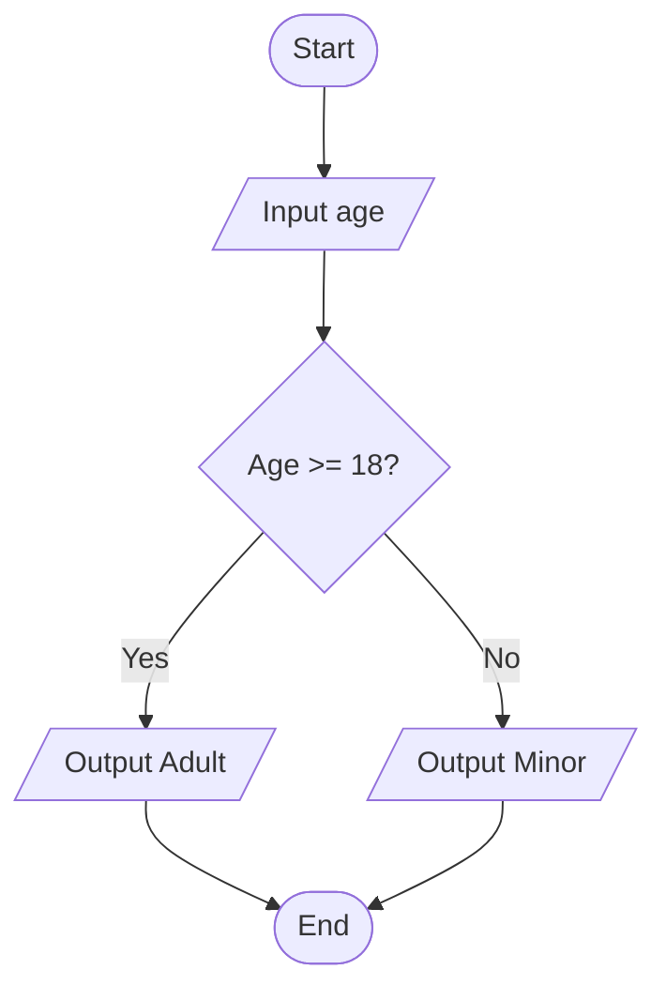

Read it aloud: Start; obtain age; ask whether age is at least 18; if yes, output Adult; otherwise, output Minor; end. The two paths join before termination.

### 3.3 Loops are arrows that return

A loop contains a **condition**, a **body**, and an **update**. If the update does not move toward termination, the algorithm may run forever. Every loop should have an explicit explanation of when it stops.

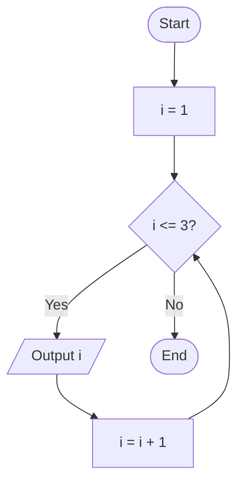

### 3.4 Common diagram mistakes

- A decision diamond with no Yes/No labels.
- A branch that never reconnects or terminates.
- An arrow that points backward without changing the loop variable.
- A chart with no clear Start or End.
- Overcrowding one box with five unrelated operations.
- Drawing an input as a decision or using a decision diamond for ordinary arithmetic.
- Having pseudocode and flowchart perform *different* operations.

## Chapter 4 — Reading and testing algorithms

### 4.1 Dry runs and trace tables

A **dry run** means pretending to be the computer: start at the first step, record each variable update, and follow exactly one decision branch at a time. A **trace table** captures that journey. For the loop above:

| Iteration | `i` before condition | `i <= 3` | Output | `i` after update |
|---:|---:|---|---:|---:|
| 1 | 1 | True | 1 | 2 |
| 2 | 2 | True | 2 | 3 |
| 3 | 3 | True | 3 | 4 |
| Exit | 4 | False | — | — |

### 4.2 Four types of tests

**Normal:** Typical input (`age = 25`). **Boundary:** At or next to a threshold (`17`, `18`, `19`). **Invalid:** Negative age, letters where a number is required. **Empty/special:** Empty list, zero, duplicate values, missing data. For every example below, ask: *What if the input is zero? Empty? Negative? Extremely large?*

### 4.3 A reusable problem-solving worksheet

```text
PROBLEM:
INPUT(S) AND DATA TYPES:
OUTPUT(S):
RULES / CONSTRAINTS:
SMALLEST TEST CASE:
NORMAL TEST CASE:
BOUNDARY TEST CASE:
INVALID TEST CASE:
PSEUDOCODE:
FLOWCHART:
TRACE TABLE:
HOW DOES IT TERMINATE?:
```

## Chapter 5 — Complexity, correctness, and readable design

An algorithm is **correct** if it produces the intended result for every input within its stated assumptions. It is **terminating** if it eventually stops. It is **readable** if another person can understand the steps. These matter more than cleverness.

**Big O** describes how the work grows with input size `n`, not the exact seconds a program takes. A single calculation is usually `O(1)`; visiting each item once is `O(n)`; nested full scans are often `O(n²)`; repeatedly halving a sorted search range is `O(log n)`. Later examples label complexity to help you recognise patterns; do not memorise these labels before understanding the algorithms.

---

# Part II — 18 fully worked examples

Every example has a problem statement, IPO, pseudocode, Mermaid flowchart, walkthrough, tests, a typical mistake, and a practice extension. The *same algorithm* is represented in both forms. For the more complex examples, the flowchart uses named subroutines to remain legible; their pseudocode defines exactly what those subroutines do.


## Example 01 — Greet a user

**Difficulty:** Absolute beginner · **Typical time complexity:** O(1)

### Problem and expected behaviour

Read a name and display a personalised greeting.

**IPO and assumptions:** Input: name (text). Output: greeting.

### Pseudocode — follow every step

```text
BEGIN
    INPUT name
    OUTPUT "Hello, " + name + "!"
END
```

### Matching flowchart

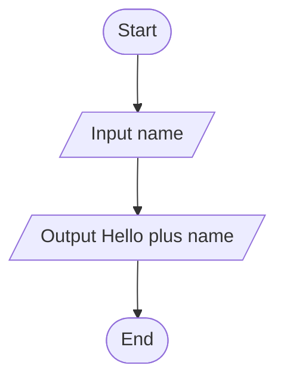

### Walkthrough (dry run)

Input Ada → output `Hello, Ada!`. There is no decision or repetition.

### Test yourself

Try Ada, Musa, and an empty name. An empty name still produces a greeting unless validation is added.

### Common mistake to avoid

Assuming `INPUT` automatically prints a greeting. Input and output are separate operations.

### Your turn — extension challenge

Reject a blank name and request it again.

---


## Example 02 — Rectangle area and perimeter

**Difficulty:** Absolute beginner · **Typical time complexity:** O(1)

### Problem and expected behaviour

Calculate both area and perimeter for a rectangle.

**IPO and assumptions:** Inputs: length, width (non-negative numbers). Outputs: area, perimeter.

### Pseudocode — follow every step

```text
BEGIN
    INPUT length, width
    area ← length × width
    perimeter ← 2 × (length + width)
    OUTPUT area, perimeter
END
```

### Matching flowchart

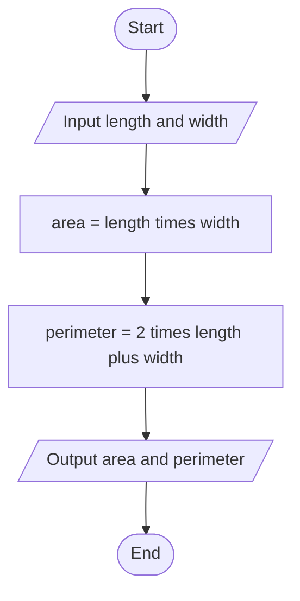

### Walkthrough (dry run)

For length 5 and width 3: area = 15 square units; perimeter = 16 units.

### Test yourself

Test (5,3) → (15,16), (0,4) → (0,8). Assume dimensions are non-negative.

### Common mistake to avoid

Forgetting parentheses in `2 × (length + width)`.

### Your turn — extension challenge

Add a validation branch that rejects negative dimensions.

---


## Example 03 — Temperature conversion

**Difficulty:** Beginner · **Typical time complexity:** O(1)

### Problem and expected behaviour

Convert Celsius to Fahrenheit using F = 9C/5 + 32.

**IPO and assumptions:** Input: Celsius number. Output: Fahrenheit number.

### Pseudocode — follow every step

```text
BEGIN
    INPUT celsius
    fahrenheit ← (9 × celsius / 5) + 32
    OUTPUT fahrenheit
END
```

### Matching flowchart

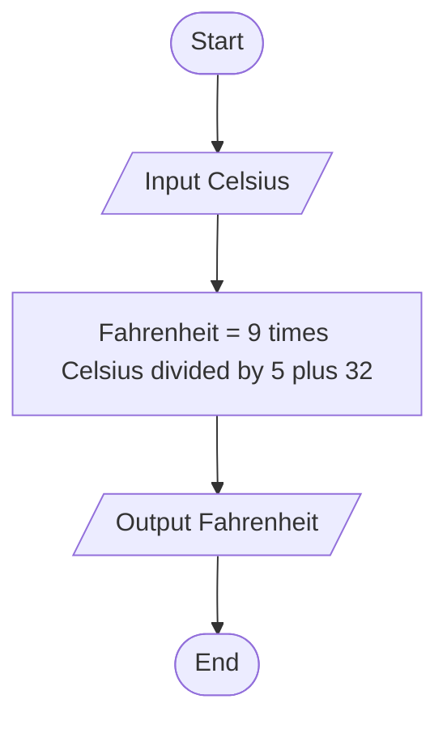

### Walkthrough (dry run)

0°C → 32°F; 100°C → 212°F. Negative temperatures are valid.

### Test yourself

Test 0, 100, -40 (which converts to -40°F).

### Common mistake to avoid

Using `9 / (5 + 32)` or forgetting operation precedence.

### Your turn — extension challenge

Build the inverse Fahrenheit-to-Celsius converter.

---


## Example 04 — Even or odd

**Difficulty:** Beginner · **Typical time complexity:** O(1)

### Problem and expected behaviour

Determine whether an integer is even.

**IPO and assumptions:** Input: integer n. Output: Even or Odd.

### Pseudocode — follow every step

```text
BEGIN
    INPUT n
    IF n MOD 2 = 0 THEN
        OUTPUT "Even"
    ELSE
        OUTPUT "Odd"
    ENDIF
END
```

### Matching flowchart

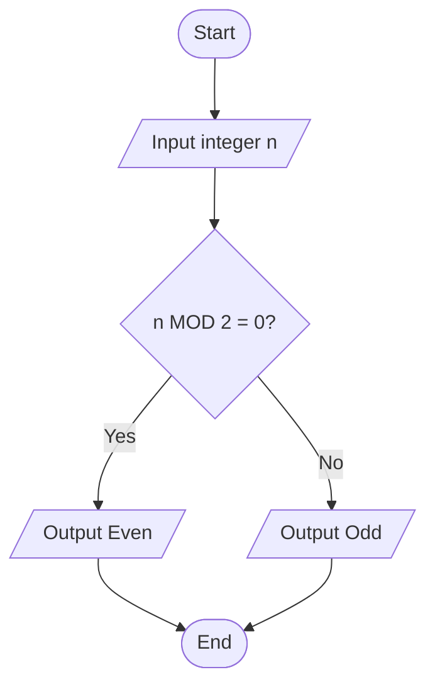

### Walkthrough (dry run)

n = 8: remainder 0 → Even. n = 7: remainder 1 → Odd.

### Test yourself

Try 0 (Even), -3 (Odd), 42 (Even).

### Common mistake to avoid

Confusing `MOD` with ordinary division.

### Your turn — extension challenge

Output whether a number is divisible by both 2 and 3.

---


## Example 05 — Pass/fail and grade bands

**Difficulty:** Beginner · **Typical time complexity:** O(1)

### Problem and expected behaviour

Classify a valid exam score into A, B, C, D, or F.

**IPO and assumptions:** Input: numeric score from 0 to 100. Output: grade or invalid-score message.

### Pseudocode — follow every step

```text
BEGIN
    INPUT score
    IF score < 0 OR score > 100 THEN
        OUTPUT "Invalid score"
    ELSE IF score >= 70 THEN
        OUTPUT "A"
    ELSE IF score >= 60 THEN
        OUTPUT "B"
    ELSE IF score >= 50 THEN
        OUTPUT "C"
    ELSE IF score >= 45 THEN
        OUTPUT "D"
    ELSE
        OUTPUT "F"
    ENDIF
END
```

### Matching flowchart

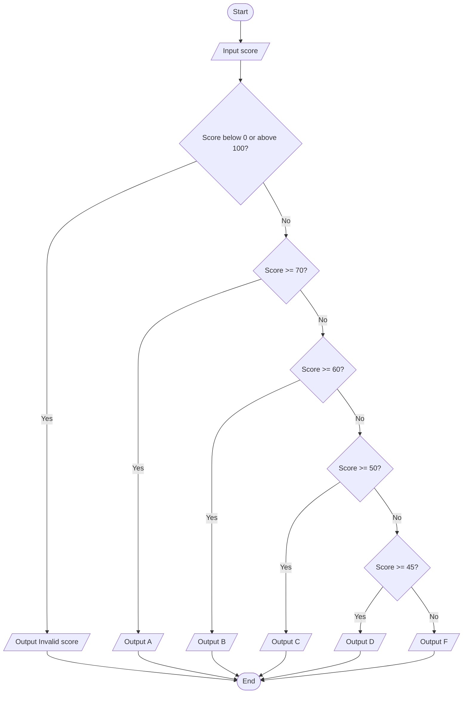

### Walkthrough (dry run)

Score 67 fails the >=70 check, passes >=60, so B. Score 44 reaches F.

### Test yourself

Try -1 invalid; 0 F; 44 F; 45 D; 49 D; 50 C; 59 C; 60 B; 69 B; 70 A; 100 A; 101 invalid.

### Common mistake to avoid

Testing `>= 50` before `>= 70`: a score of 80 would be classified as C. Check highest threshold first.

### Your turn — extension challenge

Modify the grade bands and add an overall Pass if score >= 50.

---


## Example 06 — Largest of three numbers

**Difficulty:** Beginner · **Typical time complexity:** O(1)

### Problem and expected behaviour

Find the maximum of three numeric inputs, including ties.

**IPO and assumptions:** Inputs: a, b, c. Output: maximum.

### Pseudocode — follow every step

```text
BEGIN
    INPUT a, b, c
    maximum ← a
    IF b > maximum THEN
        maximum ← b
    ENDIF
    IF c > maximum THEN
        maximum ← c
    ENDIF
    OUTPUT maximum
END
```

### Matching flowchart

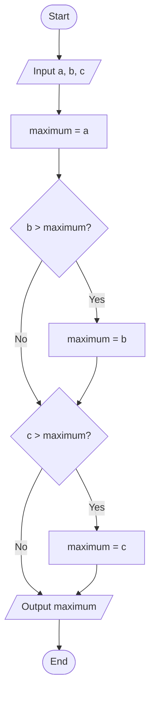

### Walkthrough (dry run)

Inputs 8, 13, 10: max starts at 8; becomes 13; stays 13.

### Test yourself

Try (3,3,3) → 3; (-9,-2,-4) → -2; (5,2,8) → 8.

### Common mistake to avoid

Starting maximum at 0 fails for all-negative inputs.

### Your turn — extension challenge

Extend to the largest of five values without repeating five nested IF blocks.

---


## Example 07 — Sum of the first N integers

**Difficulty:** Beginner → intermediate · **Typical time complexity:** O(n)

### Problem and expected behaviour

Compute 1 + 2 + … + N for a non-negative integer N.

**IPO and assumptions:** Input: N >= 0 integer. Output: sum.

### Pseudocode — follow every step

```text
BEGIN
    INPUT N
    IF N < 0 THEN
        OUTPUT "Invalid N"
    ELSE
        total ← 0
        FOR i ← 1 TO N DO
            total ← total + i
        ENDFOR
        OUTPUT total
    ENDIF
END
```

### Matching flowchart

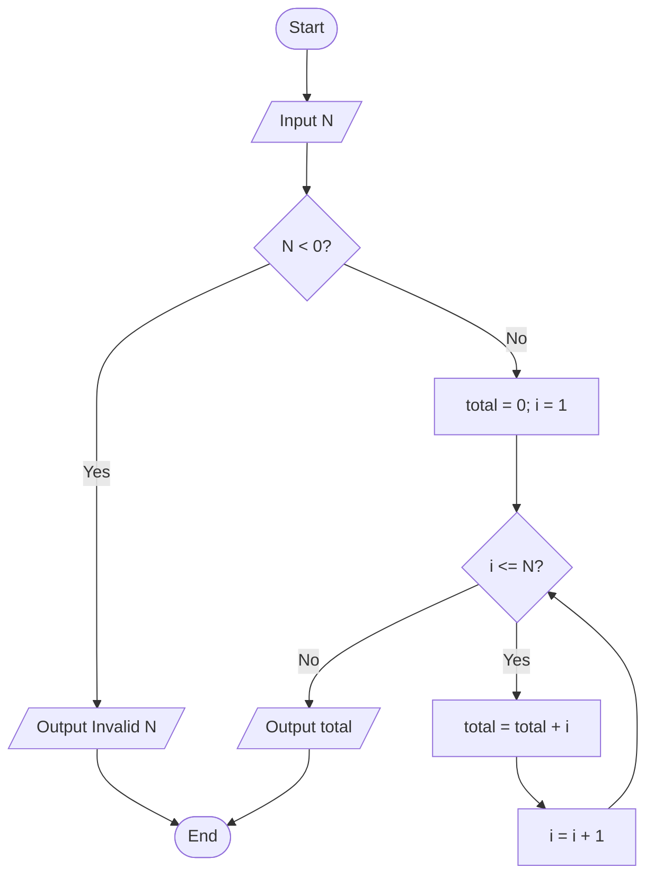

### Walkthrough (dry run)

N=4: total changes 0→1→3→6→10; i becomes 5 and the loop stops.

### Test yourself

N=0 → 0; N=1 → 1; N=5 → 15; N=-1 invalid.

### Common mistake to avoid

Updating i before adding it, or failing to increment i.

### Your turn — extension challenge

Compute the sum of even numbers between 1 and N.

---


## Example 08 — Multiplication table

**Difficulty:** Intermediate · **Typical time complexity:** O(1) for the fixed 10 iterations

### Problem and expected behaviour

Print the 1-to-10 multiplication table for a supplied integer.

**IPO and assumptions:** Input: integer n. Output: ten lines of n × i.

### Pseudocode — follow every step

```text
BEGIN
    INPUT n
    FOR i ← 1 TO 10 DO
        product ← n × i
        OUTPUT n, "×", i, "=", product
    ENDFOR
END
```

### Matching flowchart

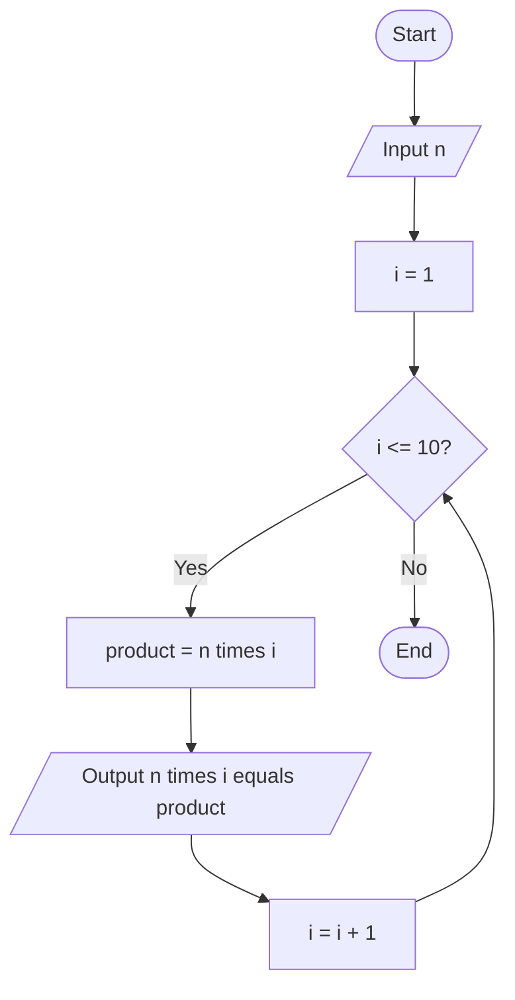

### Walkthrough (dry run)

n=3: the first three lines are 3×1=3, 3×2=6, 3×3=9; the tenth is 3×10=30.

### Test yourself

Try n=0, n=-2, n=12. The loop always runs exactly 10 times.

### Common mistake to avoid

Setting the condition to `i < 10` produces only nine lines.

### Your turn — extension challenge

Let the user choose the upper limit instead of fixing it at 10.

---


## Example 09 — Validate a PIN with limited attempts

**Difficulty:** Intermediate · **Typical time complexity:** O(1) with a three-attempt cap

### Problem and expected behaviour

Accept a correct PIN, but allow at most three attempts.

**IPO and assumptions:** Input: entered PIN each attempt; known secret PIN. Output: Access granted or Account locked.

### Pseudocode — follow every step

```text
BEGIN
    correctPIN ← "2468"
    attempts ← 0
    authenticated ← FALSE
    WHILE attempts < 3 AND authenticated = FALSE DO
        INPUT enteredPIN
        attempts ← attempts + 1
        IF enteredPIN = correctPIN THEN
            authenticated ← TRUE
        ENDIF
    ENDWHILE
    IF authenticated THEN
        OUTPUT "Access granted"
    ELSE
        OUTPUT "Account locked"
    ENDIF
END
```

### Matching flowchart

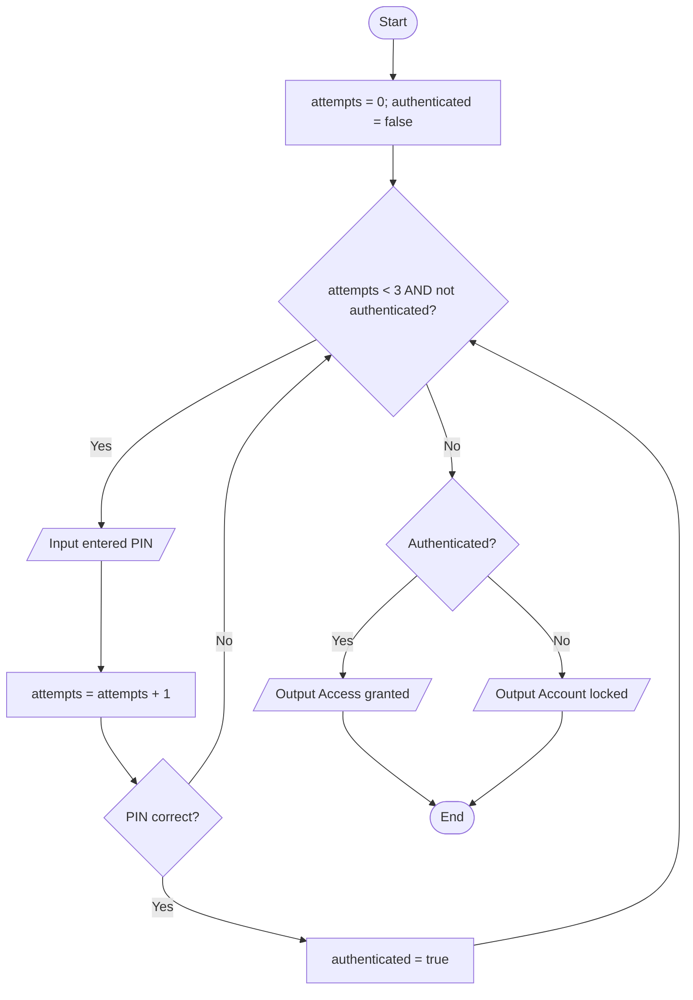

### Walkthrough (dry run)

Incorrect, incorrect, correct → access granted on attempt 3. Three incorrect entries → locked.

### Test yourself

Test correct on first attempt; correct on third; all incorrect. The PIN is text to preserve leading zeros.

### Common mistake to avoid

Checking attempts after allowing a fourth input; storing PIN as integer and losing leading zeros.

### Your turn — extension challenge

Add a message showing remaining attempts after each failure.

---


## Example 10 — Factorial using a loop

**Difficulty:** Intermediate · **Typical time complexity:** O(n)

### Problem and expected behaviour

Calculate N! = 1 × 2 × … × N; define 0! = 1.

**IPO and assumptions:** Input: non-negative integer N. Output: N factorial.

### Pseudocode — follow every step

```text
BEGIN
    INPUT N
    IF N < 0 THEN
        OUTPUT "Invalid N"
    ELSE
        result ← 1
        FOR i ← 2 TO N DO
            result ← result × i
        ENDFOR
        OUTPUT result
    ENDIF
END
```

### Matching flowchart

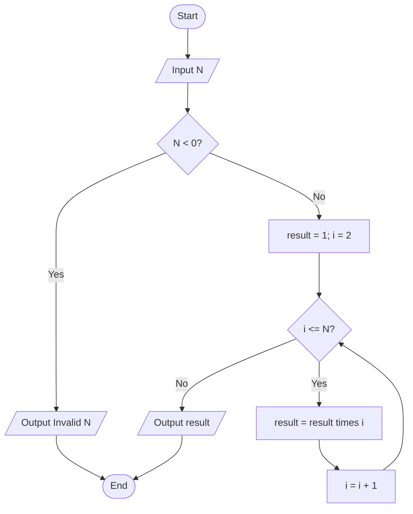

### Walkthrough (dry run)

N=4: result 1→2→6→24. N=0 skips loop and outputs 1.

### Test yourself

0 → 1; 1 → 1; 5 → 120; -1 invalid.

### Common mistake to avoid

Initialising result to 0 means every multiplication remains 0.

### Your turn — extension challenge

Compute factorial using a recursive function; compare with Example 16.

---


## Example 11 — Analyse a list of student scores

**Difficulty:** Intermediate · **Typical time complexity:** O(n)

### Problem and expected behaviour

Given a non-empty list, compute total, average, highest, lowest, and pass count (pass >=50).

**IPO and assumptions:** Input: non-empty list of scores in [0,100]. Output: total, average, max, min, pass count.

### Pseudocode — follow every step

```text
BEGIN
    INPUT scores
    IF LENGTH(scores) = 0 THEN
        OUTPUT "No scores supplied"
    ELSE
        total ← 0
        highest ← scores[0]
        lowest ← scores[0]
        passCount ← 0
        FOR EACH score IN scores DO
            total ← total + score
            IF score > highest THEN highest ← score ENDIF
            IF score < lowest THEN lowest ← score ENDIF
            IF score >= 50 THEN passCount ← passCount + 1 ENDIF
        ENDFOR
        average ← total / LENGTH(scores)
        OUTPUT total, average, highest, lowest, passCount
    ENDIF
END
```

### Matching flowchart

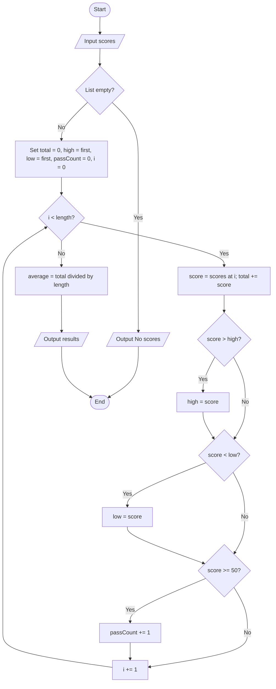

### Walkthrough (dry run)

Scores [40,70,90]: total 200, average 66.67 (rounded), highest 90, lowest 40, pass count 2.

### Test yourself

Try [50] → all values 50, pass 1; [] → message; [0,100] → average 50, pass 1.

### Common mistake to avoid

Dividing by zero for an empty list, or initialising highest to 0 and lowest to 100 without stating constraints.

### Your turn — extension challenge

Add a count of grades A/B/C/D/F and show the percentage passing.

---


## Example 12 — Linear search

**Difficulty:** Intermediate → advanced · **Typical time complexity:** O(n)

### Problem and expected behaviour

Find the index of a target in an unsorted list; return -1 if absent.

**IPO and assumptions:** Inputs: items list, target. Output: first matching index or -1.

### Pseudocode — follow every step

```text
BEGIN
    INPUT items, target
    foundIndex ← -1
    FOR i ← 0 TO LENGTH(items) - 1 DO
        IF items[i] = target THEN
            foundIndex ← i
            BREAK
        ENDIF
    ENDFOR
    OUTPUT foundIndex
END
```

### Matching flowchart

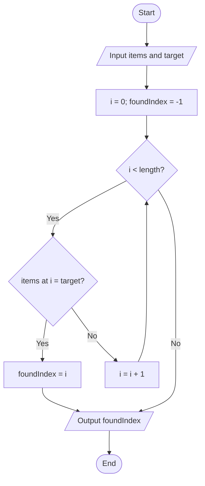

### Walkthrough (dry run)

Items [8,3,8,5], target 8 → 0 (first match). Target 5 → 3.

### Test yourself

Try empty list → -1; missing 9 → -1; duplicate 8 → first index 0.

### Common mistake to avoid

Assuming list must be sorted; linear search works on unsorted data.

### Your turn — extension challenge

Modify it to return *all* matching indices.

---


## Example 13 — Binary search on sorted data

**Difficulty:** Advanced · **Typical time complexity:** O(log n)

### Problem and expected behaviour

Find a target in an ascending sorted list by repeatedly halving the search range.

**IPO and assumptions:** Inputs: ascending sorted list, target. Output: matching index or -1.

### Pseudocode — follow every step

```text
BEGIN
    INPUT items, target
    low ← 0
    high ← LENGTH(items) - 1
    foundIndex ← -1
    WHILE low <= high DO
        mid ← (low + high) DIV 2
        IF items[mid] = target THEN
            foundIndex ← mid
            BREAK
        ELSE IF items[mid] < target THEN
            low ← mid + 1
        ELSE
            high ← mid - 1
        ENDIF
    ENDWHILE
    OUTPUT foundIndex
END
```

### Matching flowchart

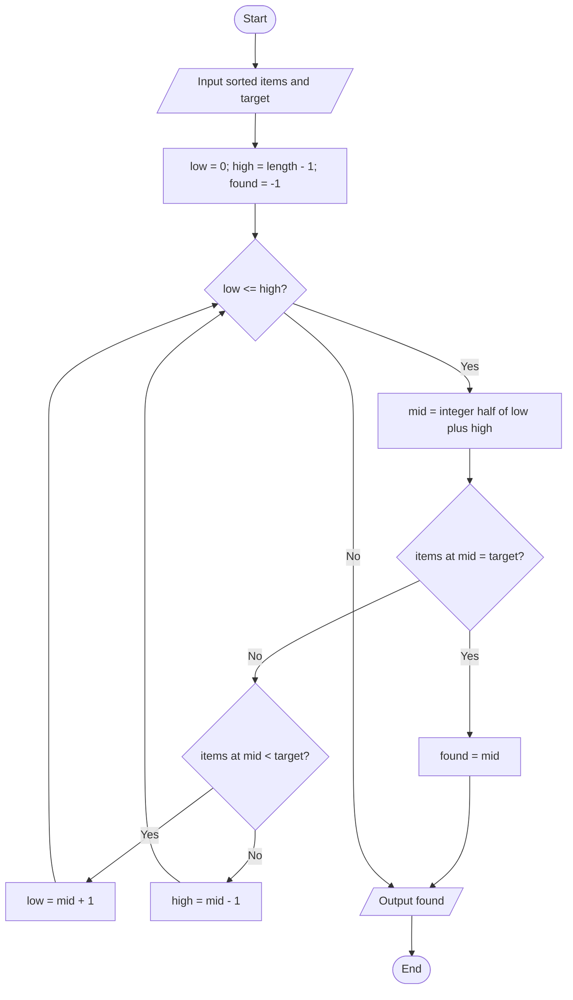

### Walkthrough (dry run)

Items [2,5,8,12,16,23,38], target 23: mid 3→12 too small, low=4; mid 5→23 found.

### Test yourself

Target 2 → 0; 38 → 6; 9 → -1; empty list → -1.

### Common mistake to avoid

Using binary search on an unsorted list. **Sorted order is a precondition**, not an optional optimisation.

### Your turn — extension challenge

Adapt the algorithm to descending-sorted numbers and explain what comparisons change.

---


## Example 14 — Bubble sort with early exit

**Difficulty:** Advanced · **Typical time complexity:** O(n²) worst case; O(n) best case with early exit

### Problem and expected behaviour

Sort a list in ascending order by swapping adjacent out-of-order values; stop early if a pass makes no swaps.

**IPO and assumptions:** Input: list of comparable numbers. Output: ascending sorted list.

### Pseudocode — follow every step

```text
BEGIN
    INPUT items
    n ← LENGTH(items)
    FOR pass ← 0 TO n - 2 DO
        swapped ← FALSE
        FOR j ← 0 TO n - pass - 2 DO
            IF items[j] > items[j + 1] THEN
                SWAP items[j], items[j + 1]
                swapped ← TRUE
            ENDIF
        ENDFOR
        IF swapped = FALSE THEN BREAK ENDIF
    ENDFOR
    OUTPUT items
END
```

### Matching flowchart

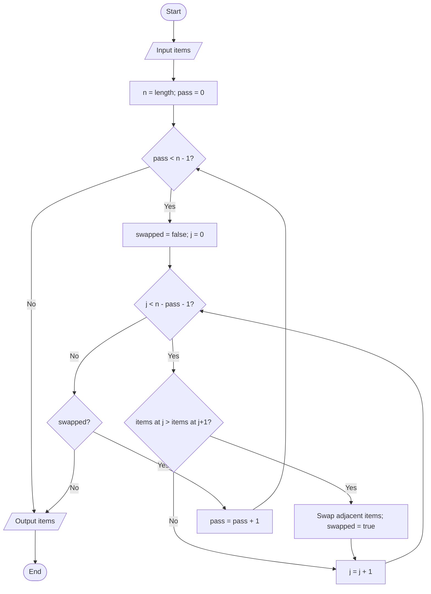

### Walkthrough (dry run)

[5,1,4] pass 1: swap 5/1 → [1,5,4], swap 5/4 → [1,4,5]; pass 2 makes no swaps → stop.

### Test yourself

[] → []; [7] → [7]; [2,1] → [1,2]; [1,2,3] stops after first no-swap pass.

### Common mistake to avoid

Incorrect inner-loop bound causes an out-of-range access at `j+1`.

### Your turn — extension challenge

Count comparisons and swaps; compare already-sorted versus reversed inputs.

---


## Example 15 — Recursive factorial

**Difficulty:** Advanced · **Typical time complexity:** O(n) time; O(n) call-stack space

### Problem and expected behaviour

Define factorial in terms of a smaller version of itself.

**IPO and assumptions:** Input: integer n >= 0. Output: n!.

### Pseudocode — follow every step

```text
FUNCTION Factorial(n)
    IF n = 0 OR n = 1 THEN
        RETURN 1
    ENDIF
    RETURN n × Factorial(n - 1)
END FUNCTION

BEGIN
    INPUT n
    IF n < 0 THEN
        OUTPUT "Invalid N"
    ELSE
        OUTPUT Factorial(n)
    ENDIF
END
```

### Matching flowchart

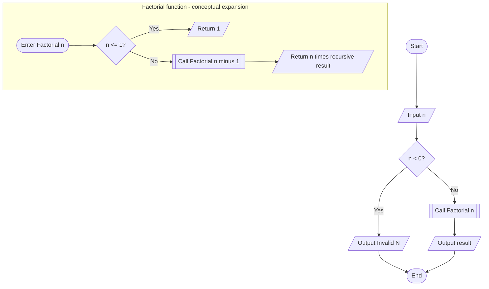

### Walkthrough (dry run)

Factorial(4) = 4×Factorial(3) = 4×3×2×1 = 24. Calls unwind in reverse order.

### Test yourself

0 → 1; 1 → 1; 4 → 24; negative input is rejected by main algorithm.

### Common mistake to avoid

Omitting the base case causes infinite recursion; calling `Factorial(n)` instead of `Factorial(n-1)` never makes progress.

### Your turn — extension challenge

Trace Factorial(5) as a call stack and compare memory use with Example 10.

---


## Example 16 — Euclidean algorithm for GCD

**Difficulty:** Expert foundations · **Typical time complexity:** O(log min(a,b)) for positive inputs

### Problem and expected behaviour

Find the greatest common divisor of two non-negative integers efficiently.

**IPO and assumptions:** Inputs: a,b non-negative integers, not both zero. Output: GCD.

### Pseudocode — follow every step

```text
BEGIN
    INPUT a, b
    IF a < 0 OR b < 0 OR (a = 0 AND b = 0) THEN
        OUTPUT "Invalid input"
    ELSE
        WHILE b ≠ 0 DO
            remainder ← a MOD b
            a ← b
            b ← remainder
        ENDWHILE
        OUTPUT a
    ENDIF
END
```

### Matching flowchart

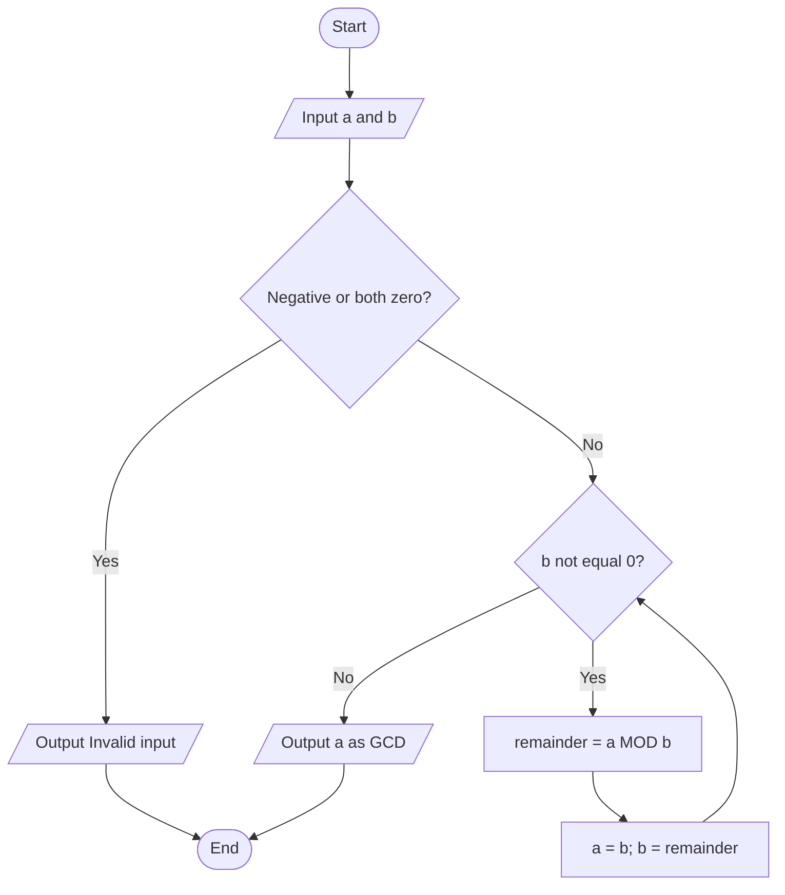

### Walkthrough (dry run)

For 48,18: remainder 12 → (18,12); remainder 6 → (12,6); remainder 0 → (6,0); GCD=6.

### Test yourself

GCD(10,0)=10; GCD(12,8)=4; (0,0) invalid; (0,5)=5.

### Common mistake to avoid

Overwriting `a` before computing the remainder. Calculate remainder first.

### Your turn — extension challenge

Use GCD to simplify fractions, e.g. 18/24 → 3/4.

---


## Example 17 — Shortest path with breadth-first search

**Difficulty:** Expert foundations · **Typical time complexity:** O(V + E) time and O(V) space

### Problem and expected behaviour

Find the shortest number of edges from a start node to a goal node in an unweighted graph.

**IPO and assumptions:** Inputs: adjacency list graph, start, goal. Output: path or No path.

### Pseudocode — follow every step

```text
BEGIN
    INPUT graph, start, goal
    queue ← empty FIFO queue
    ENQUEUE(queue, start)
    visited ← {start}
    parent[start] ← NONE
    WHILE queue is not empty DO
        current ← DEQUEUE(queue)
        IF current = goal THEN
            path ← empty list
            WHILE current ≠ NONE DO
                PREPEND current TO path
                current ← parent[current]
            ENDWHILE
            OUTPUT path
            STOP
        ENDIF
        FOR EACH neighbour IN graph[current] DO
            IF neighbour NOT IN visited THEN
                ADD neighbour TO visited
                parent[neighbour] ← current
                ENQUEUE(queue, neighbour)
            ENDIF
        ENDFOR
    ENDWHILE
    OUTPUT "No path"
END
```

### Matching flowchart

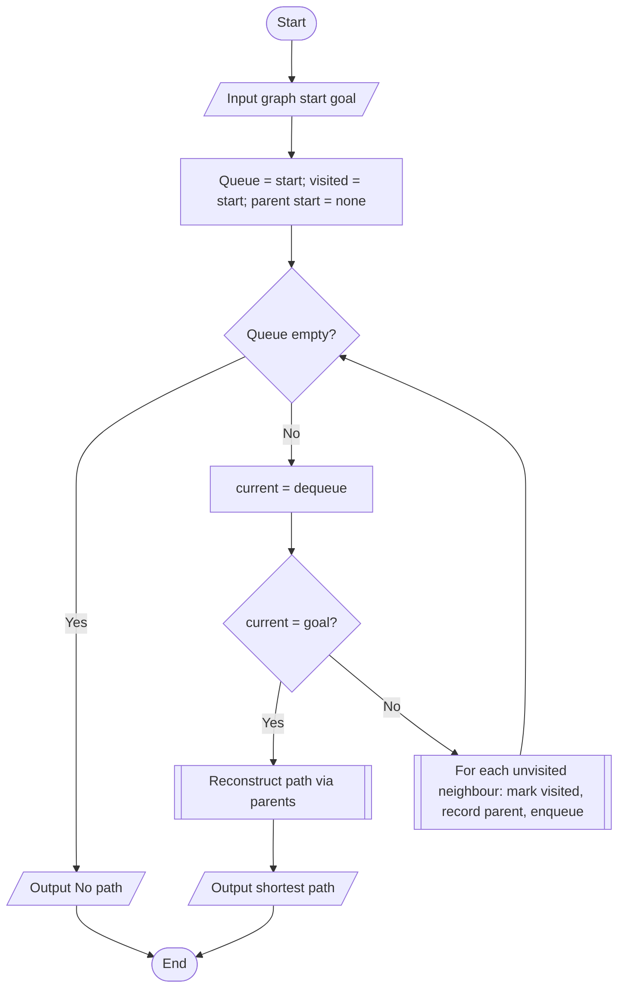

### Walkthrough (dry run)

Graph A→B,C; B→D; C→D,E; D→F. BFS from A to F explores by layers: A, then B/C, then D/E, then F; returns A→B→D→F (one shortest path).

### Test yourself

Start=goal → [start]; unreachable goal → No path; isolated start → No path.

### Common mistake to avoid

Using a stack instead of a queue changes the search to depth-first, which does not guarantee shortest path in an unweighted graph.

### Your turn — extension challenge

Draw the BFS queue contents after every step for a six-node graph.

---


## Example 18 — Topological ordering of prerequisites

**Difficulty:** Expert foundations · **Typical time complexity:** O(V + E)

### Problem and expected behaviour

Find a valid order for courses with prerequisites; detect circular dependencies.

**IPO and assumptions:** Input: directed course graph A to B means A before B. Output: order or cycle warning.

### Pseudocode — follow every step

```text
BEGIN
    INPUT graph
    COMPUTE indegree of each course
    queue ← all courses with indegree 0
    order ← empty list
    WHILE queue is not empty DO
        course ← DEQUEUE(queue)
        APPEND course TO order
        FOR EACH next IN graph[course] DO
            indegree[next] ← indegree[next] - 1
            IF indegree[next] = 0 THEN ENQUEUE(queue, next) ENDIF
        ENDFOR
    ENDWHILE
    IF LENGTH(order) = number of courses THEN
        OUTPUT order
    ELSE
        OUTPUT "Cycle detected"
    ENDIF
END
```

### Matching flowchart

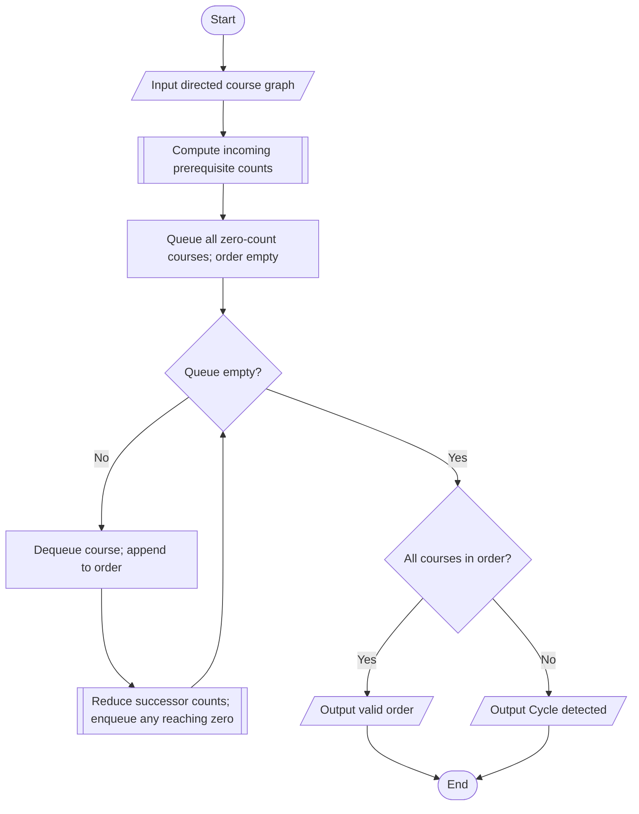

### Walkthrough (dry run)

With Python→Databases and HTML→React, one valid order is Python, HTML, Databases, React.

### Test yourself

No edges: any order; A→B→C: A,B,C; A→B→A: cycle.

### Common mistake to avoid

Forgetting to reduce the indegree of dependent courses after completing a prerequisite.

### Your turn — extension challenge

Draw a prerequisite graph for your own study plan and check for cycles.

---


# Part III — A full workflow for creating your own algorithms

## Chapter 6 — From a messy question to a clean solution

Imagine the request: “Make an app that tells a student whether they can register for an advanced course.” This is underspecified. What is the minimum score? Is attendance required? Are fees relevant? A reliable developer asks questions *before* drawing arrows.

**Step 1 — Clarify the rules.** Assume registration requires score ≥60, attendance ≥75%, and fees paid. **Step 2 — Name the inputs.** `score`, `attendance`, `feesPaid`. **Step 3 — Identify the output.** `Eligible` or `Not eligible`. **Step 4 — Define validation.** Score and attendance must be 0–100. **Step 5 — Write the decision in words.** Invalid values → error; otherwise all three conditions must be true. **Step 6 — Write pseudocode.**

```text
BEGIN
    INPUT score, attendance, feesPaid
    IF score < 0 OR score > 100 OR attendance < 0 OR attendance > 100 THEN
        OUTPUT "Invalid data"
    ELSE IF score >= 60 AND attendance >= 75 AND feesPaid = TRUE THEN
        OUTPUT "Eligible"
    ELSE
        OUTPUT "Not eligible"
    ENDIF
END
```

**Step 7 — Draw a flowchart.**

```mermaid
flowchart TD
 A([Start]) --> B[/Input score, attendance, feesPaid/]
 B --> C{Score or attendance outside 0 to 100?}
 C -- Yes --> D[/Output Invalid data/]
 C -- No --> E{Score >= 60 AND attendance >= 75 AND fees paid?}
 E -- Yes --> F[/Output Eligible/]
 E -- No --> G[/Output Not eligible/]
 D --> H([End])
 F --> H
 G --> H
```

**Step 8 — Test a decision table.**

| Score | Attendance | Fees paid? | Expected |
|---:|---:|---|---|
| 60 | 75 | Yes | Eligible |
| 59 | 90 | Yes | Not eligible |
| 90 | 74 | Yes | Not eligible |
| 90 | 90 | No | Not eligible |
| 101 | 90 | Yes | Invalid data |

**Step 9 — Review parity.** Does every pseudocode branch exist in the diagram? Does the diagram contain extra steps? Do both terminate? **Step 10 — Implement in a real language** only after the algorithm is clear.

## Chapter 7 — Translating pseudocode into Python

The same algorithm can be written in Python. Notice how `INPUT` becomes `input()`, `OUTPUT` becomes `print()`, `←` becomes `=`, and `ENDIF` is represented by indentation.

```python
score = float(input("Score (0–100): "))
attendance = float(input("Attendance (0–100): "))
fees_answer = input("Fees paid? (yes/no): ").strip().lower()
fees_paid = fees_answer == "yes"

if not (0 <= score <= 100) or not (0 <= attendance <= 100):
    print("Invalid data")
elif score >= 60 and attendance >= 75 and fees_paid:
    print("Eligible")
else:
    print("Not eligible")
```

**Important:** This Python example assumes the score and attendance inputs can be converted to numbers. A production implementation would catch `ValueError` and validate the yes/no answer. That is a useful extension exercise, not something the flowchart should silently ignore.

### A translation table

| Pseudocode | Python | What changes? |
|---|---|---|
| `INPUT x` | `x = input(...)` | `input()` initially returns text |
| `x ← 5` | `x = 5` | Assignment uses `=` |
| `IF x > 5 THEN` | `if x > 5:` | Colon and indentation |
| `ELSE` | `else:` | Colon and indentation |
| `FOR i ← 1 TO 5` | `for i in range(1, 6):` | Python's end bound is excluded |
| `WHILE x < 10 DO` | `while x < 10:` | Colon and indentation |
| `FUNCTION double(x)` | `def double(x):` | `def` declares a function |
| `RETURN x × 2` | `return x * 2` | Python uses `*` |

## Chapter 8 — Flowcharting tools and Mermaid essentials

You can draw diagrams **on paper**, in diagrams.net (draw.io), in PowerPoint, or in a Mermaid-enabled Markdown editor. GitHub renders Mermaid diagrams inside fenced `mermaid` code blocks. Mermaid is particularly useful for keeping a diagram beside its pseudocode in a version-controlled `.md` file.

### The four shapes used most often

```mermaid
flowchart LR
    A([Start / End]) --> B[/Input / Output/]
    B --> C[Process]
    C --> D{Decision?}
    D -- Yes --> E[Action A]
    D -- No --> F[Action B]
```

Mermaid syntax essentials:

```text
flowchart TD               direction top-to-bottom
A([Start])                 rounded terminator
B[/Input number/]          input/output
C[total = total + 1]       process
D{total > 10?}             decision
A --> B                    arrow
D -- Yes --> E             labelled arrow
```

**Layout tip:** Mermaid auto-arranges the diagram, so it may not look exactly like a hand-drawn textbook chart. The important properties are correct symbols, labels, directions, and branches. For large algorithms, use a high-level chart with **named subroutines** and describe those subroutines in pseudocode (as in BFS). Do not shrink a complex algorithm until its critical decisions disappear.

### Troubleshooting Mermaid

- If nothing renders, check that the code fence begins with exactly three backticks followed by `mermaid`.
- If a node label breaks parsing, simplify the text and avoid complex punctuation; keep full formulas in pseudocode.
- If arrows cross, try `flowchart LR` instead of `TD`, or split the diagram into subroutines.
- If the preview shows code rather than a diagram, your Markdown viewer may not support Mermaid; open the file on GitHub or a Mermaid-compatible viewer.

## Chapter 9 — Pseudocode and flowchart quality checklist

Before calling an algorithm finished, check every item:

- [ ] I can explain the problem in one or two sentences.
- [ ] Inputs, outputs, data types, and assumptions are explicit.
- [ ] Every variable is initialised before use.
- [ ] Each decision condition is precise.
- [ ] Every decision has all necessary outcomes.
- [ ] Every loop has a stopping condition and makes progress.
- [ ] Array bounds are respected.
- [ ] Empty collections and invalid inputs are considered.
- [ ] The pseudocode and flowchart perform equivalent steps.
- [ ] At least one normal, boundary, and invalid case was tested.
- [ ] The output matches the problem's requested result.
- [ ] A new reader could follow the logic without asking me to explain missing steps.

## Chapter 10 — Independent challenges (no immediate solutions)

Attempt each problem in **both** pseudocode and a flowchart. Use the problem-solving worksheet, create three test cases, and only then implement it in Python if you wish.

| Level | Challenge | Success criteria |
|---|---|---|
| Starter | Convert kilometres to miles | Input, formula, output |
| Starter | Calculate simple interest | Principal, rate, time, interest |
| Starter | Compare two ages | Older/younger/equal |
| Beginner | Leap-year checker | Divisible by 400, or 4 but not 100 |
| Beginner | Triangle validity | Positive sides; sum of any two exceeds third |
| Beginner | Electricity bill calculator | Clear tiered pricing and boundaries |
| Intermediate | Count vowels in a sentence | Traverse text; ignore case |
| Intermediate | Reverse a string | Iterate or index safely |
| Intermediate | Find the second-largest distinct value | Handle duplicates and too-few distinct values |
| Intermediate | ATM withdrawal simulator | Check PIN, positive amount, sufficient balance |
| Advanced | Selection sort | Find smallest remaining item and swap |
| Advanced | Palindrome checker | Decide how spaces/punctuation are treated |
| Advanced | Prime-number test | Handle n < 2; test divisors up to square root |
| Advanced | Merge two sorted lists | Two pointers, no out-of-bounds access |
| Expert | Dijkstra shortest path | Weighted, non-negative edges; min-priority queue |
| Expert | Topological sort | Directed acyclic graph; detect cycles |

### Selected challenge hints (read only after trying)

**Leap year:** `(year MOD 400 = 0) OR ((year MOD 4 = 0) AND (year MOD 100 ≠ 0))`. **Triangle:** test all three pairwise sums. **Prime:** try divisors `d` while `d × d <= n`; stop if any divides evenly. **Second-largest distinct:** track two distinct maxima, not merely the last two elements after sorting. **Dijkstra:** BFS is not sufficient when edges have different weights.

## Chapter 11 — Mini project: design a Student Results Processor

**Brief:** A school needs a console algorithm that accepts student names and scores, rejects invalid scores, computes a grade for each student, reports class average, and identifies the top scorer(s). The number of students must be at least one.

### Functional requirements

1. Ask how many students will be entered; reject counts below one.
2. For each student, read name and score; re-prompt until score is between 0 and 100.
3. Apply grade bands from Example 5.
4. Store the results.
5. Output each student's name, score, and grade.
6. Output the class average and **all** students tied for the highest score.

### Suggested decomposition

```text
FUNCTION ReadValidScore(): repeatedly ask until score in [0,100]
FUNCTION Grade(score): return A/B/C/D/F using Example 5
FUNCTION CalculateAverage(students): return sum(scores) / count
FUNCTION FindTopStudents(students): return all with maximum score
MAIN: read count; collect records; call helpers; display report
```

### High-level flowchart

```mermaid
flowchart TD
 A([Start]) --> B[/Input student count/]
 B --> C{Count >= 1?}
 C -- No --> B
 C -- Yes --> D[Create empty student records; i = 0]
 D --> E{i < count?}
 E -- Yes --> F[/Input student name/]
 F --> G[[ReadValidScore]]
 G --> H[[Calculate grade and save record]]
 H --> I[i = i + 1]
 I --> E
 E -- No --> J[[Calculate class average and top students]]
 J --> K[/Display individual results and summary/]
 K --> L([End])
```

### Acceptance tests

| Input records | Expected |
|---|---|
| 1 student, score 70 | Average 70, grade A, student is top |
| 2 students, 50 and 100 | Average 75, grades C/A, second is top |
| 3 students, 90, 90, 40 | Average ≈73.33, both 90 scorers are top |
| Invalid score -1 then 80 | Re-prompt, accept 80 |
| Count 0 then 2 | Re-prompt for valid count |

**Self-assessment:** Can you draw a separate flowchart for `ReadValidScore`? Can you explain how the loop terminates? Does your top-scorer algorithm handle ties? Are all output grades consistent with the grade bands? If yes, you have moved from copying algorithms to designing them.

## Chapter 12 — Glossary

**Algorithm:** Finite, precise steps to solve a problem. **Assignment:** Store a value in a variable. **Branch:** One possible path after a decision. **Condition:** True/false expression. **Control flow:** The order in which steps execute. **Decision table:** Table mapping conditions to outcomes. **Dry run:** Manually executing steps. **Edge case:** Unusual but important input. **Flowchart:** Diagram of algorithm control flow. **Function:** Named reusable algorithm. **Index:** Position in a collection. **Input:** Data supplied to the algorithm. **Iteration:** Repetition. **Loop invariant:** Property that remains true each iteration. **Output:** Result produced. **Pseudocode:** Language-independent algorithm description. **Recursion:** Function calling itself on a smaller problem. **Sentinel:** Special value signalling termination. **Trace table:** Record of variable values as execution progresses. **Validation:** Checking whether input meets rules.

---

## Final mastery checklist

You are ready to move beyond this handbook when you can independently: explain IPO; write clear pseudocode; identify and draw the six standard flowchart elements; model nested conditions and loops; make trace tables; prevent infinite loops; validate input; search and sort a collection; describe recursion and its base case; decompose a problem into functions; and test normal, boundary, and invalid cases.

**Suggested portfolio evidence:** Save your original diagrams and pseudocode in a GitHub repository, with one Markdown file per algorithm. Add a README explaining assumptions, tests, and what you learned. The best evidence of understanding is not copying a diagram—it is being able to defend *why every arrow and condition is there*.

*Prepared as a standalone educational resource for Opsfuxion Technologies Limited. Examples use instructional conventions rather than the syntax of any one programming language.*
