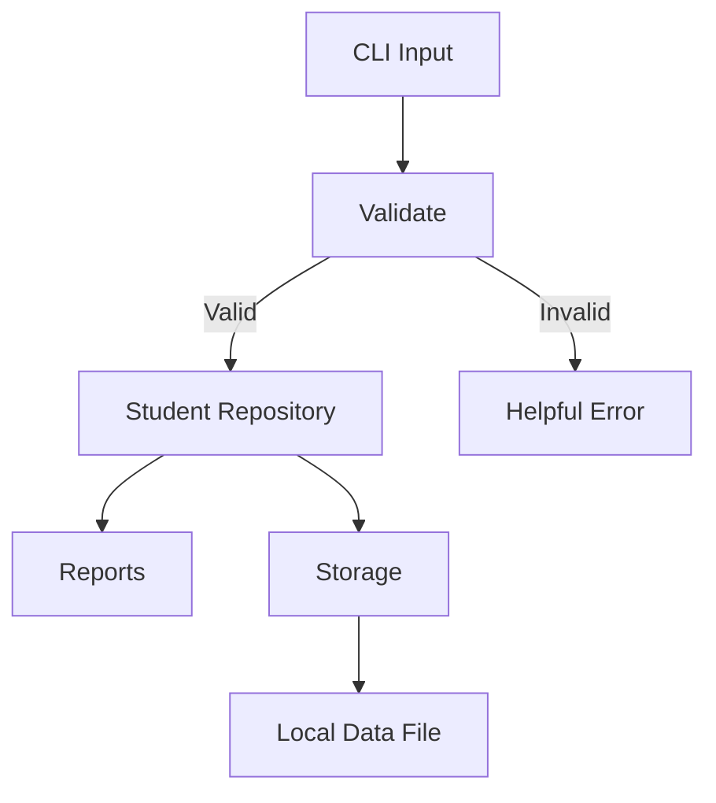

# OCaml Programming: Zero to Hero

**A complete, beginner-friendly, project-driven handbook — from your first expression to production-minded OCaml software**

**Author:** Engr. Amarachi Crystal Omereife  
**Publisher:** Opsfuxion Technologies Limited  
**Edition:** October 2026  
**Audience:** Absolute beginners, Python/JavaScript programmers learning OCaml, aspiring open-source contributors, and software engineers.

> **Learning contract:** Read the explanation, type the example yourself, predict the result, run it, change one thing, then solve the exercise before reading its solution.

**Version note:** OCaml, opam and Dune evolve. The commands here use broadly supported modern OCaml 5.x syntax. Check the installed toolchain and the official documentation before selecting versions for a production project. Examples use the standard library unless otherwise noted.

---

## How to use this handbook

1. Begin at Chapter 1 even if you know another language: OCaml's expression-oriented style is different.
2. Run small snippets in `utop`; save larger examples in `.ml` files and Dune projects.
3. Read each **Why this works** section before opening the **Solution**.
4. Complete the chapter checkpoints, then the progressive projects and final capstone.
5. Maintain a Git repository containing source files, tests and a README.

### Learning roadmap

| Stage | Chapters | You will be able to… |
|---|---|---|
| Foundations | 1–6 | Install OCaml, evaluate expressions, use bindings, functions and control flow |
| Core OCaml | 7–13 | Model data with lists, records, variants, pattern matching and recursion |
| Engineering | 14–20 | Organise modules, handle errors, work with files, build and test Dune projects |
| Advanced | 21–27 | Use functors, abstraction, sequences, complexity analysis and safe concurrency concepts |
| Applications | 28–31 | Build a CLI, design a parser, test a project and prepare for open-source contributions |

---


## Chapter 1. What is OCaml and when should you use it?

OCaml is a statically typed, type-inferred, garbage-collected, multi-paradigm programming language descended from the ML family. **Statically typed** means the compiler checks type consistency before execution; **type inference** means you often do not need to write type annotations. OCaml can compile to native executables or bytecode. It is useful for compilers, code analysis, developer tools, data-processing pipelines and general-purpose applications. It is **not** a replacement for JavaScript in a browser without additional tooling.

**Mental model:** In Python, you often write statements that change variables. In OCaml, you often build an answer by evaluating expressions and composing functions. Many values are immutable by default.

```ocaml
let answer = 40 + 2
let greeting = "Hello, OCaml!"
let () = print_endline greeting
```

**Why this works:** `let` binds names to values. `let () =` runs a side-effecting expression at program start in a source file. `print_endline` prints a line.

**Checkpoint:** Explain the difference between type inference and dynamic typing. Why might compile-time checks catch bugs early?

---


## Chapter 2. Install OCaml, opam, utop and Dune

Install the OCaml toolchain using the official platform instructions at <https://ocaml.org/install>. On macOS, Linux and Windows/WSL, use the appropriate instructions for your platform. **opam** manages OCaml compiler switches and packages; **utop** is an interactive REPL; **Dune** is a build and test system.

```bash
opam --version
opam init
opam switch list
opam install dune utop ocaml-lsp-server ocamlformat
ocaml -version
utop
```

If your shell cannot find opam-installed tools, follow opam's printed shell-configuration instructions; commonly `eval $(opam env)` applies the selected switch to the current terminal. Avoid blindly running installation commands from untrusted sources.

In `utop`, type `1 + 2;;` and observe `3`. End REPL phrases with `;;`; source files generally do **not** require it.

**Editor:** VS Code plus the OCaml Platform extension provides language-server features. Configure formatting after verifying `ocamlformat` is installed.

**Checkpoint:** Describe what each of `opam`, `utop`, `dune` and `ocamlformat` does.

---


## Chapter 3. Expressions, types and values

OCaml expressions evaluate to values and have types. Basic types include `int`, `float`, `bool`, `char`, `string` and `unit`. Integer and floating-point arithmetic use different operators.

```ocaml
let count = 12
let price = 19.95
let enabled = true
let initial = 'A'
let message = "Welcome"
let integer_total = 3 + 4
let float_total = 3.0 +. 4.5
let division = 7 / 2           (* integer result: 3 *)
let decimal_division = 7.0 /. 2.0
let converted = float_of_int count
```

**Common pitfall:** `3 + 2.5` is a type error, not an automatic conversion. `=` compares structural equality; `<>` means not equal. Do not confuse `=` with assignment in imperative languages.

**Checkpoint:** Predict `10 / 4`, `10.0 /. 4.0`, and `string_of_int 42`.

---


## Chapter 4. Names, scope, immutability and shadowing

A `let` binding does not make a mutable variable. You may reuse a name in a narrower scope; this is **shadowing**, not mutation.

```ocaml
let tax_rate = 0.075
let total price =
  let tax = price *. tax_rate in
  price +. tax

let x = 10
let x = x + 5  (* a new binding named x *)
```

`in` defines the scope of a local binding inside an expression. Prefer descriptive names and immutable data unless mutation solves a clear problem.

**Checkpoint:** Why can `let x = x + 1` work after an earlier `let x = 2`?

---


## Chapter 5. Functions, type inference and partial application

Functions are values. OCaml functions commonly accept one argument at a time; supplying fewer arguments than expected returns a new function.

```ocaml
let add a b = a + b
let add_ten = add 10
let result = add_ten 5
let square x = x * x
let apply_twice f x = f (f x)
let sixteen = apply_twice square 2
let greeting (name : string) : string = "Hello, " ^ name
```

**Why this works:** `add` has inferred type `int -> int -> int`. The arrow associates to the right. `add 10` has type `int -> int`. `^` concatenates strings.

**Checkpoint:** Define `multiply_by_three` by partially applying a multiplication function.

---


## Chapter 6. Conditions, comparisons and booleans

An `if` is an expression: both branches must produce compatible types. An `else` is required unless the then-branch returns `unit`.

```ocaml
let grade score =
  if score >= 70 then "A"
  else if score >= 60 then "B"
  else if score >= 50 then "C"
  else "F"

let eligible age has_id = age >= 18 && has_id
```

Use `&&` and `||` for short-circuit boolean logic. Test boundaries such as 49, 50, 59, 60, 69 and 70.

**Checkpoint:** Write a function returning `"positive"`, `"negative"` or `"zero"`.

---


## Chapter 7. Tuples, lists and immutable collections

Tuples group a fixed number of possibly different types. Lists contain zero or more elements **of the same type**.

```ocaml
let person = ("Ada", 21)
let (name, age) = person
let scores = [72; 85; 91]
let new_scores = 100 :: scores
let combined = [1; 2] @ [3; 4]
let doubled = List.map (fun x -> x * 2) scores
let passed = List.filter (fun x -> x >= 75) scores
```

`::` prepends an element. Lists are linked, so prepending is cheap; accessing the last element or indexing far into a list is not. Lists are not Python arrays.

**Checkpoint:** Produce a list of even values from `[1;2;3;4;5;6]`.

---


## Chapter 8. Pattern matching and exhaustive cases

Pattern matching selects behavior based on a value's structure. Prefer it over fragile index-based logic.

```ocaml
let describe = function
  | [] -> "empty"
  | [x] -> "one item: " ^ string_of_int x
  | _ :: _ -> "multiple items"

let first_or_default default = function
  | [] -> default
  | head :: _ -> head
```

The compiler can warn about non-exhaustive matches. Treat those warnings seriously. Patterns are checked top to bottom.

**Checkpoint:** Match an integer to `"zero"`, `"one"`, or `"other"`.

---


## Chapter 9. Recursion and tail recursion

Recursive functions call themselves; every recursion needs a base case and progress toward that case.

```ocaml
let rec factorial n =
  if n < 0 then invalid_arg "factorial: negative input"
  else if n = 0 then 1
  else n * factorial (n - 1)

let sum numbers =
  let rec loop acc = function
    | [] -> acc
    | x :: rest -> loop (acc + x) rest
  in
  loop 0 numbers
```

The `sum` helper is **tail-recursive** because the recursive call is the final operation. The simple factorial is not tail-recursive and may overflow the stack for large inputs. Integer factorial also overflows the machine integer range; tail recursion alone does not prevent numeric overflow.

**Checkpoint:** Implement tail-recursive list length.

---


## Chapter 10. Options: represent missing data safely

`option` avoids sentinel values and many null-related bugs.

```ocaml
let safe_head = function
  | [] -> None
  | x :: _ -> Some x

let display_head values =
  match safe_head values with
  | None -> "No values"
  | Some x -> string_of_int x
```

**Why this works:** `Some value` and `None` are different constructors of the same option type. The compiler encourages handling both.

**Checkpoint:** Write `safe_divide : int -> int -> int option`.

---


## Chapter 11. Records and custom domain models

Records name their fields and make business data self-documenting.

```ocaml
type student = {
  id : int;
  name : string;
  score : int;
}

let ada = { id = 1; name = "Ada"; score = 88 }
let promoted = { ada with score = 92 }
let label s = Printf.sprintf "%d: %s (%d)" s.id s.name s.score
```

Record update syntax creates a **new** record. The original is unchanged. Explicit domain types reduce the risk of mixing unrelated values.

**Checkpoint:** Add an `email` field and create a student record.

---


## Chapter 12. Variants and algebraic data types

Variants encode a finite set of meaningful states.

```ocaml
type payment_status = Pending | Paid | Failed of string

let status_message = function
  | Pending -> "Awaiting payment"
  | Paid -> "Payment complete"
  | Failed reason -> "Payment failed: " ^ reason
```

**Design principle:** Make invalid states difficult to represent. For example, a failed payment may require an error reason, while a paid payment should not.

**Checkpoint:** Define `traffic_light = Red | Amber | Green` and a function describing the next action.

---


## Chapter 13. Higher-order functions, map, filter and fold

Higher-order functions accept or return other functions. They help separate *what* to calculate from *how* to traverse data.

```ocaml
let scores = [55; 70; 90; 40]
let passed = List.filter (fun s -> s >= 50) scores
let boosted = List.map (fun s -> min 100 (s + 5)) scores
let total = List.fold_left ( + ) 0 scores
let average =
  match scores with
  | [] -> None
  | _ -> Some (float_of_int total /. float_of_int (List.length scores))
```

`List.fold_left` accumulates a result from left to right. Choose it when you need a sum, count, map-like aggregation or other reduction.

**Checkpoint:** Count scores above 80 using `List.fold_left`.

---


## Chapter 14. Arrays, references and controlled mutation

Arrays provide indexed access and mutable elements. References hold mutable cells. Use mutation intentionally.

```ocaml
let a = [|10; 20; 30|]
let () = a.(1) <- 25
let counter = ref 0
let () = incr counter
let current = !counter
```

**Important:** `!counter` dereferences a reference; it is not boolean negation. Array indexing is zero-based. `Array.get` and indexing raise exceptions for invalid indices.

**Checkpoint:** Implement a function that doubles each element of an array in place.

---


## Chapter 15. Exceptions, Result and validation

Exceptions suit exceptional failures; `result` is useful for expected failures that callers should handle explicitly.

```ocaml
let parse_age text =
  match int_of_string_opt text with
  | None -> Error "Age must be a whole number"
  | Some age when age < 0 -> Error "Age cannot be negative"
  | Some age -> Ok age

let age_message text =
  match parse_age text with
  | Ok age -> Printf.sprintf "Age: %d" age
  | Error msg -> "Error: " ^ msg
```

Do not catch every exception and silently ignore it. Error messages should tell the user what failed and how to fix the input.

**Checkpoint:** Validate a score from 0 to 100 using `result`.

---


## Chapter 16. Strings, characters and text processing

Use `String` operations for basic text handling. Strings are immutable values; avoid assuming byte offsets correspond to Unicode characters.

```ocaml
let cleaned = String.trim "  OCaml  "
let upper = String.uppercase_ascii cleaned
let pieces = String.split_on_char ',' "red,green,blue"
let has_prefix text = String.starts_with ~prefix:"OC" text
```

`String.uppercase_ascii` is ASCII-only. Internationalised text needs appropriate Unicode-aware libraries and deliberate encoding handling.

**Checkpoint:** Parse a simple comma-separated line, then explain why naive splitting is insufficient for quoted CSV.

---


## Chapter 17. File input/output and resource safety

Use standard-library channels for small text files. Always close resources even if an exception occurs.

```ocaml
let write_text path text =
  let oc = open_out path in
  Fun.protect
    ~finally:(fun () -> close_out_noerr oc)
    (fun () -> output_string oc text)

let read_first_line path =
  let ic = open_in path in
  Fun.protect
    ~finally:(fun () -> close_in_noerr ic)
    (fun () -> input_line ic)
```

**Safety:** Do not blindly overwrite important files. Distinguish missing files, permission failures and invalid content. For production persistence, consider atomic writes and structured formats.

**Checkpoint:** Save a greeting to a temporary file and read it back.

---


## Chapter 18. Modules, interfaces and abstraction

A module groups types and functions. A `.mli` interface describes what other modules may use; it can hide implementation details.

```ocaml
(* counter.mli *)
type t
val create : unit -> t
val increment : t -> unit
val get : t -> int
```

```ocaml
(* counter.ml *)
type t = int ref
let create () = ref 0
let increment c = incr c
let get c = !c
```

The interface makes `t` abstract to callers: they can use its operations but cannot rely on its internal representation. This supports maintainability and safe refactoring.

**Checkpoint:** Design an interface for a student repository with `add`, `find` and `list_all`.

---


## Chapter 19. Dune: structure, build and run a project

Dune is the standard build tool for modern OCaml projects. A basic project may contain `dune-project`, `bin/main.ml`, `bin/dune`, `lib/` and `test/`.

```bash
dune init proj hello_ocaml
cd hello_ocaml
dune build
dune exec hello_ocaml
```

Generated directory names and executable names depend on the Dune version and project template. Inspect the generated `dune` files and use `dune exec` with the actual executable name. `dune runtest` runs configured tests.

**Checkpoint:** Create a project, change its greeting and rebuild it.

---


## Chapter 20. Testing, assertions and Alcotest

Start with small deterministic functions and test expected outputs, boundaries and invalid inputs. OCaml has built-in `assert`; libraries such as Alcotest provide richer test reporting.

```ocaml
let clamp low high value = max low (min high value)
let () =
  assert (clamp 0 100 120 = 100);
  assert (clamp 0 100 (-5) = 0);
  assert (clamp 0 100 50 = 50)
```

`assert` is useful for learning but a proper test runner is preferable for a growing codebase. Configure tests with Dune and run `dune runtest`. Test failure paths as well as successful ones.

**Checkpoint:** Write at least five tests for a grade-classification function.

---


## Chapter 21. Algorithmic complexity and collection choices

Reason about time and memory cost. `List.hd` is O(1), but finding an item in an unsorted list is O(n). `Array.get` is O(1). Standard-library `Map` and `Set` are typically balanced trees with O(log n) lookups; `Hashtbl` offers expected O(1) lookup under ordinary conditions.

```ocaml
module IntSet = Set.Make (Int)
let unique = IntSet.of_list [3; 1; 3; 2]
let exists = IntSet.mem 2 unique
```

Choose data structures based on operations you perform most often, not just on familiarity.

**Checkpoint:** Compare list scanning with set membership for repeated lookups.

---


## Chapter 22. Maps, sets and hash tables

Use `Map` for ordered key-value relationships, `Set` for uniqueness and `Hashtbl` for mutable hash-based lookup.

```ocaml
module StringMap = Map.Make (String)
let contacts =
  StringMap.empty
  |> StringMap.add "Ada" "ada@example.com"
  |> StringMap.add "Tobi" "tobi@example.com"
let ada_email = StringMap.find_opt "Ada" contacts

let counts = Hashtbl.create 16
let () = Hashtbl.replace counts "passed" 3
```

`Map` operations return new maps; `Hashtbl.replace` mutates the table. Do not assume iteration order for hash tables.

**Checkpoint:** Count word frequencies in a list using a hash table.

---


## Chapter 23. Functors and reusable modules

A functor is a module-level function: it takes a module and produces another module. You have already used functors such as `Set.Make` and `Map.Make`.

```ocaml
module type SHOWABLE = sig
  type t
  val show : t -> string
end

module MakePrinter (X : SHOWABLE) = struct
  let print value = print_endline (X.show value)
end

module IntPrinter = MakePrinter (struct
  type t = int
  let show = string_of_int
end)
```

Functors help share implementations while keeping types and module boundaries explicit. Learn ordinary functions and modules first; do not introduce functors unnecessarily.

**Checkpoint:** Adapt `MakePrinter` for strings.

---


## Chapter 24. Object-oriented features in OCaml

OCaml supports objects and classes, although many projects prefer records, variants and modules for domain modelling.

```ocaml
class counter = object
  val mutable value = 0
  method increment = value <- value + 1
  method get = value
end

let c = new counter
let () = c#increment
let count = c#get
```

**Design trade-off:** Use objects when subtyping, object identity or encapsulated mutable state genuinely helps. Do not force every design into classes simply because that is familiar from Java or Python.

**Checkpoint:** Implement a `bank_account` class with a non-negative deposit method.

---


## Chapter 25. Lazy values and sequences

Lazy evaluation delays computation until requested. `Seq` supports potentially lazy sequences, useful for streaming transformations.

```ocaml
let expensive = lazy (40 + 2)
let answer = Lazy.force expensive
let numbers = List.to_seq [1; 2; 3; 4]
let doubled = Seq.map (fun x -> x * 2) numbers
let result = List.of_seq doubled
```

Be careful with repeated evaluation assumptions and side effects. Laziness is a tool, not an automatic performance improvement.

**Checkpoint:** Convert a list into a sequence, filter odd numbers and convert back.

---


## Chapter 26. Concurrency, domains and effects: orientation

OCaml 5 introduced multicore capabilities, including domains and an effect system. These are advanced tools requiring deliberate design. **Concurrency** means tasks can make progress over overlapping periods; **parallelism** means work actually executes simultaneously. Do not share mutable state across domains without a synchronisation strategy.

```ocaml
(* OCaml 5: simple parallel computation *)
let d = Domain.spawn (fun () -> 20 + 22)
let answer = Domain.join d
```

For I/O concurrency, use a suitable ecosystem library and follow its version-specific documentation. Effect handlers are powerful but not necessary for beginner projects.

**Checkpoint:** Explain why immutable data can simplify concurrent programs.

---


## Chapter 27. Profiling, formatting, debugging and code quality

Use `ocamlformat` to enforce consistent style, compiler warnings to catch suspicious code and tests to prevent regressions. Measure performance before optimising. Prefer small pure functions and explicit types at important interfaces.

```bash
dune build
dune runtest
ocamlformat --version
```

Common bugs include incomplete pattern matches, accidental integer division, confusing structural equality with physical equality, and unchecked list operations. Avoid premature optimisation and suppressing warnings without understanding them.

**Checkpoint:** Explain how you would reproduce, isolate, fix and regression-test a bug.

---


## Chapter 28. Guided project: command-line grade calculator

Build a CLI that accepts a score, validates it and prints a grade. Separate pure logic from I/O.

```ocaml
let grade score =
  if score >= 70 then "A"
  else if score >= 60 then "B"
  else if score >= 50 then "C"
  else "F"

let parse_score text =
  match int_of_string_opt text with
  | Some score when score >= 0 && score <= 100 -> Ok score
  | _ -> Error "Enter a whole number between 0 and 100"

let () =
  print_string "Score: ";
  match read_line () |> parse_score with
  | Ok score -> Printf.printf "Grade: %s\n" (grade score)
  | Error message -> prerr_endline message
```

**Extension:** Add distinctions and write unit tests for every boundary.

---


## Chapter 29. Guided project: expression evaluator

Model a small arithmetic language using a recursive variant. This illustrates interpreters and compiler tooling.

```ocaml
type expr =
  | Number of int
  | Add of expr * expr
  | Multiply of expr * expr

let rec eval = function
  | Number n -> n
  | Add (a, b) -> eval a + eval b
  | Multiply (a, b) -> eval a * eval b

let sample = Add (Number 2, Multiply (Number 3, Number 4))
let result = eval sample  (* 14 *)
```

**Extension:** Add subtraction, division with `result`, pretty-printing and a parser. Keep evaluation separate from parsing.

---


## Chapter 30. Capstone: Student Records CLI

**Goal:** Create a small, reliable, testable CLI with records, variants, options/results, collections, modules, file persistence and Dune tests.

**Functional requirements:**
1. Add a student with a unique positive ID, non-empty name and score 0–100.
2. List students, find by ID, update score and delete by ID.
3. Show average, highest score and pass rate.
4. Save and reload data from a documented text format.
5. Reject malformed input with helpful messages.

**Suggested architecture:** `Student` (types and validation), `Repository` (collection operations), `Storage` (read/write), `Reports` (statistics), `Cli` (interaction), `test/` (automated tests).



**Milestones:** M1 types and validation; M2 in-memory CRUD; M3 reports; M4 persistence; M5 tests and README; M6 demonstration.

**Definition of done:** Builds without errors, tests pass, invalid input is handled, data survives restart, and a new learner can run it from the README.

---


## Chapter 31. Contributing to OCaml open source

Start with project-specific contributor documentation. Clone the repository, create an opam switch when recommended, install dependencies, run the existing test suite, reproduce the issue and make a minimal change. Read the repository's coding style and contribution guidelines before writing code.

**Typical workflow:**
```bash
git clone <repository-url>
cd <repository-directory>
# Follow the repository's documented opam/dune setup
dune build
dune runtest
git checkout -b fix/clear-description
```

Do not copy the placeholder commands literally; substitute the real project URL and directory. Submit a focused pull request with the problem, approach, test evidence and any limitations. OCaml projects vary: some use Dune, others use alternative build systems or specialised compiler tooling.

**Checkpoint:** Draft a PR description for a small bug fix, including steps to reproduce and tests run.

---


## Progressive worked exercises — attempt before opening the solutions

The following 18 exercises move from beginner to advanced. Each solution is a **reference solution**, not the only valid approach. Save code in a `.ml` file or paste individual definitions into `utop`.


### Exercise 01 — Add two integers

**Task:** Write `sum_two` accepting two integers.

**Try first:** Write a function signature, identify normal and edge cases, then run at least three tests.

<details>
<summary>Show reference solution and explanation</summary>

```ocaml
let sum_two a b = a + b
```

**Why it works:** The solution uses OCaml's type checking and standard-library operations to express the requested behaviour. Test empty collections, boundary values and invalid inputs when relevant.

</details>


### Exercise 02 — Convert Celsius to Fahrenheit

**Task:** Write `to_fahrenheit` using floating-point operators.

**Try first:** Write a function signature, identify normal and edge cases, then run at least three tests.

<details>
<summary>Show reference solution and explanation</summary>

```ocaml
let to_fahrenheit c = (c *. 9.0 /. 5.0) +. 32.0
```

**Why it works:** The solution uses OCaml's type checking and standard-library operations to express the requested behaviour. Test empty collections, boundary values and invalid inputs when relevant.

</details>


### Exercise 03 — Even or odd

**Task:** Return `true` if an integer is even.

**Try first:** Write a function signature, identify normal and edge cases, then run at least three tests.

<details>
<summary>Show reference solution and explanation</summary>

```ocaml
let is_even n = n mod 2 = 0
```

**Why it works:** The solution uses OCaml's type checking and standard-library operations to express the requested behaviour. Test empty collections, boundary values and invalid inputs when relevant.

</details>


### Exercise 04 — Safe division

**Task:** Return `None` for a zero denominator.

**Try first:** Write a function signature, identify normal and edge cases, then run at least three tests.

<details>
<summary>Show reference solution and explanation</summary>

```ocaml
let safe_divide a b = if b = 0 then None else Some (a / b)
```

**Why it works:** The solution uses OCaml's type checking and standard-library operations to express the requested behaviour. Test empty collections, boundary values and invalid inputs when relevant.

</details>


### Exercise 05 — List squares

**Task:** Square every integer in a list.

**Try first:** Write a function signature, identify normal and edge cases, then run at least three tests.

<details>
<summary>Show reference solution and explanation</summary>

```ocaml
let squares xs = List.map (fun x -> x * x) xs
```

**Why it works:** The solution uses OCaml's type checking and standard-library operations to express the requested behaviour. Test empty collections, boundary values and invalid inputs when relevant.

</details>


### Exercise 06 — Keep passing scores

**Task:** Filter scores at least 50.

**Try first:** Write a function signature, identify normal and edge cases, then run at least three tests.

<details>
<summary>Show reference solution and explanation</summary>

```ocaml
let passing xs = List.filter (fun x -> x >= 50) xs
```

**Why it works:** The solution uses OCaml's type checking and standard-library operations to express the requested behaviour. Test empty collections, boundary values and invalid inputs when relevant.

</details>


### Exercise 07 — List total

**Task:** Sum a list using fold.

**Try first:** Write a function signature, identify normal and edge cases, then run at least three tests.

<details>
<summary>Show reference solution and explanation</summary>

```ocaml
let total xs = List.fold_left ( + ) 0 xs
```

**Why it works:** The solution uses OCaml's type checking and standard-library operations to express the requested behaviour. Test empty collections, boundary values and invalid inputs when relevant.

</details>


### Exercise 08 — Count positives

**Task:** Count strictly positive values.

**Try first:** Write a function signature, identify normal and edge cases, then run at least three tests.

<details>
<summary>Show reference solution and explanation</summary>

```ocaml
let count_positive xs = List.fold_left (fun n x -> if x > 0 then n + 1 else n) 0 xs
```

**Why it works:** The solution uses OCaml's type checking and standard-library operations to express the requested behaviour. Test empty collections, boundary values and invalid inputs when relevant.

</details>


### Exercise 09 — Tail-recursive length

**Task:** Calculate list length with an accumulator.

**Try first:** Write a function signature, identify normal and edge cases, then run at least three tests.

<details>
<summary>Show reference solution and explanation</summary>

```ocaml
let length xs =
  let rec loop n = function [] -> n | _ :: rest -> loop (n + 1) rest in
  loop 0 xs
```

**Why it works:** The solution uses OCaml's type checking and standard-library operations to express the requested behaviour. Test empty collections, boundary values and invalid inputs when relevant.

</details>


### Exercise 10 — Reverse a list

**Task:** Implement reverse without `List.rev`.

**Try first:** Write a function signature, identify normal and edge cases, then run at least three tests.

<details>
<summary>Show reference solution and explanation</summary>

```ocaml
let reverse xs =
  let rec loop acc = function [] -> acc | x :: rest -> loop (x :: acc) rest in
  loop [] xs
```

**Why it works:** The solution uses OCaml's type checking and standard-library operations to express the requested behaviour. Test empty collections, boundary values and invalid inputs when relevant.

</details>


### Exercise 11 — Grade boundaries

**Task:** Map 70+ to A, 60+ to B, 50+ to C, otherwise F.

**Try first:** Write a function signature, identify normal and edge cases, then run at least three tests.

<details>
<summary>Show reference solution and explanation</summary>

```ocaml
let grade x = if x >= 70 then "A" else if x >= 60 then "B" else if x >= 50 then "C" else "F"
```

**Why it works:** The solution uses OCaml's type checking and standard-library operations to express the requested behaviour. Test empty collections, boundary values and invalid inputs when relevant.

</details>


### Exercise 12 — Search records

**Task:** Find a student by ID.

**Try first:** Write a function signature, identify normal and edge cases, then run at least three tests.

<details>
<summary>Show reference solution and explanation</summary>

```ocaml
type student = { id : int; name : string }
let find_student id xs = List.find_opt (fun s -> s.id = id) xs
```

**Why it works:** The solution uses OCaml's type checking and standard-library operations to express the requested behaviour. Test empty collections, boundary values and invalid inputs when relevant.

</details>


### Exercise 13 — Unique values

**Task:** Remove duplicate integers with a set.

**Try first:** Write a function signature, identify normal and edge cases, then run at least three tests.

<details>
<summary>Show reference solution and explanation</summary>

```ocaml
module IntSet = Set.Make (Int)
let unique xs = IntSet.elements (IntSet.of_list xs)
```

**Why it works:** The solution uses OCaml's type checking and standard-library operations to express the requested behaviour. Test empty collections, boundary values and invalid inputs when relevant.

</details>


### Exercise 14 — Word frequencies

**Task:** Count strings with a hash table.

**Try first:** Write a function signature, identify normal and edge cases, then run at least three tests.

<details>
<summary>Show reference solution and explanation</summary>

```ocaml
let frequencies words =
  let table = Hashtbl.create 16 in
  List.iter (fun word ->
    let count = Option.value (Hashtbl.find_opt table word) ~default:0 in
    Hashtbl.replace table word (count + 1)) words;
  table
```

**Why it works:** The solution uses OCaml's type checking and standard-library operations to express the requested behaviour. Test empty collections, boundary values and invalid inputs when relevant.

</details>


### Exercise 15 — Binary search

**Task:** Search a sorted integer array and return an optional index.

**Try first:** Write a function signature, identify normal and edge cases, then run at least three tests.

<details>
<summary>Show reference solution and explanation</summary>

```ocaml
let binary_search a target =
  let rec loop low high =
    if low > high then None
    else let mid = low + (high - low) / 2 in
      if a.(mid) = target then Some mid
      else if a.(mid) < target then loop (mid + 1) high
      else loop low (mid - 1)
  in loop 0 (Array.length a - 1)
```

**Why it works:** The solution uses OCaml's type checking and standard-library operations to express the requested behaviour. Test empty collections, boundary values and invalid inputs when relevant.

</details>


### Exercise 16 — Balanced brackets

**Task:** Check balanced round parentheses in a string.

**Try first:** Write a function signature, identify normal and edge cases, then run at least three tests.

<details>
<summary>Show reference solution and explanation</summary>

```ocaml
let balanced text =
  let rec loop i depth =
    if depth < 0 then false
    else if i = String.length text then depth = 0
    else match text.[i] with
      | '(' -> loop (i + 1) (depth + 1)
      | ')' -> loop (i + 1) (depth - 1)
      | _ -> loop (i + 1) depth
  in loop 0 0
```

**Why it works:** The solution uses OCaml's type checking and standard-library operations to express the requested behaviour. Test empty collections, boundary values and invalid inputs when relevant.

</details>


### Exercise 17 — Merge sorted lists

**Task:** Merge two ascending lists while preserving order.

**Try first:** Write a function signature, identify normal and edge cases, then run at least three tests.

<details>
<summary>Show reference solution and explanation</summary>

```ocaml
let rec merge a b =
  match a, b with
  | [], xs | xs, [] -> xs
  | x :: xs, y :: ys ->
      if x <= y then x :: merge xs b else y :: merge a ys
```

**Why it works:** The solution uses OCaml's type checking and standard-library operations to express the requested behaviour. Test empty collections, boundary values and invalid inputs when relevant.

</details>


### Exercise 18 — Validate an enrolment

**Task:** Return `Ok` only when student ID is positive and course is non-empty.

**Try first:** Write a function signature, identify normal and edge cases, then run at least three tests.

<details>
<summary>Show reference solution and explanation</summary>

```ocaml
let validate_enrolment student_id course =
  if student_id <= 0 then Error "Student ID must be positive"
  else if String.trim course = "" then Error "Course is required"
  else Ok (student_id, String.trim course)
```

**Why it works:** The solution uses OCaml's type checking and standard-library operations to express the requested behaviour. Test empty collections, boundary values and invalid inputs when relevant.

</details>


## Debugging laboratory: 12 common mistakes

| Mistake | Why it fails | Correction |
|---|---|---|
| `1 + 2.5` | Integer operator with a float | `1.0 +. 2.5` |
| `"Hi" + "Ada"` | `+` is numeric | `"Hi" ^ "Ada"` |
| `if true then 1 else "no"` | Branch types differ | Return one common type or a variant |
| `let rec f n = f n` | No progress/base case | Add a base case and decreasing measure |
| `List.hd []` | Empty list | Pattern match or use `List.hd_opt` |
| `List.nth xs 100` | Out-of-range index | Validate index or change representation |
| `let x = 1; x = 2` | `=` is comparison | Use new binding or explicit mutable reference |
| `3 / 2 = 1.5` | Integer division | Use float conversion and `/.` |
| Missing `None` case | Incomplete match | Handle every constructor |
| `print_endline 42` | Expects string | `print_endline (string_of_int 42)` |
| `a.(100)` on short array | Invalid index | Check `Array.length` |
| Ignoring `Error` result | Expected failure unhandled | Match on `Ok` and `Error` |

### Systematic debugging process

1. Reproduce the issue with the smallest possible input.
2. Read the compiler error from its first line, including the expected and actual types.
3. Inspect the expression, not only the line number.
4. Use small `utop` experiments to test your assumption.
5. Fix the cause; add a regression test.
6. Run the full suite with `dune runtest`.

---

## Practical learning schedule (12 weeks)

| Week | Focus | Deliverable |
|---|---|---|
| 1 | Toolchain, expressions and types | REPL practice log |
| 2 | Functions, scope and conditions | Grade calculator |
| 3 | Lists, tuples and patterns | List utilities |
| 4 | Recursion and options | Safe list toolkit |
| 5 | Records, variants and folds | Student domain model |
| 6 | Arrays, errors and file I/O | Validated CLI |
| 7 | Modules, `.mli`, Dune | Multi-module project |
| 8 | Testing and debugging | Automated test suite |
| 9 | Maps, sets and complexity | Search and reporting toolkit |
| 10 | Functors, objects and sequences | Reusable utility module |
| 11 | Expression evaluator | Interpreter mini-project |
| 12 | Student Records capstone | Tested, documented repository |

---

## Capstone marking rubric (100 points)

| Criterion | Points | Evidence |
|---|---:|---|
| Requirements and validation | 15 | Clearly documented rules and invalid-input tests |
| Type and module design | 20 | Records, variants, interfaces and clear boundaries |
| Correct CRUD operations | 20 | Demonstrable create/read/update/delete flows |
| Persistence and failure handling | 15 | Save/load and corrupted-input behaviour |
| Automated tests | 15 | Meaningful normal, boundary and failure cases |
| Documentation and reproducibility | 10 | Setup, run, test, examples and limitations |
| Code clarity | 5 | Naming, formatting and readable functions |

---

## Professional repository template

```text
ocaml-student-records/
├── README.md
├── dune-project
├── lib/
│   ├── student.ml
│   ├── student.mli
│   ├── repository.ml
│   ├── repository.mli
│   ├── storage.ml
│   └── reports.ml
├── bin/
│   ├── dune
│   └── main.ml
└── test/
    ├── dune
    └── test_student.ml
```

Document supported compiler/tool versions, dependency setup, build/run/test commands, input format, known limitations, and the contribution workflow.

---

## Glossary

- **Algebraic data type:** Type assembled from products (records/tuples) and sums (variants).
- **Currying:** Representing multi-argument functions as a sequence of single-argument functions.
- **Dune:** OCaml build and test system.
- **Exhaustive pattern match:** Match that handles all possible cases of a type.
- **Functor:** Module that accepts module parameters and produces a module.
- **Immutable:** Cannot be modified after creation; new values are constructed instead.
- **Module signature:** Public interface specifying types and operations.
- **opam:** OCaml package and compiler-switch manager.
- **Option:** Type representing presence (`Some`) or absence (`None`).
- **Pattern matching:** Structural branching over variants, lists, tuples and other data.
- **Pure function:** Function whose result depends on inputs without observable side effects.
- **REPL:** Read–evaluate–print loop for interactive experimentation.
- **Result:** Type expressing success (`Ok`) or expected failure (`Error`).
- **Tail recursion:** Recursion where the recursive call is the final computation.
- **Type inference:** Compiler determines types from expressions and usage.
- **utop:** Interactive OCaml environment.

---

## Official references and further reading

- [OCaml official website and documentation](https://ocaml.org/)
- [OCaml installation guide](https://ocaml.org/install)
- [OCaml language manual](https://ocaml.org/manual/)
- [OCaml package manager (opam)](https://opam.ocaml.org/)
- [Dune documentation](https://dune.readthedocs.io/)
- [OCaml Platform tools](https://ocaml.org/tools)
- [OCaml community](https://discuss.ocaml.org/)

Consult the official manuals for compiler-version-specific behaviour, platform installation differences and evolving ecosystem tools.

---

## About the author

**Engr. Amarachi Crystal Omereife** is a software engineer, technology entrepreneur and technical educator with experience across Python backend engineering, cloud computing, DevOps, DevSecOps and software delivery. She holds a Master's degree in Computer Science with a specialisation in Software Engineering and leads **Opsfuxion Technologies Limited**, a technology company focused on cloud and DevOps engineering, cloud security, web and mobile application development, and technology training and mentorship. Through practical, project-driven educational resources, she aims to help aspiring developers build the foundational skills, confidence and engineering discipline required for professional software development.

**Opsfuxion Technologies Limited**  
*Orchestrate intelligence, deliver with precision.*

---

*Educational publication. Code examples are designed for learning; review input validation, dependency versions, security, licensing and operational requirements before production deployment.*

