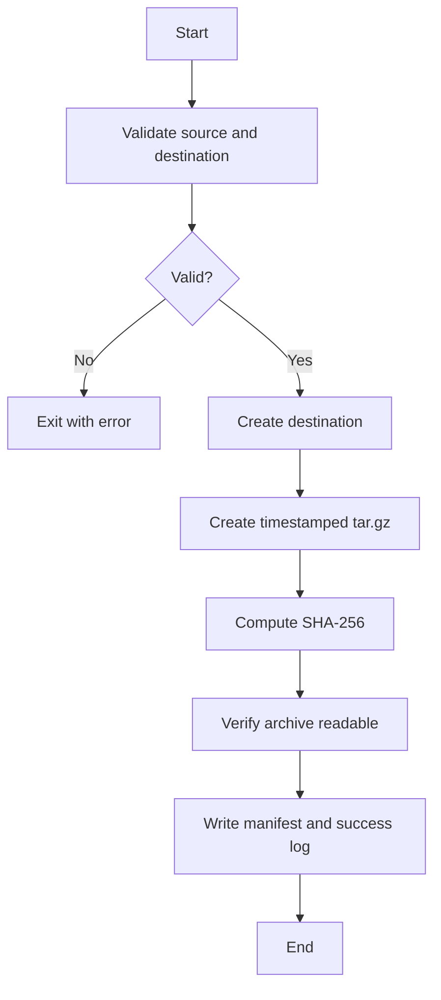

# Shell Scripting: Beginner to Advanced

**A practical, self-paced Bash automation handbook for developers, DevOps and system administrators**  
**Author:** Engr. Amarachi Crystal Omereife  
**Publisher:** Opsfuxion Technologies Limited  
**Edition:** October 2026

> This book teaches **Bash**, not generic POSIX `sh`. It uses Bash arrays, `[[ ... ]]`, `(( ... ))` and other Bash features. On macOS the default `/bin/bash` is often Bash 3.2; examples requiring newer features are identified. For consistent practice, use Bash 5 on Linux, WSL or a current Homebrew installation. Do not paste unfamiliar scripts into privileged shells.

## Contents

1. Shell fundamentals and safe setup
2. Commands, paths and navigation
3. Your first script, shebang and execution
4. Variables, quoting and expansion
5. Input, arguments and exit statuses
6. Tests and branching
7. Loops and iteration
8. Functions and reusable code
9. Arrays and associative arrays
10. Text processing with grep, sed, awk
11. Pipes, redirection and streams
12. Filesystem automation and safe deletion
13. Processes, signals and traps
14. Logging, errors and robust scripting
15. Regular expressions and parsing data
16. Networking, HTTP and JSON
17. Scheduling and environment management
18. Testing, linting and security
19. Advanced patterns: parallelism and locks
20. Capstone: Backup and verification tool
21. Projects, glossary, author

## Orientation: shell vs terminal vs Bash

A **terminal** is the interface you type into. A **shell** interprets commands; Bash is one shell. A **script** is a file of commands executed by a shell. A script runs as your current user unless you explicitly elevate privileges. Start with a disposable practice directory, not important production files.

### Prepare a sandbox

```bash
mkdir -p "$HOME/shell-zero-to-hero"
cd "$HOME/shell-zero-to-hero"
printf 'apple\nbanana\napple\n' > fruits.txt
bash --version
```

On macOS, use `bash script.sh` to ensure Bash runs the script even if your interactive shell is zsh. `chmod +x script.sh` makes it directly executable when it has a valid shebang. Prefer `#!/usr/bin/env bash` for portability when `env` is available.

**Safety first:** Quote expansions (`"$file"`), inspect paths before deleting, use `--` where supported to stop option parsing, never run downloaded scripts blindly, and avoid `sudo` unless necessary.


---

## Chapter 1: Understanding the shell

**By the end of this chapter:** distinguish commands, scripts and processes.

### Understand the idea

A command can be a shell builtin (`cd`, `printf`), an executable (`ls`, `git`) or a function. The shell parses arguments and starts programs. The prompt itself is not part of a command. `pwd` shows your current directory; `type` reveals how a command is resolved.

### Follow-along example

```bash
pwd
type cd
type printf
printf 'Hello, %s!\n' 'learner'
```

### How it works, step by step

`pwd` prints the working directory. `type` identifies command resolution. `printf` formats output predictably; prefer it over `echo` when output may contain escape-like characters.

### Try it yourself

Print the current directory and a message containing your name.

<details><summary><strong>Show a worked solution</strong></summary>

```bash
printf 'Working in: %s\n' "$PWD"
printf 'Hello from %s\n' 'Ada'
```

</details>

### Common mistakes and good habits

The `$PWD` variable expands to the current directory. Keep expansion quoted.

---

## Chapter 2: Paths and filesystem navigation

**By the end of this chapter:** navigate without damaging files.

### Understand the idea

Absolute paths begin at `/`; relative paths are interpreted from the current directory. `.` means current directory, `..` means parent, `~` expands to the home directory in appropriate contexts. Use `ls`, `find` and `stat` to inspect. Filenames may contain spaces, tabs and newlines; robust scripts must account for them.

### Follow-along example

```bash
mkdir -p demo/reports
printf 'sample\n' > 'demo/reports/month one.txt'
find demo -type f -print
cat 'demo/reports/month one.txt'
```

### How it works, step by step

`mkdir -p` creates parent directories as needed. Quotes keep `month one.txt` as a single argument. `find` discovers files recursively.

### Try it yourself

Create a `notes` directory and a file named `my notes.txt`, then display it.

<details><summary><strong>Show a worked solution</strong></summary>

```bash
mkdir -p notes
printf 'Today I learned paths.\n' > 'notes/my notes.txt'
cat 'notes/my notes.txt'
```

</details>

### Common mistakes and good habits

Do not use `rm -rf` as a default cleanup technique. Inspect target directories and use narrow paths.

---

## Chapter 3: First script and shebang

**By the end of this chapter:** create an executable script.

### Understand the idea

A shebang specifies the interpreter used when an executable script is launched. A script can also be run explicitly with `bash script.sh`. Shell scripts are text files, so a text editor is sufficient.

### Follow-along example

```bash
cat > hello.sh <<'SCRIPT'
#!/usr/bin/env bash
printf 'Hello, shell scripting!\n'
SCRIPT
chmod +x hello.sh
./hello.sh
```

### How it works, step by step

The quoted heredoc delimiter `<<'SCRIPT'` prevents variable expansion while writing the file. `chmod +x` adds execute permission; `./` tells the shell to run the file in the current directory.

### Try it yourself

Create a script that prints three lines: your name, the date and your current directory.

<details><summary><strong>Show a worked solution</strong></summary>

```bash
#!/usr/bin/env bash
printf 'Name: %s\n' 'Ada'
date
printf 'Directory: %s\n' "$PWD"
```

</details>

### Common mistakes and good habits

If `Permission denied` occurs, run `bash file.sh` or check execute permission. Avoid `sh script.sh` for Bash-specific scripts.

---

## Chapter 4: Variables, quoting and expansion

**By the end of this chapter:** avoid word-splitting and globbing bugs.

### Understand the idea

Assign with `name=value` (no spaces). Read with `$name` or `${name}`. Double quotes preserve spaces while allowing expansion; single quotes preserve literal text. Command substitution `$(command)` captures output; arithmetic expansion `$(( ... ))` evaluates integers. In Bash, unquoted expansions can split into multiple words and expand wildcard characters.

### Follow-along example

```bash
#!/usr/bin/env bash
name='Uzoamaka'
folder='my reports'
mkdir -p -- "$folder"
printf 'Hello, %s\n' "$name"
printf 'Files in %s: %s\n' "$folder" "$(find "$folder" -type f | wc -l)"
```

### How it works, step by step

Quotes protect spaces in `my reports`. The `--` after `mkdir -p` stops filenames beginning with `-` from being interpreted as options (GNU and many BSD utilities support this convention). Command substitution removes trailing newlines.

### Try it yourself

Store a price of 150 and quantity of 3, then print the integer total.

<details><summary><strong>Show a worked solution</strong></summary>

```bash
price=150
quantity=3
printf 'Total: %d\n' "$((price * quantity))"
```

</details>

### Common mistakes and good habits

Bash arithmetic is integer-only. For money, consider integer minor units or a tool that supports decimals; avoid floating-point assumptions.

---

## Chapter 5: Input, positional arguments and status codes

**By the end of this chapter:** write parameterised scripts.

### Understand the idea

`$0` is the script name; `$1`, `$2` etc. are positional parameters; `$#` is the count; `"$@"` preserves each argument as a separate word. `read -r` reads a line without treating backslashes as escapes. Commands signal success with exit status 0 and failure with nonzero status; `$?` holds the most recent status, but capture it immediately if needed.

### Follow-along example

```bash
#!/usr/bin/env bash
if (( $# != 1 )); then
  printf 'Usage: %s NAME\n' "$0" >&2
  exit 2
fi
printf 'Welcome, %s\n' "$1"
```

Run: `bash greet.sh 'Ada Lovelace'`

### How it works, step by step

The quoted argument is one parameter despite the space. `>&2` sends usage information to standard error. Exit code 2 indicates incorrect usage by convention.

### Try it yourself

Write a script that accepts a city as its first argument and prints `City: ...`. Reject missing arguments.

<details><summary><strong>Show a worked solution</strong></summary>

```bash
#!/usr/bin/env bash
if (( $# < 1 )); then printf 'City required\n' >&2; exit 2; fi
printf 'City: %s\n' "$1"
```

</details>

### Common mistakes and good habits

Always quote `"$@"` when forwarding arguments: `some_command "$@"`. Do not use `$*` as a replacement.

---

## Chapter 6: Conditions and tests

**By the end of this chapter:** express decisions using Bash syntax.

### Understand the idea

`[[ ... ]]` is Bash's safer conditional syntax for string and pattern tests. `-f` checks regular files, `-d` directories, `-e` existence, `-z` empty strings. Use `(( ... ))` for integer comparisons. `&&` and `||` can combine conditions; prefer explicit `if` blocks for complex logic.

### Follow-along example

```bash
#!/usr/bin/env bash
path=${1:-}
if [[ -z $path ]]; then
  printf 'Provide a path\n' >&2; exit 2
elif [[ -f $path ]]; then
  printf 'Regular file\n'
elif [[ -d $path ]]; then
  printf 'Directory\n'
else
  printf 'Missing or other file type\n'
fi
```

### How it works, step by step

`${1:-}` safely substitutes an empty value if the first parameter is unset. `[[ -f $path ]]` tests the file type. Order matters if different tests overlap.

### Try it yourself

Accept an integer age and print `Adult` for age >= 18; reject non-digits.

<details><summary><strong>Show a worked solution</strong></summary>

```bash
#!/usr/bin/env bash
age=${1:-}
if [[ ! $age =~ ^[0-9]+$ ]]; then printf 'Invalid age\n' >&2; exit 2; fi
if (( 10#$age >= 18 )); then printf 'Adult\n'; else printf 'Minor\n'; fi
```
Note: `10#` forces base 10 for leading zeros; handle an empty string before arithmetic as shown.

</details>

### Common mistakes and good habits

Use `=`/`==` for string equality inside `[[ ]]`, and `-eq`/arithmetic for numeric comparison. Avoid interpreting arbitrary text as arithmetic.

---

## Chapter 7: Loops

**By the end of this chapter:** repeat over files, lines and ranges.

### Understand the idea

`for` iterates over known items; `while` repeats while a command succeeds. Use `while IFS= read -r line` for line-based text. Avoid `for x in $(cat file)` because command substitution splits on whitespace and can mangle data.

### Follow-along example

```bash
#!/usr/bin/env bash
while IFS= read -r fruit || [[ -n $fruit ]]; do
  printf 'Fruit: %s\n' "$fruit"
done < fruits.txt
```

### How it works, step by step

`IFS=` prevents trimming whitespace. `-r` preserves backslashes. The final `|| [[ -n $fruit ]]` handles a last line without a newline.

### Try it yourself

Print numbers 1 through 5 and their squares.

<details><summary><strong>Show a worked solution</strong></summary>

```bash
#!/usr/bin/env bash
for ((i=1; i<=5; i++)); do
  printf '%d squared = %d\n' "$i" "$((i*i))"
done
```

</details>

### Common mistakes and good habits

When iterating filenames, use globs (`for f in *.txt`) with appropriate no-match handling, or null-delimited `find -print0` with `read -d ''`.

---

## Chapter 8: Functions and return statuses

**By the end of this chapter:** make scripts reusable and testable.

### Understand the idea

Bash functions use positional parameters and return exit statuses, not arbitrary data. Print a result to standard output and capture it with `$(...)` when appropriate. Keep logging on standard error to avoid corrupting returned data. Prefer local variables with `local` inside functions.

### Follow-along example

```bash
#!/usr/bin/env bash
require_file() {
  local file=$1
  if [[ ! -f $file ]]; then
    printf 'Not a file: %s\n' "$file" >&2
    return 1
  fi
}
if require_file fruits.txt; then
  printf 'Ready to process\n'
fi
```

### How it works, step by step

`require_file` returns 0 if the file exists and 1 otherwise. `if` checks the status directly. The local variable does not overwrite a global of the same name.

### Try it yourself

Write a function `greet` that prints a name and fails when called without one.

<details><summary><strong>Show a worked solution</strong></summary>

```bash
greet() {
  if (( $# != 1 )); then return 2; fi
  printf 'Hello, %s\n' "$1"
}
greet 'Ada'
```

</details>

### Common mistakes and good habits

Do not use `return 300` to return a numeric result; exit statuses are limited and wrap modulo 256 in common shells.

---

## Chapter 9: Arrays and maps

**By the end of this chapter:** manage collections in Bash.

### Understand the idea

Indexed arrays are supported in Bash 3.2+. Associative arrays (`declare -A`) require Bash 4+, so macOS's system Bash may not support them. Use `"${array[@]}"` to preserve elements and `${#array[@]}` for count. Bash arrays are not substitutes for robust JSON or database storage.

### Follow-along example

```bash
#!/usr/bin/env bash
subjects=('C Programming' 'Shell Scripting' 'SQL')
printf 'Count: %d\n' "${#subjects[@]}"
for subject in "${subjects[@]}"; do
  printf 'Study: %s\n' "$subject"
done
```

### How it works, step by step

The array contains three elements, including names with spaces. Quoting `"${subjects[@]}"` keeps each element intact.

### Try it yourself

Add `Git` to the array and print the final element.

<details><summary><strong>Show a worked solution</strong></summary>

```bash
subjects+=('Git')
printf 'Last: %s\n' "${subjects[${#subjects[@]}-1]}"
```

</details>

### Common mistakes and good habits

Associative-array example for Bash 4+: `declare -A score=([Ada]=95 [Tobi]=87)` then `printf '%s\n' "${score[Ada]}"`. Check `bash --version` first.

---

## Chapter 10: grep, sed and awk

**By the end of this chapter:** search and transform text without overcomplicating scripts.

### Understand the idea

`grep` selects matching lines; `sed` transforms text streams; `awk` processes fields and records. These tools vary slightly across GNU and BSD/macOS versions. For simple CSV, `awk -F,` works only when fields do not contain quoted commas; use a proper CSV parser for general CSV.

### Follow-along example

```bash
printf 'Ada,90\nTobi,76\nMira,84\n' > scores.csv
grep '^Ada,' scores.csv
awk -F, 'NR>=1 { total += $2; count++ } END { if (count) printf "Average: %.2f\n", total/count }' scores.csv
sed 's/,/ -> /' scores.csv
```

### How it works, step by step

`grep` filters, `awk` computes and `sed` substitutes. The `$2` inside single quotes is an awk field reference, not a shell variable.

### Try it yourself

Print only records with scores >= 80 using awk.

<details><summary><strong>Show a worked solution</strong></summary>

```bash
awk -F, '$2 >= 80 { print $1, $2 }' scores.csv
```

</details>

### Common mistakes and good habits

Always understand the input format. Parsing JSON or CSV with naive regular expressions is fragile.

---

## Chapter 11: Pipes, redirects and streams

**By the end of this chapter:** connect tools correctly.

### Understand the idea

Every process commonly has stdin (0), stdout (1) and stderr (2). `>` overwrites a file; `>>` appends; `<` reads from a file; `|` sends stdout to the next command's stdin. By default, a pipeline's status is often the final command's status; `set -o pipefail` changes that in Bash.

### Follow-along example

```bash
#!/usr/bin/env bash
set -o pipefail
printf 'pear\napple\npear\n' | sort | uniq -c
printf 'A log line\n' >> activity.log
printf 'An error message\n' >&2
```

### How it works, step by step

`sort` groups identical values; `uniq -c` counts adjacent duplicates. Appending with `>>` preserves existing content. stderr remains separate unless redirected.

### Try it yourself

Count the number of lines in `fruits.txt` without using `cat`.

<details><summary><strong>Show a worked solution</strong></summary>

```bash
wc -l < fruits.txt
```
This counts newline characters; a final unterminated line is not counted by `wc -l`.

</details>

### Common mistakes and good habits

`command >file 2>&1` combines both streams into one file. Redirection order matters.

---

## Chapter 12: Filesystem automation

**By the end of this chapter:** safely create, copy and inspect files.

### Understand the idea

Automation often involves directories and file paths. Build scripts with a dry-run mode, restrict destructive operations to known directories and quote every path. Avoid assuming filenames lack spaces. Use `cp`, `mv`, `mkdir`, `find` and `mktemp` with care.

### Follow-along example

```bash
#!/usr/bin/env bash
source_dir=${1:-}
dest_dir=${2:-}
if [[ ! -d $source_dir || -z $dest_dir ]]; then
  printf 'Usage: %s SOURCE_DIR DEST_DIR\n' "$0" >&2; exit 2
fi
mkdir -p -- "$dest_dir"
find "$source_dir" -maxdepth 1 -type f -name '*.txt' -exec cp -n {} "$dest_dir"/ \;
```

### How it works, step by step

The script checks arguments before touching files. `find -exec ...` handles filenames containing spaces. `cp -n` avoids overwriting, but behavior and race guarantees vary by platform.

### Try it yourself

Add a `--dry-run` mode that prints what would be copied rather than copying.

<details><summary><strong>Show a worked solution</strong></summary>

```bash
if [[ ${3:-} == --dry-run ]]; then
  find "$source_dir" -maxdepth 1 -type f -name '*.txt' -print
else
  find "$source_dir" -maxdepth 1 -type f -name '*.txt' -exec cp -n {} "$dest_dir"/ \;
fi
```

</details>

### Common mistakes and good habits

Do not rely on `find | while read` for arbitrary filenames. Prefer `-exec`, or `-print0` with a null-aware reader.

---

## Chapter 13: Processes and signals

**By the end of this chapter:** handle interruption and cleanup.

### Understand the idea

The shell starts processes and can wait for them. `trap` registers cleanup actions for signals or shell exit. A temporary directory should be removed on normal exit and most interruptions, but no trap can handle SIGKILL or machine power loss. Avoid assuming background tasks have completed until you `wait`.

### Follow-along example

```bash
#!/usr/bin/env bash
set -e
tmp_dir=$(mktemp -d) || exit 1
cleanup() { rm -rf -- "$tmp_dir"; }
trap cleanup EXIT
printf 'working\n' > "$tmp_dir/data.txt"
cat "$tmp_dir/data.txt"
```

### How it works, step by step

`mktemp -d` creates a private temporary directory. The cleanup trap runs on shell exit. The script only deletes a directory it just created, not an arbitrary user-supplied path.

### Try it yourself

Create a temporary file, write a message, and remove it automatically when the script exits.

<details><summary><strong>Show a worked solution</strong></summary>

```bash
#!/usr/bin/env bash
tmp_file=$(mktemp) || exit 1
trap 'rm -f -- "$tmp_file"' EXIT
printf 'temporary\n' > "$tmp_file"
cat "$tmp_file"
```

</details>

### Common mistakes and good habits

Signal handling can be subtle. Use a dedicated cleanup function when multiple resources need closing.

---

## Chapter 14: Logging and errors

**By the end of this chapter:** produce useful diagnostics and predictable failures.

### Understand the idea

`set -euo pipefail` is useful but not magic: `errexit` has exceptions in conditions, pipelines and function contexts. Handle expected failures explicitly. Use structured log messages with timestamps and send diagnostics to stderr. Keep exit codes meaningful.

### Follow-along example

```bash
#!/usr/bin/env bash
set -euo pipefail
log() { printf '%s [%s] %s\n' "$(date -u '+%Y-%m-%dT%H:%M:%SZ')" "$1" "$2" >&2; }
file=${1:-}
if [[ -z $file || ! -f $file ]]; then
  log ERROR 'Input file missing'; exit 2
fi
log INFO "Processing $file"
wc -l < "$file"
```

### How it works, step by step

`-u` treats unset variables as errors; `pipefail` surfaces failures in pipelines; `-e` exits on many unhandled failures. Explicit input checks still matter.

### Try it yourself

Extend the logger with a `WARN` message if the input file is empty.

<details><summary><strong>Show a worked solution</strong></summary>

```bash
if [[ ! -s $file ]]; then log WARN 'Input file is empty'; fi
```

</details>

### Common mistakes and good habits

Avoid printing secrets, tokens, private keys or raw customer data in logs.

---

## Chapter 15: Patterns and parsing

**By the end of this chapter:** use regular expressions with realistic boundaries.

### Understand the idea

In Bash, `[[ string =~ regex ]]` tests an extended regular expression. Keep the regex unquoted when using a literal pattern inside `[[ ]]` and store it in a variable for clarity. Regex validates shape, not existence: an email-like string is not proof an inbox exists.

### Follow-along example

```bash
#!/usr/bin/env bash
email=${1:-}
pattern='^[^[:space:]@]+@[^[:space:]@]+\.[^[:space:]@]+$'
if [[ $email =~ $pattern ]]; then
  printf 'Plausible email format\n'
else
  printf 'Invalid format\n' >&2; exit 2
fi
```

### How it works, step by step

`^` and `$` anchor the entire string; the pattern requires an `@` and a dot in the domain. It is a pragmatic classroom check, not a complete email address validator.

### Try it yourself

Validate a simple username containing only letters, digits and underscores, length 3–20.

<details><summary><strong>Show a worked solution</strong></summary>

```bash
username=${1:-}
if [[ $username =~ ^[a-zA-Z0-9_]{3,20}$ ]]; then
  printf 'Valid\n'
else
  printf 'Invalid\n' >&2; exit 2
fi
```

</details>

### Common mistakes and good habits

Never use regex alone to parse general JSON, HTML or complex CSV. Prefer format-aware tools.

---

## Chapter 16: HTTP APIs and JSON

**By the end of this chapter:** call APIs safely and inspect structured output.

### Understand the idea

`curl` sends HTTP requests; `jq` parses JSON. Install jq (`brew install jq` or `sudo apt install jq`) before using these examples. Use HTTPS, reasonable timeouts and `--fail-with-body` where supported (curl 7.76+); for older curl use `--fail`. Do not put API secrets in command-line arguments when avoidable, because process lists and shell history can expose them.

### Follow-along example

```bash
#!/usr/bin/env bash
set -euo pipefail
url='https://api.github.com/repos/git/git'
json=$(curl --fail --silent --show-error --max-time 15 "$url")
printf '%s\n' "$json" | jq -r '.full_name, .default_branch'
```

### How it works, step by step

`curl` retrieves a JSON response. `jq -r` extracts plain string values. The endpoint is public; no token is required for light use, but rate limits may apply.

### Try it yourself

Extract the number of stars from the same JSON response.

<details><summary><strong>Show a worked solution</strong></summary>

```bash
printf '%s\n' "$json" | jq -r '.stargazers_count'
```

</details>

### Common mistakes and good habits

Do not parse JSON with `grep`/`sed`. For production scripts, handle HTTP status, timeouts, retries, rate limits and schema changes.

---

## Chapter 17: Scheduling and environments

**By the end of this chapter:** run scripts unattended responsibly.

### Understand the idea

Cron schedules recurring commands on many Unix-like systems; systemd timers are common on Linux and launchd is used on macOS. Scheduled jobs have limited environments and may run from unexpected directories. Use absolute paths, explicit interpreter paths and logging. Store secrets in an appropriate secret manager rather than embedding them in scripts.

### Follow-along example

```bash
# Example crontab entry (edit with: crontab -e)
# At 02:30 every day:
30 2 * * * /usr/bin/env bash /home/user/bin/report.sh >> /home/user/logs/report.log 2>&1
```

### How it works, step by step

The five cron fields are minute, hour, day-of-month, month and day-of-week. Replace sample paths with actual absolute paths; ensure the log directory exists. Cron's time zone and DST behavior depend on the environment.

### Try it yourself

Write a cron expression to run a script at 6:15 every Monday.

<details><summary><strong>Show a worked solution</strong></summary>

```cron
15 6 * * 1 /usr/bin/env bash /home/user/bin/weekly.sh
```

</details>

### Common mistakes and good habits

On macOS, prefer launchd for reliable scheduling; on systemd systems, timers offer more logging and dependency controls.

---

## Chapter 18: Testing, linting and security

**By the end of this chapter:** validate scripts before trusting them.

### Understand the idea

Run `bash -n script.sh` to check syntax without execution. ShellCheck finds many quoting and portability mistakes; install it with your package manager. Bats-core is a popular Bash testing framework. Write tests for success, missing inputs, malformed inputs and filenames with spaces. Avoid `eval`, untrusted `source`, unsafe temporary filenames and string-built shell commands.

### Follow-along example

```bash
# Static checks
bash -n hello.sh
shellcheck hello.sh

# Minimal test harness
output=$(bash hello.sh)
if [[ $output == 'Hello, shell scripting!' ]]; then
  printf 'PASS\n'
else
  printf 'FAIL\n' >&2; exit 1
fi
```

### How it works, step by step

Syntax checking catches parse errors; ShellCheck catches likely bugs; runtime tests verify behavior. Each covers a different risk.

### Try it yourself

Write a test that confirms `greet.sh` exits nonzero when no argument is supplied.

<details><summary><strong>Show a worked solution</strong></summary>

```bash
if bash greet.sh >/dev/null 2>&1; then
  printf 'FAIL: expected nonzero status\n' >&2; exit 1
else
  printf 'PASS: missing argument rejected\n'
fi
```

</details>

### Common mistakes and good habits

Never write `eval "$user_input"`. Prefer arrays to construct commands and pass each argument safely.

---

## Chapter 19: Parallel jobs and lock discipline

**By the end of this chapter:** avoid overlapping runs and manage child processes.

### Understand the idea

A background command (`&`) runs concurrently. Capture its PID with `$!` and use `wait` to collect its status. Concurrent jobs may write the same files; avoid races with isolated outputs or a lock. `flock` is common on Linux but not universally installed on macOS; the portable directory-creation lock shown here is simple but requires stale-lock handling for production.

### Follow-along example

```bash
#!/usr/bin/env bash
set -euo pipefail
lock_dir=${TMPDIR:-/tmp}/my-report-job.lock
if ! mkdir "$lock_dir" 2>/dev/null; then
  printf 'Another run may be active\n' >&2; exit 1
fi
trap 'rmdir -- "$lock_dir" 2>/dev/null || true' EXIT
(sleep 1; printf 'Job A complete\n') &
pid_a=$!
(sleep 1; printf 'Job B complete\n') &
pid_b=$!
wait "$pid_a"
wait "$pid_b"
```

### How it works, step by step

`mkdir` is atomic for an ordinary local filesystem and serves as a basic mutual-exclusion mechanism. The trap releases the lock on normal exit. A crash can leave a stale directory; production locks need recovery procedures.

### Try it yourself

Run three independent tasks in the background and wait for all to finish.

<details><summary><strong>Show a worked solution</strong></summary>

```bash
pids=()
for task in 1 2 3; do
  (sleep 1; printf 'Done %s\n' "$task") &
  pids+=("$!")
done
for pid in "${pids[@]}"; do wait "$pid"; done
```

</details>

### Common mistakes and good habits

Unbounded parallelism can overload a machine or API. Use concurrency limits and inspect individual exit statuses.

---

## Chapter 20: Capstone — Safe Backup and Verification Tool

**Scenario:** A small development team needs to archive a project directory before releases. A successful tool should validate inputs, create a timestamped archive, compute a checksum, log progress and avoid overwriting previous backups. It should not delete source files.

### Architecture



### Complete reference script

Save as `backup.sh` and run `bash backup.sh ./demo ./backups`.

```bash
#!/usr/bin/env bash
set -euo pipefail

usage() {
  printf 'Usage: %s SOURCE_DIR BACKUP_DIR\n' "$0" >&2
  exit 2
}
log() {
  printf '%s [%s] %s\n' "$(date -u '+%Y-%m-%dT%H:%M:%SZ')" "$1" "$2" >&2
}

(( $# == 2 )) || usage
source_dir=$1
backup_dir=$2
[[ -d $source_dir ]] || { log ERROR 'Source directory does not exist'; exit 2; }
mkdir -p -- "$backup_dir"

# Resolve physical absolute paths so relative paths and symlinks are handled consistently.
source_abs=$(cd -- "$source_dir" && pwd -P)
backup_abs=$(cd -- "$backup_dir" && pwd -P)
[[ $source_abs != / ]] || { log ERROR 'Refusing to archive filesystem root'; exit 2; }
case "$backup_abs/" in
  "$source_abs/"*) log ERROR 'Backup directory must not be inside source'; exit 2 ;;
esac

source_parent=$(dirname -- "$source_abs")
source_name=$(basename -- "$source_abs")
timestamp=$(date -u '+%Y%m%dT%H%M%SZ')
archive="$backup_abs/${source_name}_${timestamp}_$$_backup.tar.gz"
manifest="$archive.sha256"

# Remove partial outputs if interrupted or if a command fails.
completed=0
cleanup() {
  if (( ! completed )); then
    rm -f -- "$archive" "$manifest"
  fi
}
trap cleanup EXIT

log INFO "Archiving $source_abs"
tar -czf "$archive" -C "$source_parent" "$source_name"

# Use available SHA-256 utility; avoid parsing output that includes filename formatting.
if command -v shasum >/dev/null 2>&1; then
  digest=$(shasum -a 256 < "$archive" | awk '{print $1}')
elif command -v sha256sum >/dev/null 2>&1; then
  digest=$(sha256sum < "$archive" | awk '{print $1}')
else
  log ERROR 'Install shasum or sha256sum'; exit 1
fi
[[ $digest =~ ^[[:xdigit:]]{64}$ ]] || { log ERROR 'Invalid digest'; exit 1; }
printf '%s  %s\n' "$digest" "$(basename -- "$archive")" > "$manifest"

# tar -tzf verifies archive structure/readability, not source-vs-archive identity.
tar -tzf "$archive" >/dev/null
completed=1
log INFO "Backup created: $archive"
log INFO "SHA-256: $digest"
```

**Important limitations:** This tool is designed for an ordinary local project directory. It is not an atomic snapshot of files being modified during backup; it does not encrypt sensitive data, provide remote redundancy, verify a restore, or guarantee durability after a storage failure. For production backups, add retention policies, offsite storage, encryption, restore drills and monitoring.

### Walkthrough

1. Validate the source before any archive is created.
2. Create the destination and resolve physical absolute paths.
3. Prevent the destination from being inside the source (avoids recursively backing up previous backups).
4. Use timestamp + PID to reduce naming collisions.
5. Archive a single named directory from its parent so restoration has a predictable top-level directory.
6. Calculate a SHA-256 digest and save a manifest.
7. Test whether `tar` can list the archive and log completion.
8. Remove partial artifacts on ordinary failures.

### Independent challenges with solution guidance

**Challenge A — Dry run.** Add `--dry-run` as an optional third argument. If supplied, validate paths, print the planned archive location and exit without creating it.

```bash
if [[ ${3:-} == --dry-run ]]; then
  log INFO "Would archive $source_abs into $backup_abs"
  exit 0
fi
```

**Challenge B — Restore test.** Extract into a fresh temporary directory and check expected files. Never blindly extract untrusted archives into important directories; archive entries can be malicious.

```bash
tmp_restore=$(mktemp -d) || exit 1
trap 'rm -rf -- "$tmp_restore"' EXIT
tar -xzf "$archive" -C "$tmp_restore"
test -d "$tmp_restore/$source_name"
```

This snippet is for **trusted archives created by your own script** and would replace the earlier `EXIT` trap if copied verbatim. In the actual program, integrate restoration into the existing cleanup function rather than overwriting it.

**Challenge C — Retention.** Keep the newest five backups, but first implement a dry-run list and verify only this tool's archive naming pattern is matched. Do not delete anything automatically until tests confirm it.

### Capstone grading (100 points)

| Area | Points |
|---|---:|
| Input validation and path safety | 25 |
| Archive creation and verification | 25 |
| Error handling and cleanup | 20 |
| Logging, portability and readability | 15 |
| Tests, README and restore demonstration | 15 |

---

## Chapter 21: Projects, checklist and glossary

### Ten additional projects

1. Directory inventory report with file counts and sizes.
2. Log analyser that groups HTTP status codes.
3. Safe batch file renamer with a mandatory dry run.
4. Git repository health checker.
5. Service availability checker with timeouts.
6. CSV report generator for a simple dataset.
7. Local development environment bootstrapper.
8. Backup retention planner that prints candidates but does not delete by default.
9. CI helper that runs linting, tests and build steps.
10. Deployment preflight checklist with explicit exit statuses.

For each project, document requirements, inputs, outputs, dependencies, failure modes, test cases and rollback/recovery instructions.

### Mastery checklist

- **Beginner:** I can write a shebang, use quotes, variables, conditions, loops and arguments.
- **Intermediate:** I can build functions, parse text safely, handle streams and create reusable scripts.
- **Advanced:** I can design automation with logging, traps, tests, secure defaults, concurrency limits and recovery plans.

### Glossary

*Shell* — command interpreter; *Bash* — Bourne Again Shell; *shebang* — interpreter declaration; *stdout* — standard output; *stderr* — diagnostic output; *pipeline* — connects command output to another command's input; *exit status* — numeric success/failure indicator; *trap* — shell handler for an event/signal; *glob* — filename pattern; *word splitting* — shell division of unquoted expansions; *idempotent* — safe to run repeatedly with the same intended end state; *race condition* — outcome depends on concurrent timing.

### Recommended references

Use `help`, `man bash`, `man find`, `man tar`, `man curl`, ShellCheck documentation, GNU/BSD utility manuals and the Bash Reference Manual. When deploying scripts to different platforms, test the exact installed versions of Bash and command-line tools.

## About the author

**Engr. Amarachi Crystal Omereife** is a software engineer, technology entrepreneur and technical mentor with a Master's degree in Computer Science (Software Engineering). She leads **Opsfuxion Technologies Limited**, focusing on software development, cloud computing, DevOps, DevSecOps, technical documentation and practical technology training. Her professional background includes backend engineering, cloud infrastructure, automation and mentoring emerging developers. Through these handbooks, she aims to make rigorous software engineering concepts accessible through step-by-step explanations and hands-on practice.

**Opsfuxion Technologies Limited** — *Orchestrate intelligence, deliver with precision.*
