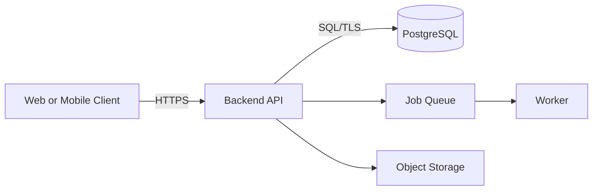
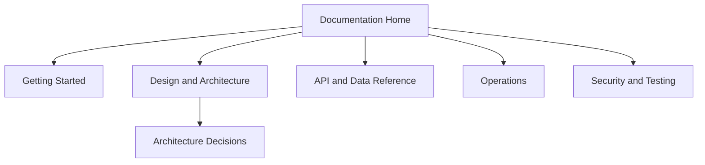
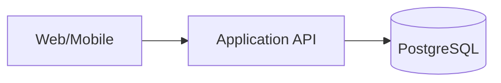

# Software Technical Documentation: Beginner to Expert

## A Practical, Template-Rich Handbook for Small, Full-Stack, Mobile, Cloud-Native and Enterprise Applications

**Author:** Engr. Amarachi Crystal Omereife  
**Organisation:** Opsfuxion Technologies Limited  
**Edition:** 1.0 · October 2026  
**Audience:** Beginners, developers, technical writers, QA engineers, architects, DevOps engineers, engineering managers and maintainers

> **Promise:** By the end, you should be able to identify the documents a project needs, write clear and testable technical documentation, maintain it alongside code, and assemble a professional documentation portfolio. The templates below are examples of disciplined engineering practice—not official templates of Google, Amazon, or any other company.

**How to use:** Start with Parts I–III; copy only the templates your project needs from Part IV; complete the exercises; review your documents with the quality gates in Part VI. Replace every `[PLACEHOLDER]` with verified facts. Never publish secrets, credentials, customer data or unapproved internal diagrams.

---

# Part I — Documentation Fundamentals

## 1. What technical documentation is

Technical documentation is structured information that helps people **understand, use, build, operate, secure, test, troubleshoot, extend and retire** software. It is not simply a README or a collection of screenshots. Good documentation answers a specific reader's question with a clear, verified next action.

### Common audiences and their questions

| Reader | Question | Typical document |
|---|---|---|
| New user | How do I start? | Quickstart, user guide |
| Developer | How do I run and change this? | README, developer setup, architecture |
| Integrator | How do I call the API? | API reference, examples, errors |
| Tester | How do I know it works? | Test strategy, acceptance criteria |
| Operator | How do I deploy and recover it? | Runbook, deployment, backup/restore |
| Security reviewer | What can go wrong? | Threat model, access matrix |
| Engineering lead | Why was this approach chosen? | ADR, design proposal |
| Auditor | What changed and who approved it? | Change record, evidence index |

### A simple quality formula

**Useful documentation = accurate + discoverable + audience-appropriate + actionable + maintained.**

Bad: “Install dependencies and configure the database.”  
Better: “Run `python -m pip install -r requirements.txt`; copy `.env.example` to `.env`; set `DATABASE_URL` to a development database; run `python manage.py migrate`. Never commit `.env`.”

**Practice:** Rewrite “Set up the app and test it” as a numbered procedure with prerequisites, commands, expected results and recovery steps.

## 2. The documentation lifecycle

1. **Discover:** Identify audience, software boundaries and decisions.
2. **Plan:** Create a documentation inventory and owners.
3. **Draft:** Write task-first procedures and reference pages.
4. **Verify:** Run every command; test links and sample requests.
5. **Review:** Technical, security, accessibility and editorial review.
6. **Publish:** Version, index and announce.
7. **Maintain:** Update in the same pull request as behavior changes.
8. **Retire:** Archive superseded versions and add migration guidance.

**Definition of done for a doc:** owner named; purpose clear; tested steps; version/context stated; sensitive details removed; links checked; reviewer approved; update trigger identified.

## 3. Types of documentation

- **Tutorial:** Learning-oriented, guided journey with explanation.
- **How-to:** Task-oriented procedure for a reader with a goal.
- **Reference:** Precise facts, options, endpoints and parameters.
- **Explanation:** Concepts, architecture, trade-offs and reasoning.

Avoid mixing all four into one long page. Link between them. For example, a quickstart should link to configuration reference rather than repeat every environment variable.

## 4. Writing for beginners without losing precision

Define acronyms at first use; give context before commands; use consistent names; explain why a step matters; show expected output; distinguish required from optional; state assumptions. Prefer active voice: “Run the migration” rather than “The migration should be run.” Avoid “obviously,” “simply” and unexplained jargon.

### Procedure pattern

**Goal → Prerequisites → Steps → Expected result → Troubleshooting → Next step.**

### Reference pattern

**Purpose → Syntax/schema → Parameters → Defaults → Examples → Errors → Limits → Version notes.**

## 5. Markdown and docs-as-code

Learn headings, links, fenced code blocks, tables, relative links, Mermaid diagrams, admonition alternatives, and anchors. Keep docs in Git; review through pull requests; lint and build in CI. A practical repository structure:

```text
project/
├── README.md
├── CHANGELOG.md
├── CONTRIBUTING.md
├── SECURITY.md
├── LICENSE
├── .env.example
├── docs/
│   ├── index.md
│   ├── getting-started.md
│   ├── architecture.md
│   ├── api/
│   ├── decisions/
│   ├── operations/
│   ├── security/
│   └── testing/
└── src/
```

**Tools:** VS Code, Git/GitHub, Markdown linting, link checking, MkDocs or Docusaurus, Mermaid, OpenAPI, Sphinx (Python) and JSDoc/TypeDoc (JavaScript/TypeScript). Choose based on language, audience and hosting needs; no tool substitutes for accuracy.

## 6. Documentation planning by project size

| Document | Small CLI | Small web/mobile | Full-stack | Enterprise |
|---|---|---|---|---|
| README + setup | Required | Required | Required | Required |
| User workflows | If applicable | Required | Required | Required |
| Architecture overview | Short | Short | Required | Required |
| API reference | If API | If API | Required | Required |
| Data model | If persistent | Required | Required | Required |
| Test instructions | Required | Required | Required | Required |
| Deployment + rollback | If deployed | Required | Required | Required |
| Security considerations | Required | Required | Required | Required + threat model |
| ADRs | As needed | As needed | Recommended | Required for major decisions |
| SLOs, incident runbooks | Not usually | If production | Recommended | Required for critical services |
| Compliance/evidence | Context dependent | Context dependent | Context dependent | As applicable |

**Rule:** Documentation depth follows *risk, complexity, operational impact and number of collaborators*, not company size alone.

---

# Part II — Engineering Knowledge You Must Document

## 7. Requirements and traceability

Distinguish **business goals**, **stakeholders**, **functional requirements**, **nonfunctional requirements**, **constraints**, **assumptions** and **acceptance criteria**. A requirement must be testable.

Poor: “The system should be fast.”  
Better: “For the `/courses` endpoint, the 95th-percentile response latency is at most 400 ms under the defined 200-request-per-second test workload, excluding third-party network delays.”

A traceability matrix links requirement → design → implementation → test → release evidence. It helps detect omissions and manage change.

## 8. Architecture and design

Document **context**, **containers/services**, **components** and **deployment** at the level the audience needs. Explain boundaries, dependencies, trust zones, data flows and failure modes. Avoid diagrams with no labels or legends.



Include assumptions, alternative designs, trade-offs and reasons. Keep sensitive internal network details in access-controlled docs.

## 9. APIs and integration contracts

Specify HTTP methods, URLs, auth, headers, request/response bodies, status codes, pagination, idempotency, retries, rate limits, versioning, webhooks and error formats. Prefer a machine-readable OpenAPI specification plus human-oriented guides. Never show real API keys.

```http
POST /api/v1/enrolments HTTP/1.1
Authorization: Bearer <ACCESS_TOKEN>
Content-Type: application/json

{"course_id":"course_123"}
```

```json
{"id":"enrol_456","course_id":"course_123","status":"active"}
```

State that sample IDs are illustrative and define behavior for duplicate requests and invalid input.

## 10. Data and database documentation

Document entities, relationships, constraints, indexing rationale, ownership, retention, migrations, backup/restore and data classification. Describe how to handle personally identifiable information and deletion requests. A schema diagram is not a substitute for a data dictionary.

```mermaid
erDiagram
  USER ||--o{ ENROLMENT : creates
  COURSE ||--o{ ENROLMENT : receives
  USER { uuid id PK; string email UK }
  COURSE { uuid id PK; string title }
  ENROLMENT { uuid id PK; uuid user_id FK; uuid course_id FK }
```

## 11. Testing and quality documentation

Connect tests to risk and acceptance criteria. Explain environments, fixtures, isolation, mocks, test data, unit/integration/E2E boundaries, coverage interpretation, performance budgets and release blockers. “100% coverage” does not prove correctness.

## 12. Security, privacy and accessibility

Document assets, entry points, roles, trust boundaries, threats, mitigations, secrets management, dependency review, logging redaction, data retention, incident contacts and accessibility requirements. Follow least privilege. Use OWASP guidance and applicable organisational policies; never assert compliance without evidence.

## 13. Deployment, operations and reliability

Include prerequisites, environment differences, migration order, feature flags, rollback, health checks, dashboards, alerts, incident severity, on-call escalation, SLOs, disaster recovery objectives and restore drills. Differentiate **RPO** (acceptable data loss window) from **RTO** (acceptable restoration time).

## 14. Versioning and governance

Assign owners, reviewers, last-verified date, supported versions, source of truth, change triggers, approval path and archival policy. Separate **public**, **internal** and **restricted** documentation. A changelog explains externally relevant changes; an ADR records decisions and their rationale.

---

# Part III — A Worked Documentation Journey

## 15. Running example: CourseHub

CourseHub is a fictional learning platform with a React web client, optional mobile client, Python API and PostgreSQL. Requirements: users register, browse courses, enrol, track progress; administrators publish courses. Assume no real payments in the first release. The documents in Part IV use this scenario; adapt them to your own stack.

### Step 1 — Identify readers

- Learner: onboarding and account tasks.
- Developer: setup, architecture and API behavior.
- QA: acceptance tests and test data.
- Operator: deploy, monitor, backup and recover.
- Security reviewer: permissions, data flows and risks.

### Step 2 — Define scope

In scope: registration, course catalogue, enrolment, progress. Out of scope: payments, offline video downloads and third-party SSO. Capture exclusions so readers do not infer unsupported features.

### Step 3 — Make a documentation map



### Step 4 — Write a golden-path quickstart

Prerequisites: supported Python, Node and PostgreSQL versions; credentials for local development only. Provide copy-paste commands, expected healthy response, a clean-up command and known errors. Pin versions in the actual project rather than copying stale values from a handbook.

### Step 5 — Add a verified change process

A pull request that adds an API field must update OpenAPI, API examples, contract tests and release notes. A migration must update schema docs, deployment runbook and rollback guidance.

### Step 6 — Review for production readiness

Run a documentation-only rehearsal: ask a colleague unfamiliar with the system to deploy to a sandbox and recover from a simulated failure using only the docs. Record every unclear instruction as a defect.

---

# Part IV — Copy-and-Adapt Professional Templates

> Templates below are intentionally explicit. Delete inapplicable sections; do not leave `[TBD]` in published documents without an owner and due date. Never treat sample values as production recommendations.

## Template 01 — Documentation Home / Portal

**When to use:** Audience, ownership, navigation and support entry point.

**Instructions:** Copy the template into a dedicated Markdown file, replace placeholders, remove irrelevant sections, and validate with a second reader.

````markdown
# [PRODUCT] Documentation
**Purpose:** [one-sentence product description]  
**Audience:** [users/developers/operators]  
**Supported versions:** [versions]  
**Owner:** [team/contact] · **Last verified:** [date]

## Start here
- [Quickstart](getting-started.md) — first successful run
- [Architecture](architecture.md) — system boundaries
- [API reference](api/index.md) — integration contracts
- [Operations](operations/index.md) — deploy and recover
- [Security](security/index.md) — safe use and reporting

## Choose your goal
| I want to... | Read... |
|---|---|
| Install locally | [link] |
| Integrate an API | [link] |
| Report a defect | [link] |
| Restore service | [restricted runbook link] |

## Support and feedback
[Support channel], [issue process], [documentation correction workflow].
````

**Review prompts:** Who will use this? Can they complete the task without asking the author? Are commands, owners and versions verified? What would make this unsafe or stale?

## Template 02 — Repository README

**When to use:** A concise entry point for any software repository.

**Instructions:** Copy the template into a dedicated Markdown file, replace placeholders, remove irrelevant sections, and validate with a second reader.

````markdown
# [PROJECT]
[One-paragraph purpose and target users.]

## Status
[Development/production/archived]; supported platforms [list].

## Features
- [Feature 1]
- [Feature 2]

## Requirements
- [Runtime + tested version]
- [Database + tested version]

## Quickstart
```bash
[verified installation command]
[verified configuration command]
[verified start command]
```
**Expected result:** [URL or terminal output].

## Configuration
Copy `.env.example` to `.env`; see [configuration reference]. Never commit secrets.

## Tests
```bash
[verified test command]
```

## Architecture
[one paragraph + link to detailed design]

## Contributing / Security / License
[links to CONTRIBUTING.md, SECURITY.md, LICENSE]

## Maintainers
[team] · Last verified [date].
````

**Review prompts:** Who will use this? Can they complete the task without asking the author? Are commands, owners and versions verified? What would make this unsafe or stale?

## Template 03 — Installation & Quickstart

**When to use:** A repeatable first-success procedure.

**Instructions:** Copy the template into a dedicated Markdown file, replace placeholders, remove irrelevant sections, and validate with a second reader.

````markdown
# Quickstart: [TASK]
**Goal:** [observable success]. **Estimated time:** [measured duration].
**Applies to:** [version/OS].

## Prerequisites
- [required tool + tested version]
- [access required]

## Steps
1. [Command and why it matters]
   ```bash
   [command]
   ```
   Expected: `[specific safe output]`.
2. [Next step]
3. [Verify with a command or browser URL]

## Common failures
| Symptom | Cause | Safe fix |
|---|---|---|
| [message] | [diagnosis] | [fix] |

## Cleanup
[commands to stop services and remove test resources]

## Next steps
[link to tutorial and reference].
````

**Review prompts:** Who will use this? Can they complete the task without asking the author? Are commands, owners and versions verified? What would make this unsafe or stale?

## Template 04 — Developer Environment & Configuration

**When to use:** How to set up local, test and staging environments.

**Instructions:** Copy the template into a dedicated Markdown file, replace placeholders, remove irrelevant sections, and validate with a second reader.

````markdown
# Development Environment
**Owner:** [team] · **Last tested:** [date]

## Supported platforms
[OS/architecture/runtime compatibility table]

## Dependencies
[database, cache, package manager, local service mocks]

## Environment variables
| Variable | Purpose | Example (not secret) | Required | Default |
|---|---|---|---|---|
| `DATABASE_URL` | Database connection | `postgresql://user@localhost:5432/app_dev` | Yes | None |
| `LOG_LEVEL` | Logging verbosity | `INFO` | No | `INFO` |

## Bootstrap
[verified commands]

## Verify
[smoke test, unit tests, database migration check]

## Troubleshoot
[ports, permissions, missing dependencies, reset local state]

## Security notes
Use separate non-production credentials; do not copy production data to laptops.
````

**Review prompts:** Who will use this? Can they complete the task without asking the author? Are commands, owners and versions verified? What would make this unsafe or stale?

## Template 05 — Product Requirements Document (PRD)

**When to use:** Business need, scope, success metrics and constraints.

**Instructions:** Copy the template into a dedicated Markdown file, replace placeholders, remove irrelevant sections, and validate with a second reader.

````markdown
# PRD: [FEATURE/PRODUCT]
**Status:** Draft / Reviewed / Approved  
**Owner:** [name/team] · **Reviewers:** [roles] · **Date:** [date]

## Problem
[Who experiences what problem, with evidence?]

## Goals and non-goals
**Goals:** [measurable outcomes]  
**Non-goals:** [explicit exclusions]

## Personas and journeys
[persona], [starting state], [desired outcome], [obstacles]

## Requirements
| ID | Requirement | Priority | Acceptance criterion | Owner |
|---|---|---|---|---|
| FR-01 | [testable behavior] | Must | [Given/When/Then] | [team] |

## Nonfunctional requirements
[latency, availability, accessibility, privacy, retention, capacity]

## Dependencies and risks
[dependency], [risk], [mitigation], [decision needed]

## Success metrics
[metric], [baseline], [target], [measurement source]

## Open questions and approvals
[question/owner/due date]; [sign-off record].
````

**Review prompts:** Who will use this? Can they complete the task without asking the author? Are commands, owners and versions verified? What would make this unsafe or stale?

## Template 06 — User Stories & Acceptance Criteria

**When to use:** Translate needs into verifiable behavior.

**Instructions:** Copy the template into a dedicated Markdown file, replace placeholders, remove irrelevant sections, and validate with a second reader.

````markdown
# User Story: [ID/TITLE]
**As a** [persona], **I want** [capability], **so that** [outcome].

## Preconditions
[authentication, data, system state]

## Acceptance criteria
```gherkin
Scenario: Successful enrolment
  Given a signed-in learner and an available course
  When the learner submits an enrolment request
  Then the enrolment is stored once
  And the learner sees confirmation
```

## Edge cases
[duplicate request, expired session, course full, network timeout]

## Accessibility / Security
[keyboard and screen reader behavior, authorization requirement]

## Test mapping
[unit/integration/E2E test IDs]

## Out of scope
[explicit exclusions].
````

**Review prompts:** Who will use this? Can they complete the task without asking the author? Are commands, owners and versions verified? What would make this unsafe or stale?

## Template 07 — Architecture Overview

**When to use:** Explain the system to a new engineer.

**Instructions:** Copy the template into a dedicated Markdown file, replace placeholders, remove irrelevant sections, and validate with a second reader.

````markdown
# Architecture Overview: [SYSTEM]
**Scope:** [boundary] · **Version:** [revision] · **Owner:** [team]

## Context and users
[actors, external systems, purpose]

## Diagram


## Components
| Component | Responsibility | Technology | Owner |
|---|---|---|---|
| [API] | [business logic] | [stack] | [team] |

## Data flow
[request path, asynchronous jobs, sensitive data]

## Trust boundaries and failures
[auth boundary, failure behavior, retries]

## Scaling and operational assumptions
[traffic, capacity, SLO, constraints]

## Decisions and alternatives
[links to ADRs]; [known technical debt].
````

**Review prompts:** Who will use this? Can they complete the task without asking the author? Are commands, owners and versions verified? What would make this unsafe or stale?

## Template 08 — Technical Design / RFC

**When to use:** A reviewable proposal before implementation.

**Instructions:** Copy the template into a dedicated Markdown file, replace placeholders, remove irrelevant sections, and validate with a second reader.

````markdown
# RFC: [CHANGE]
**Status:** Proposed / Accepted / Superseded  
**Author:** [name] · **Reviewers:** [teams] · **Date:** [date]

## Summary and motivation
[problem and proposed solution]

## Requirements and constraints
[functional, nonfunctional, security, compatibility]

## Proposed design
[component diagrams, sequence, schema, contracts]

## Alternatives considered
| Option | Advantages | Disadvantages | Decision |
|---|---|---|---|
| A | [...] | [...] | [...] |

## Failure modes and mitigations
[timeouts, partial failures, retries, rollback]

## Rollout and migration
[feature flag, stages, data migration, backout]

## Observability and test plan
[metrics, logs, alerts, tests]

## Risks and unresolved questions
[owner and decision date]

## Review record
[approvals and comments].
````

**Review prompts:** Who will use this? Can they complete the task without asking the author? Are commands, owners and versions verified? What would make this unsafe or stale?

## Template 09 — Architecture Decision Record (ADR)

**When to use:** Preserve important decisions and trade-offs.

**Instructions:** Copy the template into a dedicated Markdown file, replace placeholders, remove irrelevant sections, and validate with a second reader.

````markdown
# ADR-[NUMBER]: [DECISION TITLE]
**Status:** Proposed / Accepted / Deprecated / Superseded  
**Date:** [date] · **Decision makers:** [roles]

## Context
[forces, constraints and problem]

## Decision
[what is being chosen]

## Alternatives
[options with evidence]

## Consequences
**Positive:** [...]  
**Negative:** [...]  
**Operational:** [...]  
**Security:** [...]

## Validation and revisit trigger
[how to check outcome and when to reconsider]

## References
[design docs, benchmarks, issue links].
````

**Review prompts:** Who will use this? Can they complete the task without asking the author? Are commands, owners and versions verified? What would make this unsafe or stale?

## Template 10 — API Endpoint Reference

**When to use:** Precise REST endpoint contract.

**Instructions:** Copy the template into a dedicated Markdown file, replace placeholders, remove irrelevant sections, and validate with a second reader.

````markdown
# [METHOD] [PATH]
**Purpose:** [one sentence] · **Version:** [v1]  
**Authentication:** [scheme and scopes] · **Idempotency:** [rules]

## Request
**Headers:** [name/type/required]  
**Path parameters:** [table]  
**Query parameters:** [table]

```json
{"course_id":"course_123"}
```

| Field | Type | Required | Validation |
|---|---|---|---|
| course_id | string | Yes | Existing accessible course |

## Response
**Success:** `201 Created`
```json
{"id":"enrol_456","status":"active"}
```

## Errors
| Status | Code | Meaning | Client action |
|---|---|---|---|
| 400 | INVALID_INPUT | Malformed data | Correct input |
| 401 | UNAUTHENTICATED | No valid session | Sign in |
| 409 | ALREADY_ENROLLED | Duplicate | Show existing enrolment |

## Pagination / Limits / Retry
[if applicable]

## Example request
```bash
curl -X POST 'https://api.example.invalid/v1/enrolments' \
  -H 'Authorization: Bearer <TOKEN>' \
  -H 'Content-Type: application/json' \
  -d '{"course_id":"course_123"}'
```

## Compatibility and changelog
[breaking changes, deprecation timeline].
````

**Review prompts:** Who will use this? Can they complete the task without asking the author? Are commands, owners and versions verified? What would make this unsafe or stale?

## Template 11 — Data Model & Data Dictionary

**When to use:** Make database semantics unambiguous.

**Instructions:** Copy the template into a dedicated Markdown file, replace placeholders, remove irrelevant sections, and validate with a second reader.

````markdown
# Data Model: [SERVICE]
**Owner:** [team] · **Database:** [PostgreSQL version] · **Updated:** [date]

## ER diagram
[Mermaid ER diagram or controlled link]

## Tables
### `enrolments`
| Column | Type | Null? | Constraint | Meaning |
|---|---|---|---|---|
| id | uuid | No | Primary key | Enrolment identifier |
| user_id | uuid | No | Foreign key | Enrolled user |
| course_id | uuid | No | Foreign key | Course |

## Invariants
[uniqueness, referential integrity, permitted states]

## Indexes
[index], [query supported], [write trade-off]

## Data classification / retention
[classification], [retention], [deletion workflow]

## Migrations and compatibility
[migration ID], [backfill], [rollback limitations]

## Backup and ownership
[policy reference, stewardship].
````

**Review prompts:** Who will use this? Can they complete the task without asking the author? Are commands, owners and versions verified? What would make this unsafe or stale?

## Template 12 — Mobile App Technical Specification

**When to use:** Platform-specific behavior and offline concerns.

**Instructions:** Copy the template into a dedicated Markdown file, replace placeholders, remove irrelevant sections, and validate with a second reader.

````markdown
# Mobile Application Technical Specification
**Platforms:** [iOS/Android] · **Minimum OS:** [versions]

## User journeys and navigation
[screens, deep links, state transitions]

## Architecture
[UI, state, storage, networking, backend]

## Permissions
| Permission | Why needed | When requested | Fallback |
|---|---|---|---|
| [camera] | [feature] | [just in time] | [manual alternative] |

## Offline behavior
[cache policy, write queue, conflicts, sync retry]

## Security and privacy
[secure storage, token lifecycle, redaction, telemetry]

## Performance and accessibility
[startup budget, low bandwidth, screen reader, touch targets]

## Release and compatibility
[app store rollout, minimum API version, rollback limits]

## Testing
[device matrix, OS versions, network conditions].
````

**Review prompts:** Who will use this? Can they complete the task without asking the author? Are commands, owners and versions verified? What would make this unsafe or stale?

## Template 13 — Authentication & Authorization Matrix

**When to use:** Define who can do what.

**Instructions:** Copy the template into a dedicated Markdown file, replace placeholders, remove irrelevant sections, and validate with a second reader.

````markdown
# Access Control Specification
**Authentication:** [method] · **Session lifetime:** [policy]

## Roles and permissions
| Resource/action | Anonymous | Learner | Instructor | Admin |
|---|---|---|---|---|
| View published courses | Yes | Yes | Yes | Yes |
| Enrol self | No | Yes | [policy] | [policy] |
| Publish course | No | No | Own only | Yes |

## Enforcement points
[API middleware, object-level checks, database constraints]

## Security cases
[IDOR, privilege escalation, expired token, revoked role]

## Audit events
[login failure, role change, privileged action; no secrets in logs]

## Verification
[test IDs for each denied/allowed path].
````

**Review prompts:** Who will use this? Can they complete the task without asking the author? Are commands, owners and versions verified? What would make this unsafe or stale?

## Template 14 — Threat Model & Security Review

**When to use:** Identify risks before deployment.

**Instructions:** Copy the template into a dedicated Markdown file, replace placeholders, remove irrelevant sections, and validate with a second reader.

````markdown
# Threat Model: [SYSTEM/FEATURE]
**Assets:** [credentials, PII, payment metadata]  
**Scope:** [components and data flows]

## Trust boundaries
[diagram showing client, API, database, third parties]

## Threat register
| ID | Threat | Impact | Likelihood | Mitigation | Owner | Residual risk |
|---|---|---|---|---|---|---|
| T-01 | Unauthorized record access | High | [assess] | Object-level authorization tests | [team] | [assess] |

## Security controls
[auth, validation, encryption, secret rotation, audit logging]

## Verification evidence
[tests, review links, scan results, manual checks]

## Open issues and approvals
[risk acceptance process; expiry date].
````

**Review prompts:** Who will use this? Can they complete the task without asking the author? Are commands, owners and versions verified? What would make this unsafe or stale?

## Template 15 — Test Strategy & Test Plan

**When to use:** Explain what quality means and how it is checked.

**Instructions:** Copy the template into a dedicated Markdown file, replace placeholders, remove irrelevant sections, and validate with a second reader.

````markdown
# Test Strategy: [RELEASE]
**Owner:** [QA/engineering] · **Version:** [commit/tag]

## Scope and risks
[critical workflows and failure impact]

## Test layers
| Layer | Goal | Tool | Execution |
|---|---|---|---|
| Unit | Business rules | pytest/Vitest | Each PR |
| Integration | DB/API contract | [tool] | CI |
| E2E | User journey | Playwright | [schedule] |

## Environments and data
[isolated test DB, fixtures, synthetic records]

## Entry / exit criteria
[build health, pass rate, blocking defects, security gates]

## Traceability
| Requirement | Tests | Result | Evidence |
|---|---|---|---|
| FR-01 | test_enrolment | [status] | [CI link] |

## Defect handling
[severity definitions, triage, owner]

## Residual risks and sign-off
[known gaps and approval].
````

**Review prompts:** Who will use this? Can they complete the task without asking the author? Are commands, owners and versions verified? What would make this unsafe or stale?

## Template 16 — Deployment & Rollback Runbook

**When to use:** A safe, repeatable release procedure.

**Instructions:** Copy the template into a dedicated Markdown file, replace placeholders, remove irrelevant sections, and validate with a second reader.

````markdown
# Deploy [SERVICE] to [ENVIRONMENT]
**Owner:** [team] · **Approvals:** [roles] · **Last tested:** [date]

## Preconditions
[maintenance window, change ticket, access, healthy baseline]

## Preflight
- [ ] Backups verified and restore point identified
- [ ] Migration compatibility reviewed
- [ ] Dashboard and alerting available
- [ ] Rollback criteria and decision maker agreed

## Deployment steps
1. [Version/build artifact and signature check]
2. [Schema migration procedure]
3. [Rollout command or CI job]
4. [Smoke tests and health checks]
5. [Observe metrics for defined period]

## Success criteria
[availability, error rate, latency, business checks]

## Rollback trigger
[objective thresholds, who decides]

## Rollback procedure
[verified safe rollback steps; note irreversible migrations]

## Post-deployment
[announce, log evidence, update release record].
````

**Review prompts:** Who will use this? Can they complete the task without asking the author? Are commands, owners and versions verified? What would make this unsafe or stale?

## Template 17 — Operations Runbook & Troubleshooting

**When to use:** Help on-call engineers respond safely.

**Instructions:** Copy the template into a dedicated Markdown file, replace placeholders, remove irrelevant sections, and validate with a second reader.

````markdown
# Runbook: [ALERT / SYMPTOM]
**Service:** [name] · **Severity:** [classification]  
**Owner/on-call:** [contact route] · **Last drill:** [date]

## Symptoms
[alert names, dashboards, customer impact]

## Immediate safety checks
[confirm scope, avoid destructive actions, preserve evidence]

## Diagnosis
1. [Check dashboard]
2. [Check logs with safe filters]
3. [Check dependencies and recent deploys]

## Mitigation
[reversible, approved actions and expected effects]

## Escalation
[conditions and escalation path]

## Recovery verification
[health, data integrity, customer confirmation]

## Follow-up
[incident ticket, timeline, postmortem, doc update].
````

**Review prompts:** Who will use this? Can they complete the task without asking the author? Are commands, owners and versions verified? What would make this unsafe or stale?

## Template 18 — Incident Report / Postmortem

**When to use:** Learn from incidents without blame.

**Instructions:** Copy the template into a dedicated Markdown file, replace placeholders, remove irrelevant sections, and validate with a second reader.

````markdown
# Incident Review: [INCIDENT ID]
**Date:** [date] · **Severity:** [level] · **Status:** [closed/open]

## Executive summary
[what happened, impact, duration]

## Customer impact
[who, what, measured magnitude, uncertainty]

## Timeline (UTC)
| Time | Event | Evidence |
|---|---|---|
| [timestamp] | [observation/action] | [link] |

## Detection and response
[alert, escalation, mitigation, recovery]

## Contributing factors
[technical and process conditions; avoid personal blame]

## What worked / what did not
[observations]

## Action items
| Action | Owner | Due | Verification |
|---|---|---|---|
| [preventive action] | [team] | [date] | [test] |

## Lessons and communication
[stakeholder summary, documentation updates].
````

**Review prompts:** Who will use this? Can they complete the task without asking the author? Are commands, owners and versions verified? What would make this unsafe or stale?

## Template 19 — Backup, Restore & Disaster Recovery

**When to use:** Make recoverability testable.

**Instructions:** Copy the template into a dedicated Markdown file, replace placeholders, remove irrelevant sections, and validate with a second reader.

````markdown
# Backup and Recovery Plan
**Systems:** [DB/files/queues] · **Owner:** [team]

## Business requirements
**RPO:** [approved target] · **RTO:** [approved target]

## Backup inventory
| Asset | Method | Frequency | Retention | Location | Encryption |
|---|---|---|---|---|---|
| [PostgreSQL] | [physical/logical] | [policy] | [policy] | [approved] | [control] |

## Restore prerequisites
[access, keys, clean environment, version compatibility]

## Recovery steps
[numbered, tested commands maintained in restricted runbook]

## Verification
[checksums, row counts, app smoke tests, access controls]

## Drill schedule and evidence
[date, owner, duration, result, corrective actions].
````

**Review prompts:** Who will use this? Can they complete the task without asking the author? Are commands, owners and versions verified? What would make this unsafe or stale?

## Template 20 — Release Notes & Changelog

**When to use:** Communicate changes to the right audience.

**Instructions:** Copy the template into a dedicated Markdown file, replace placeholders, remove irrelevant sections, and validate with a second reader.

````markdown
# Release [VERSION] — [DATE]

## Highlights
[user-facing summary]

## Added / Changed / Fixed
- Added: [feature]
- Changed: [behavior + compatibility]
- Fixed: [bug and affected versions]

## Breaking changes
[what changes, affected clients, required action]

## Migration steps
[prerequisites, safe procedure, rollback constraints]

## Security notes
[disclosure-safe summary and advisory link]

## Known issues
[issue, workaround, planned fix]

## Verification and support
[test evidence, contact, documentation links].
````

**Review prompts:** Who will use this? Can they complete the task without asking the author? Are commands, owners and versions verified? What would make this unsafe or stale?

## Template 21 — Contribution Guide & Code Review

**When to use:** Onboard collaborators consistently.

**Instructions:** Copy the template into a dedicated Markdown file, replace placeholders, remove irrelevant sections, and validate with a second reader.

````markdown
# Contributing to [PROJECT]

## Code of conduct and support
[links]

## Local setup
[link to verified quickstart]

## Workflow
1. Create an issue or link an approved ticket.
2. Create a feature branch.
3. Implement changes with tests and documentation.
4. Run formatting, linting, tests and security checks.
5. Open a pull request using the PR template.

## Pull request checklist
- [ ] Behavior and scope described
- [ ] Tests added/updated
- [ ] Docs updated
- [ ] Migration/rollback considered
- [ ] No secrets or personal data included
- [ ] Accessibility/security reviewed as applicable

## Review and merge policy
[reviewers, branch protection, approvals, CI gates].
````

**Review prompts:** Who will use this? Can they complete the task without asking the author? Are commands, owners and versions verified? What would make this unsafe or stale?

## Template 22 — Pull Request Template

**When to use:** Capture engineering evidence at change time.

**Instructions:** Copy the template into a dedicated Markdown file, replace placeholders, remove irrelevant sections, and validate with a second reader.

````markdown
## Summary
[What changed and why?]

## Related issue / requirement
[links]

## Implementation
[important decisions and trade-offs]

## Verification
- [ ] Unit tests
- [ ] Integration tests
- [ ] Manual smoke test
- [ ] Documentation links checked

**Commands run:** `[commands]`  
**Results:** [summary / CI link]

## Security / privacy / accessibility
[impact and checks]

## Database / deployment / rollback
[impact or Not applicable with reason]

## Screenshots / API examples
[redacted evidence where useful]

## Reviewer notes
[focus areas].
````

**Review prompts:** Who will use this? Can they complete the task without asking the author? Are commands, owners and versions verified? What would make this unsafe or stale?

## Template 23 — Service-Level Objectives & Monitoring

**When to use:** Connect reliability promises to evidence.

**Instructions:** Copy the template into a dedicated Markdown file, replace placeholders, remove irrelevant sections, and validate with a second reader.

````markdown
# Reliability Specification: [SERVICE]
**Owner:** [team] · **Review period:** [window]

## User journey
[critical request or operation]

## Service-level indicator (SLI)
[precise numerator, denominator, exclusions, source]

## Service-level objective (SLO)
[approved target and measurement window]

## Error budget and response
[budget policy, release constraints, escalation]

## Monitoring
| Signal | Source | Threshold | Response |
|---|---|---|---|
| [5xx rate] | [dashboard] | [threshold] | [runbook] |

## Known limitations
[measurement gaps and dependencies]

## Review history
[dates and decisions].
````

**Review prompts:** Who will use this? Can they complete the task without asking the author? Are commands, owners and versions verified? What would make this unsafe or stale?

## Template 24 — Data Migration Plan

**When to use:** Avoid losing data during schema changes.

**Instructions:** Copy the template into a dedicated Markdown file, replace placeholders, remove irrelevant sections, and validate with a second reader.

````markdown
# Migration Plan: [ID/TITLE]
**Owner:** [team] · **Target release:** [version]

## Current and target state
[schema/data differences]

## Compatibility plan
[expand → migrate/backfill → contract sequence]

## Preflight
[backup verification, row counts, capacity, lock impact]

## Execution
[batching, throttling, retry, idempotency]

## Validation
[record counts, constraints, sampling, checksums]

## Rollback and irreversible steps
[restore strategy, cutover checkpoint, decision owner]

## Monitoring and communication
[metrics, alerts, stakeholder updates]

## Sign-off
[DBA, application, security as applicable].
````

**Review prompts:** Who will use this? Can they complete the task without asking the author? Are commands, owners and versions verified? What would make this unsafe or stale?

## Template 25 — Handover & Maintenance Guide

**When to use:** Make ownership transfer safe.

**Instructions:** Copy the template into a dedicated Markdown file, replace placeholders, remove irrelevant sections, and validate with a second reader.

````markdown
# Engineering Handover: [SYSTEM]
**From:** [team] · **To:** [team] · **Date:** [date]

## Purpose and critical workflows
[what the system does]

## Architecture and repositories
[links and ownership]

## Environments and deployment
[links to runbooks and pipelines]

## Access and secrets
[how access is requested; never paste credentials]

## Operations
[SLOs, dashboards, alerts, on-call, backups]

## Open issues and risks
[severity, owner, mitigation]

## Maintenance calendar
[dependency updates, restore drills, key rotation]

## Handover acceptance
[walkthrough completed, recipient acknowledged].
````

**Review prompts:** Who will use this? Can they complete the task without asking the author? Are commands, owners and versions verified? What would make this unsafe or stale?

## Template 26 — User Guide & FAQ

**When to use:** Support nontechnical application users.

**Instructions:** Copy the template into a dedicated Markdown file, replace placeholders, remove irrelevant sections, and validate with a second reader.

````markdown
# Using [FEATURE]
**Who this is for:** [persona]  
**What you will accomplish:** [goal]

## Before you begin
[account/access/device requirements]

## Steps
1. [clear action in UI]
2. [next action]
3. [confirmation to expect]

## If something goes wrong
| Problem | What to try | When to contact support |
|---|---|---|
| [symptom] | [safe fix] | [escalation] |

## Accessibility and mobile notes
[keyboard, screen reader, responsive behavior]

## Frequently asked questions
**Q:** [question]  
**A:** [concise answer]

## Related topics
[links].
````

**Review prompts:** Who will use this? Can they complete the task without asking the author? Are commands, owners and versions verified? What would make this unsafe or stale?

## Template 27 — Documentation Audit & Inventory

**When to use:** Know what exists and what is stale.

**Instructions:** Copy the template into a dedicated Markdown file, replace placeholders, remove irrelevant sections, and validate with a second reader.

````markdown
# Documentation Inventory
**Project:** [name] · **Audit date:** [date]

| Doc | Audience | Owner | Source of truth | Last verified | Status | Next action |
|---|---|---|---|---|---|---|
| README | Developers | [team] | [link] | [date] | Current | [action] |

## Coverage gaps
[missing docs by user journey and operational risk]

## Staleness triggers
[API change, dependency upgrade, deployment change, ownership change]

## Priority
[high risk first: security, deployment, recovery, API]

## Audit actions
[issue, owner, deadline, evidence].
````

**Review prompts:** Who will use this? Can they complete the task without asking the author? Are commands, owners and versions verified? What would make this unsafe or stale?

## Template 28 — Documentation Style Guide

**When to use:** Ensure consistency across teams.

**Instructions:** Copy the template into a dedicated Markdown file, replace placeholders, remove irrelevant sections, and validate with a second reader.

````markdown
# Documentation Style Guide

## Voice
Use direct, inclusive, task-oriented language. Define acronyms on first use.

## Structure
One task per how-to; meaningful headings; descriptive link text; numbered steps for ordered tasks.

## Commands
Show shell context, prerequisites, expected output and cleanup. Never include live secrets.

## Code samples
Use runnable, minimal, versioned examples with safe placeholders.

## Terminology
| Preferred | Avoid | Reason |
|---|---|---|
| [term] | [ambiguous term] | [clarity] |

## Accessibility
Use alt text for meaningful images, sufficient contrast, clear tables and text descriptions for diagrams.

## Review
[editorial checklist and owners].
````

**Review prompts:** Who will use this? Can they complete the task without asking the author? Are commands, owners and versions verified? What would make this unsafe or stale?

## Template 29 — Technical Writing Portfolio Case Study

**When to use:** Demonstrate documentation impact professionally.

**Instructions:** Copy the template into a dedicated Markdown file, replace placeholders, remove irrelevant sections, and validate with a second reader.

````markdown
# Case Study: [DOCUMENTATION PROJECT]

## Context
[product, audience, scale; redact confidential details]

## Problem
[what was difficult before]

## My role
[exact contributions]

## Process
[research, information architecture, drafting, verification, reviews]

## Deliverables
[links to permitted samples, templates and diagrams]

## Outcome
[measured onboarding time, support tickets, task completion, or qualitative feedback]

## Lessons
[what changed and what you would improve]

## Confidentiality
[what was anonymised or omitted].
````

**Review prompts:** Who will use this? Can they complete the task without asking the author? Are commands, owners and versions verified? What would make this unsafe or stale?

## Template 30 — Capstone Documentation Package

**When to use:** A complete deliverable for a production-minded application.

**Instructions:** Copy the template into a dedicated Markdown file, replace placeholders, remove irrelevant sections, and validate with a second reader.

````markdown
# Documentation Package: [APPLICATION]

## Required contents
- [ ] README and documentation portal
- [ ] Product scope and requirements
- [ ] User guide and quickstart
- [ ] Architecture overview and one ADR
- [ ] API reference (if applicable)
- [ ] Data model and migration notes
- [ ] Authentication/authorization description
- [ ] Test strategy and evidence
- [ ] Deployment and rollback guide
- [ ] Operations and incident runbook
- [ ] Security review and privacy considerations
- [ ] Release notes and handover

## Review evidence
[working links, verified commands, peer review, demo recording]

## Acceptance
[reviewers, sign-off date, known limitations].
````

**Review prompts:** Who will use this? Can they complete the task without asking the author? Are commands, owners and versions verified? What would make this unsafe or stale?

---

# Part V — Progressive Worked Examples

## Example 1 (Absolute beginner): Document a Python calculator

**Task:** Write a README for a CLI calculator supporting addition and subtraction. Start with the user goal, a Python version prerequisite, exact run command, sample interaction and test command. Avoid claiming multiplication exists unless implemented.

**Mini-solution:**

````markdown
# Calculator CLI
A beginner Python program that adds and subtracts two numbers.

## Requirements
Python 3.11+ (verify against the project environment).

## Run
```bash
python calculator.py
```

## Example
Input: `4`, `2`, `+`  
Output: `6`

## Tests
```bash
python -m unittest discover -s tests
```

## Limitations
No persistent history; accepts numeric input only.
````

**Check:** Can a new student follow this without the author present?

## Example 2 (Beginner): Write a contact form user guide

**Task:** Describe how to fill Name, Email and Message, submit, and interpret success or validation errors. **Solution:** Document exact field labels, required fields, what happens after Submit, privacy notice location, and what to do if the request fails. Do not claim email delivery if the backend only stores a record.

## Example 3 (Beginner): Document an environment variable

**Task:** Explain `DATABASE_URL`. **Solution:** Describe format, required/optional status, sample development-only value, which process reads it, error when missing and secret-handling rules. Never use real credentials in examples.

## Example 4 (Intermediate): Document a REST endpoint

**Task:** Describe enrolment creation. **Solution:** Use Template 10 with auth scope, input schema, `201`, `400`, `401`, `403`, `409`, retry and duplicate handling, safe example and contract-test link.

## Example 5 (Intermediate): Create a system architecture page

**Task:** Explain React → API → PostgreSQL. **Solution:** Include actors, boundaries, responsibilities, data flow, auth, sensitive data, deployment assumptions and failure behavior; link to an ADR for choosing PostgreSQL.

## Example 6 (Intermediate): Design a migration note

**Task:** Add `enrolments.created_at`. **Solution:** Define existing rows' backfill, default behavior, index impact, old-code compatibility, validation query and rollback limitations. Never imply an irreversible data migration can be rolled back trivially.

## Example 7 (Advanced): Write a production deployment runbook

**Task:** Roll out a backend with database migrations. **Solution:** Include approved artifact, backup check, compatibility check, migration order, canary or staged rollout, health verification, monitoring period, rollback triggers and escalation.

## Example 8 (Advanced): Write a security design review

**Task:** Prevent users from reading another learner's enrolment. **Solution:** Model asset, trust boundary, threat (insecure direct object reference), server-side object authorization, negative tests, audit logs and residual risk.

## Example 9 (Advanced): Produce an incident postmortem

**Task:** Explain a 30-minute API outage. **Solution:** Timeline with evidence, impact, detection, contributing factors, mitigation, restoration, preventive actions with owners and deadlines. Avoid blame and unsupported root-cause claims.

## Example 10 (Expert practice): Document a multi-service enterprise release

**Task:** A web client, mobile client, API, worker and database change must deploy safely. **Solution outline:** Create cross-service compatibility matrix; RFC/ADR; OpenAPI and event contracts; migration plan; feature-flag stages; security review; SLO-based verification; per-service runbooks; rollback boundaries; release notes; ownership and approval evidence.

---

# Part VI — Exercises, Solutions and Evaluation

## 16 Independent Challenges

| # | Challenge | Expected artifact | Difficulty |
|---|---|---|---|
| 1 | Explain a terminal command to a beginner | How-to | Beginner |
| 2 | Document a simple HTML contact form | User guide | Beginner |
| 3 | Write a Python app README | README | Beginner |
| 4 | Build a documentation table of contents | Portal | Beginner |
| 5 | Create `.env.example` reference | Config guide | Beginner |
| 6 | Define acceptance criteria for login | User story | Intermediate |
| 7 | Describe a PostgreSQL schema | Data dictionary | Intermediate |
| 8 | Document a CRUD API | API reference | Intermediate |
| 9 | Compare two architecture choices | ADR | Intermediate |
| 10 | Build a React–API–DB diagram | Architecture page | Intermediate |
| 11 | Write a test strategy | QA plan | Advanced |
| 12 | Write a safe migration plan | Migration doc | Advanced |
| 13 | Design an access control matrix | Security doc | Advanced |
| 14 | Document a rollback | Runbook | Advanced |
| 15 | Write a blameless incident review | Postmortem | Advanced |
| 16 | Assemble an enterprise-ready docs portal | Capstone | Expert practice |

### Model answer guidance

1. **Command how-to:** goal, shell context, prerequisites, command, expected output, error path.
2. **Contact form:** field definitions, validation, submit behavior, privacy, failure and retry.
3. **README:** purpose, prerequisites, install/run/test, configuration, limitations and links.
4. **Portal:** audience-based navigation, owners, versions and support route.
5. **Config:** variable purpose, safe example, required/default, secret policy and error behavior.
6. **Login:** Given/When/Then for success, invalid credentials, locked account and expired session.
7. **Schema:** keys, nullability, relationships, constraints, retention and migration history.
8. **API:** method/path, auth, request/response, errors, rate limits, examples and versioning.
9. **ADR:** context, options, decision, consequences and revisit trigger.
10. **Diagram:** labeled actors, trust boundaries, data flow, components and legend.
11. **Test plan:** risks, layers, data, environment, entry/exit criteria and evidence.
12. **Migration:** preflight, backup, compatibility, backfill, validation and rollback constraints.
13. **Access matrix:** role/resource actions, server enforcement, negative tests and audit events.
14. **Rollback:** trigger, decision owner, tested commands, database limitations and verification.
15. **Incident review:** impact, evidence-based timeline, contributing factors and tracked actions.
16. **Portal:** cohesive package with all relevant templates, working links and peer-reviewed procedures.

## Capstone assignment — Document CourseHub as if another team will inherit it

**Scenario:** A small team built a web and mobile course-enrolment system using React, a Python backend and PostgreSQL. A new team will operate it next month. Write a professional documentation package without access to the original engineers during the handover simulation.

**Deliverables:** README, setup guide, PRD, 5 acceptance-tested user stories, architecture diagram, 2 ADRs, 3 API endpoints, data dictionary, role matrix, test strategy, deployment/rollback runbook, incident runbook, changelog, handover checklist and documentation portal.

### Scoring rubric (100 points)

| Criterion | Points | Excellent work demonstrates |
|---|---:|---|
| Accuracy and technical verification | 20 | Commands/examples run; no invented behavior |
| Audience clarity and navigability | 15 | Readers can find and complete tasks |
| Requirements and design traceability | 15 | Goals map to design and tests |
| API and data precision | 15 | Contracts, constraints and errors explicit |
| Security and operational safety | 15 | No secrets; safe deploy/restore guidance |
| Maintainability and governance | 10 | Owners, versions, update triggers |
| Writing and accessibility | 10 | Clear, consistent, inclusive, readable |

**Passing guidance:** 70+ with no critical security or operational defects; 85+ indicates strong professional readiness; 95+ requires independent reader validation and evidence. These are instructional criteria, not an external industry certification.

## Document review checklist

- [ ] The first paragraph says who the document is for and what it enables.
- [ ] Prerequisites and supported versions are explicit.
- [ ] Commands, examples and diagrams reflect actual software behavior.
- [ ] All internal links and external references work.
- [ ] Tables have meaningful headers; diagrams have text descriptions.
- [ ] The document has an owner, last-verified date and review trigger.
- [ ] No passwords, tokens, customer data or private infrastructure are exposed.
- [ ] Error paths, limitations and recovery steps are described.
- [ ] At least one representative reader completed the procedure.
- [ ] A reviewer approved changes and follow-up issues were captured.

---

# Part VII — Professional Practices at Scale

## 17. Information architecture for large organisations

Organise by **user tasks and system boundaries**, not just team names. Establish a central portal, consistent navigation, search metadata, canonical URLs, ownership and archival rules. Document dependencies across services without copying each service's reference content into multiple places.

## 18. Documentation in CI/CD

A practical pipeline may run Markdown lint, link checking, spell checking, docs site build, OpenAPI validation and example smoke tests. Block merges for broken critical links and invalid API specifications. Be cautious with external-link flakiness and avoid exposing private preview URLs in public CI logs.

```yaml
# Illustrative GitHub Actions job: adjust tooling and versions for your repo.
name: Documentation checks
on: [pull_request]
jobs:
  docs:
    runs-on: ubuntu-latest
    steps:
      - uses: actions/checkout@v4
      - name: Verify docs structure
        run: |
          test -f README.md
          test -d docs
```

## 19. Measuring documentation quality

Useful measures include task completion rate, time to first successful setup, search abandonment, broken-link rate, stale-page percentage, support tickets caused by unclear instructions, and recovery drill success. Avoid rewarding word count alone.

## 20. Writing for enterprise risk and compliance

Differentiate requirements from evidence. Link each applicable policy/control to its owner, implementation, verification evidence and review date. Restrict audit artefacts and security-sensitive details. For regulated systems, seek appropriate legal/compliance review rather than assuming a template establishes compliance.

## 21. Documentation for APIs, SDKs and open source

Provide language-specific snippets, compatibility matrices, changelogs, migration guides, semantic versioning policy, issue templates, support expectations, contribution guidelines and a vulnerability-reporting channel. Code snippets should be tested or generated from source where feasible.

## 22. Common failure patterns

| Anti-pattern | Why it fails | Better approach |
|---|---|---|
| Huge undifferentiated README | Hard to navigate | Short entry point + linked guides |
| Screenshots without text | Inaccessible, quickly stale | Text steps + optional screenshots |
| Untested commands | Frustrates onboarding | CI smoke test and reviewer rehearsal |
| “Contact the author” everywhere | Knowledge silo | Record procedures and owners |
| Fake examples shown as real | Misleads users | Label samples and verify behavior |
| Secret-bearing config examples | Security risk | `.env.example` with placeholders |
| Diagrams without trust boundaries | Hides risk | Explicit data flow and permissions |
| Runbooks without rollback | Unsafe operations | Decision thresholds and tested recovery |

## 23. Career and mastery roadmap

**Foundation:** Markdown, Git, README, task-based writing, basic diagrams.  
**Intermediate:** API reference, data dictionaries, user stories, architecture, docs site tooling.  
**Advanced:** RFCs, ADRs, security, runbooks, automated validation, cross-team reviews.  
**Expert practice:** enterprise information architecture, governance, compliance evidence, measurable quality, incident-ready documentation, mentoring and long-term ownership.

### Recommended authoritative references

- [Google Technical Writing Courses](https://developers.google.com/tech-writing)
- [Google Developer Documentation Style Guide](https://developers.google.com/style)
- [Microsoft Writing Style Guide](https://learn.microsoft.com/style-guide/welcome/)
- [Diátaxis documentation framework](https://diataxis.fr/)
- [The OpenAPI Specification](https://spec.openapis.org/oas/latest.html)
- [OWASP Cheat Sheet Series](https://cheatsheetseries.owasp.org/)
- [Mermaid documentation](https://mermaid.js.org/)
- [Write the Docs](https://www.writethedocs.org/)
- [The Twelve-Factor App](https://12factor.net/)
- [C4 model](https://c4model.com/)

These are learning references, not endorsements or claims that this handbook reproduces any organisation's internal standards.

---

# Glossary

**ADR:** Architecture Decision Record; captures a significant technical decision.  
**API:** Application Programming Interface; a contract between software components.  
**CI/CD:** Continuous Integration / Continuous Delivery or Deployment.  
**Contract test:** Verifies agreement between service interfaces.  
**Data dictionary:** Definitions and constraints for data fields.  
**Docs-as-code:** Managing documentation with software development tools and reviews.  
**ERD:** Entity Relationship Diagram.  
**Idempotency:** Repeating an operation has the same intended effect as performing it once.  
**PRD:** Product Requirements Document.  
**RACI:** Responsible, Accountable, Consulted, Informed.  
**RPO:** Recovery Point Objective; maximum tolerable data loss window.  
**RTO:** Recovery Time Objective; target time to restore service.  
**Runbook:** A tested operational procedure.  
**SLO:** Service-Level Objective; a reliability target based on an indicator.  
**Threat model:** Structured analysis of assets, trust boundaries and threats.  
**Traceability:** Linking requirements to implementation and verification.

---

# About the Author

**Engr. Amarachi Crystal Omereife** is a software engineer and technology professional with experience across backend development, cloud computing, DevOps, DevSecOps, software delivery and technical training. She holds a Master's degree in Software Engineering and is associated with **Opsfuxion Technologies Limited**, a technology company focused on cloud and DevOps engineering, cloud security, web and mobile application development, technical documentation, and technology training and mentorship. Her educational resources emphasise practical learning, professional engineering habits and accessible pathways into software development.

**Opsfuxion Technologies Limited**  
*Orchestrate intelligence, deliver with precision.*

**Publication note:** This handbook is an independent educational resource. All product names and external organisations mentioned are used for illustrative or reference purposes. Templates require adaptation, verification and appropriate organisational approval before production use.

