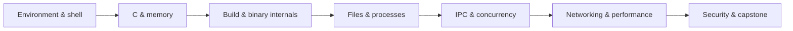
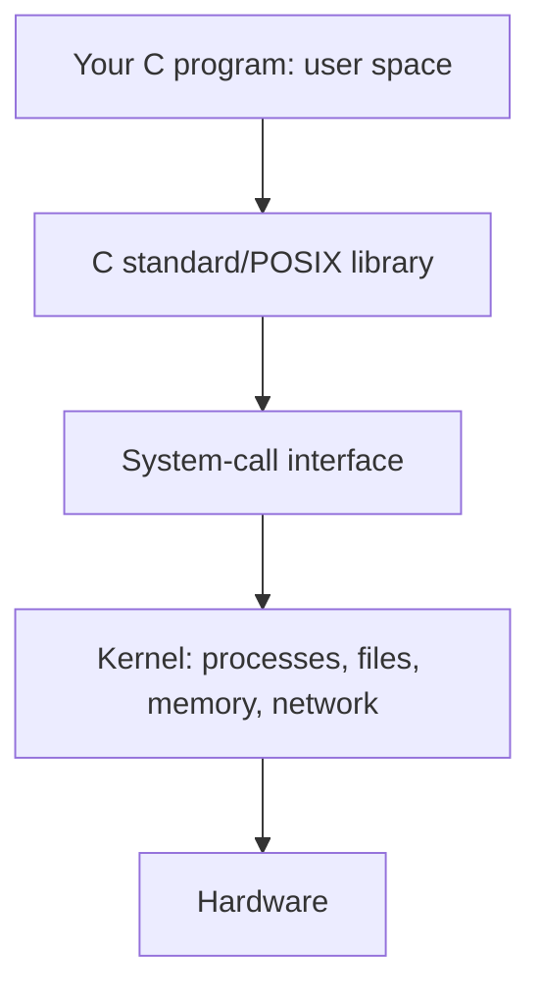
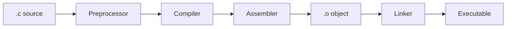
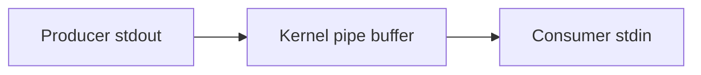
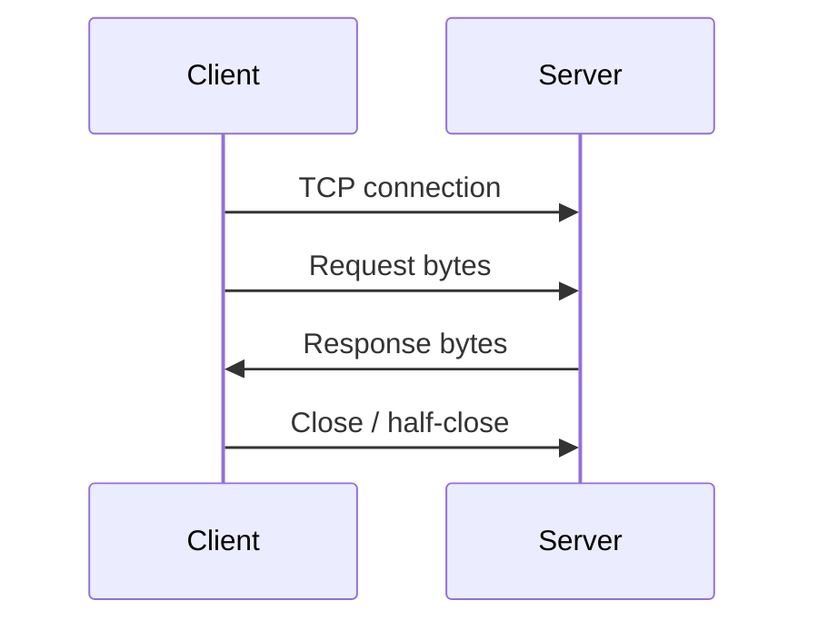
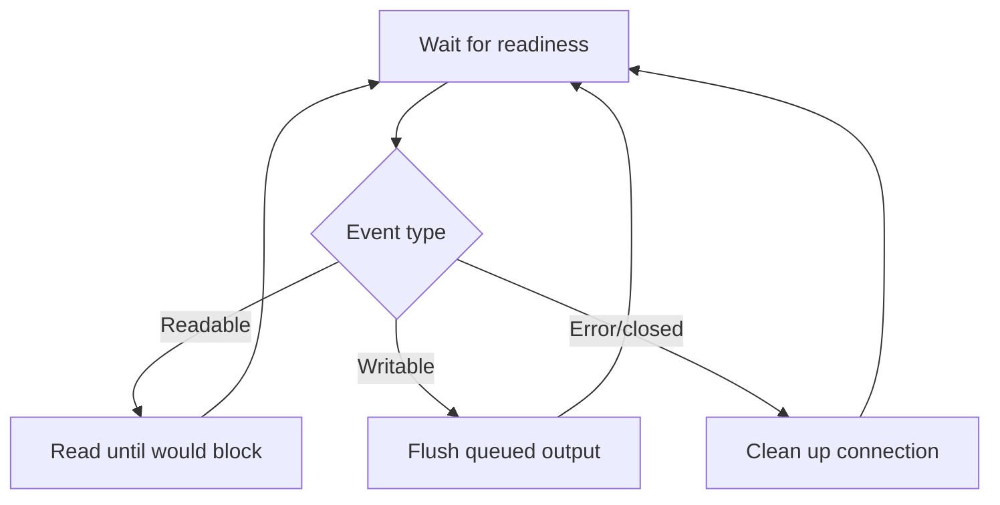
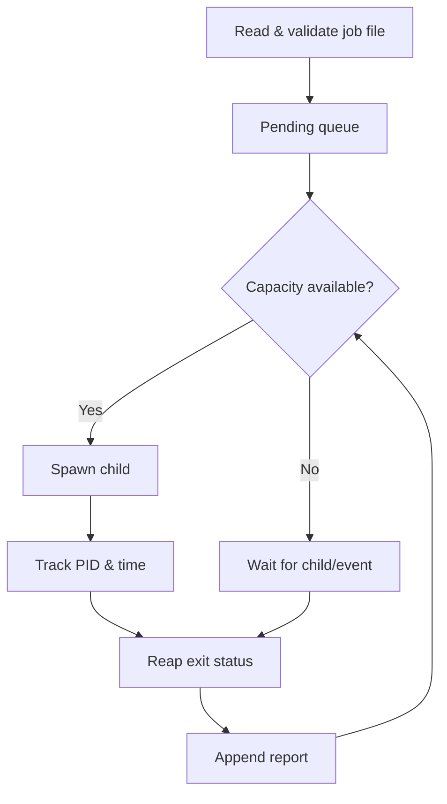

# SYSTEMS PROGRAMMING: ZERO TO HERO
## A Practical, Beginner-Friendly Handbook — From the Command Line to Operating-System Interfaces

**Prepared for:** Opsfuxion Technologies Limited — Technology Training & Mentorship  
**Author:** Engr. Amarachi C. Omereife  
**Tagline:** *Orchestrate intelligence, deliver with precision.*  
**Level:** Absolute beginner → intermediate → advanced systems developer  
**Primary platform:** Linux (Ubuntu/Debian); macOS notes where relevant  
**Primary language:** C (C17), with Bash and Python for tooling  
**Edition:** October 2026

> **Learning promise:** You will learn not only *what* systems calls and memory are, but *why* they behave the way they do, how to test them, and how to build robust low-level applications. This is a hands-on educational handbook, not a substitute for platform-specific man pages or production security reviews.

---

## How to use this handbook

1. Read each chapter's mental model before copying code.
2. Type the examples yourself; compile with warnings enabled.
3. Predict the output, run it, then explain discrepancies.
4. Complete the guided lab and independent challenge **before** reading the worked solution.
5. Commit each lab to Git with a README documenting your results.
6. Never run destructive commands or experiments as root on your main computer. Prefer a disposable VM or container.

**Conventions:** `$` is a shell prompt; it is not typed. `errno` is a per-thread error indicator meaningful after a call signals failure. `fd` means file descriptor. Examples assume POSIX-like systems; Linux-specific features are explicitly labelled. On macOS, use `clang` instead of `gcc` if GCC is unavailable; some Linux-only facilities (`epoll`, `signalfd`, `procfs` details) do not exist.

### Learning outcomes

By the end, you should be able to explain the user/kernel boundary; compile and debug C; reason about pointers, memory ownership and undefined behavior; use POSIX file and process APIs; handle signals and concurrency; write TCP programs; inspect binaries; troubleshoot resource leaks; harden system software; and complete a multi-process systems capstone.

### Roadmap



### Suggested 16-week pace

| Weeks | Focus | Evidence of progress |
|---|---|---|
| 1–2 | Linux shell, C fundamentals | CLI utilities and compiler logs |
| 3–4 | Pointers, heap, strings, debugging | Leak-free dynamic array |
| 5–6 | Files, permissions, system calls | Robust file copier |
| 7–8 | Processes, exec, pipes, signals | Mini shell and pipeline |
| 9–10 | Threads, synchronization, IPC | Thread-safe work queue |
| 11–12 | Sockets, multiplexing | TCP echo server |
| 13–14 | Binaries, performance, security | Profiling and hardening report |
| 15–16 | Integration, testing, capstone | Working concurrent job runner |

---

---

# Chapter 01 — What Systems Programming Really Means

Systems programming builds software that interacts closely with the operating system and hardware abstractions: shells, servers, runtimes, databases, embedded components, drivers, command-line tools, and infrastructure agents. It differs from ordinary application programming in **how explicitly you manage resources**: memory, processes, files, sockets, permissions, timing and failure.

**Mental model:** applications run in *user space*. The operating-system *kernel* controls protected resources. A **system call** is a controlled transition across that boundary. Library functions such as `printf()` may eventually use system calls but are not themselves necessarily system calls.



**Core vocabulary:** process (running program instance), thread (execution flow within a process), virtual memory (per-process address abstraction), file descriptor (small integer referring to an open resource), ABI (binary-level calling convention), POSIX (portable OS interface standard), race condition (result depends on uncontrolled timing).

**Guided reflection:** Why should an application not write directly into another process's memory? **Answer:** isolation prevents accidental corruption and limits privilege escalation; the kernel mediates access.

**Practice:** List five tools on your machine that count as systems software and justify each. **Model answer:** shell (process orchestration), SSH server (network and authentication), database engine (storage and concurrency), container runtime (process isolation), compiler (machine-code generation).

---

# Chapter 02 — Linux, the Shell, and Your Lab Environment

Use a disposable Ubuntu VM, a dev container, or WSL on Windows. On macOS, most C/POSIX lessons work locally, but Linux-specific tracing should run inside Linux.

```bash
uname -a
pwd
ls -lah
mkdir -p ~/systems-lab/{src,bin,tests,notes}
cd ~/systems-lab
printf 'hello systems
' > notes/hello.txt
cat notes/hello.txt
find . -maxdepth 2 -type f
```

**Paths:** absolute paths begin at `/`; relative paths are interpreted from the current directory. `.` means current directory; `..` parent. Hidden names begin with `.`. A shell expands globs such as `*.c` *before* executing a command. Quotes matter: `"$filename"` prevents unwanted word splitting.

**Permissions:** `r` read, `w` write, `x` execute/search. `chmod 640 file` gives owner `rw-`, group `r--`, others `---`. Directory execute permission means traversal, not program execution.

```bash
id
umask
stat notes/hello.txt
chmod 640 notes/hello.txt
printf '%s
' 'hello world' | wc -w
```

**Exit status:** `0` usually means success. Inspect with `echo $?` immediately after the command. `cmd1 && cmd2` runs `cmd2` only on success; `cmd1 || cmd2` only on failure.

**Safety:** Do not paste unfamiliar `sudo`, `rm -rf`, `curl | sh`, or `dd` commands. Never assume `/tmp` filenames are safe from race attacks.

**Lab:** Create `notes/today.txt`, write three lines, count them and set permissions to `600`. **Solution:** `printf 'one
two
three
' > notes/today.txt; wc -l < notes/today.txt; chmod 600 notes/today.txt; stat notes/today.txt`.

---

# Chapter 03 — C Fundamentals and the Compilation Pipeline

C is a compiled language with explicit data representation and resource management. The compiler translates source code into object files; the linker resolves external symbols into an executable.

Create `src/hello.c`:

```c
#include <stdio.h>

int main(void) {
    puts("Hello, systems programming!");
    return 0;
}
```

Compile and run:

```bash
cc -std=c17 -Wall -Wextra -Wpedantic -Werror -g   src/hello.c -o bin/hello
./bin/hello
file bin/hello
```

**Read every flag:** `-std=c17` selects a language version; `-Wall -Wextra -Wpedantic` enables useful diagnostics; `-Werror` promotes warnings to errors; `-g` adds debugging symbols. For production optimization, build separately with `-O2` and test again.



**Types:** `int`, `char`, `double`, `size_t`, `uint32_t`; use `<stdint.h>` for fixed-width integers and `<stddef.h>` for `size_t`. A type's width is not universally fixed; avoid assuming `int` is always 32 bits.

**Control flow:** `if`, `for`, `while`, `switch`; functions return values and accept arguments. `main(int argc, char **argv)` receives command-line arguments, where `argv[0]` is conventionally the program name.

**Lab:** Write a program that accepts two integer arguments and prints their sum, rejecting invalid input. **Hint:** `strtol()` plus end-pointer and range checks is safer than `atoi()`. **Model reasoning:** require `argc == 3`; set `errno=0`; call `strtol` on each; reject `errno`, empty strings and trailing characters; check addition overflow before adding. Never trust user input.

---

# Chapter 04 — Pointers, Arrays, Strings, and Memory Ownership

A pointer stores an address. `&x` gets an address; `*p` dereferences a pointer. Pointer types matter because arithmetic scales by the pointed-to type. An array is not the same thing as a pointer, although it often *decays* to one in expressions.

```c
#include <stdio.h>

int main(void) {
    int score = 42;
    int *p = &score;
    printf("value=%d via pointer=%d
", score, *p);
    *p = 99;
    printf("updated=%d
", score);
}
```

**String model:** C strings are byte arrays ending with ``. `strlen` counts bytes before the terminator; `sizeof` reports the size of an object in bytes. A buffer sized for 10 characters needs 11 bytes for the terminator.

**Storage durations:** automatic locals usually reside in a stack frame; dynamically allocated memory comes from the heap; global/static objects have static storage duration. These are practical models, not universal implementation mandates.

**Ownership rule:** every successful `malloc` allocation must have a clear owner responsible for exactly one `free`. Never use memory after freeing it. Never dereference an uninitialized or null pointer.

```c
#include <stdio.h>
#include <stdlib.h>

int main(void) {
    size_t n = 5;
    int *values = calloc(n, sizeof *values);
    if (!values) { perror("calloc"); return 1; }
    for (size_t i = 0; i < n; ++i) values[i] = (int)(i * i);
    for (size_t i = 0; i < n; ++i) printf("%d ", values[i]);
    puts("");
    free(values);
    return 0;
}
```

**Undefined behavior (UB):** out-of-bounds access, signed integer overflow, use-after-free, and data races can invalidate assumptions about the program. A program appearing to work does **not** prove correctness.

**Practice:** What is wrong with `char word[4] = "hello";`? **Solution:** it cannot store the terminating null byte; the initializer is too long for a valid C string. Use `char word[] = "hello";` or at least six bytes.

**Challenge:** Implement a growable array. **Solution outline:** track `length` and `capacity`; when full, double capacity only after checking multiplication overflow; call `realloc` into a temporary pointer; update owner only on success; free on shutdown.

---

# Chapter 05 — Debugging, Sanitizers, and Defensive C

Debugging is an experiment: reproduce, isolate, hypothesize, inspect, fix, and rerun tests. Build a **debug** executable with symbols and sanitizers (where supported):

```bash
cc -std=c17 -g -O1 -Wall -Wextra   -fsanitize=address,undefined src/hello.c -o bin/hello_san
./bin/hello_san
```

AddressSanitizer helps catch invalid memory accesses; UndefinedBehaviorSanitizer detects many (not all) undefined operations. Sanitizers are development aids, not guarantees.

**GDB walkthrough (Linux):**

```bash
gdb ./bin/hello
# inside gdb:
# break main
# run
# next
# print score
# backtrace
# quit
```

On macOS, use LLDB (`lldb ./bin/hello`). `valgrind --leak-check=full ./bin/program` is useful on supported Linux environments, though sanitizers and Valgrind differ in coverage.

**Failure checklist:** Check return values; avoid unchecked integer conversions; cap allocation sizes; validate lengths; initialize state; close every resource; prefer a single cleanup path for complex C functions.

**Lab:** Diagnose a function returning a pointer to a local array. **Solution:** the array's lifetime ends when the function returns; return heap-owned memory with a documented free responsibility, or let the caller supply a buffer.

---

# Chapter 06 — Files, File Descriptors, and POSIX I/O

A file descriptor (FD) is a process-local integer identifying an open file description or other kernel-managed I/O object. Standard FDs: `0` stdin, `1` stdout, `2` stderr. `open`, `read`, `write`, and `close` are POSIX interfaces; `fopen`/`fprintf` are buffered C stdio interfaces. Mixing buffered and unbuffered I/O on the same underlying file requires care.

**Important:** `read()` can return fewer bytes than requested; `write()` can write fewer bytes. Both can be interrupted. `read()` returning zero generally signals EOF for a regular file.

```c
#define _POSIX_C_SOURCE 200809L
#include <errno.h>
#include <fcntl.h>
#include <stdio.h>
#include <unistd.h>

int main(void) {
    int fd = open("notes/hello.txt", O_RDONLY);
    if (fd == -1) { perror("open"); return 1; }
    char buf[1024];
    ssize_t n;
    while ((n = read(fd, buf, sizeof buf)) > 0) {
        ssize_t off = 0;
        while (off < n) {
            ssize_t w = write(STDOUT_FILENO, buf + off, (size_t)(n - off));
            if (w < 0 && errno == EINTR) continue;
            if (w <= 0) { perror("write"); close(fd); return 1; }
            off += w;
        }
    }
    if (n < 0) { perror("read"); close(fd); return 1; }
    if (close(fd) < 0) { perror("close"); return 1; }
    return 0;
}
```

**File flags:** `O_RDONLY`, `O_WRONLY`, `O_RDWR`, `O_CREAT`, `O_EXCL`, `O_TRUNC`, `O_APPEND`. For safe creation, consider `O_CREAT|O_EXCL` and restrictive permissions; check `umask`. `O_CLOEXEC` prevents accidental FD inheritance on `exec` (where supported).

**Atomicity caveat:** atomic append and atomic file replacement are different problems. A typical durable update writes a temporary file in the same directory, flushes data with `fsync`, renames atomically, and—when durability across crashes matters—also syncs the directory, subject to filesystem semantics.

**Practice:** Why is `write(fd, data, n)` not always sufficient? **Answer:** short writes and interruption; loop until all bytes are written or a real error occurs.

---

# Chapter 07 — Processes, fork, exec, wait, and Exit Status

A process has an address space, file descriptor table, credentials and execution state. On POSIX, `fork()` creates a child; the child receives a logical copy of the parent's address space (often implemented with copy-on-write). `exec*()` replaces the current process image. `waitpid()` reaps child termination status and prevents zombie accumulation.

```c
#define _POSIX_C_SOURCE 200809L
#include <stdio.h>
#include <stdlib.h>
#include <sys/types.h>
#include <sys/wait.h>
#include <unistd.h>

int main(void) {
    pid_t pid = fork();
    if (pid < 0) { perror("fork"); return 1; }
    if (pid == 0) {
        execlp("echo", "echo", "hello from child", (char *)NULL);
        perror("execlp");
        _exit(127);
    }
    int status;
    if (waitpid(pid, &status, 0) == -1) { perror("waitpid"); return 1; }
    if (WIFEXITED(status)) printf("child exit=%d
", WEXITSTATUS(status));
    else if (WIFSIGNALED(status)) printf("child signal=%d
", WTERMSIG(status));
    return 0;
}
```

**Why `_exit()` in the child after failed `exec`?** It avoids running inherited `atexit` handlers and flushing copied stdio buffers unexpectedly. In multithreaded programs, the child after `fork` must be especially careful; prefer `posix_spawn` when suitable.

**Process lifecycle:** created → runnable/running → waiting → exited → reaped. A **zombie** has exited but not been reaped; an **orphan** is reparented according to OS rules.

**Lab:** Change `echo` to `false`; predict the exit code. **Solution:** `false` normally exits with status 1, so the parent prints `child exit=1`.

---

# Chapter 08 — Pipes, Redirection, and Building a Mini Shell

A pipe is a unidirectional byte stream connecting writers and readers. `pipe(fds)` creates a read end `fds[0]` and write end `fds[1]`. `dup2` redirects an FD, and `exec` runs a new program. Correctly closing unused ends is essential; otherwise a reader may never observe EOF.



**Two-command pipeline algorithm:**

1. Create a pipe.
2. Fork producer; `dup2(pipefd[1], STDOUT_FILENO)`; close both original ends; `exec` producer.
3. Fork consumer; `dup2(pipefd[0], STDIN_FILENO)`; close both ends; `exec` consumer.
4. Parent closes both ends and waits for **both** children.
5. Handle partial setup failure by closing FDs and reaping already-started children.

**Shell warning:** `system()` delegates to a shell and can create injection vulnerabilities when input is untrusted. Prefer `execvp` with a validated argument vector; even then, avoid trusting unqualified executable search paths in privileged programs.

**Lab:** Explain `printf 'a
b
' | wc -l`. **Solution:** producer writes two newline-terminated lines into pipe; consumer reads stream and reports 2.

**Challenge:** Build `minish` supporting commands without quoting, then add `cd`, redirection and a two-stage pipeline. **Acceptance criteria:** `exit`, invalid commands, and child failures behave predictably; no FD leaks; no zombie children. **Solution architecture:** tokenize input; built-in commands in parent; otherwise fork, set up FDs, exec, wait.

---

# Chapter 09 — Signals, Timers, and Graceful Shutdown

Signals are asynchronous notifications such as `SIGINT` (interrupt), `SIGTERM` (termination request) and `SIGCHLD` (child state change). A signal is not a regular function call; signal handlers may interrupt normal execution.

Use `sigaction()` rather than legacy `signal()` for portable control. In a signal handler, perform only **async-signal-safe** operations. In particular, do not call `printf` or `malloc` from a handler. A simple handler may set a `volatile sig_atomic_t` flag; the main loop can check it and clean up.

```c
#define _POSIX_C_SOURCE 200809L
#include <signal.h>
#include <stdio.h>
#include <unistd.h>

static volatile sig_atomic_t stop = 0;
static void on_term(int sig) { (void)sig; stop = 1; }

int main(void) {
    struct sigaction sa = {0};
    sa.sa_handler = on_term;
    sigemptyset(&sa.sa_mask);
    if (sigaction(SIGINT, &sa, NULL) == -1) { perror("sigaction"); return 1; }
    while (!stop) pause();
    puts("Shutdown requested");
    return 0;
}
```

**Important race:** A `while (!stop) pause()` loop can miss a signal between checking the flag and calling `pause()`, leaving it blocked. For robust event loops, block signals and use `sigsuspend()` or `pselect()` to wait atomically, or Linux `signalfd` where appropriate. The snippet illustrates the handler pattern, not a race-free shutdown loop.

**Practice:** Why should cleanup run outside the handler? **Answer:** most cleanup libraries and I/O routines are not async-signal-safe; main-loop cleanup is more predictable.

**Challenge:** Implement a program that handles `SIGINT` and reports a count of completed jobs before exiting; use `sigprocmask` plus `sigsuspend` to eliminate the check/wait race.

---

# Chapter 10 — Threads, Mutexes, and Condition Variables

Threads share process memory and open FDs but have separate stacks and execution states. This makes communication cheap and **data races** dangerous. `pthread_create` starts a thread; `pthread_join` waits for it. A mutex protects shared invariants, not just individual statements.

```c
#define _POSIX_C_SOURCE 200809L
#include <pthread.h>
#include <stdio.h>

static long counter = 0;
static pthread_mutex_t lock = PTHREAD_MUTEX_INITIALIZER;

static void *worker(void *arg) {
    (void)arg;
    for (int i = 0; i < 100000; ++i) {
        pthread_mutex_lock(&lock);
        ++counter;
        pthread_mutex_unlock(&lock);
    }
    return NULL;
}

int main(void) {
    pthread_t a, b;
    if (pthread_create(&a, NULL, worker, NULL) != 0) return 1;
    if (pthread_create(&b, NULL, worker, NULL) != 0) return 1;
    pthread_join(a, NULL);
    pthread_join(b, NULL);
    printf("counter=%ld
", counter);
    pthread_mutex_destroy(&lock);
}
```

Compile with `cc -std=c17 -Wall -Wextra -pthread src/threads.c -o bin/threads`.

**Concepts:** race condition vs data race; mutual exclusion; deadlock (cyclic waiting); starvation; thread-safe vs reentrant; condition variables; atomics. `pthread_cond_wait` atomically releases a mutex and waits, then reacquires it before returning. Always recheck the predicate in a **while** loop because wakeups may be spurious.

**Lab:** Remove the lock and run repeatedly. **Solution:** the result may differ from 200000, and the program has a C data race (undefined behavior); an apparently correct run proves nothing.

**Challenge:** Build a bounded producer–consumer queue using one mutex, `not_empty` and `not_full` condition variables. **Solution invariants:** `0 <= count <= capacity`; producers wait while full; consumers wait while empty; signal after state change; define shutdown semantics.

---

# Chapter 11 — IPC: Shared Memory, FIFOs, and Message Passing

Inter-process communication (IPC) moves information between isolated processes. Options include anonymous pipes (related processes), named pipes/FIFOs, Unix-domain sockets, POSIX shared memory, and message queues. Each makes different tradeoffs in framing, lifetime, security and synchronization.

| Mechanism | Good for | Main caution |
|---|---|---|
| Pipe | Parent/child streaming | Byte stream; no message boundaries |
| FIFO | Local named streaming | Blocking/open behavior |
| Unix socket | Local bidirectional clients | Permissions and protocol framing |
| Shared memory | High-throughput data exchange | Requires explicit synchronization |
| TCP socket | Remote communication | Partial reads, failures, authentication |

**FIFO lab:**

```bash
mkfifo /tmp/opsfuxion-demo-fifo
# Terminal A: cat /tmp/opsfuxion-demo-fifo
# Terminal B: printf 'message
' > /tmp/opsfuxion-demo-fifo
rm /tmp/opsfuxion-demo-fifo
```

Use a unique private directory instead of a predictable shared `/tmp` pathname in real applications; the example is for a disposable lab only.

**Shared-memory rule:** two processes mapping the same memory does not make updates automatically safe. Use process-shared synchronization primitives or a carefully designed atomic protocol.

**Practice:** Why might shared memory be faster than sending large buffers over a pipe? **Answer:** it can avoid extra copies, but coordination complexity and cache effects may offset gains.

---

# Chapter 12 — Networking: TCP, UDP, and Socket APIs

A socket is an endpoint for communication. TCP provides a reliable ordered **byte stream**, not message boundaries. UDP sends datagrams, which can be lost, duplicated or reordered. A server typically uses `socket → bind → listen → accept → read/write → close`; a client uses `socket → connect → read/write → close`.



**Network byte order:** use `htons`/`htonl` and corresponding inverse operations for numeric fields. **Framing:** choose newline-delimited messages, fixed-length records, or length-prefixed payloads; always set maximum message sizes.

**Guided lab (tools first):**

```bash
# Terminal A (if netcat is installed; flags vary by implementation)
nc -l 127.0.0.1 9090
# Terminal B
printf 'hello
' | nc 127.0.0.1 9090
```

**Production concerns:** timeouts, backpressure, authentication, TLS, input validation, retry safety, graceful shutdown and denial-of-service limits. Never expose an unauthenticated lab server to the public Internet.

**Practice:** A single `recv` returns 12 bytes; does that mean the sender sent a 12-byte message? **Answer:** no; TCP segments and application messages do not align. Parse a defined protocol.

---

# Chapter 13 — I/O Multiplexing and Event-Driven Servers

Blocking `read` waits for data. Nonblocking FDs return promptly with `EAGAIN`/`EWOULDBLOCK` when an operation cannot proceed. `select` and `poll` let one thread monitor many descriptors. Linux `epoll` and BSD/macOS `kqueue` offer scalable event notification APIs, but they are platform-specific.

**Event-loop mental model:**



**Readiness is not completion:** a ready FD can still yield a short operation; state machines must track partially received and transmitted messages. Edge-triggered APIs generally require draining until `EAGAIN` to avoid stalls. Handle `EINTR`, resource limits, slow clients and fairness.

**Lab:** Sketch per-client state: input buffer, output buffer, parse state, last-activity time, and FD. **Solution:** register interest in writable events only when output is pending; cap buffers; remove and close dead connections.

**Challenge:** Extend a blocking TCP echo server to `poll`-based multiplexing and test with ten simultaneous clients.

---

# Chapter 14 — Executables, Linking, ABI, and Dynamic Libraries

Source code is not what the CPU executes. The executable contains machine instructions, metadata, symbols and sections. An **ABI** defines binary interfaces: calling conventions, register usage, type layout and symbol rules. Static linking incorporates needed library code into the executable; dynamic linking resolves shared libraries at load/run time.

```bash
cc -c -std=c17 -Wall -Wextra src/hello.c -o bin/hello.o
cc bin/hello.o -o bin/hello
file bin/hello
nm bin/hello | head
# Linux: readelf -h bin/hello; ldd bin/hello
# macOS: otool -L bin/hello
```

**Common sections:** `.text` machine code, `.rodata` read-only data, `.data` initialized writable globals, `.bss` zero-initialized globals. Actual section layouts vary by toolchain and binary format (ELF on Linux, Mach-O on macOS).

**Linker errors:** `undefined reference` usually means a declaration exists but no definition was linked; `multiple definition` means a symbol was defined more than once. Headers declare interfaces; source/object files provide implementations.

**Practice:** Why does changing a shared library's exported function signature risk breaking an existing binary? **Answer:** compiled callers depend on ABI-level assumptions that the changed function may violate.

---

# Chapter 15 — Operating-System Internals: Scheduling, Virtual Memory, and Filesystems

A scheduler chooses which runnable thread receives CPU time. **Context switching** changes execution state; excessive switching can reduce throughput. **Virtual memory** maps virtual addresses to physical memory or backing storage through page tables. A **page fault** occurs when a translation or access requires OS handling; not every page fault is an error.

**Memory concepts:** pages, protection flags, copy-on-write, demand paging, `mmap`, swapping, locality, TLB, stack growth. The kernel may overcommit memory; successful allocation does not guarantee that every future access will succeed under all configurations.

**Filesystem concepts:** inodes/metadata, directory entries, links, file descriptors vs pathnames, page cache, `fsync`, journaling and crash consistency. `rename()` can be atomic as a namespace operation under appropriate same-filesystem conditions, but that does not automatically imply durability after a power loss.

**Lab:** Compare sequential vs random access in a large array; time repeated runs using `clock_gettime(CLOCK_MONOTONIC, ...)` and document compiler flags. **Interpretation:** cache locality often makes sequential access faster; control for warm-up and noise.

**Practice:** Why can two processes have the same virtual address but different data? **Answer:** their page tables can map that virtual address to different physical pages.

---

# Chapter 16 — Performance Engineering and Observability

Performance optimization starts with measurement and a defined workload. Important metrics include latency (time per operation), throughput (operations per second), CPU utilization, memory footprint, I/O wait, context switches and tail latency (e.g., p95/p99).

**Linux tools:** `time`, `ps`, `top`, `vmstat`, `iostat` (if installed), `strace`, `perf`, `/proc`. **macOS alternatives:** `time`, Activity Monitor, `sample`, Instruments, `dtruss` where permissions allow.

```bash
/usr/bin/time -p ./bin/hello
# Linux only, where tracing is permitted:
strace -f -o /tmp/hello.trace ./bin/hello
```

**Profiling process:** define a hypothesis; capture a baseline; change one variable; rerun under equivalent conditions; report variance; retain correctness tests. Avoid interpreting microbenchmarks as real-world production performance.

**Lab:** Benchmark 1000 small writes versus one buffered write. **Expected interpretation:** batching often reduces system-call overhead, but buffering trades memory and latency; actual outcomes depend on environment.

---

# Chapter 17 — Security, Robustness, and Secure Systems Design

Systems programs operate near valuable resources, so errors can become security vulnerabilities. Think in terms of **threat models**: assets, attackers, trust boundaries, entry points and mitigations.

**Frequent vulnerabilities:** buffer overflows, integer overflow, format-string bugs, use-after-free, command injection, path traversal, TOCTOU races, insecure temporary files, excessive privileges, inherited FDs, unbounded allocations, and resource exhaustion.

**Secure defaults:** least privilege; validate input size and encoding; use `snprintf` with correct bounds; avoid `gets` and unchecked `strcpy`; use `O_CLOEXEC`; use safe temporary-file creation (`mkstemp` with appropriate cleanup); set timeouts; apply resource limits; avoid shell interpolation; log errors without exposing secrets.

**TOCTOU example:** checking a pathname and later opening it creates a race if an attacker can change the path between operations. Prefer descriptor-relative APIs such as `openat` and carefully selected flags; precise defenses depend on platform and threat model.

**Lab:** Review `printf(user_input);`. **Solution:** user-controlled format specifiers can read or write unintended memory; use `printf("%s", user_input);` after ensuring the string is valid and appropriately bounded.

**Hardening:** test with sanitizers and fuzzers; enable compiler/platform mitigations where supported; run services as unprivileged accounts; isolate with containers/VMs (not a complete security boundary); patch dependencies; conduct code review.

---

# Chapter 18 — Build Systems, Testing, CI, and Documentation

Professional systems code should be reproducible, testable and understandable by someone other than its author.

**Minimal Makefile** (commands must begin with a real tab):

```makefile
CC ?= cc
CFLAGS = -std=c17 -Wall -Wextra -Wpedantic -g

all: bin/hello

bin/hello: src/hello.c
	mkdir -p bin
	$(CC) $(CFLAGS) $< -o $@

test: all
	./bin/hello

clean:
	rm -f bin/hello

.PHONY: all test clean
```

**Testing pyramid:** unit tests for pure logic, integration tests for file/process/network behavior, fault-injection tests for partial I/O and allocation failures, and end-to-end tests for user workflows. Test both success and failure paths.

**Git workflow:** small commits, descriptive messages, pull requests, automated checks and documented reproduction steps. CI should build with warnings, run unit tests, execute sanitizer-enabled tests when supported and scan for secrets.

**README template:** purpose, supported OS/toolchain, build steps, usage examples, exit codes, input limits, architecture, security assumptions, testing commands, known limitations, and license.

**Lab:** Create a `make test` target that compares program output against an expected file. **Solution:** `./bin/hello > /tmp/hello.actual && printf 'Hello, systems programming!
' > /tmp/hello.expected && diff -u /tmp/hello.expected /tmp/hello.actual` (use a private temp directory for real CI).

---

# Chapter 19 — Advanced Topics: Atomics, mmap, Containers, and eBPF

**Atomics and memory ordering:** atomic operations can coordinate threads without data races on atomic objects, but ordering is subtle. Start with mutexes; use C11 atomics only when you can articulate the required happens-before relationship. `memory_order_relaxed` provides atomicity without general synchronization.

**Memory mapping (`mmap`):** maps files or anonymous memory into a process address space. It is useful for large-file access and shared memory, but mapping is not a universal performance win; handle page alignment, truncation, synchronization and mapping lifetime.

**Containers:** a Linux container typically combines namespaces (isolation views), cgroups (resource controls), capabilities and filesystem mechanisms. A container is not a virtual machine, and root inside a container is not automatically harmless.

**eBPF (Linux-specific):** verified programs can run at selected kernel hooks for tracing, networking and security. Requires knowledge of verifier restrictions, privileges, kernel compatibility and observability ethics. Begin with safe tracing tools before writing kernel-attached programs.

**Further directions:** `io_uring` (Linux async I/O), NUMA, lock-free queues, real-time scheduling, device drivers and embedded bare-metal programming. These are specialization paths, not prerequisites for the capstone.

**Practice:** Why should a beginner not replace every mutex with atomics? **Answer:** complex invariants and ordering are easier to get wrong; performance benefits must be measured.

---

# Chapter 20 — Capstone: Concurrent Job Runner and Monitoring Agent

**Project brief:** Build `opsrun`, a command-line tool that reads a simple job file, launches external commands with controlled concurrency, records exit status and elapsed time, and shuts down gracefully. This integrates C, file I/O, processes, signals, resource handling, testing and documentation.

**Example input (`jobs.txt`):**

```text
# one executable and fixed arguments per line (your parser defines exact syntax)
/bin/echo hello
/bin/sleep 1
/usr/bin/true
```

**Scope warning:** avoid passing arbitrary input to `/bin/sh -c`. For a beginner-safe capstone, support a small allowlist of executable paths and a documented whitespace-only argument grammar; explicitly reject shell metacharacters, oversized lines and invalid paths.

**Functional requirements:**

1. Accept `--jobs FILE --max-parallel N` with strict input validation.
2. Parse lines safely with `getline`; enforce line/argument/count limits.
3. Start up to N children using `fork` + `execv` (or `posix_spawn`).
4. Record PID, start time and state for each child.
5. Reap children with `waitpid` and report success/failure accurately.
6. On SIGINT/SIGTERM, stop accepting new jobs, request child shutdown, escalate after a documented grace period, and reap all children.
7. Produce a CSV summary with escaped/controlled fields and meaningful exit codes.
8. Close FDs, free memory and handle partial failure cleanly.



**Milestones:** (1) sequential runner; (2) bounded concurrency; (3) shutdown; (4) report; (5) tests and hardening. Keep each milestone working and committed.

**Suggested source tree:**

```text
opsrun/
├── Makefile
├── README.md
├── include/opsrun.h
├── src/main.c
├── src/parser.c
├── src/runner.c
├── src/report.c
├── tests/test_parser.c
├── tests/integration.sh
└── examples/jobs.txt
```

**Worked design solution (pseudocode):**

```text
parse_cli_and_validate_limits()
read_all_jobs_with_bounded_parser()
install_signal_handler_that_sets_shutdown_flag()
while pending_jobs or active_children:
    while not shutting_down and active < max_parallel and pending:
        spawn_next_job_and_record_pid()
    if active > 0:
        wait_for_a_child_with_EINTR_handling()
        record_exit_status_and_elapsed_time()
    if shutdown_requested:
        signal_active_children_then_enforce_grace_period()
write_summary_and_release_all_resources()
```

**Important implementation note:** a blocking `waitpid` and a shutdown flag require a deliberate EINTR/signal strategy; avoid sleeping forever when there are no active children. If your signal policy needs timeouts, use `waitpid(..., WNOHANG)` with a monotonic-clock deadline or an event-based design.

**Acceptance tests:** empty file; malformed line; missing executable; child exits 1; 100 short jobs; `--max-parallel 1` and `4`; SIGINT during long job; file permission denied; out-of-memory simulation where feasible; repeated execution under sanitizers; no zombies or FD leaks.

**Rubric (100 points):** correctness 30, error handling 20, resource management 15, concurrency/shutdown 15, tests 10, documentation 10.

**Stretch goals:** structured JSON output, Unix-domain control socket, rate limiting, structured logs, systemd service unit (Linux), Prometheus-style metrics, secure sandboxing (advanced).

---

# Practical Assessment Bank — 30 Questions with Model Answers

**Foundations**

1. **What separates user space from kernel space?** A protection boundary; applications request privileged services via system calls.
2. **Why enable compiler warnings?** They reveal suspicious constructs before runtime and support safer coding.
3. **What does `sizeof(char)` return?** Exactly 1 by C definition (one byte; a byte need not be eight bits on every platform).
4. **What is a null terminator?** A zero byte marking the end of a C string.
5. **What does `malloc` return on failure?** A null pointer; do not dereference it.
6. **Why is `realloc(p, newsize)` assigned to a temporary?** To avoid losing the original allocation on failure.
7. **What is undefined behavior?** Behavior for which the language standard imposes no requirements.
8. **Why is `strtol` usually safer than `atoi`?** It supports error detection and validation of trailing text.

**Files and processes**

9. **Name standard file descriptors.** 0 stdin, 1 stdout, 2 stderr.
10. **Can `read` return fewer bytes than requested?** Yes, including on pipes, sockets and regular files.
11. **What does `read` returning zero mean for a regular file?** End of file.
12. **Why loop on `write`?** Short writes and interruption are possible.
13. **What does `fork` return in the child?** Zero; parent gets child PID, failure is -1.
14. **What does `exec` do?** Replaces the current process image; successful `exec` does not return.
15. **Why call `waitpid`?** Collect child status and reap terminated children.
16. **What is a zombie process?** An exited child whose status has not yet been reaped.
17. **Why close unused pipe ends?** To release resources and permit correct EOF detection.
18. **What is `dup2` used for?** Reassigning one FD number to refer to another open resource, commonly redirection.

**Concurrency and networking**

19. **What is a data race?** Conflicting concurrent accesses to the same memory, at least one write, without required synchronization.
20. **Does a mutex protect a variable automatically?** No; all relevant accesses must follow the locking discipline.
21. **Why use `while` around `pthread_cond_wait`?** Predicates can change and wakeups can be spurious.
22. **What is deadlock?** Threads/processes remain blocked waiting on resources in a cycle or otherwise impossible progress.
23. **Does TCP preserve message boundaries?** No; it provides an ordered byte stream.
24. **What is backpressure?** A mechanism preventing producers from overwhelming slower consumers.
25. **What is `EAGAIN`?** An operation would block under current nonblocking conditions; retry when ready.

**Advanced practice**

26. **What is an ABI?** Rules for binary-level interoperability between compiled components.
27. **What is copy-on-write?** Sharing physical pages until a write requires a private copy.
28. **Does `rename` guarantee crash durability?** Not by itself; durable update procedures depend on filesystem and syncing.
29. **What is a TOCTOU race?** State changes between checking a resource and using it.
30. **Why profile before optimizing?** To identify actual bottlenecks and measure the effect of changes.

---

# Troubleshooting Playbook

| Symptom | Likely causes | First checks |
|---|---|---|
| `command not found` | Missing package or PATH entry | `command -v cc`; inspect PATH |
| `permission denied` | Mode bits, directory traversal, mount options | `id`; `ls -ld`; `stat` |
| Segmentation fault | Invalid pointer, out-of-bounds, lifetime error | Sanitizers; debugger backtrace |
| `undefined reference` | Missing object/library or wrong symbol | Compile/link command; `nm` |
| Program hangs | Deadlock, blocked I/O, open pipe write end | Thread stacks; `strace`; FD inspection |
| `Address already in use` | Bound port occupied or socket lifecycle | `ss -ltn` (Linux); inspect listener |
| Too many open files | FD leak or low resource limit | `ulimit -n`; inspect `/proc/PID/fd` |
| Different results across runs | Race, uninitialized memory, environment | Sanitizers; repeat with logging |
| Child process becomes zombie | Missing wait/reaping | `waitpid`; SIGCHLD policy |
| High CPU use | Busy loop, retries without backoff | Profile; check `EAGAIN` handling |

---

# Glossary (Quick Reference)

**ABI:** Binary interface conventions.  
**Atomic operation:** Operation indivisible under a defined memory model.  
**Backpressure:** Flow control between producers and consumers.  
**Buffer overflow:** Writing past allocated buffer bounds.  
**Context switch:** CPU execution moves between schedulable entities.  
**Deadlock:** Cyclic or irrecoverable waiting that prevents progress.  
**Descriptor:** Process-local integer handle for an open resource.  
**ELF:** Common executable/object file format on Linux.  
**EOF:** End-of-file indication.  
**Heap:** Dynamic allocation region (conceptual).  
**IPC:** Inter-process communication.  
**Kernel:** Privileged OS core controlling resources.  
**Mutex:** Mutual-exclusion synchronization primitive.  
**Page fault:** Event requiring memory translation/access handling.  
**POSIX:** Family of portable OS interface specifications.  
**Race condition:** Outcome depends on relative execution timing.  
**Signal:** Asynchronous process/thread notification.  
**Stack:** Automatic call-frame storage (common implementation).  
**System call:** Controlled request for kernel service.  
**Thread:** Execution stream sharing a process's resources.  
**Undefined behavior:** Behavior unconstrained by C standard.  
**Virtual memory:** Per-process virtual address abstraction.

---

# Instructor and Self-Study Checklist

- [ ] Explain the user/kernel boundary without memorized jargon.
- [ ] Compile a C program with strict warnings.
- [ ] Diagnose a memory error with a sanitizer.
- [ ] Implement correct partial-read/partial-write handling.
- [ ] Create and reap child processes.
- [ ] Describe why unused pipe ends must close.
- [ ] Explain async-signal-safe handler restrictions.
- [ ] Protect a shared invariant with a mutex.
- [ ] Implement framing for a TCP byte stream.
- [ ] Measure a program and document benchmark limits.
- [ ] Identify five common security weaknesses.
- [ ] Complete and demonstrate the capstone.

# References and Next Steps

Use these authoritative sources alongside the exercises:

1. **The Linux man-pages project** — https://man7.org/linux/man-pages/ (system calls, process, file and network APIs).
2. **POSIX / The Open Group specifications** — https://pubs.opengroup.org/onlinepubs/ (portable API contracts).
3. **GNU C Manual** — https://www.gnu.org/software/gnu-c-manual/ (C language reference).
4. **GNU Make manual** — https://www.gnu.org/software/make/manual/ (build automation).
5. **GDB manual** — https://sourceware.org/gdb/documentation/ (debugging).
6. **AddressSanitizer documentation** — https://clang.llvm.org/docs/AddressSanitizer.html (memory error detection).
7. **Beej's Guide to Network Programming** — https://beej.us/guide/bgnet/ (practical sockets).
8. **Operating Systems: Three Easy Pieces** — https://pages.cs.wisc.edu/~remzi/OSTEP/ (OS theory and labs).
9. **The Linux Programming Interface**, Michael Kerrisk (book; comprehensive Linux/POSIX reference).
10. **C Programming: A Modern Approach**, K. N. King (book; C foundations).

**Specialization paths:** Linux platform engineering, network services, database internals, embedded systems, performance engineering, security research, compiler/runtime engineering, and kernel/eBPF observability.

---

## About the author and publisher

**Engr. Amarachi C. Omereife** is a software engineer, technology educator and founder of **Opsfuxion Technologies Limited**, with professional interests spanning cloud infrastructure, DevOps, DevSecOps, software engineering and practical technical mentorship. This handbook is designed to help learners build a strong, testable foundation in systems programming through guided labs and progressively challenging projects.

**Opsfuxion Technologies Limited** — *Orchestrate intelligence, deliver with precision.*  
Website: https://www.opsfuxiontech.com

**End of handbook.**

