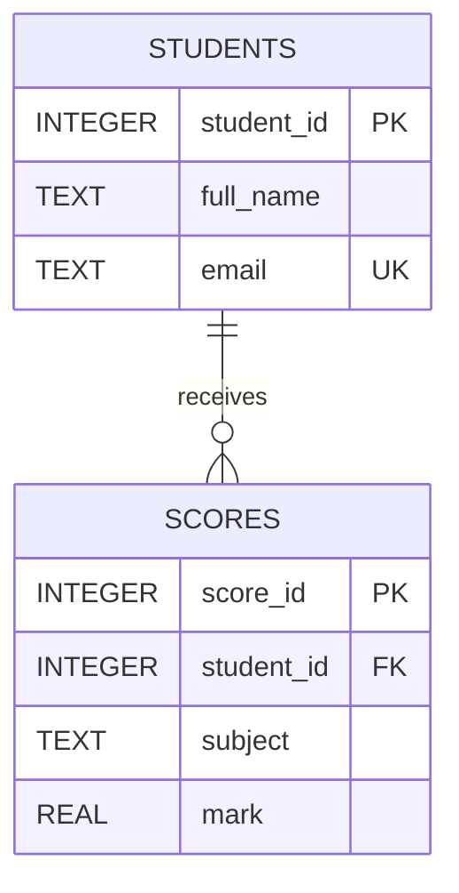

# WEEK 10 — RELATIONAL DATABASES, SQL, SQLITE & PYTHON INTEGRATION

**Opsfuxion Technologies Limited**  
*Orchestrate Intelligence, Deliver with Precision.*

**Practical Software Engineering Foundation Programme — COMPLETE LECTURER'S TEACHING MANUAL**  
**Level:** Beginner progressing toward intermediate | **Contact:** Tuesday / Thursday / Saturday, 3 × 120 minutes (6 hours) | **Independent work:** 6–10 hours  
**Learner:** Uzoamaka | **Instructor edition:** contains solutions, assessment guidance and answer keys.

> **Teaching rule:** Explain → demonstrate → ask learner to predict → learner codes → test success and failure → discuss → commit. Never reveal a model answer until after a genuine independent attempt. A six-hour week is an introduction, not mastery of the entire subject.

**Prerequisites:** Week 8 Student OOP model; Week 9 searching/sorting; Python functions, exceptions and Git  
**End-of-week deliverable:** A persistent Student Records Database with SQLite, CRUD operations, parameterised SQL and a Python CLI.

## Instructor preparation

1. Verify `python3 --version`, VS Code, integrated terminal and Git are working; use Python 3.11+ syntax without third-party dependencies unless noted.
2. Create `Week-10/session-1`, `session-2`, `session-3`, `assignment`, `project`, `tests`, and `README.md`.
3. Prepare a starter file and a separate instructor-only solution file. Save terminal output/screenshots for review.
4. Check understanding through verbal explanation, not merely working code. Have the learner predict at least one output before executing each example.
5. Require meaningful Git commits at the end of each session, using the Week 3 workflow.

## Marking framework (100 points)

| Dimension | Points | What good looks like |
|---|---:|---|
| Correctness and requirements | 35 | Meets acceptance criteria; handles normal cases |
| Concepts and design | 20 | Correctly uses the week's main ideas |
| Input validation and edge cases | 15 | Handles bad, empty, boundary input |
| Code clarity and decomposition | 15 | Clear names, manageable functions, readable formatting |
| Tests and evidence | 10 | Reproducible test cases and expected results |
| Git and documentation | 5 | README, meaningful commits, runnable instructions |

**Mastery thresholds:** 85–100 excellent; 70–84 competent; 55–69 needs targeted practice; below 55 reteach before advancing. Ask the learner to explain *why* their approach works.

---

# SCOPE NOTE — IMPORTANT CURRICULUM DISTINCTION

This **Week 10** module uses **SQLite**, the lightweight relational database bundled with Python, as agreed in the 12-week foundation curriculum. The separately authored **PostgreSQL Zero-to-Hero Handbook** is the advanced companion for production-oriented web/mobile applications. Do not substitute PostgreSQL here without changing the prerequisites and setup. The SQL concepts transfer; database-specific commands and drivers do not.

# SESSION 1 — RELATIONAL DESIGN, KEYS & SQL BASICS (120 MIN)

| Minutes | Activity |
|---|---|
| 0–15 | Compare Week 8 in-memory data with persistence |
| 15–40 | Tables, rows, columns, types, primary/foreign keys |
| 40–60 | Relationships, ERD, normalisation |
| 60–90 | SQLite shell and CREATE/INSERT/SELECT |
| 90–110 | Guided SQL query lab |
| 110–120 | Review and commit |

## 1.1 What problem does a database solve?

**Say:** “Our Week 8 program forgot students when it closed. A database stores information between program runs and supports organised, reliable access.” Distinguish a database (stored data), DBMS (software managing it), SQL (query language), schema (structure), and query (request).

**Analogy:** Spreadsheet rows and columns help introduce tables, but databases additionally support constraints, transactions, relationships and concurrent access. SQLite is embedded, file-based and excellent for local learning, prototypes and many real applications. PostgreSQL is a separate server-based system suitable for many multiuser web/mobile backends.

## 1.2 Tables and keys

| Concept | Meaning | Example |
|---|---|---|
| Table | Collection of similar records | `students` |
| Row | One record | Ada's record |
| Column | One attribute | `email` |
| Primary key | Unique row identifier | `student_id` |
| Foreign key | Reference to another table's key | `scores.student_id` |
| Constraint | Rule enforced by DB | `NOT NULL`, `UNIQUE`, `CHECK` |
| Index | Lookup structure | Index on `students.email` |

### Design example

Students can have multiple scores, so store scores in a second table rather than `score1`, `score2`, `score3` columns.



**Normalisation intuition:** 1NF: atomic cells/no repeated groups; 2NF: non-key fields depend on whole candidate key (relevant for composite keys); 3NF: avoid non-key-to-non-key dependencies. At this level, prioritise avoiding duplicated student contact details across score rows. Explain that normalisation is not an excuse for excessive table splitting.

## 1.3 SQLite setup and SQL shell

On Mac: `sqlite3 --version` checks the command-line utility. If missing, Python's `sqlite3` module can still be available; the shell is optional. Create a file database with `sqlite3 school.db`, then use `.tables`, `.schema students`, `.quit`. Dot-commands belong to SQLite's shell, **not** SQL and not Python's `cursor.execute()`.

### Instructor's SQL setup (`schema.sql`)

```sql
PRAGMA foreign_keys = ON;

CREATE TABLE IF NOT EXISTS students (
    student_id INTEGER PRIMARY KEY,
    full_name TEXT NOT NULL CHECK (length(trim(full_name)) > 0),
    email TEXT NOT NULL UNIQUE
);

CREATE TABLE IF NOT EXISTS scores (
    score_id INTEGER PRIMARY KEY,
    student_id INTEGER NOT NULL,
    subject TEXT NOT NULL,
    mark REAL NOT NULL CHECK (mark >= 0 AND mark <= 100),
    FOREIGN KEY (student_id) REFERENCES students(student_id) ON DELETE CASCADE
);

INSERT INTO students (full_name, email) VALUES
    ('Ada Okafor', 'ada@example.com'),
    ('Chika Obi', 'chika@example.com');

INSERT INTO scores (student_id, subject, mark) VALUES
    (1, 'Python', 88),
    (1, 'Databases', 92),
    (2, 'Python', 75);
```

**Note:** This seed script inserts sample records each time it is run, so use a fresh database for each demonstration. `CREATE TABLE IF NOT EXISTS` is idempotent; the sample `INSERT` statements are not. SQLite's dynamic typing means `TEXT` is not the same as rigorous email-format validation; application validation remains necessary.

Run from terminal: `sqlite3 school.db < schema.sql`. Use a **new file** if resetting to avoid duplicate email errors.

## 1.4 SELECT, WHERE, ORDER BY, LIMIT

```sql
SELECT * FROM students;
SELECT full_name, email FROM students ORDER BY full_name ASC;
SELECT * FROM scores WHERE mark >= 80 ORDER BY mark DESC;
SELECT * FROM scores WHERE subject = 'Python' LIMIT 10;
SELECT COUNT(*) AS total_students FROM students;
SELECT ROUND(AVG(mark), 2) AS average_mark FROM scores;
```

**Explain:** `SELECT` chooses columns; `FROM` chooses table; `WHERE` filters rows; `ORDER BY` sorts; `LIMIT` restricts count; `COUNT`/`AVG` aggregate. SQL string literals use single quotes; `NULL` means unknown/missing and is tested with `IS NULL`, not `= NULL`.

### Guided exercise + answer

**Task:** Find scores below 80, highest first. **Answer:**

```sql
SELECT student_id, subject, mark
FROM scores
WHERE mark < 80
ORDER BY mark DESC;
```

**Task:** Count score records per subject. **Answer:**

```sql
SELECT subject, COUNT(*) AS entries
FROM scores
GROUP BY subject
ORDER BY entries DESC;
```

**Exit quiz:** Difference between PK and FK? PK uniquely identifies; FK references. Why two tables? One-to-many without repeated student details. What does `ORDER BY mark DESC` mean? Highest to lowest.

---
# SESSION 2 — CRUD, JOINS, CONSTRAINTS & TRANSACTIONS (120 MIN)

| Minutes | Activity |
|---|---|
| 0–15 | Review SQL SELECT and constraints |
| 15–40 | INSERT, UPDATE, DELETE safely |
| 40–65 | JOIN and aggregation |
| 65–85 | Transactions and rollback |
| 85–110 | Python `sqlite3` connection and parameters |
| 110–120 | Practice and commit |

## 2.1 CRUD: create, read, update, delete

```sql
INSERT INTO students (full_name, email)
VALUES ('Ngozi Nwosu', 'ngozi@example.com');

SELECT * FROM students WHERE email = 'ngozi@example.com';

UPDATE students SET full_name = 'Ngozi Ada Nwosu'
WHERE email = 'ngozi@example.com';

DELETE FROM students WHERE email = 'ngozi@example.com';
```

**Critical safety lesson:** An `UPDATE` or `DELETE` without `WHERE` affects **all rows**. Always preview with `SELECT ... WHERE ...` first. Use a transaction for risky changes.

## 2.2 JOIN tables to answer useful questions

```sql
SELECT s.full_name, c.subject, c.mark
FROM students AS s
JOIN scores AS c ON c.student_id = s.student_id
ORDER BY s.full_name, c.subject;

SELECT s.student_id, s.full_name, ROUND(AVG(c.mark), 2) AS average_mark
FROM students AS s
LEFT JOIN scores AS c ON c.student_id = s.student_id
GROUP BY s.student_id, s.full_name
ORDER BY average_mark DESC;
```

**INNER JOIN:** only matching students with scores. **LEFT JOIN:** includes students with no scores; their `AVG` is `NULL`. **GROUP BY:** groups rows before aggregate calculation. Ask the learner to predict the effect of adding a student without scores.

## 2.3 Transactions

```sql
BEGIN TRANSACTION;
UPDATE scores SET mark = 90 WHERE score_id = 1;
SELECT * FROM scores WHERE score_id = 1;
ROLLBACK;
-- Re-query: previous value is restored
```

Explain **atomicity**: related operations should succeed together or fail together. Other ACID properties: consistency, isolation, durability. SQLite and PostgreSQL differ in locking/concurrency implementation; avoid implying identical behaviour.

## 2.4 Python integration and SQL injection prevention

```python
import sqlite3

with sqlite3.connect("school.db") as connection:
    connection.execute("PRAGMA foreign_keys = ON")
    email = input("Email to search: ").strip()
    rows = connection.execute(
        "SELECT student_id, full_name FROM students WHERE email = ?",
        (email,),
    ).fetchall()
    print(rows)
```

**Explain:** The `?` is a placeholder; the second argument supplies values separately. Never interpolate user input into SQL with f-strings or string concatenation. Parameters protect **values**, not arbitrary table/column identifiers. Whitelist identifiers if dynamic identifiers are truly needed.

**Important nuance:** The `sqlite3` connection context manager commits or rolls back a transaction but does not itself guarantee the connection is closed. For a short teaching script it is usually fine; for managed applications use explicit closing/contextlib.closing or lifecycle management.

### Guided task and solution

**Task:** Write `get_student_by_email(email)` that returns a dictionary or `None`.

```python
import sqlite3

def get_student_by_email(email, db_path="school.db"):
    connection = sqlite3.connect(db_path)
    try:
        connection.row_factory = sqlite3.Row
        row = connection.execute(
            "SELECT student_id, full_name, email FROM students WHERE email = ?",
            (email,),
        ).fetchone()
        return dict(row) if row is not None else None
    finally:
        connection.close()
```

### Practice and answer key

1. Add a score of 101: **CHECK constraint rejects it**.
2. Insert duplicate email: **UNIQUE constraint rejects it**.
3. Insert score for nonexistent student: **FOREIGN KEY rejects it when `PRAGMA foreign_keys=ON` is enabled for that connection**.
4. How to find students with no scores? **LEFT JOIN with `WHERE c.score_id IS NULL`**.
5. Why `WHERE email = ?`? **Prevents SQL injection through parameter binding**.

---
# SESSION 3 — CAPSTONE: PERSISTENT STUDENT RECORDS CLI (120 MIN)

| Minutes | Activity |
|---|---|
| 0–20 | Requirements and schema walkthrough |
| 20–50 | Build database access functions |
| 50–80 | CLI integration and validation |
| 80–105 | Tests, edge cases, restart persistence |
| 105–120 | Demonstration, feedback and Git commit |

## 3.1 Requirements and file layout

```text
Week-10/
├── student_db.py       # schema and data access
├── app.py              # command-line interface
├── test_student_db.py  # automated tests
├── README.md
└── school.db           # generated locally; exclude from Git if contains personal data
```

**Acceptance criteria:** add student; list students; record score; view student average; delete student (with confirmation in CLI); unique email; score range 0–100; parameterised queries; persistence after restarting; test with temporary database. SQLite database files can contain personal information: never commit real student records.

## 3.2 Full instructor solution: database layer (`student_db.py`)

```python
import sqlite3

SCHEMA = """
CREATE TABLE IF NOT EXISTS students (
    student_id INTEGER PRIMARY KEY,
    full_name TEXT NOT NULL CHECK (length(trim(full_name)) > 0),
    email TEXT NOT NULL UNIQUE
);
CREATE TABLE IF NOT EXISTS scores (
    score_id INTEGER PRIMARY KEY,
    student_id INTEGER NOT NULL REFERENCES students(student_id) ON DELETE CASCADE,
    subject TEXT NOT NULL,
    mark REAL NOT NULL CHECK (mark BETWEEN 0 AND 100)
);
"""

class StudentDatabase:
    def __init__(self, path="school.db"):
        self.path = path
        self.connection = sqlite3.connect(path)
        self.connection.row_factory = sqlite3.Row
        self.connection.execute("PRAGMA foreign_keys = ON")
        self.connection.executescript(SCHEMA)
        self.connection.commit()

    def close(self):
        self.connection.close()

    def add_student(self, name, email):
        if not name.strip() or "@" not in email:
            raise ValueError("Enter a name and an email address")
        with self.connection:
            cursor = self.connection.execute(
                "INSERT INTO students (full_name, email) VALUES (?, ?)",
                (name.strip(), email.strip().lower()),
            )
        return cursor.lastrowid

    def list_students(self):
        rows = self.connection.execute(
            "SELECT student_id, full_name, email FROM students ORDER BY full_name"
        ).fetchall()
        return [dict(row) for row in rows]

    def add_score(self, student_id, subject, mark):
        if not subject.strip() or not 0 <= mark <= 100:
            raise ValueError("Enter a subject and score between 0 and 100")
        with self.connection:
            self.connection.execute(
                "INSERT INTO scores (student_id, subject, mark) VALUES (?, ?, ?)",
                (student_id, subject.strip(), mark),
            )

    def student_average(self, student_id):
        row = self.connection.execute(
            "SELECT AVG(mark) AS average_mark FROM scores WHERE student_id = ?",
            (student_id,),
        ).fetchone()
        return row["average_mark"]

    def delete_student(self, student_id):
        with self.connection:
            cursor = self.connection.execute(
                "DELETE FROM students WHERE student_id = ?", (student_id,)
            )
        return cursor.rowcount > 0
```

**Explain:** `executescript` is for trusted static schema SQL, not user input; `lastrowid` returns the inserted row's identifier; SQLite constraints are a second line of defence; `row_factory` lets rows be accessed by column name. Simple `"@" in email` is intentionally minimal and **not complete email validation**; production apps require stronger validation and verification. `ON DELETE CASCADE` removes scores when a student is deleted; discuss whether this is the right business rule.

## 3.3 Full instructor solution: CLI (`app.py`)

```python
import sqlite3
from student_db import StudentDatabase


def main():
    db = StudentDatabase()
    try:
        while True:
            print("\n1 Add student  2 List  3 Add score  4 Average  5 Delete  6 Exit")
            choice = input("Choose: ").strip()
            try:
                if choice == "1":
                    name = input("Name: ")
                    email = input("Email: ")
                    print("Student ID:", db.add_student(name, email))
                elif choice == "2":
                    for student in db.list_students():
                        print(student)
                elif choice == "3":
                    student_id = int(input("Student ID: "))
                    subject = input("Subject: ")
                    mark = float(input("Mark: "))
                    db.add_score(student_id, subject, mark)
                    print("Score saved")
                elif choice == "4":
                    student_id = int(input("Student ID: "))
                    result = db.student_average(student_id)
                    print(f"Average: {result:.1f}" if result is not None else "No scores")
                elif choice == "5":
                    student_id = int(input("Student ID: "))
                    if input("Type DELETE to confirm: ") == "DELETE":
                        print("Deleted" if db.delete_student(student_id) else "Not found")
                elif choice == "6":
                    break
                else:
                    print("Choose 1–6")
            except (ValueError, sqlite3.IntegrityError) as error:
                print(f"Cannot complete action: {error}")
    finally:
        db.close()


if __name__ == "__main__":
    main()
```

**Run:** `python3 app.py`. Add a student, exit, rerun, list: record persists. Delete a student and check whether their scores are removed; discuss cascade rules and data retention.

## 3.4 Automated tests (`test_student_db.py`)

```python
import sqlite3
import tempfile
import unittest
from pathlib import Path
from student_db import StudentDatabase

class DatabaseTests(unittest.TestCase):
    def setUp(self):
        self.tempdir = tempfile.TemporaryDirectory()
        self.db = StudentDatabase(str(Path(self.tempdir.name) / "test.db"))

    def tearDown(self):
        self.db.close()
        self.tempdir.cleanup()

    def test_insert_and_list(self):
        student_id = self.db.add_student("Ada", "ada@example.com")
        self.assertGreater(student_id, 0)
        self.assertEqual(self.db.list_students()[0]["full_name"], "Ada")

    def test_duplicate_email(self):
        self.db.add_student("Ada", "ada@example.com")
        with self.assertRaises(sqlite3.IntegrityError):
            self.db.add_student("Another Ada", "ada@example.com")

    def test_scores_and_cascade(self):
        student_id = self.db.add_student("Ada", "ada@example.com")
        self.db.add_score(student_id, "Python", 80)
        self.db.add_score(student_id, "SQL", 90)
        self.assertEqual(self.db.student_average(student_id), 85)
        self.assertTrue(self.db.delete_student(student_id))
        self.assertIsNone(self.db.student_average(student_id))

    def test_score_range(self):
        student_id = self.db.add_student("Ada", "ada@example.com")
        with self.assertRaises(ValueError):
            self.db.add_score(student_id, "Python", 101)

if __name__ == "__main__":
    unittest.main()
```

Run `python3 -m unittest -v`. Ask the student to explain why temporary test databases prevent test runs from damaging real data.

## 3.5 Independent assignments with instructor solutions

**A. Search students by partial name, case-insensitive.**

```python
# Add method to StudentDatabase:
def search_students(self, fragment):
    rows = self.connection.execute(
        "SELECT student_id, full_name, email FROM students "
        "WHERE lower(full_name) LIKE ? ORDER BY full_name",
        (f"%{fragment.lower()}%",),
    ).fetchall()
    return [dict(row) for row in rows]
```

**Teaching nuance:** `%` and `_` are SQL LIKE wildcards. If users should search for literal `%` or `_`, escape them and add `ESCAPE` clause. For this introductory assignment, wildcard interpretation is accepted and documented.

**B. Produce a per-student score report (including students with no scores).**

```sql
SELECT s.student_id, s.full_name,
       COUNT(c.score_id) AS score_count,
       ROUND(AVG(c.mark), 1) AS average_mark
FROM students AS s
LEFT JOIN scores AS c ON c.student_id = s.student_id
GROUP BY s.student_id, s.full_name
ORDER BY s.full_name;
```

**C. Add a subject filter and test it.** Solution: append `WHERE subject = ?` to a score query and bind the subject parameter. **D. Write a backup plan.** Solution: stop writers or use SQLite's online backup API rather than blindly copying a live database file; verify a restore. **E. Security question:** Should a mobile application connect directly to a production PostgreSQL database with a secret password embedded in the app? **No**; use a secure backend/API with authorisation and managed credentials.

## 3.6 Troubleshooting guide

| Symptom | Likely cause | Fix |
|---|---|---|
| `no such table` | Wrong DB path or schema not initialised | Print absolute DB path; run schema |
| `UNIQUE constraint failed` | Duplicate email | Show friendly error; decide update policy |
| `FOREIGN KEY constraint failed` | Missing student or FK enforcement | Validate ID; enable FK per connection |
| `database is locked` | Concurrent write transaction | Close transactions; consider timeout; avoid long locks |
| `incorrect number of bindings` | Parameter tuple malformed | For one parameter use `(value,)` |
| SQL syntax error | Missing comma/quote | Run smaller statements, inspect SQL |
| `unable to open database file` | Missing directory or permissions | Check path and write access |

## 3.7 Oral examination and answers

1. **Why SQL?** Declarative language for working with relational data.
2. **Primary vs foreign key?** Unique row identity vs reference to related row.
3. **What is CRUD?** Create, Read, Update, Delete.
4. **Why parameterised SQL?** Separate untrusted values from SQL structure.
5. **Why transaction?** Group changes for all-or-nothing behaviour.
6. **What is JOIN?** Combine related rows across tables.
7. **What does `NULL` mean?** Missing/unknown, not numeric zero.
8. **Why test persistence after restart?** Verify data was written to durable storage.
9. **SQLite vs PostgreSQL?** Embedded local engine vs server-based DBMS with different concurrency and deployment models.
10. **Can client-side validation replace DB constraints?** No; both are needed.

## Final delivery checklist

- [ ] ER diagram and schema SQL submitted.
- [ ] All required CRUD operations work.
- [ ] Invalid score and duplicate email rejected.
- [ ] At least four automated tests pass.
- [ ] Persistence verified after program restart.
- [ ] Queries use placeholders for user-supplied values.
- [ ] README explains setup, launch, tests, database file and limitations.
- [ ] No real personal data or credentials committed.

**Bridge to Week 11:** Use this database project to teach requirements, SDLC, design, testing and capstone planning. **Bridge to PostgreSQL handbook:** Compare SQLite schema/queries with PostgreSQL, then study server configuration, roles, migrations, indexes, backups and API integration separately.
