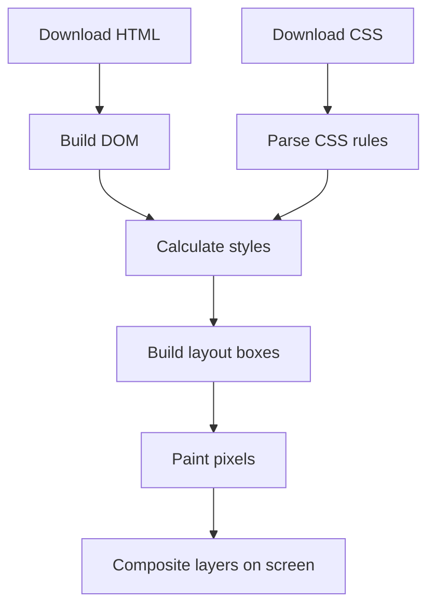
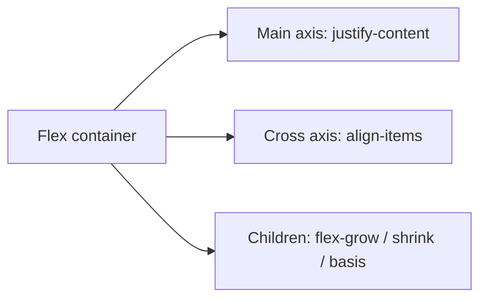

# CSS Zero to Hero — The Complete Practical Handbook

> **From your first CSS rule to maintainable, accessible, responsive production interfaces**  
> **Format:** self-paced, beginner-to-expert Markdown learning handbook  
> **Prerequisites:** basic HTML, a code editor, and a modern browser  
> **How to learn:** read → type the examples → experiment → complete the exercises → build the projects.

---

## Table of Contents

### Part I — Foundations
1. [How the Web Renders CSS](#1-how-the-web-renders-css)
2. [Your First Stylesheet and Development Workflow](#2-your-first-stylesheet-and-development-workflow)
3. [Selectors, Combinators and Relationships](#3-selectors-combinators-and-relationships)
4. [The Cascade, Specificity, Inheritance and Layers](#4-the-cascade-specificity-inheritance-and-layers)
5. [Values, Units, Colours and Functions](#5-values-units-colours-and-functions)
6. [Typography and Readable Content](#6-typography-and-readable-content)
7. [The Box Model and Sizing](#7-the-box-model-and-sizing)
8. [Display, Overflow and Visibility](#8-display-overflow-and-visibility)

### Part II — Layout and Responsive Design
9. [Normal Flow and Positioning](#9-normal-flow-and-positioning)
10. [Flexbox from First Principles](#10-flexbox-from-first-principles)
11. [CSS Grid from First Principles](#11-css-grid-from-first-principles)
12. [Responsive Design and Media Queries](#12-responsive-design-and-media-queries)
13. [Images, Backgrounds and Media](#13-images-backgrounds-and-media)
14. [Forms, Tables and Interactive States](#14-forms-tables-and-interactive-states)
15. [Pseudo-classes, Pseudo-elements and Advanced Selectors](#15-pseudo-classes-pseudo-elements-and-advanced-selectors)

### Part III — Advanced and Production CSS
16. [Custom Properties, Themes and Design Tokens](#16-custom-properties-themes-and-design-tokens)
17. [Transitions, Transforms and Animations](#17-transitions-transforms-and-animations)
18. [Modern CSS: Container Queries, Nesting and Relational Styling](#18-modern-css-container-queries-nesting-and-relational-styling)
19. [Accessibility and Inclusive Styling](#19-accessibility-and-inclusive-styling)
20. [Architecture, Naming and Maintainability](#20-architecture-naming-and-maintainability)
21. [Performance, Browser Support and Security](#21-performance-browser-support-and-security)
22. [Debugging CSS with DevTools](#22-debugging-css-with-devtools)

### Part IV — Apply and Prove Your Skills
23. [Twelve Guided Mini-Labs](#23-twelve-guided-mini-labs)
24. [Three Portfolio Projects](#24-three-portfolio-projects)
25. [Capstone: Responsive Training Academy Website](#25-capstone-responsive-training-academy-website)
26. [Practice Exercises and Answer Key](#26-practice-exercises-and-answer-key)
27. [Interview Questions and Model Answers](#27-interview-questions-and-model-answers)
28. [Glossary, Roadmap and Mastery Checklists](#28-glossary-roadmap-and-mastery-checklists)

---

# Part I — Foundations

## 1. How the Web Renders CSS

**HTML describes meaning and structure; CSS controls presentation and layout; JavaScript adds behaviour.** CSS is a declarative language: you describe how matching elements should look, rather than manually drawing every pixel.

A browser roughly performs these steps:



The **DOM** is the tree of HTML elements. The browser combines DOM nodes with applicable CSS declarations to calculate *computed styles*, then determines each element's size and position. Painting produces visible pixels. Not every change requires all stages; changing `width` often affects layout, while changing `transform` can often avoid layout.

**Mental model:** CSS is a system of rules and constraints. When a page looks wrong, ask: *Which rule won? What size was available? Which layout algorithm placed the box?*

**Knowledge check:** Why might changing a parent's width move several children even when their own CSS did not change? Because layout depends on available space and the parent-child relationship.

## 2. Your First Stylesheet and Development Workflow

Create a folder:

```text
css-zero-to-hero/
├── index.html
├── styles.css
└── assets/
```

**index.html**

```html
<!doctype html>
<html lang="en">
<head>
  <meta charset="UTF-8">
  <meta name="viewport" content="width=device-width, initial-scale=1">
  <title>My First CSS Page</title>
  <link rel="stylesheet" href="styles.css">
</head>
<body>
  <main class="card">
    <h1>Hello, CSS!</h1>
    <p>My first styled page.</p>
    <a href="#next">Continue learning</a>
  </main>
</body>
</html>
```

**styles.css**

```css
/* A rule consists of a selector and declarations. */
body {
  font-family: system-ui, sans-serif;
  background-color: #f3f6fb;
  color: #172033;
}

.card {
  max-width: 40rem;
  margin: 3rem auto;
  padding: 2rem;
  background: white;
  border-radius: 1rem;
}

.card a { color: #155eef; }
```

A CSS declaration is `property: value;`. A ruleset combines a selector and a declaration block. CSS comments use `/* ... */`.

**Three ways to add CSS:** external stylesheet (recommended for most projects), embedded `<style>` in HTML, and inline `style` attributes (use sparingly). External stylesheets promote reuse and caching.

**Workflow:** save → refresh browser → inspect element → edit → repeat. Use browser DevTools (`Inspect`) to see which declarations apply or are crossed out.

**Try it:** change the background, add `line-height: 1.6`, and change `max-width` to `30rem`. Describe what each change does.

## 3. Selectors, Combinators and Relationships

A selector determines **which elements** receive a rule.

| Selector | Example | Matches |
|---|---|---|
| Type | `p` | All paragraphs |
| Class | `.notice` | Elements with class `notice` |
| ID | `#header` | Element with that ID |
| Universal | `*` | All elements |
| Attribute | `[required]` | Elements with a `required` attribute |
| Attribute value | `input[type="email"]` | Email inputs |
| Descendant | `.card p` | Paragraphs anywhere inside `.card` |
| Child | `.menu > li` | Direct list-item children |
| Adjacent sibling | `h2 + p` | First paragraph immediately after an `h2` |
| General sibling | `h2 ~ p` | Later sibling paragraphs |
| Selector list | `h1, h2, h3` | All three types |

```html
<article class="course-card featured">
  <h2>Frontend Development</h2>
  <p class="summary">Build modern interfaces.</p>
  <a href="/courses/frontend">See course</a>
</article>
```

```css
.course-card { border: 1px solid #d0d5dd; }
.course-card.featured { border-color: rebeccapurple; }
.course-card > h2 { margin-block-start: 0; }
.course-card a { text-decoration-thickness: 2px; }
```

**Common mistake:** `.card .featured` means a *descendant* with class `featured` inside `.card`; `.card.featured` means the *same element* has both classes.

**Practice:** style only direct links inside a navigation list, not links inside nested dropdowns. **Hint:** `nav > ul > li > a`.

## 4. The Cascade, Specificity, Inheritance and Layers

When declarations compete, CSS determines a winner using **origin and importance, cascade layer, specificity, scoping proximity, and source order** (with nuances for animations and transitions). Specificity alone does not decide everything.

A simplified comparison for ordinary rules in the same origin/layer:

| Selector | Specificity |
|---|---|
| `p` | `0-0-1` |
| `.card` | `0-1-0` |
| `#main` | `1-0-0` |
| `.card p` | `0-1-1` |
| `#main .card p` | `1-1-1` |

```css
p { color: navy; }
.message { color: green; }
#urgent { color: crimson; }
```

For `<p id="urgent" class="message">`, `crimson` wins among these ordinary declarations because the ID selector is more specific.

**Inheritance:** `color` and `font-family` typically inherit; `margin` and `border` do not. Keywords `inherit`, `initial`, `unset`, `revert`, and `revert-layer` provide different reset behaviours.

**Cascade layers:**

```css
@layer reset, base, components, utilities;

@layer base {
  a { color: #155eef; }
}
@layer components {
  .button { color: white; background: #155eef; }
}
```

For *normal* declarations, later declared layers have higher priority than earlier layers, regardless of specificity across those layers. For `!important`, layer priority reverses. Unlayered normal author styles outrank layered normal author styles. Avoid `!important` as a default fix.

**Debugging exercise:** Add `.button { color: yellow; }` to the `base` layer and explain why the `components` layer still wins.

## 5. Values, Units, Colours and Functions

| Unit | Meaning | Best use |
|---|---|---|
| `px` | CSS pixel | Borders and precise small details |
| `rem` | Root font-size relative | Type, spacing, scalable layout |
| `em` | Current element's font size relative | Component-relative sizing |
| `%` | Relative to property-specific reference | Fluid sizing |
| `vw`, `vh` | Viewport units | Full-screen effects |
| `dvh` | Dynamic viewport height | Mobile viewport-aware panels |
| `ch` | Approximate width of the `0` glyph | Readable text measures |
| `fr` | Fraction of leftover grid space | Grid tracks |

```css
:root { font-size: 100%; }
.hero {
  padding: clamp(2rem, 5vw, 5rem);
  min-height: 60dvh;
}
.hero h1 { font-size: clamp(2rem, 4vw + 1rem, 4.5rem); }
.container { width: min(100% - 2rem, 72rem); margin-inline: auto; }
.sidebar { width: calc(25% - 1rem); }
```

**Colour formats:** named (`tomato`), hex (`#1d4ed8`), `rgb()`, `hsl()`, and modern perceptual formats such as `oklch()`. Alpha values provide transparency.

```css
:root {
  --brand: #1d4ed8;
  --surface: hsl(210 20% 98%);
  --shadow: rgb(15 23 42 / 12%);
}
```

**`clamp(min, preferred, max)`** helps create fluid values within safe limits. **`min()` and `max()`** select the smaller/larger computed values. Avoid using viewport-only font sizes without minimums.

**Practice:** Build a title that grows from 2rem to 4rem as the viewport widens.

## 6. Typography and Readable Content

Good typography is functional: readers should quickly scan headings and comfortably read paragraphs.

```css
body {
  font-family: system-ui, -apple-system, "Segoe UI", sans-serif;
  font-size: 1rem;
  line-height: 1.65;
}
article { max-width: 70ch; }
h1, h2, h3 { line-height: 1.15; text-wrap: balance; }
p { text-wrap: pretty; }
.small-print { font-size: 0.875rem; }
```

**Core properties:** `font-family`, `font-size`, `font-weight`, `font-style`, `line-height`, `letter-spacing`, `text-align`, `text-decoration`, `text-transform`, `white-space`, `overflow-wrap`.

Use real heading elements (`h1`–`h6`) in meaningful order. Don't fake headings with a large `<div>`. A text column of roughly 45–75 characters per line is often comfortable; context matters.

**Web fonts:**

```css
@font-face {
  font-family: "MyBrand";
  src: url("assets/mybrand.woff2") format("woff2");
  font-display: swap;
}
```

Only reference font files you are licensed to use. Prefer a system font when custom fonts are unnecessary.

**Common mistake:** Setting `font-size: 12px` for every paragraph can reduce readability. Test zoom to 200% and mobile layouts.

## 7. The Box Model and Sizing

Every rendered element has content, padding, border, and margin.

```text
┌────────────── margin (outside) ──────────────┐
│ ┌──────────── border ──────────────────────┐ │
│ │ ┌────────── padding ──────────────────┐ │ │
│ │ │             CONTENT                │ │ │
│ │ └────────────────────────────────────┘ │ │
│ └────────────────────────────────────────┘ │
└────────────────────────────────────────────┘
```

Under `content-box`, a declared `width: 300px` excludes padding and borders. Under `border-box`, the declared width includes content + padding + borders.

```css
*, *::before, *::after { box-sizing: border-box; }
.card {
  width: 300px;
  padding: 24px;
  border: 2px solid #94a3b8;
  margin: 20px;
}
```

With `border-box`, the card's border-box width is **300px**. Without it, width becomes **352px** (300 + 48 padding + 4 border), excluding margins.

**Margin collapsing:** adjacent vertical margins of block elements in normal flow can collapse. Flex and grid item margins do not collapse in the same way. Prefer `gap` for spacing between flex/grid children.

**Logical properties** support writing directions:

```css
.card { padding-inline: 1.5rem; padding-block: 1rem; margin-inline: auto; }
```

**Practice:** Create two cards, one with `content-box`, one with `border-box`, both `width: 300px; padding: 20px; border: 5px solid;`. Measure actual widths.

## 8. Display, Overflow and Visibility

| Value | Behaviour |
|---|---|
| `block` | Starts on a new line and normally fills available inline space |
| `inline` | Flows with text; width/height behave differently |
| `inline-block` | Inline placement with box dimensions |
| `flex` | Establishes a flex formatting context |
| `grid` | Establishes a grid formatting context |
| `none` | Removes element from layout and accessibility tree in normal circumstances |

```css
.badge { display: inline-block; padding: 0.25rem 0.6rem; }
.scroller { overflow-x: auto; }
.clipped { overflow: hidden; }
```

`visibility: hidden` usually retains layout space, while `display: none` does not. `opacity: 0` can leave an element interactive and focusable—don't use opacity alone to hide interactive controls.

**Overflow troubleshooting:** If a page scrolls horizontally, inspect children with fixed widths, `white-space: nowrap`, long URLs, and flex/grid items missing `min-width: 0`.

---

# Part II — Layout and Responsive Design

## 9. Normal Flow and Positioning

The default layout is **normal flow**: block elements stack and inline content wraps. Positioning changes how boxes are placed.

```css
.relative-parent { position: relative; }
.absolute-badge { position: absolute; top: 0.5rem; right: 0.5rem; }
.sticky-header { position: sticky; top: 0; z-index: 10; }
.floating-help { position: fixed; right: 1rem; bottom: 1rem; }
```

- `relative`: offset visually while preserving original layout space.
- `absolute`: removed from normal flow, positioned relative to an appropriate containing block.
- `fixed`: commonly relative to viewport, though transformed ancestors can change this.
- `sticky`: participates in flow until it reaches its threshold within a scroll container.

**Stacking context:** `z-index` does not simply compare every element globally. Positioned elements with `z-index`, transforms, opacity below 1, and other properties can create separate stacking contexts.

**Pitfall:** `position: sticky` may fail to appear sticky when there is no scrolling room or an ancestor's overflow changes the scroll container.

## 10. Flexbox from First Principles

Flexbox is a **one-dimensional** layout system: it arranges items along a main axis and aligns them along a cross axis.



```html
<nav class="nav">
  <a class="brand" href="/">Academy</a>
  <div class="nav-links"><a href="#courses">Courses</a><a href="#contact">Contact</a></div>
</nav>
```

```css
.nav { display: flex; align-items: center; justify-content: space-between; gap: 1rem; }
.nav-links { display: flex; flex-wrap: wrap; gap: 1rem; }
```

**Container properties:** `display: flex`, `flex-direction`, `flex-wrap`, `justify-content`, `align-items`, `align-content`, `gap`.

**Item properties:** `flex-grow`, `flex-shrink`, `flex-basis`, `flex` shorthand, `align-self`, `order`.

```css
.cards { display: flex; flex-wrap: wrap; gap: 1rem; }
.cards > article { flex: 1 1 16rem; min-width: 0; }
```

`flex: 1 1 16rem` means: grow if space is available, shrink if needed, and start with a basis of 16rem. `justify-content` works on the main axis; if `flex-direction: column`, that axis is vertical.

**Accessibility caution:** `order` changes visual order, not DOM reading/tab order. Keep logical source order.

**Exercise:** Build a navigation bar that stacks on narrow screens without changing HTML.

## 11. CSS Grid from First Principles

Grid is a **two-dimensional** layout system. Use it when both rows and columns matter.

```css
.dashboard {
  display: grid;
  grid-template-columns: 16rem minmax(0, 1fr);
  gap: 1.5rem;
}
.gallery {
  display: grid;
  grid-template-columns: repeat(auto-fit, minmax(min(100%, 16rem), 1fr));
  gap: 1rem;
}
```

**Key vocabulary:** grid container, grid item, track, line, cell, area, gap, explicit and implicit grid.

**Named areas:**

```css
.page {
  display: grid;
  grid-template-areas:
    "header header"
    "sidebar main"
    "footer footer";
  grid-template-columns: 14rem minmax(0, 1fr);
  gap: 1rem;
}
.header { grid-area: header; }
.sidebar { grid-area: sidebar; }
.main { grid-area: main; }
.footer { grid-area: footer; }
```

**Grid vs Flexbox:** use Grid for page regions and multi-axis layouts; Flexbox for navigation, toolbars and one-axis alignment. They work well together.

`auto-fit` can collapse empty repeated tracks; `auto-fill` preserves tracks even if unoccupied. `minmax(0, 1fr)` is useful to avoid overflow from long content.

**Exercise:** Make a 3-column desktop course gallery that becomes 2 columns on tablet and 1 on mobile.

## 12. Responsive Design and Media Queries

Responsive design is about **adapting to available space and user preferences**, not targeting specific phone models.

Start mobile-first:

```css
.layout { display: grid; gap: 1rem; }
@media (min-width: 48rem) {
  .layout { grid-template-columns: 1fr 2fr; }
}
@media (min-width: 72rem) {
  .layout { grid-template-columns: 16rem minmax(0, 1fr) 14rem; }
}
```

Use fluid containers and responsive images:

```css
.container { width: min(100% - 2rem, 72rem); margin-inline: auto; }
img, video { max-width: 100%; height: auto; }
```

**Breakpoints should respond to content:** shrink your browser until the design stops working, then introduce a breakpoint. Don't assume a tablet is always 768px wide.

**Media queries for preferences:**

```css
@media (prefers-reduced-motion: reduce) {
  *, *::before, *::after { scroll-behavior: auto !important; }
}
@media (prefers-color-scheme: dark) {
  :root { color-scheme: dark; }
}
```

The first example only disables smooth scrolling; for animations, also reduce or remove nonessential motion where needed.

**Testing matrix:** 320px, 375px, 768px, 1024px, 1440px; keyboard navigation; 200% zoom; long text; slow network; light/dark preference.

## 13. Images, Backgrounds and Media

```css
.hero {
  background-image: linear-gradient(rgb(0 0 0 / 45%), rgb(0 0 0 / 45%)),
    url("assets/classroom.jpg");
  background-size: cover;
  background-position: center;
}
.avatar { width: 4rem; aspect-ratio: 1; object-fit: cover; border-radius: 50%; }
.video { width: 100%; aspect-ratio: 16 / 9; }
```

Use `` for meaningful content and CSS backgrounds for decoration. Provide descriptive `alt` text for informative images; use `alt=""` for decorative images in HTML.

**Responsive image HTML:**

```html

```

Don't lazy-load the main above-the-fold hero image by default. Compress images and provide dimensions when possible to reduce layout shifts.

## 14. Forms, Tables and Interactive States

```html
<form class="enquiry">
  <label for="email">Email address</label>
  <input id="email" name="email" type="email" autocomplete="email" required>
  <button type="submit">Request information</button>
</form>
```

```css
.enquiry { display: grid; gap: 0.75rem; max-width: 28rem; }
.enquiry input { font: inherit; padding: 0.75rem; border: 1px solid #64748b; border-radius: 0.5rem; }
.enquiry input:focus-visible { outline: 3px solid #2563eb; outline-offset: 2px; }
.enquiry input:invalid:not(:placeholder-shown) { border-color: #b91c1c; }
.enquiry button { cursor: pointer; padding: 0.75rem 1rem; }
```

**Important:** CSS does not submit a form to a server or validate business rules. HTML provides basic validation; JavaScript and backend validation may be required for real workflows.

**Tables:** use real `<table>`, `<thead>`, `<tbody>`, `<th scope="col">` for tabular data. Wrap wide tables in a container with `overflow-x: auto` rather than breaking semantic structure.

## 15. Pseudo-classes, Pseudo-elements and Advanced Selectors

Pseudo-classes describe state or relationships; pseudo-elements target generated or special parts.

```css
button:hover { background: #1d4ed8; }
button:focus-visible { outline: 3px solid orange; }
input:disabled { opacity: 0.55; cursor: not-allowed; }
li:nth-child(odd) { background: #f8fafc; }
.card:not(.featured) { border-color: #cbd5e1; }
.card::before { content: ""; display: block; height: 0.25rem; background: #2563eb; }
::selection { background: #bfdbfe; }
```

**`:is()`** groups alternatives while taking the highest specificity of its arguments. **`:where()`** always contributes zero specificity. **`:has()`** can style a parent based on descendants or other relational conditions.

```css
:where(h1, h2, h3) { margin-block: 0 0.75rem; }
.course-card:has(.badge--new) { border-color: #16a34a; }
```

Use `:focus-visible` for keyboard-friendly focus, but don't remove outlines without providing an accessible replacement.

---

# Part III — Advanced and Production CSS

## 16. Custom Properties, Themes and Design Tokens

CSS custom properties are reusable values that participate in the cascade and inheritance.

```css
:root {
  --color-brand: #1d4ed8;
  --color-text: #0f172a;
  --color-bg: #ffffff;
  --space-1: 0.25rem;
  --space-2: 0.5rem;
  --space-4: 1rem;
  --radius-card: 0.75rem;
}
body { color: var(--color-text); background: var(--color-bg); }
.button { background: var(--color-brand); padding: var(--space-2) var(--space-4); }
[data-theme="dark"] { --color-text: #f8fafc; --color-bg: #0f172a; }
```

`var(--token, fallback)` uses a fallback if the custom property is missing or invalid in certain ways. Custom properties are resolved at use time and can be overridden per component.

**Advanced:** `@property` can register typed custom properties for validation, inheritance control, and animatable values.

```css
@property --progress {
  syntax: "<percentage>";
  inherits: false;
  initial-value: 0%;
}
```

**Design token hierarchy:** primitives (`--blue-600`) → semantic tokens (`--color-action`) → component tokens (`--button-bg`). Prefer semantic tokens in components so themes can change without rewriting them.

## 17. Transitions, Transforms and Animations

```css
.button {
  transition: background-color 180ms ease, transform 180ms ease;
}
.button:hover { transform: translateY(-2px); }

@keyframes appear {
  from { opacity: 0; transform: translateY(0.5rem); }
  to { opacity: 1; transform: translateY(0); }
}
.toast { animation: appear 250ms ease-out both; }

@media (prefers-reduced-motion: reduce) {
  .button { transition: none; }
  .toast { animation: none; }
}
```

**Transform functions:** `translate`, `rotate`, `scale`, `skew`. `transform-origin` changes the pivot point. Animating `transform` and `opacity` often performs better than repeatedly animating layout properties such as `top` and `width`, though performance depends on context.

**Avoid:** autoplaying large motions, endless flashing, and motion essential to understanding content. Provide non-motion alternatives.

**Exercise:** Animate a notification entering the screen, then verify reduced-motion mode disables the animation.

## 18. Modern CSS: Container Queries, Nesting and Relational Styling

**Container queries** respond to a component's containing element rather than the entire viewport.

```html
<section class="course-list">
  <article class="course-card"><h2>CSS Mastery</h2><p>Build responsive layouts.</p></article>
</section>
```

```css
.course-list { container-type: inline-size; }
.course-card { display: grid; gap: 1rem; }
@container (min-width: 32rem) {
  .course-card { grid-template-columns: 1fr 2fr; }
}
```

A container query applies to descendants of a qualifying query container, not the container element itself.

**Native nesting:**

```css
.card {
  padding: 1rem;
  & h2 { margin-top: 0; }
  &:hover { box-shadow: 0 8px 20px rgb(0 0 0 / 10%); }
}
```

**Progressive enhancement:**

```css
@supports (display: grid) {
  .gallery { display: grid; grid-template-columns: repeat(3, 1fr); }
}
```

Other useful modern features include `aspect-ratio`, `accent-color`, `scroll-margin-top`, logical properties, `subgrid`, and `color-mix()`. Check browser support for your target audience before adopting features that are essential to function.

## 19. Accessibility and Inclusive Styling

Accessible CSS respects differences in vision, motor ability, device, input method and user preferences.

**Checklist:**

1. Ensure sufficient contrast: WCAG AA generally requires **4.5:1** for normal text and **3:1** for large text (with exceptions).
2. Preserve visible keyboard focus and logical tab order.
3. Do not convey meaning through colour alone.
4. Make interactive targets comfortably sized and spaced.
5. Support text zoom and reflow; avoid clipping at 200% zoom.
6. Respect `prefers-reduced-motion` and colour-scheme preferences.
7. Use semantic HTML; CSS alone cannot replace labels, headings, or landmarks.
8. Avoid hiding meaningful content only visually without considering assistive technologies.

**Visually hidden, but screen-reader accessible:**

```css
.sr-only {
  position: absolute;
  width: 1px;
  height: 1px;
  padding: 0;
  margin: -1px;
  overflow: hidden;
  clip: rect(0, 0, 0, 0);
  white-space: nowrap;
  border: 0;
}
```

Use this pattern intentionally, not to conceal essential instructions from sighted users.

**Exercise:** Navigate your project without a mouse and at 200% zoom. Fix anything unreachable, invisible, or clipped.

## 20. Architecture, Naming and Maintainability

A growing stylesheet needs predictable organisation. A simple layered structure:

```text
styles/
├── tokens.css       # colours, spacing, typography variables
├── reset.css        # careful defaults
├── base.css         # global element styles
├── layout.css       # containers and major page regions
├── components.css   # cards, buttons, forms
└── utilities.css    # small intentional helpers
```

**BEM naming example:** `.course-card`, `.course-card__title`, `.course-card--featured`.

```css
.course-card { padding: 1rem; }
.course-card__title { font-weight: 700; }
.course-card--featured { border: 2px solid var(--color-brand); }
```

**Guidelines:** prefer classes over IDs for styling; keep selectors shallow; reuse tokens; avoid unexplained magic numbers; delete dead rules; group component states near the component; document unusual browser workarounds.

**Architecture exercise:** Refactor three pages that each use slightly different blue buttons into a shared `.button` component with variants.

## 21. Performance, Browser Support and Security

**Performance principles:**

- Keep CSS lean and remove unused styles.
- Minify production CSS; cache static assets appropriately.
- Avoid unnecessary expensive effects on huge regions.
- Set image dimensions or aspect ratios to limit layout shift.
- Prefer targeted animations; measure before optimising.
- Use `content-visibility: auto` thoughtfully for large off-screen sections, with layout sizing and accessibility testing.
- Consider critical rendering path and stylesheet loading; don't indiscriminately inline large CSS files.

**Browser support:** test features in your actual target browsers and consult current compatibility data. Use fallbacks when necessary.

**Security boundary:** CSS is not a security layer. Hiding an admin button with `display: none` does not protect an action. Authorization belongs on the server. Don't trust unvalidated user content inserted into CSS URLs or HTML.

**Production release checklist:** no overflow, keyboard focus works, responsive at multiple widths, no missing fonts/assets, acceptable performance, dark-mode/reduced-motion behaviour checked, CSS minified, and console/network errors reviewed.

## 22. Debugging CSS with DevTools

A repeatable diagnostic procedure:

1. **Reproduce** the issue at a known viewport size.
2. **Inspect** the wrong element.
3. **Check Computed** to see the final property value.
4. **Inspect Styles** to find the winning and crossed-out declarations.
5. **Inspect Box Model** for padding, border, margin and dimensions.
6. **Toggle layout overlays** for Flexbox/Grid.
7. **Check ancestors** for overflow, containing blocks, transforms and stacking contexts.
8. **Temporarily disable rules**, then make the smallest durable fix.
9. **Retest** mobile, desktop, keyboard and zoom.

| Symptom | Likely causes | First check |
|---|---|---|
| Horizontal scrollbar | Fixed width, long text, flex min-content | Element widths in DevTools |
| `z-index` not working | Different stacking contexts | Ancestor stacking contexts |
| Sticky not sticking | Wrong scroll container or no room | Ancestor overflow |
| Flex item overflows | Default `min-width: auto` | Try `min-width: 0` |
| Image distorted | Forced width and height | `object-fit` and aspect ratio |
| CSS rule crossed out | Cascade winner | Specificity/layer/source order |
| Grid column too wide | Min-content sizing | `minmax(0, 1fr)` |

**Debugging challenge:** intentionally set `.card { width: 600px; }` inside a 320px viewport. Find the overflow and fix it with `width: min(100%, 600px)`.

---

# Part IV — Apply and Prove Your Skills

## 23. Twelve Guided Mini-Labs

Each lab includes a **goal**, **starting point**, **task**, and **success test**. Save each lab in its own folder and include a README explaining what you learned.

### Lab 1 — Style a Profile Card (Beginner)
**Goal:** selectors, fonts, colours, spacing.  
**Start:** a page with a name, bio and link.  
**Build:** a centered card with rounded corners, shadow and a clear call-to-action.  
**Success:** card stays readable at 320px; link has visible keyboard focus.

### Lab 2 — Box Model Detective (Beginner)
**Goal:** compare `content-box` and `border-box`.  
**Build:** two boxes with identical declared widths and different box-sizing.  
**Success:** explain their measured dimensions in DevTools.

### Lab 3 — Typography System (Beginner)
**Goal:** hierarchy and readability.  
**Build:** an article with title, subheadings, callout, lists and code.  
**Success:** readable line lengths, logical headings, and 200% zoom support.

### Lab 4 — Navigation Bar (Intermediate)
**Goal:** Flexbox and responsive states.  
**Build:** logo, links and an enrol button.  
**Success:** no overlap at 320px; keyboard navigation works.

### Lab 5 — Course Card Grid (Intermediate)
**Goal:** Grid, `auto-fit`, `minmax()`.  
**Build:** six cards with titles, durations and links.  
**Success:** cards flow naturally between one and several columns.

### Lab 6 — Responsive Hero (Intermediate)
**Goal:** `clamp()`, images and contrast.  
**Build:** headline, supporting text, CTA and decorative image.  
**Success:** text remains readable on mobile and desktop.

### Lab 7 — Accessible Enquiry Form (Intermediate)
**Goal:** labels, focus and validation states.  
**Build:** name, email, course selector and submit button.  
**Success:** usable with keyboard and clear error styling. No backend required.

### Lab 8 — Sticky Sidebar (Intermediate)
**Goal:** positioning and scroll containers.  
**Build:** article with table of contents sidebar.  
**Success:** sidebar sticks only when room allows; no content obstruction.

### Lab 9 — Theme Tokens (Advanced)
**Goal:** custom properties and dark mode.  
**Build:** two visual themes using semantic tokens.  
**Success:** component styles don't hard-code theme colours.

### Lab 10 — Animated Notification (Advanced)
**Goal:** keyframes, transitions and reduced motion.  
**Build:** notification card that enters smoothly.  
**Success:** animation is disabled for reduced-motion preference.

### Lab 11 — Container-aware Component (Advanced)
**Goal:** container queries.  
**Build:** a course card that changes from stacked to side-by-side depending on its container.  
**Success:** works in narrow sidebar and wide main column at the same viewport width.

### Lab 12 — Debug and Refactor (Advanced)
**Goal:** DevTools, cascade, architecture.  
**Build:** intentionally conflicting styles, then resolve without `!important`.  
**Success:** no regressions; explain which rules won and why.

## 24. Three Portfolio Projects

### Project A — Personal Portfolio (Beginner)
**Pages:** Home, About, Projects, Contact.  
**Required:** typography system, responsive cards, focus states, semantic HTML, reusable button classes.  
**Stretch:** print stylesheet and light/dark theme.

### Project B — Product Landing Page (Intermediate)
**Pages:** single-page product marketing experience.  
**Required:** hero, benefits, pricing cards, FAQ, mobile navigation, responsive imagery, accessible CTA.  
**Stretch:** CSS-only disclosure using semantic `<details>`.

### Project C — Analytics Dashboard (Advanced)
**Pages:** dashboard with sidebar, header, metrics, activity table.  
**Required:** Grid shell, Flexbox widgets, table overflow, custom properties, container queries, dark theme, keyboard focus.  
**Stretch:** loading skeleton that respects reduced-motion settings.

**Portfolio quality bar:** live demo, readable README, screenshots at mobile and desktop widths, accessibility notes, and explanation of design decisions.

## 25. Capstone: Responsive Training Academy Website

**Scenario:** A training academy needs a public website that showcases programmes and helps prospective students enquire. Build a polished, accessible front-end. This is a CSS/HTML project; a working registration backend is **out of scope**.

### Required pages

1. **Home:** hero, featured courses, benefits, testimonial section and CTA.
2. **About:** academy story, mission, training approach and facilities.
3. **Courses:** searchable-looking course listing (static display unless JavaScript is added), categories and cards.
4. **Course Details:** reusable layout with overview, curriculum, duration and enquiry CTA.
5. **Contact:** accessible enquiry form, contact details and location information.

### Suggested file structure

```text
academy-capstone/
├── index.html
├── about.html
├── courses.html
├── course-details.html
├── contact.html
├── assets/
│   └── images/
└── css/
    ├── tokens.css
    ├── base.css
    ├── layout.css
    ├── components.css
    └── responsive.css
```

### Build stages

**Stage 1 — Plan:** wireframe mobile and desktop; define colours, typography and spacing tokens; inventory page sections.  
**Stage 2 — Semantic HTML:** create landmarks, navigation, headings, links, lists and labelled form fields.  
**Stage 3 — Base CSS:** reset, box sizing, typography, colour system and reusable containers.  
**Stage 4 — Components:** buttons, cards, badges, navigation, footer and form controls.  
**Stage 5 — Layout:** Grid for page regions and card galleries; Flexbox for navigation and controls.  
**Stage 6 — Responsive:** test at 320px through desktop; eliminate horizontal overflow.  
**Stage 7 — Inclusive UX:** keyboard navigation, focus, contrast, zoom and reduced-motion.  
**Stage 8 — QA:** cross-browser testing, DevTools audit, README and screenshots.

### Starter design tokens

```css
:root {
  --brand: #1d4ed8;
  --brand-dark: #1e40af;
  --ink: #0f172a;
  --muted: #475569;
  --surface: #ffffff;
  --canvas: #f8fafc;
  --border: #cbd5e1;
  --space-sm: 0.5rem;
  --space-md: 1rem;
  --space-lg: 2rem;
  --radius: 0.75rem;
  --container: 72rem;
}
*, *::before, *::after { box-sizing: border-box; }
body { margin: 0; font: 1rem/1.6 system-ui, sans-serif; color: var(--ink); background: var(--canvas); }
.container { width: min(100% - 2rem, var(--container)); margin-inline: auto; }
```

### Capstone evaluation rubric (100 points)

| Category | Points | What excellent work demonstrates |
|---|---:|---|
| Semantic structure | 10 | Meaningful HTML, headings, navigation, form labels |
| Visual hierarchy | 15 | Consistent typography, spacing and readable composition |
| Layout mastery | 20 | Appropriate Flexbox/Grid and resilient components |
| Responsive design | 20 | Usable across widths without clipping or overflow |
| Accessibility | 15 | Focus, contrast, zoom, reduced motion, semantic controls |
| Maintainable CSS | 10 | Tokens, clear naming, low specificity, organised files |
| Testing and documentation | 10 | Tested states, README, screenshots and known limitations |
| **Total** | **100** | |

**Definition of done:** all five pages work locally, all links are meaningful, no console/network errors from missing assets, and a reviewer can use the site at 320px and 200% zoom.

## 26. Practice Exercises and Answer Key

Attempt these **before** checking the answers.

### Beginner

**B1.** What is the difference between a class selector and an ID selector?  
**B2.** What is the final border-box width of `width: 200px; padding: 10px; border: 2px solid` under `content-box`?  
**B3.** Write a rule that selects all links inside `.footer`.  
**B4.** Explain the difference between `rem` and `em`.  
**B5.** Why should you include the viewport meta tag in responsive pages?

### Intermediate

**I1.** Build a Flexbox row with items spaced apart and vertically centred.  
**I2.** Create a Grid with three equal columns and a 16px gap.  
**I3.** Make the grid one column below 600px.  
**I4.** Explain why a flex child containing a long URL may overflow.  
**I5.** Build a sticky header with a visible background.

### Advanced

**A1.** Define semantic tokens for light and dark themes.  
**A2.** Write a container query that changes a card at 30rem.  
**A3.** Style a card only when it contains an `.error` descendant.  
**A4.** Disable a nonessential animation for reduced-motion users.  
**A5.** Diagnose a modal hidden behind a header even though its `z-index` is larger.  
**A6.** Explain the difference between `:is()` and `:where()` specificity.

### Answer key with explanations

**B1:** `.class` is reusable; `#id` matches an ID value intended to be unique in a document and carries higher specificity. Prefer classes for styling.  
**B2:** `224px`: 200 content + 20 horizontal padding + 4 border.  
**B3:** `.footer a { ... }`  
**B4:** `rem` refers to root font size; `em` is relative to the element's computed font size for `font-size` calculations (and typically the element's own font size for other properties).  
**B5:** It tells mobile browsers to size the layout viewport to the device width rather than a wider virtual viewport.

**I1:** `.row { display:flex; justify-content:space-between; align-items:center; }`  
**I2:** `.grid { display:grid; grid-template-columns:repeat(3,1fr); gap:16px; }`  
**I3:** `@media (max-width: 599px) { .grid { grid-template-columns:1fr; } }`  
**I4:** Flex items have an automatic minimum size; try `min-width:0` and `overflow-wrap:anywhere` where appropriate.  
**I5:** `.header { position:sticky; top:0; background:white; z-index:10; }` and check the scroll container.

**A1:**

```css
:root { --bg: #fff; --fg: #111827; }
[data-theme="dark"] { --bg: #111827; --fg: #fff; }
body { background: var(--bg); color: var(--fg); }
```

**A2:**

```css
.wrapper { container-type: inline-size; }
@container (min-width: 30rem) { .card { display: grid; grid-template-columns: 1fr 2fr; } }
```

**A3:** `.card:has(.error) { border-color: red; }`  
**A4:** `@media (prefers-reduced-motion: reduce) { .animated { animation: none; } }`  
**A5:** Inspect ancestor stacking contexts; a child cannot escape its ancestor's stacking context merely with a large `z-index`. Consider the top layer (`<dialog>`) where appropriate.  
**A6:** `:is()` adopts the highest specificity among its selector-list arguments; `:where()` always adds zero specificity.

## 27. Interview Questions and Model Answers

1. **What is CSS?** A declarative styling language used to describe the presentation of structured documents such as HTML.
2. **Explain the cascade.** The browser resolves competing declarations based on origin, importance, layers, specificity and order, with additional rules for scope and animations.
3. **What is specificity?** A comparison of selector weights, often represented as ID-class-type counts.
4. **When would you use Flexbox?** One-dimensional alignment, navigation bars, toolbars and groups of components.
5. **When would you use Grid?** Two-dimensional page structures and layouts that coordinate rows and columns.
6. **What is the box model?** Content, padding, border and margin determining element dimensions and spacing.
7. **Why use `box-sizing: border-box`?** Declared width includes padding and border, making sizing more predictable.
8. **Difference between `display:none` and `visibility:hidden`?** The former removes the box from layout; the latter generally preserves space.
9. **What creates a stacking context?** Properties such as positioned elements with non-auto z-index, transforms and opacity below 1, among others.
10. **What is responsive design?** Layouts and content that adapt to available space and user preferences.
11. **What is mobile-first CSS?** Base styles target constrained layouts; wider enhancements use `min-width` queries.
12. **What is a container query?** A query based on a qualifying ancestor container's size or style rather than viewport size.
13. **What are CSS custom properties?** Cascade-aware reusable values accessed with `var()`.
14. **Why might `position: sticky` fail?** Incorrect scroll container, overflow behaviour, or insufficient scrolling room.
15. **Why does `z-index: 99999` sometimes fail?** Stacking contexts isolate descendants.
16. **How do you debug an overridden rule?** Inspect computed styles and cascade winners in DevTools.
17. **How do you avoid layout shifts?** Reserve space for images/media and avoid inserting unreserved content above visible material.
18. **How do you respect reduced motion?** Detect `prefers-reduced-motion` and remove nonessential transitions/animations.
19. **How do you organise CSS at scale?** Tokens, base styles, layout, components, utilities and predictable naming.
20. **Can CSS enforce access control?** No. Visual hiding is not authorization; security belongs to application/server controls.

**Interview challenge:** Explain how you would build a responsive pricing section with three cards, a featured plan, keyboard-accessible actions, and a dark theme. Discuss semantics, Grid/Flexbox choice, tokens, focus, contrast, breakpoints and testing.

## 28. Glossary, Roadmap and Mastery Checklists

### Glossary

| Term | Meaning |
|---|---|
| Selector | Pattern matching elements to style |
| Declaration | Property-value pair inside a CSS rule |
| Cascade | Process resolving competing declarations |
| Specificity | Weight of a selector for conflict resolution |
| Inheritance | Certain property values passed from parent to child |
| Computed value | Value after the browser resolves applicable rules and calculations |
| Box model | Content, padding, border and margin |
| Containing block | Reference box used for certain dimensions/positioning |
| Flex axis | Main or cross axis of a flex layout |
| Grid track | Row or column between grid lines |
| Breakpoint | Condition where a responsive rule changes |
| Stacking context | Independent group for z-order comparisons |
| Pseudo-class | Selector for state or structural relation |
| Pseudo-element | Selector for a special part/generated box |
| Custom property | CSS variable-like value starting with `--` |
| Design token | Named reusable design decision |
| Container query | Style condition based on a qualifying container |
| Reflow/layout | Browser process calculating box dimensions and positions |
| Paint | Rendering visual details into pixels |
| Progressive enhancement | Start with broadly supported functionality; add advanced features safely |

### Suggested 10-week learning roadmap

| Week | Topics | Deliverable |
|---|---|---|
| 1 | Setup, selectors, cascade | Profile card |
| 2 | Units, typography, box model | Styled article |
| 3 | Flow, positioning, overflow | Sticky article layout |
| 4 | Flexbox | Responsive navigation |
| 5 | Grid | Course gallery |
| 6 | Media queries, imagery | Responsive landing page |
| 7 | Forms, states, accessibility | Enquiry form |
| 8 | Tokens, animation, modern CSS | Themeable component library |
| 9 | Architecture, performance, debugging | Refactored portfolio project |
| 10 | Capstone build and QA | Five-page training academy website |

### Beginner mastery checklist

- [ ] I can link an external stylesheet.
- [ ] I can write class, type and relationship selectors.
- [ ] I can explain why one CSS rule overrides another.
- [ ] I can use `rem`, `%`, and `clamp()` appropriately.
- [ ] I can explain the box model and `border-box`.
- [ ] I can style readable text and visible focus states.

### Intermediate mastery checklist

- [ ] I can build layouts with Flexbox and Grid.
- [ ] I can use mobile-first media queries.
- [ ] I can make images and tables responsive.
- [ ] I can debug overflow and sticky positioning.
- [ ] I can style accessible forms and interactive states.
- [ ] I can test at mobile, tablet, desktop and 200% zoom.

### Advanced mastery checklist

- [ ] I can build semantic design tokens and themes.
- [ ] I can use cascade layers intentionally.
- [ ] I can apply container queries and native nesting.
- [ ] I can respect reduced-motion preferences.
- [ ] I can diagnose stacking contexts and specificity conflicts.
- [ ] I can organise a multi-page CSS codebase.
- [ ] I can explain browser rendering and common performance pitfalls.
- [ ] I can deliver and document a polished capstone project.

### Further study and reference

- [MDN CSS Learning Area](https://developer.mozilla.org/en-US/docs/Learn_web_development/Core/Styling_basics)
- [MDN CSS Reference](https://developer.mozilla.org/en-US/docs/Web/CSS/Reference)
- [web.dev Learn CSS](https://web.dev/learn/css)
- [W3C Web Content Accessibility Guidelines](https://www.w3.org/WAI/standards-guidelines/wcag/)
- [Can I Use — browser compatibility](https://caniuse.com/)

---

## Final Advice: What “CSS Hero” Really Means

Expertise is not memorising hundreds of properties. It is the ability to **reason about the cascade, build layouts that survive changing content, maintain accessible interfaces, debug efficiently, and write CSS another developer can confidently extend**.

**Your next action:** complete Labs 1–3 without copying solutions, then build Project A. Return to each chapter whenever you encounter a real layout problem. After the capstone, rebuild one page from scratch and compare the quality and maintainability of both attempts.

*End of handbook.*
