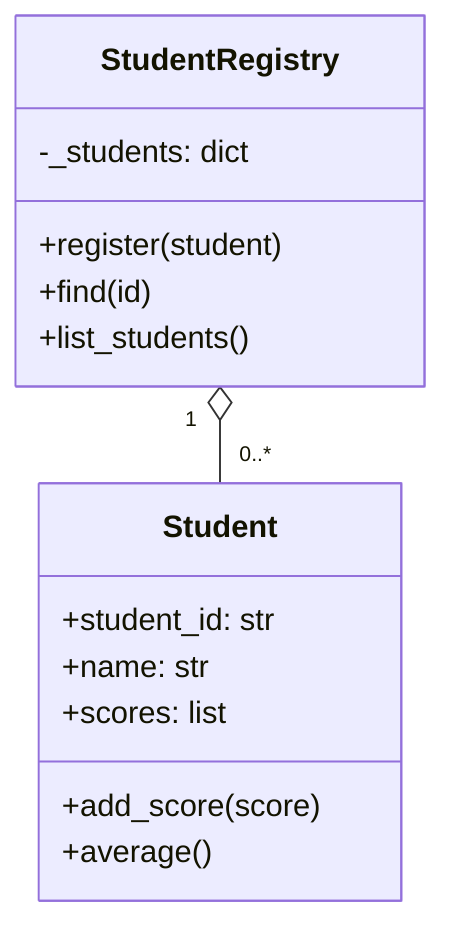

# WEEK 8 — OBJECT-ORIENTED PROGRAMMING (OOP) IN PYTHON

**Opsfuxion Technologies Limited**  
*Orchestrate Intelligence, Deliver with Precision.*

**Practical Software Engineering Foundation Programme — COMPLETE LECTURER'S TEACHING MANUAL**  
**Level:** Beginner progressing toward intermediate | **Contact:** Tuesday / Thursday / Saturday, 3 × 120 minutes (6 hours) | **Independent work:** 6–10 hours  
**Learner:** Uzoamaka | **Instructor edition:** contains solutions, assessment guidance and answer keys.

> **Teaching rule:** Explain → demonstrate → ask learner to predict → learner codes → test success and failure → discuss → commit. Never reveal a model answer until after a genuine independent attempt. A six-hour week is an introduction, not mastery of the entire subject.

**Prerequisites:** Week 7 functions, modules, error handling and file operations  
**End-of-week deliverable:** A menu-driven, object-oriented Student Management System (in-memory; SQLite integration belongs in Week 10).

## Instructor preparation

1. Verify `python3 --version`, VS Code, integrated terminal and Git are working; use Python 3.11+ syntax without third-party dependencies unless noted.
2. Create `Week-08/session-1`, `session-2`, `session-3`, `assignment`, `project`, `tests`, and `README.md`.
3. Prepare a starter file and a separate instructor-only solution file. Save terminal output/screenshots for review.
4. Check understanding through verbal explanation, not merely working code. Have the learner predict at least one output before executing each example.
5. Require meaningful Git commits at the end of each session, using the Week 3 workflow.

## Marking framework (100 points)

| Dimension | Points | What good looks like |
|---|---:|---|
| Correctness and requirements | 35 | Meets acceptance criteria; handles normal cases |
| Concepts and design | 20 | Correctly uses the week's main ideas |
| Input validation and edge cases | 15 | Handles bad, empty, boundary input |
| Code clarity and decomposition | 15 | Clear names, manageable functions, readable formatting |
| Tests and evidence | 10 | Reproducible test cases and expected results |
| Git and documentation | 5 | README, meaningful commits, runnable instructions |

**Mastery thresholds:** 85–100 excellent; 70–84 competent; 55–69 needs targeted practice; below 55 reteach before advancing. Ask the learner to explain *why* their approach works.

---

# SESSION 1 — FROM FUNCTIONS TO OBJECTS (120 MIN)

| Time | Teaching activity | Evidence of learning |
|---|---|---|
| 0–15 | Retrieve prior knowledge: functions and dictionaries | Student explains data vs behaviour |
| 15–35 | OOP motivation, objects in real life | Identifies state and actions |
| 35–60 | Class, instance, `__init__`, `self` | Creates a Student object |
| 60–85 | Instance attributes, methods, `__str__` | Predicts object state |
| 85–110 | Guided practical: Student class | Tests valid and invalid marks |
| 110–120 | Recap, exit ticket, commit | Explains class vs object |

## 1.1 Why OOP? (lecturer script)

**Say:** “A dictionary can store a student's name and scores. A function can calculate their average. An object groups that student's data with the actions that belong to it.” OOP is *one way* to organise software, not automatically the best for every task. An **object** is an instance of a **class**; a class describes how such objects are created and behave. **State** means stored values; **behaviour** means methods.

```python
student = {"name": "Ada", "scores": [70, 80]}
def average(record):
    return sum(record["scores"]) / len(record["scores"])
print(average(student))
```

Ask: What happens if we manage 500 students? Where should validation live? Introduce class as a reusable blueprint; an instance is one particular student.

## 1.2 Anatomy of a Python class

```python
class Student:
    def __init__(self, student_id: str, name: str):
        self.student_id = student_id  # each object stores its own ID
        self.name = name
        self.scores = []

    def add_score(self, score: float) -> None:
        if not 0 <= score <= 100:
            raise ValueError("Score must be between 0 and 100")
        self.scores.append(score)

    def average(self) -> float | None:
        return sum(self.scores) / len(self.scores) if self.scores else None

    def __str__(self) -> str:
        return f"{self.student_id}: {self.name}"

ada = Student("ST001", "Ada")
ada.add_score(75)
ada.add_score(85)
print(ada)             # ST001: Ada
print(ada.average())   # 80.0
```

**Explain line by line:** `class` defines the type; `__init__` initialises each instance; `self` refers to the current instance and is passed implicitly for instance methods; `self.name` is an attribute; methods are functions attached to the class; `raise` signals invalid input; `__str__` supplies a friendly string. Type hints are guidance, not runtime enforcement.

**Predict first:** What happens if `ada.add_score(110)` runs? A `ValueError` is raised and the score is not appended. What does `average()` return for a new student? `None`, avoiding division by zero.

### Guided practical A (student-facing)

Create a `Book` class with `title`, `author`, `available=True`, `borrow()` and `return_book()`. Borrowing twice must fail. Display useful messages. Time: 15 minutes.

**Instructor solution:**

```python
class Book:
    def __init__(self, title, author):
        self.title = title
        self.author = author
        self.available = True

    def borrow(self):
        if not self.available:
            return "Book is already borrowed"
        self.available = False
        return "Borrowed successfully"

    def return_book(self):
        if self.available:
            return "Book was not borrowed"
        self.available = True
        return "Returned successfully"

book = Book("Python Basics", "A. Teacher")
assert book.borrow() == "Borrowed successfully"
assert book.borrow() == "Book is already borrowed"
assert book.return_book() == "Returned successfully"
```

### Independent practice B

Build a `BankAccount` with owner, opening balance and `deposit`/`withdraw` methods. Reject negative deposits, nonpositive withdrawals and insufficient funds. Explain why validating inside methods is better than trusting callers.

**Solution:**

```python
class BankAccount:
    def __init__(self, owner, balance=0):
        if balance < 0:
            raise ValueError("Opening balance cannot be negative")
        self.owner = owner
        self.balance = balance

    def deposit(self, amount):
        if amount <= 0:
            raise ValueError("Deposit must be positive")
        self.balance += amount

    def withdraw(self, amount):
        if amount <= 0 or amount > self.balance:
            raise ValueError("Invalid withdrawal")
        self.balance -= amount

account = BankAccount("Ada", 1000)
account.deposit(500)
account.withdraw(200)
assert account.balance == 1300
```

**Exit questions with answers:** Class vs object? Blueprint vs instance. `self`? Current instance. Why `__init__`? Initial state. Why raise errors? Protect object invariants. **Homework:** Create a `Rectangle` with positive dimensions and `area`/`perimeter`; solution: `width*height` and `2*(width+height)` after constructor validation.

---
# SESSION 2 — ENCAPSULATION, COMPOSITION & INTRODUCTORY INHERITANCE (120 MIN)

| Time | Activity |
|---|---|
| 0–15 | Review Book and BankAccount |
| 15–40 | Public vs internal attributes, properties |
| 40–65 | Composition: Student and StudentRegistry |
| 65–85 | Inheritance and overriding |
| 85–110 | Guided lab and tests |
| 110–120 | Knowledge check and commit |

## 2.1 Encapsulation and invariants

**Say:** “Encapsulation keeps the rules for changing data close to the data.” Python uses conventions (`_balance`) rather than strict private access; `@property` can expose a controlled read-only interface. Do not claim `_balance` is inaccessible.

```python
class Wallet:
    def __init__(self, amount=0):
        if amount < 0:
            raise ValueError("Invalid amount")
        self._amount = amount

    @property
    def balance(self):
        return self._amount

    def credit(self, amount):
        if amount <= 0:
            raise ValueError("Amount must be positive")
        self._amount += amount

wallet = Wallet(100)
wallet.credit(50)
assert wallet.balance == 150
# wallet.balance = 999  # AttributeError: property has no setter
```

Explain that an underscore is a convention, not a security boundary. Real security needs authentication, authorisation and server-side checks.

## 2.2 Composition: HAS-A relationship

A registry **has** many Student objects. This is composition/aggregation, not inheritance.

```python
class StudentRegistry:
    def __init__(self):
        self._students = {}

    def register(self, student):
        if student.student_id in self._students:
            raise ValueError("Duplicate student ID")
        self._students[student.student_id] = student

    def find(self, student_id):
        return self._students.get(student_id)

    def list_students(self):
        return list(self._students.values())

registry = StudentRegistry()
registry.register(Student("ST001", "Ada"))
assert registry.find("ST001").name == "Ada"
```

**Draw:** `StudentRegistry 1 ── contains ── 0..* Student`. Ask why a registry should not inherit from Student: a registry is not a student.

## 2.3 Inheritance: IS-A relationship

```python
class Person:
    def __init__(self, name):
        self.name = name

    def describe(self):
        return f"Person: {self.name}"

class Teacher(Person):
    def __init__(self, name, subject):
        super().__init__(name)
        self.subject = subject

    def describe(self):  # method overriding
        return f"Teacher: {self.name} teaches {self.subject}"

people = [Person("Ada"), Teacher("Chika", "Python")]
for person in people:
    print(person.describe())
```

**Vocabulary:** subclass, superclass, `super()`, method overriding, polymorphism (same method call, behaviour depends on object). **Caution:** Prefer composition unless a genuine IS-A relationship exists; inheritance is not a badge of sophistication.

### Guided lab: create a `GraduateStudent(Student)`

Add `research_topic` and override `__str__`. Keep Student's existing validation and score logic.

**Solution:**

```python
class GraduateStudent(Student):
    def __init__(self, student_id, name, research_topic):
        super().__init__(student_id, name)
        self.research_topic = research_topic

    def __str__(self):
        return f"{super().__str__()} — {self.research_topic}"

researcher = GraduateStudent("G001", "Ngozi", "Databases")
assert "Databases" in str(researcher)
```

### Mistake clinic

| Mistake | Symptom | Fix |
|---|---|---|
| Missing `self` in method | `TypeError` on call | Include `self` first |
| `scores=[]` as mutable default in constructor | Shared/unexpected state | Initialise `self.scores=[]` inside constructor |
| `self.name = name` outside `__init__` | `NameError` or missing field | Initialise explicitly |
| Treating inheritance as reuse of any kind | Confusing model | Check IS-A vs HAS-A |
| `average()` on empty list | Division by zero | Return `None` or agreed sentinel |

**Homework:** Implement `Vehicle`/`ElectricVehicle` with overridden `description()`; solution follows the Person/Teacher pattern. Write a paragraph explaining composition versus inheritance with original examples.

---
# SESSION 3 — CAPSTONE: STUDENT MANAGEMENT SYSTEM (120 MIN)

| Time | Activity |
|---|---|
| 0–15 | Define user stories and acceptance criteria |
| 15–35 | Draw class responsibilities |
| 35–60 | Implement model and registry |
| 60–90 | Build CLI and validation |
| 90–110 | Test edge cases and fix bugs |
| 110–120 | Demo, retrospective, commit |

## 3.1 Problem and design

**User stories:** register student; prevent duplicate IDs; add score 0–100; list students; look up student; display average; exit. This week's application is in-memory; data disappears after exit. **Do not introduce SQLite before Week 10.**



## 3.2 Complete instructor reference implementation (`student_system.py`)

```python
class Student:
    def __init__(self, student_id, name):
        if not student_id.strip() or not name.strip():
            raise ValueError("ID and name cannot be empty")
        self.student_id = student_id.strip().upper()
        self.name = name.strip()
        self.scores = []

    def add_score(self, score):
        if not 0 <= score <= 100:
            raise ValueError("Score must be 0–100")
        self.scores.append(score)

    def average(self):
        return sum(self.scores) / len(self.scores) if self.scores else None


class StudentRegistry:
    def __init__(self):
        self._students = {}

    def register(self, student):
        if student.student_id in self._students:
            raise ValueError("Student ID already exists")
        self._students[student.student_id] = student

    def find(self, student_id):
        return self._students.get(student_id.strip().upper())

    def list_students(self):
        return sorted(self._students.values(), key=lambda student: student.name.lower())


def read_score():
    while True:
        try:
            score = float(input("Score (0–100): "))
            if not 0 <= score <= 100:
                raise ValueError("Out of range")
            return score
        except ValueError:
            print("Enter a number between 0 and 100")


def main():
    registry = StudentRegistry()
    while True:
        print("\n1 Register  2 Add score  3 List  4 Find  5 Exit")
        choice = input("Choose: ").strip()
        if choice == "1":
            try:
                registry.register(Student(input("ID: "), input("Name: ")))
                print("Registered")
            except ValueError as error:
                print(f"Error: {error}")
        elif choice == "2":
            student = registry.find(input("ID: "))
            if student is None:
                print("Student not found")
            else:
                student.add_score(read_score())
                print("Score saved")
        elif choice == "3":
            for student in registry.list_students():
                avg = student.average()
                print(student.student_id, student.name,
                      f"Average: {avg:.1f}" if avg is not None else "No scores")
        elif choice == "4":
            student = registry.find(input("ID: "))
            print(f"{student.name}: {student.scores}" if student else "Not found")
        elif choice == "5":
            break
        else:
            print("Select 1–5")


if __name__ == "__main__":
    main()
```

**Walkthrough:** Why is `if __name__ == "__main__"` used? So importing classes does not start the interactive menu. Why store by ID in a dictionary? Fast direct lookup and uniqueness checks. Why sort a list for display? User-friendly order; it does not alter storage.

## 3.3 Tests (`test_student_system.py`)

```python
import unittest
from student_system import Student, StudentRegistry

class StudentTests(unittest.TestCase):
    def test_average_and_empty(self):
        student = Student("S1", "Ada")
        self.assertIsNone(student.average())
        student.add_score(70)
        student.add_score(90)
        self.assertEqual(student.average(), 80)

    def test_invalid_score(self):
        with self.assertRaises(ValueError):
            Student("S1", "Ada").add_score(101)

    def test_duplicate_id(self):
        registry = StudentRegistry()
        registry.register(Student("s1", "Ada"))
        with self.assertRaises(ValueError):
            registry.register(Student("S1", "Chika"))

if __name__ == "__main__":
    unittest.main()
```

Run `python3 -m unittest -v`. Have student add tests for blank name, negative score and case-insensitive lookup.

## 3.4 Student assignment (withhold solution)

Add (1) remove student by ID, (2) change student name without accepting blank, (3) top performer by average, ignoring students without scores, (4) menu options for each. Write at least five new tests.

**Instructor solution fragments:**

```python
# Add to StudentRegistry:
def remove(self, student_id):
    return self._students.pop(student_id.strip().upper(), None) is not None

def top_performer(self):
    eligible = [s for s in self._students.values() if s.average() is not None]
    return max(eligible, key=lambda s: s.average(), default=None)

# Add to Student:
def rename(self, new_name):
    if not new_name.strip():
        raise ValueError("Name cannot be empty")
    self.name = new_name.strip()
```

Integrate those methods into the menu; discuss empty registry and ties (first in insertion order wins unless a tie policy is defined).

## 3.5 Oral viva and answers

1. **What is encapsulation?** Keeping state and the rules for changing it together.
2. **Can `self._students` be accessed externally?** Yes; underscore is a convention.
3. **Why not use a class for everything?** Simple functions and data structures can be clearer.
4. **What is overriding?** Subclass replaces an inherited method implementation.
5. **Why do tests matter?** They make behaviour repeatable and detect regressions.
6. **What is lost on exit?** All in-memory records; persistence comes in Week 10.

## Instructor assessment and submission checklist

- [ ] Student can explain class, instance, state, method and `self` without notes.
- [ ] Two distinct Student objects maintain separate score lists.
- [ ] Duplicate IDs, blank names, out-of-range scores are rejected.
- [ ] CLI supports required operations and exits cleanly.
- [ ] At least five tests pass; README contains execution instructions.
- [ ] Git repository contains at least three meaningful commits.

**Suggested remediation:** If the student confuses classes and dictionaries, model the same record both ways and compare. If they struggle with inheritance, return to composition before proceeding.
