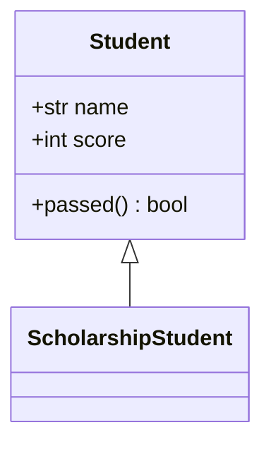
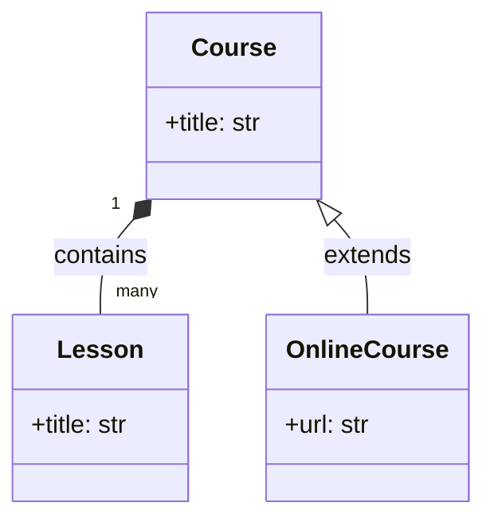
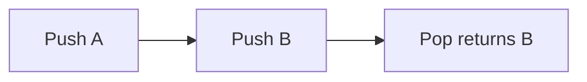
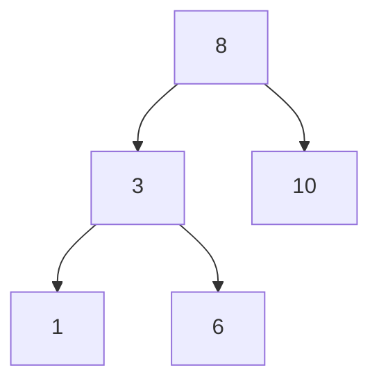
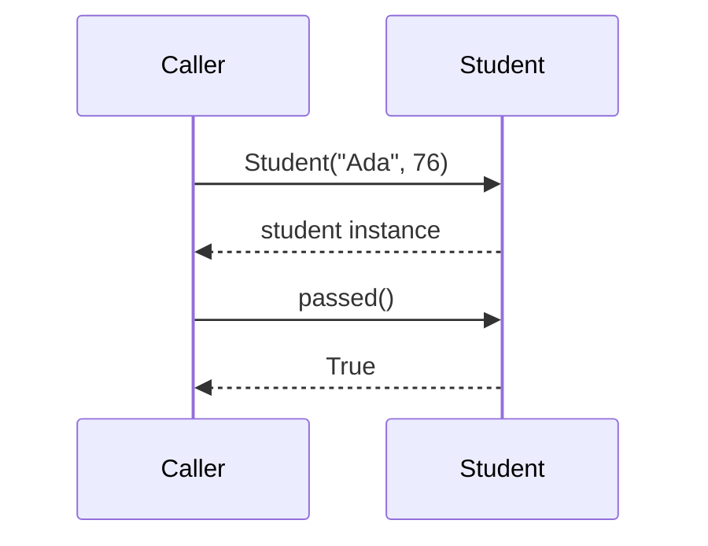
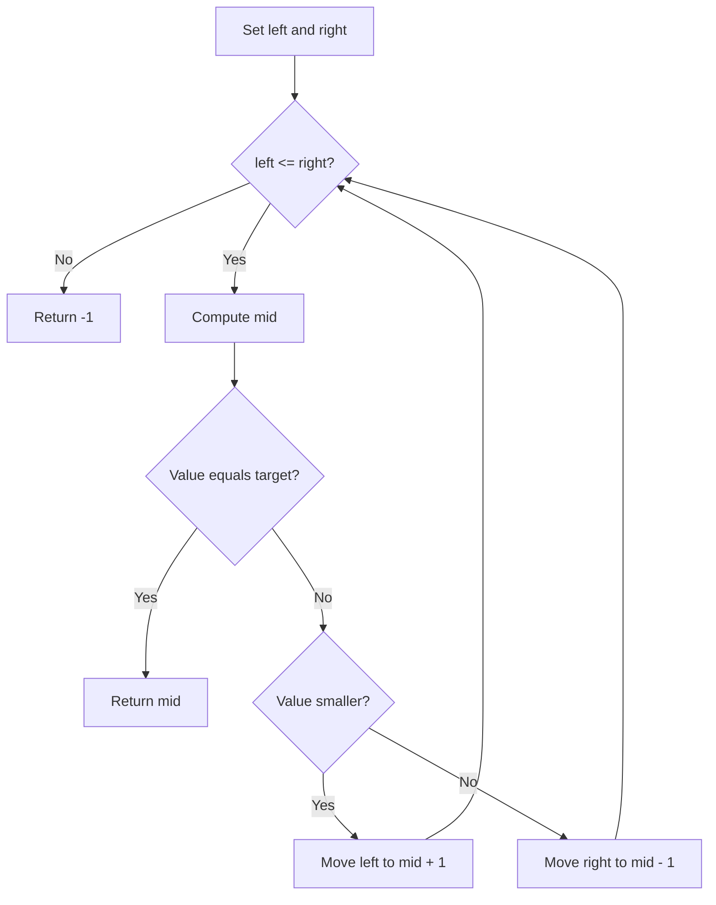
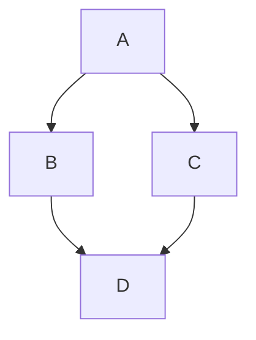
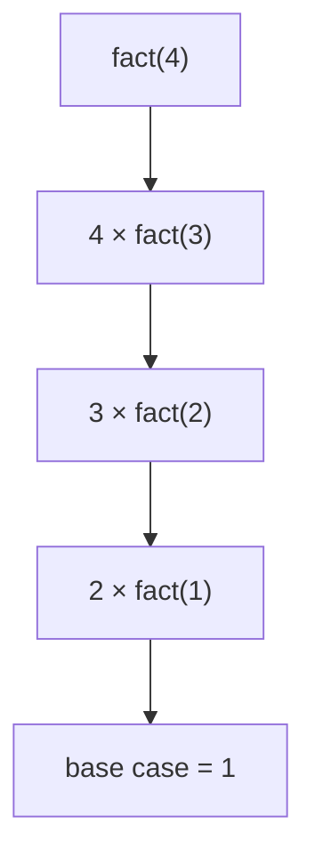
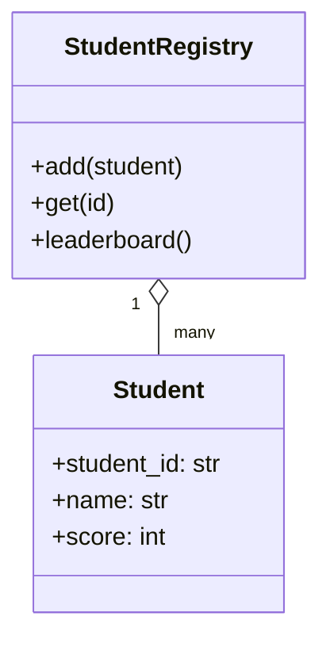
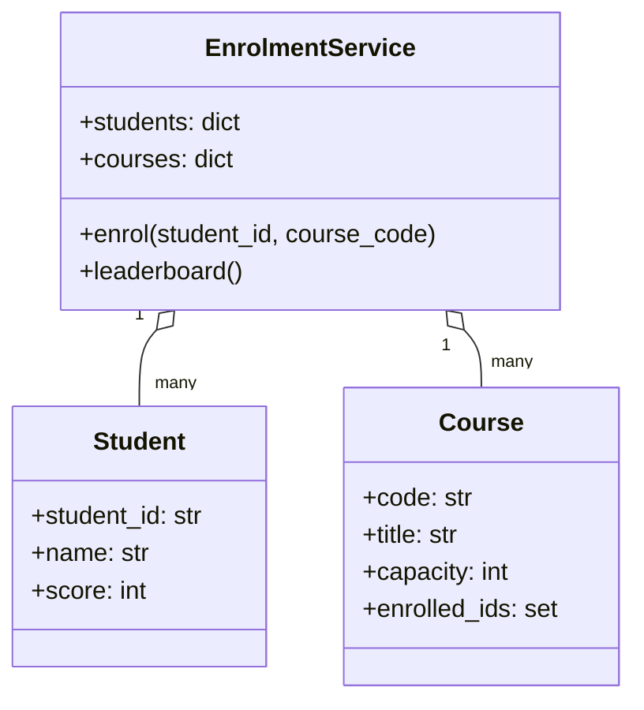

# Object-Oriented Programming & Data Structures and Algorithms
## A Practical Zero-to-Hero Handbook Using Python

**Author:** Engr. Amarachi Crystal Omereife  
**Organisation:** Opsfuxion Technologies Limited  
**Tagline:** *Orchestrate intelligence, deliver with precision.*  
**Audience:** Absolute beginners, self-taught developers, software engineering students, and junior web/mobile backend developers  
**Prerequisites:** Basic Python variables, conditionals, loops, functions and collections. If unfamiliar, read the Python fundamentals guide first.  
**Format:** Self-study handbook—not a lesson plan. Every major concept includes intuition, diagrams or trace tables, executable code, exercises and solutions.

> **Learning promise:** By the end, you will be able to model real-world software with classes, choose appropriate data structures, reason about runtime and memory, implement core algorithms, test them and build an integrated application. “Hero” means a strong, practical foundation—not mastery of every advanced computer science topic.

## How to use this book
1. Read a chapter in order; do not skip the mental model.
2. Type the code yourself into Python files instead of copying blindly.
3. Predict the output before running it.
4. Complete the **Try it yourself** task before opening the answer.
5. Test normal, edge and invalid inputs.
6. Record what you learned in a Git repository.

**Environment:** Python 3.11+; VS Code or any editor; a terminal. No third-party packages required for core exercises.

```bash
python3 --version
mkdir oop-dsa-lab && cd oop-dsa-lab
python3 -m venv .venv
source .venv/bin/activate   # macOS/Linux
# Windows PowerShell: .venv\Scripts\Activate.ps1
python3 -m unittest discover -v
```

**Notation:** `n` is input size; `O(...)` describes how resources grow, not a precise stopwatch time. Code uses standard Python unless stated otherwise.

---

# Part I — OOP: Think in Objects


## Chapter 1. Programming paradigms and the OOP mental model

Procedural programming organises instructions into functions. OOP groups **state** (data) and **behaviour** (methods) into objects. Neither style is universally superior. OOP is especially useful when many entities have identities and rules: students, courses, orders, accounts and enrolments.

**Class** = blueprint; **object/instance** = a particular item built from that blueprint; **attribute** = data on an object; **method** = behaviour; **invariant** = a rule that must remain true.



**Think first:** What are the entities? What data belongs to each? What actions must each perform? Which rules should never be broken?


## Chapter 2. Classes, instances, constructors and self

Python uses `class` to define a class. `__init__` initialises each new instance; `self` refers to that particular instance. `Student("Ada")` calls construction; `student.name` accesses its data. Class names usually use `PascalCase`; variables and methods use `snake_case`.

A class is **not** a database table and `__init__` is **not** the object allocator. Python's `__new__` creates the instance before `__init__` initialises it.


## Chapter 3. Encapsulation, properties and invariants

Encapsulation means keeping related data and operations together and controlling how state changes. Python's `_attribute` is a **convention** for internal use, not strict privacy. `@property` gives controlled attribute-like access. Validation should happen at trust boundaries and in domain rules.

For example, an account balance should not become negative just because a caller assigned a value; a `withdraw` method should enforce that invariant. In real financial software, use `Decimal`, not binary floating-point money.


## Chapter 4. Class attributes, instance attributes and mutable defaults

Instance attributes belong to each object. Class attributes are shared by all instances unless shadowed. Avoid mutable class attributes for per-instance collections: `items = []` at class scope accidentally shares a list among objects. Prefer `self.items = []` in `__init__`.

A `@classmethod` receives `cls` and is useful for alternative constructors; a `@staticmethod` is a function logically grouped with the class but requiring no instance or class state.


## Chapter 5. Composition, inheritance and polymorphism

**Composition:** a `Course` *has* a list of lessons. **Inheritance:** an `OnlineCourse` *is a* specialised `Course`. Prefer composition for flexible relationships; use inheritance when the subtype genuinely honours the parent's contract. **Polymorphism:** different objects respond to the same method interface (e.g. `send()`), possibly using different implementations.



**Common trap:** Inheriting only to reuse code, even when the child is not conceptually a type of the parent.


## Chapter 6. Abstraction, protocols, dataclasses and design choices

Abstraction exposes what a caller needs without requiring knowledge of internal implementation. Python `abc.ABC` and `@abstractmethod` support abstract base classes; `typing.Protocol` supports structural interfaces. `@dataclass` reduces boilerplate for mostly-data objects.

Avoid excessive class hierarchies. A simple function is often better than a one-method class. Use dependency injection to pass collaborators (such as repositories) rather than creating them invisibly inside domain objects.


## Chapter 7. Exceptions, testing and clean object design

Raise specific exceptions for invalid operations (`ValueError`, `KeyError`) and catch exceptions at appropriate boundaries. Unit tests should assert observable behaviour, not internal implementation details. Use `unittest` from Python's standard library. Keep methods focused, avoid hidden global state, and separate input/output from business rules so code is testable.


# Part II — DSA: Organise Data and Reason About Efficiency

## Chapter 8. What is a data structure? What is an algorithm?
A **data structure** stores/organises data; an **algorithm** is a finite, precise procedure for solving a problem. A good solution is correct, understandable and efficient enough for its constraints. First establish correctness; then consider performance.

| Structure | Typical use | Key caution |
|---|---|---|
| Python list (dynamic array) | Ordered items, indexing | Inserting at front shifts elements |
| Tuple | Fixed ordered record | Immutable |
| Dictionary (hash table) | Key → value lookup | Keys must be hashable |
| Set (hash table) | Unique membership | No positional indexing |
| `collections.deque` | Queue / both ends | Not efficient for random indexing |
| Linked list (custom) | Node pointer practice | Usually slower than Python lists in practice |
| Heap (`heapq`) | Priority queue | Only minimum is guaranteed at root |
| Tree / BST | Hierarchical data, ordered search | Unbalanced BST can degrade |
| Graph | Networks, dependencies | Choose adjacency representation carefully |

## Chapter 9. Complexity, correctness and trace tables
- **O(1):** constant work, such as `items[0]` (assuming nonempty list).
- **O(log n):** repeatedly halve a search interval.
- **O(n):** visit each element once.
- **O(n log n):** typical efficient comparison sorting.
- **O(n²):** compare many pairs with nested loops.
- **O(2ⁿ):** common in naïve subset recursion.

**Space complexity** counts additional memory. A list copy of size `n` needs O(n) extra space. Big-O is an asymptotic upper bound and hides constants. Python `dict`/`set` lookups are **average** O(1), not guaranteed O(1) worst-case. Python's built-in `sort()` is stable and typically O(n log n) worst-case.

A **loop invariant** is a fact that remains true before and after each iteration. A good correctness argument has *initialisation*, *maintenance* and *termination*.

| Binary-search step | left | right | mid | comparison | next interval |
|---|---:|---:|---:|---|---|
| 1 on `[2,4,6,8,10]`, target 8 | 0 | 4 | 2 | 6 < 8 | 3..4 |
| 2 | 3 | 4 | 3 | 8 = 8 | found |

## Chapter 10. Arrays, stacks, queues and hash tables
A **stack** follows LIFO: last in, first out (undo, browser backtracking). A **queue** follows FIFO: first in, first out (task processing). Python lists implement stacks efficiently at the end; `deque` is preferable for FIFO because `list.pop(0)` shifts elements. Hash tables support fast average membership checks, but cannot replace ordered structures in every problem.



## Chapter 11. Linked lists, trees, heaps and graphs
A linked list stores nodes containing a value and reference to another node. A binary tree node has at most two children; a **binary search tree** maintains ordered values on either side (when using a defined duplicate policy). A **heap** gives efficient priority access; it is not fully sorted. A **graph** contains vertices and edges, directed or undirected.



## Chapter 12. Searching, sorting and algorithmic patterns
**Linear search:** scan items; works without sorting. **Binary search:** needs a sorted sequence and an indexing strategy. **Bubble/selection sort:** excellent teaching tools, generally poor choices for large production datasets. **Merge sort:** divide-and-conquer O(n log n), typically O(n) auxiliary space for the implementation here. **Two pointers:** move indices according to a condition. **Sliding window:** maintain a contiguous range efficiently. **Hashing:** trade memory for faster membership or counts. **Recursion:** solve smaller versions of a problem with a base case. **Memoisation:** cache repeated subproblem results.

## Chapter 13. Graph algorithms and advanced foundations
**BFS** explores layer by layer, giving shortest paths in an unweighted graph. **DFS** explores a branch deeply before backtracking. **Dijkstra** finds shortest paths with **non-negative edge weights**. **Topological sort** orders a directed acyclic graph (DAG) by dependencies; cycles prevent such an order. Dynamic programming is useful when subproblems overlap and optimal substructure holds.

---

# Part III — 30 Fully Worked Examples: Beginner → Expert Foundations

Each example includes a problem, runnable Python solution, reasoning, complexity, test case and a variation to attempt before consulting the answer. Run examples individually in separate files.


## Worked Example 01 — Your first class: a student

**Level:** Beginner  
**Problem:** Create a student and report whether the student passed.

**Implementation (run independently):**

```python
class Student:
    def __init__(self, name, score):
        self.name = name
        self.score = score

    def passed(self):
        return self.score >= 50

ada = Student("Ada", 76)
print(ada.name, ada.passed())  # Ada True
```

**Why it works:** Each instance stores its own name and score; the method checks a rule.

**Complexity:** O(1) time and space per object.

**Try it yourself:** Change the pass mark to 60; try score 59 and 60.

**Self-check:** Explain the input, output, invariant or stopping condition, and one edge case before moving on.


## Worked Example 02 — Input validation with properties

**Level:** Beginner  
**Problem:** Reject scores outside 0–100.

**Implementation (run independently):**

```python
class Student:
    def __init__(self, score):
        self.score = score

    @property
    def score(self):
        return self._score

    @score.setter
    def score(self, value):
        if not isinstance(value, (int, float)) or isinstance(value, bool):
            raise TypeError("score must be numeric")
        if not 0 <= value <= 100:
            raise ValueError("score must be 0..100")
        self._score = value

student = Student(82)
student.score = 90
print(student.score)  # 90
```

**Why it works:** The setter enforces the invariant even when values change later.

**Complexity:** O(1).

**Try it yourself:** Try Student(-1) and explain the exception.

**Self-check:** Explain the input, output, invariant or stopping condition, and one edge case before moving on.


## Worked Example 03 — Bank account with Decimal

**Level:** Beginner  
**Problem:** Deposit and withdraw without floating-point money errors.

**Implementation (run independently):**

```python
from decimal import Decimal

class Account:
    def __init__(self, balance="0.00"):
        self._balance = Decimal(balance)
        if self._balance < 0:
            raise ValueError("negative starting balance")

    def deposit(self, amount):
        amount = Decimal(str(amount))
        if amount <= 0:
            raise ValueError("amount must be positive")
        self._balance += amount

    def withdraw(self, amount):
        amount = Decimal(str(amount))
        if amount <= 0 or amount > self._balance:
            raise ValueError("invalid withdrawal")
        self._balance -= amount

    @property
    def balance(self):
        return self._balance

a = Account("100.00")
a.deposit("25.50")
a.withdraw("10.00")
print(a.balance)  # 115.50
```

**Why it works:** Operations protect the balance; `Decimal` represents decimal values precisely when constructed from strings.

**Complexity:** O(1) for bounded-size monetary values.

**Try it yourself:** Add a transaction history list.

**Self-check:** Explain the input, output, invariant or stopping condition, and one edge case before moving on.


## Worked Example 04 — Class methods and dataclasses

**Level:** Beginner  
**Problem:** Construct a course from a compact text record.

**Implementation (run independently):**

```python
from dataclasses import dataclass

@dataclass
class Course:
    code: str
    title: str

    @classmethod
    def from_text(cls, text):
        code, title = text.split("|", maxsplit=1)
        return cls(code.strip(), title.strip())

print(Course.from_text("PY101|Python Basics"))
```

**Why it works:** `@dataclass` creates an initializer and useful representation; classmethod is an alternative constructor.

**Complexity:** O(n) for input text length.

**Try it yourself:** Validate that neither field is blank.

**Self-check:** Explain the input, output, invariant or stopping condition, and one edge case before moving on.


## Worked Example 05 — Composition: course contains lessons

**Level:** Beginner  
**Problem:** Model a course as a collection of lessons.

**Implementation (run independently):**

```python
class Lesson:
    def __init__(self, title):
        self.title = title

class Course:
    def __init__(self, title):
        self.title = title
        self.lessons = []

    def add_lesson(self, lesson):
        if not isinstance(lesson, Lesson):
            raise TypeError("expected Lesson")
        self.lessons.append(lesson)

course = Course("Python")
course.add_lesson(Lesson("Variables"))
print([lesson.title for lesson in course.lessons])
```

**Why it works:** Composition is a has-a relationship; each course owns its list.

**Complexity:** Appending amortised O(1); listing n titles O(n).

**Try it yourself:** Add a method that counts lessons.

**Self-check:** Explain the input, output, invariant or stopping condition, and one edge case before moving on.


## Worked Example 06 — Inheritance and method overriding

**Level:** Beginner  
**Problem:** Extend a notification interface with email and SMS implementations.

**Implementation (run independently):**

```python
class Notification:
    def send(self, message):
        raise NotImplementedError

class EmailNotification(Notification):
    def send(self, message):
        return f"EMAIL: {message}"

class SMSNotification(Notification):
    def send(self, message):
        return f"SMS: {message}"

for channel in [EmailNotification(), SMSNotification()]:
    print(channel.send("Welcome"))
```

**Why it works:** The same `send` call works across different object types: polymorphism.

**Complexity:** O(n) over n channels, ignoring message length.

**Try it yourself:** Add a PushNotification subclass.

**Self-check:** Explain the input, output, invariant or stopping condition, and one edge case before moving on.


## Worked Example 07 — Abstract interfaces

**Level:** Intermediate  
**Problem:** Require every storage provider to implement `save`.

**Implementation (run independently):**

```python
from abc import ABC, abstractmethod

class Repository(ABC):
    @abstractmethod
    def save(self, item):
        pass

class MemoryRepository(Repository):
    def __init__(self):
        self.items = []

    def save(self, item):
        self.items.append(item)

repo = MemoryRepository()
repo.save("Student A")
print(repo.items)
```

**Why it works:** Abstract base classes declare a contract; concrete subclasses implement it.

**Complexity:** Amortised O(1) append.

**Try it yourself:** Add a `find_all()` abstract method.

**Self-check:** Explain the input, output, invariant or stopping condition, and one edge case before moving on.


## Worked Example 08 — Unit-test an object

**Level:** Intermediate  
**Problem:** Test successful and invalid account operations.

**Implementation (run independently):**

```python
import unittest
from decimal import Decimal

class Account:
    def __init__(self):
        self.balance = Decimal("0")
    def deposit(self, amount):
        value = Decimal(str(amount))
        if value <= 0:
            raise ValueError("positive amounts only")
        self.balance += value

class AccountTests(unittest.TestCase):
    def test_deposit(self):
        account = Account()
        account.deposit("12.50")
        self.assertEqual(account.balance, Decimal("12.50"))

    def test_reject_zero(self):
        with self.assertRaises(ValueError):
            Account().deposit(0)

if __name__ == "__main__":
    unittest.main()
```

**Why it works:** Tests document the contract and prevent regressions.

**Complexity:** O(1) per test.

**Try it yourself:** Add a negative-deposit test.

**Self-check:** Explain the input, output, invariant or stopping condition, and one edge case before moving on.


## Worked Example 09 — Stack: undo operations

**Level:** Beginner  
**Problem:** Implement push, pop and empty checks.

**Implementation (run independently):**

```python
class Stack:
    def __init__(self):
        self._items = []

    def push(self, value):
        self._items.append(value)

    def pop(self):
        if not self._items:
            raise IndexError("empty stack")
        return self._items.pop()

stack = Stack()
stack.push("type A")
stack.push("type B")
print(stack.pop())  # type B
```

**Why it works:** LIFO: the newest operation is undone first.

**Complexity:** Push/pop amortised O(1); O(n) stored space.

**Try it yourself:** Implement `peek()` without removal.

**Self-check:** Explain the input, output, invariant or stopping condition, and one edge case before moving on.


## Worked Example 10 — Queue: customer support tickets

**Level:** Beginner  
**Problem:** Process tickets in arrival order.

**Implementation (run independently):**

```python
from collections import deque

tickets = deque()
tickets.append("T-101")
tickets.append("T-102")
print(tickets.popleft())  # T-101
print(tickets.popleft())  # T-102
```

**Why it works:** `deque.popleft()` avoids shifting all elements.

**Complexity:** Append and popleft O(1).

**Try it yourself:** Simulate three arrivals and one cancellation.

**Self-check:** Explain the input, output, invariant or stopping condition, and one edge case before moving on.


## Worked Example 11 — Hash maps: count word frequency

**Level:** Beginner  
**Problem:** Count occurrences in a sentence.

**Implementation (run independently):**

```python
def frequencies(words):
    counts = {}
    for word in words:
        counts[word] = counts.get(word, 0) + 1
    return counts

print(frequencies(["sql", "python", "sql"]))
# {'sql': 2, 'python': 1}
```

**Why it works:** Dictionary keys allow average constant-time updates.

**Complexity:** Average O(n) time, O(k) space for k distinct words.

**Try it yourself:** Normalise words to lowercase.

**Self-check:** Explain the input, output, invariant or stopping condition, and one edge case before moving on.


## Worked Example 12 — Sets: remove duplicate student IDs

**Level:** Beginner  
**Problem:** Preserve first-seen order while removing duplicates.

**Implementation (run independently):**

```python
def unique_in_order(ids):
    seen = set()
    result = []
    for student_id in ids:
        if student_id not in seen:
            seen.add(student_id)
            result.append(student_id)
    return result

print(unique_in_order([3, 1, 3, 2, 1]))  # [3, 1, 2]
```

**Why it works:** A set checks membership quickly; the result list preserves order.

**Complexity:** Average O(n) time, O(n) space.

**Try it yourself:** Explain why `list(set(ids))` may not preserve first-seen order.

**Self-check:** Explain the input, output, invariant or stopping condition, and one edge case before moving on.


## Worked Example 13 — Singly linked list

**Level:** Intermediate  
**Problem:** Prepend nodes and iterate values.

**Implementation (run independently):**

```python
class Node:
    def __init__(self, value, next_node=None):
        self.value = value
        self.next = next_node

class LinkedList:
    def __init__(self):
        self.head = None

    def prepend(self, value):
        self.head = Node(value, self.head)

    def values(self):
        current = self.head
        while current is not None:
            yield current.value
            current = current.next

items = LinkedList()
items.prepend("B")
items.prepend("A")
print(list(items.values()))  # ['A', 'B']
```

**Why it works:** Each node points to the next; head insertion changes only a pointer.

**Complexity:** Prepend O(1), traversal O(n).

**Try it yourself:** Implement `contains(target)`.

**Self-check:** Explain the input, output, invariant or stopping condition, and one edge case before moving on.


## Worked Example 14 — Linear search

**Level:** Beginner  
**Problem:** Find the index of an item in an unsorted list.

**Implementation (run independently):**

```python
def linear_search(items, target):
    for index, item in enumerate(items):
        if item == target:
            return index
    return -1

print(linear_search([8, 3, 9], 3))  # 1
print(linear_search([8, 3, 9], 4))  # -1
```

**Why it works:** Each element may need checking; works even when unsorted.

**Complexity:** O(n) time, O(1) space.

**Try it yourself:** Return all matching indices instead of the first.

**Self-check:** Explain the input, output, invariant or stopping condition, and one edge case before moving on.


## Worked Example 15 — Binary search

**Level:** Intermediate  
**Problem:** Search a sorted array by halving the interval.

**Implementation (run independently):**

```python
def binary_search(items, target):
    left, right = 0, len(items) - 1
    while left <= right:
        mid = (left + right) // 2
        if items[mid] == target:
            return mid
        if items[mid] < target:
            left = mid + 1
        else:
            right = mid - 1
    return -1

print(binary_search([2, 4, 6, 8, 10], 8))  # 3
```

**Why it works:** Invariant: if target exists, it remains in the current search interval. Requires sorted input.

**Complexity:** O(log n) time, O(1) space.

**Try it yourself:** Test empty list, one item, absent target.

**Self-check:** Explain the input, output, invariant or stopping condition, and one edge case before moving on.


## Worked Example 16 — Bubble sort

**Level:** Intermediate  
**Problem:** Sort numbers using adjacent swaps.

**Implementation (run independently):**

```python
def bubble_sort(values):
    a = values.copy()
    for end in range(len(a) - 1, 0, -1):
        swapped = False
        for i in range(end):
            if a[i] > a[i + 1]:
                a[i], a[i + 1] = a[i + 1], a[i]
                swapped = True
        if not swapped:
            break
    return a

print(bubble_sort([5, 1, 4, 2]))  # [1, 2, 4, 5]
```

**Why it works:** After each full pass, the largest remaining value reaches its final position.

**Complexity:** Worst O(n²) time, O(n) copy space; best O(n) with early exit.

**Try it yourself:** Trace [3,2,1] after each pass.

**Self-check:** Explain the input, output, invariant or stopping condition, and one edge case before moving on.


## Worked Example 17 — Selection sort

**Level:** Intermediate  
**Problem:** Repeatedly select the smallest remaining element.

**Implementation (run independently):**

```python
def selection_sort(values):
    a = values.copy()
    for start in range(len(a)):
        smallest = start
        for j in range(start + 1, len(a)):
            if a[j] < a[smallest]:
                smallest = j
        a[start], a[smallest] = a[smallest], a[start]
    return a

print(selection_sort([4, 2, 7, 1]))  # [1, 2, 4, 7]
```

**Why it works:** At step i, positions before i are already the i smallest elements in order.

**Complexity:** O(n²) time, O(n) copied list space.

**Try it yourself:** Compare the number of comparisons to bubble sort.

**Self-check:** Explain the input, output, invariant or stopping condition, and one edge case before moving on.


## Worked Example 18 — Merge sort

**Level:** Advanced  
**Problem:** Use divide-and-conquer to sort an array.

**Implementation (run independently):**

```python
def merge_sort(values):
    if len(values) <= 1:
        return values.copy()
    middle = len(values) // 2
    left = merge_sort(values[:middle])
    right = merge_sort(values[middle:])
    result = []
    i = j = 0
    while i < len(left) and j < len(right):
        if left[i] <= right[j]:
            result.append(left[i]); i += 1
        else:
            result.append(right[j]); j += 1
    return result + left[i:] + right[j:]

print(merge_sort([7, 2, 9, 1]))  # [1, 2, 7, 9]
```

**Why it works:** Recursively sort halves, then merge them; `<=` preserves stability for equal keys.

**Complexity:** O(n log n) time; O(n) auxiliary storage overall for this slicing implementation.

**Try it yourself:** Trace the split/merge tree for [4,1,3,2].

**Self-check:** Explain the input, output, invariant or stopping condition, and one edge case before moving on.


## Worked Example 19 — Recursion: factorial

**Level:** Intermediate  
**Problem:** Compute n! with a base case.

**Implementation (run independently):**

```python
def factorial(n):
    if not isinstance(n, int) or isinstance(n, bool) or n < 0:
        raise ValueError("non-negative integer required")
    if n <= 1:
        return 1
    return n * factorial(n - 1)

print(factorial(5))  # 120
```

**Why it works:** Each call solves a smaller instance; the base case stops recursion. Large n may exceed Python recursion limits.

**Complexity:** O(n) time and O(n) call-stack space.

**Try it yourself:** Write an iterative version with O(1) extra space.

**Self-check:** Explain the input, output, invariant or stopping condition, and one edge case before moving on.


## Worked Example 20 — Two pointers: pair sum

**Level:** Intermediate  
**Problem:** Find two numbers in a sorted array that sum to a target.

**Implementation (run independently):**

```python
def pair_sum_sorted(numbers, target):
    left, right = 0, len(numbers) - 1
    while left < right:
        total = numbers[left] + numbers[right]
        if total == target:
            return (numbers[left], numbers[right])
        if total < target:
            left += 1
        else:
            right -= 1
    return None

print(pair_sum_sorted([1, 2, 4, 7, 11], 9))  # (2, 7)
```

**Why it works:** Sorted order tells us which pointer can move without missing a valid pair.

**Complexity:** O(n) time, O(1) space.

**Try it yourself:** What changes if the input is unsorted?

**Self-check:** Explain the input, output, invariant or stopping condition, and one edge case before moving on.


## Worked Example 21 — Sliding window: maximum fixed-length sum

**Level:** Intermediate  
**Problem:** Find the maximum sum of k consecutive elements.

**Implementation (run independently):**

```python
def max_window_sum(numbers, k):
    if not 1 <= k <= len(numbers):
        raise ValueError("k must be 1..len(numbers)")
    current = sum(numbers[:k])
    best = current
    for right in range(k, len(numbers)):
        current += numbers[right] - numbers[right - k]
        best = max(best, current)
    return best

print(max_window_sum([2, 1, 5, 1, 3, 2], 3))  # 9
```

**Why it works:** Remove the outgoing item and add the incoming item instead of re-summing every window.

**Complexity:** O(n) time, O(1) extra space.

**Try it yourself:** Return the starting index of the best window.

**Self-check:** Explain the input, output, invariant or stopping condition, and one edge case before moving on.


## Worked Example 22 — Heap: top-k largest values

**Level:** Advanced  
**Problem:** Find the three highest scores without sorting everything.

**Implementation (run independently):**

```python
import heapq

scores = [51, 92, 75, 88, 99, 64]
print(heapq.nlargest(3, scores))  # [99, 92, 88]
```

**Why it works:** A heap is useful when k is much smaller than n.

**Complexity:** O(n log k) typical time, O(k) auxiliary space.

**Try it yourself:** Find the smallest two scores with `nsmallest`.

**Self-check:** Explain the input, output, invariant or stopping condition, and one edge case before moving on.


## Worked Example 23 — Tree traversal: inorder

**Level:** Advanced  
**Problem:** Traverse a binary tree left-root-right.

**Implementation (run independently):**

```python
class TreeNode:
    def __init__(self, value, left=None, right=None):
        self.value = value
        self.left = left
        self.right = right

def inorder(root):
    if root is None:
        return []
    return inorder(root.left) + [root.value] + inorder(root.right)

root = TreeNode(8, TreeNode(3), TreeNode(10))
print(inorder(root))  # [3, 8, 10]
```

**Why it works:** Inorder traversal of a valid BST produces ascending values. This list-concatenation version can do more copying than necessary.

**Complexity:** Traversal visits n nodes; this concatenation implementation can be O(n²) worst-case, with O(h) recursion stack plus output.

**Try it yourself:** Rewrite using an accumulator for O(n) time.

**Self-check:** Explain the input, output, invariant or stopping condition, and one edge case before moving on.


## Worked Example 24 — Breadth-first search (BFS)

**Level:** Advanced  
**Problem:** Find the shortest unweighted path between nodes.

**Implementation (run independently):**

```python
from collections import deque

def shortest_path(graph, start, goal):
    queue = deque([(start, [start])])
    visited = {start}
    while queue:
        node, path = queue.popleft()
        if node == goal:
            return path
        for neighbor in graph.get(node, []):
            if neighbor not in visited:
                visited.add(neighbor)
                queue.append((neighbor, path + [neighbor]))
    return None

graph = {"A": ["B", "C"], "B": ["D"], "C": ["D"], "D": []}
print(shortest_path(graph, "A", "D"))  # ['A', 'B', 'D']
```

**Why it works:** FIFO exploration visits nodes by distance; visited avoids cycles. Copying full paths is simple but uses more memory than parent pointers.

**Complexity:** BFS exploration O(V+E), with additional path-copy overhead in this implementation.

**Try it yourself:** Rewrite using a parent dictionary.

**Self-check:** Explain the input, output, invariant or stopping condition, and one edge case before moving on.


## Worked Example 25 — Depth-first search (DFS)

**Level:** Advanced  
**Problem:** Visit all reachable nodes using an explicit stack.

**Implementation (run independently):**

```python
def dfs(graph, start):
    visited = set()
    order = []
    stack = [start]
    while stack:
        node = stack.pop()
        if node in visited:
            continue
        visited.add(node)
        order.append(node)
        stack.extend(reversed(graph.get(node, [])))
    return order

print(dfs({"A": ["B", "C"], "B": ["D"], "C": [], "D": []}, "A"))
# ['A', 'B', 'D', 'C']
```

**Why it works:** The stack explores deeper paths first. Neighbor order influences traversal order.

**Complexity:** O(V+E) time and O(V+E) space worst-case for stack entries.

**Try it yourself:** Add cycle A→B→A and verify termination.

**Self-check:** Explain the input, output, invariant or stopping condition, and one edge case before moving on.


## Worked Example 26 — Dijkstra shortest paths

**Level:** Expert foundations  
**Problem:** Compute shortest distances from a source in a non-negative weighted graph.

**Implementation (run independently):**

```python
import heapq

def dijkstra(graph, start):
    distances = {start: 0}
    heap = [(0, start)]
    while heap:
        distance, node = heapq.heappop(heap)
        if distance != distances.get(node):
            continue
        for neighbor, weight in graph.get(node, []):
            if weight < 0:
                raise ValueError("negative weights not supported")
            candidate = distance + weight
            if candidate < distances.get(neighbor, float("inf")):
                distances[neighbor] = candidate
                heapq.heappush(heap, (candidate, neighbor))
    return distances

graph = {"A": [("B", 4), ("C", 1)], "C": [("B", 2)], "B": []}
print(dijkstra(graph, "A"))  # {'A': 0, 'B': 3, 'C': 1}
```

**Why it works:** Always expand the cheapest current candidate; negative weights invalidate Dijkstra’s guarantee. Nodes are strings here so heap ties are comparable.

**Complexity:** O((V+E) log V) for common adjacency-list/binary-heap analysis.

**Try it yourself:** Store predecessors to reconstruct the shortest path.

**Self-check:** Explain the input, output, invariant or stopping condition, and one edge case before moving on.


## Worked Example 27 — Topological sort: course prerequisites

**Level:** Expert foundations  
**Problem:** Order courses so every prerequisite comes first.

**Implementation (run independently):**

```python
from collections import deque

def topological_sort(graph):
    nodes = set(graph)
    for children in graph.values():
        nodes.update(children)
    indegree = {node: 0 for node in nodes}
    for children in graph.values():
        for child in children:
            indegree[child] += 1
    queue = deque(sorted(n for n, degree in indegree.items() if degree == 0))
    result = []
    while queue:
        node = queue.popleft()
        result.append(node)
        for child in graph.get(node, []):
            indegree[child] -= 1
            if indegree[child] == 0:
                queue.append(child)
    if len(result) != len(nodes):
        raise ValueError("dependency cycle")
    return result

print(topological_sort({"Python": ["OOP"], "OOP": ["DSA"], "DSA": []}))
```

**Why it works:** Edges mean prerequisite → dependent. Kahn’s algorithm repeatedly removes zero-indegree nodes.

**Complexity:** O(V+E) after initial O(V log V) sorting of zero-indegree nodes.

**Try it yourself:** Create a cycle and explain why it cannot be scheduled.

**Self-check:** Explain the input, output, invariant or stopping condition, and one edge case before moving on.


## Worked Example 28 — Dynamic programming: minimum coins

**Level:** Expert foundations  
**Problem:** Find the minimum coins needed to make an amount, or report impossibility.

**Implementation (run independently):**

```python
def min_coins(coins, amount):
    if amount < 0 or any(c <= 0 for c in coins):
        raise ValueError("positive denominations and nonnegative amount required")
    dp = [float("inf")] * (amount + 1)
    dp[0] = 0
    for total in range(1, amount + 1):
        for coin in coins:
            if coin <= total:
                dp[total] = min(dp[total], dp[total - coin] + 1)
    return -1 if dp[amount] == float("inf") else dp[amount]

print(min_coins([1, 3, 4], 6))  # 2 (3+3)
```

**Why it works:** Each amount reuses solutions to smaller amounts; greedy choice can fail for arbitrary coin systems.

**Complexity:** O(amount × number_of_coins) time, O(amount) space.

**Try it yourself:** Recover which coins form the optimal answer.

**Self-check:** Explain the input, output, invariant or stopping condition, and one edge case before moving on.


## Worked Example 29 — Memoisation: Fibonacci

**Level:** Advanced  
**Problem:** Avoid repeated recursive work with caching.

**Implementation (run independently):**

```python
from functools import lru_cache

@lru_cache(maxsize=None)
def fibonacci(n):
    if n < 0:
        raise ValueError("n must be nonnegative")
    if n < 2:
        return n
    return fibonacci(n - 1) + fibonacci(n - 2)

print(fibonacci(10))  # 55
```

**Why it works:** Caching changes repeated overlapping subproblems into one computation each. Very large n still hits recursion limits.

**Complexity:** O(n) calls and O(n) cached values, ignoring growing integer bit-cost.

**Try it yourself:** Implement bottom-up Fibonacci with O(1) auxiliary space.

**Self-check:** Explain the input, output, invariant or stopping condition, and one edge case before moving on.


## Worked Example 30 — Integrating OOP and DSA: searchable student registry

**Level:** Expert foundations  
**Problem:** Combine a domain class, dictionary lookup, sorted rankings and robust validation.

**Implementation (run independently):**

```python
from dataclasses import dataclass

@dataclass(frozen=True)
class Student:
    student_id: str
    name: str
    score: int

    def __post_init__(self):
        if not self.student_id.strip() or not self.name.strip():
            raise ValueError("id and name are required")
        if not isinstance(self.score, int) or isinstance(self.score, bool) or not 0 <= self.score <= 100:
            raise ValueError("score must be an integer 0..100")

class StudentRegistry:
    def __init__(self):
        self._by_id = {}

    def add(self, student):
        if not isinstance(student, Student):
            raise TypeError("expected Student")
        if student.student_id in self._by_id:
            raise ValueError("duplicate ID")
        self._by_id[student.student_id] = student

    def get(self, student_id):
        return self._by_id.get(student_id)

    def leaderboard(self):
        return sorted(self._by_id.values(), key=lambda s: (-s.score, s.name, s.student_id))

registry = StudentRegistry()
registry.add(Student("S02", "Ada", 90))
registry.add(Student("S01", "Chidi", 75))
print(registry.get("S02"))
print([(s.name, s.score) for s in registry.leaderboard()])
```

**Why it works:** OOP enforces domain rules; a hash map gives average fast ID lookups; sorting builds a leaderboard.

**Complexity:** Add/get average O(1); leaderboard O(n log n) time, O(n) space.

**Try it yourself:** Add update/delete and unit tests for duplicate IDs.

**Self-check:** Explain the input, output, invariant or stopping condition, and one edge case before moving on.


---

# Part IV — Visual Walkthroughs and Trace Tables

## Diagram A. Object construction and method call


## Diagram B. Binary search decision process


## Diagram C. BFS on a small graph

Starting from A, BFS processes A, then B and C, then D (assuming adjacency order B then C). Queue trace: `[A]` → `[B,C]` → `[C,D]` → `[D]` → `[]`.

## Diagram D. Recursion call tree (factorial 4)


## Diagram E. Composition in the capstone


## How to create a trace table
1. Write down variables that change.
2. Record their values **before and after** each loop iteration.
3. Identify when the loop condition becomes false.
4. Confirm the final answer against a hand-calculated result.

| Bubble sort input `[3,1,2]` | State |
|---|---|
| Start | `[3,1,2]` |
| Swap 3 and 1 | `[1,3,2]` |
| Swap 3 and 2 | `[1,2,3]` |
| Next pass, no swaps | `[1,2,3]` |


# Part V — Guided Practice Problems (with Model Solutions)

**Instruction:** Attempt each problem before reading its solution. For every task, write at least three test cases including an edge case.


## Practice 1. Student grade object

**Task:** Create a `GradeRecord` with `student`, `score`, and a `letter()` method: A ≥ 70, B ≥ 60, C ≥ 50, D ≥ 45, otherwise F.

<details>
<summary>Reveal model solution</summary>

```python
class GradeRecord:
    def __init__(self, student, score):
        if not 0 <= score <= 100:
            raise ValueError("score out of range")
        self.student, self.score = student, score

    def letter(self):
        if self.score >= 70: return "A"
        if self.score >= 60: return "B"
        if self.score >= 50: return "C"
        if self.score >= 45: return "D"
        return "F"

assert GradeRecord("Ada", 70).letter() == "A"
```

**After solving:** Explain correctness, estimate time and extra space, and test an empty/boundary case.

</details>


## Practice 2. Encapsulated inventory

**Task:** Create inventory with add/remove operations and prevent negative stock.

<details>
<summary>Reveal model solution</summary>

```python
class Inventory:
    def __init__(self): self._stock = {}
    def add(self, sku, count):
        if count <= 0: raise ValueError("count must be positive")
        self._stock[sku] = self._stock.get(sku, 0) + count
    def remove(self, sku, count):
        if count <= 0 or count > self._stock.get(sku, 0):
            raise ValueError("insufficient stock")
        self._stock[sku] -= count
    def quantity(self, sku): return self._stock.get(sku, 0)
```

**After solving:** Explain correctness, estimate time and extra space, and test an empty/boundary case.

</details>


## Practice 3. Balanced parentheses

**Task:** Use a stack to determine whether parentheses `()` are balanced.

<details>
<summary>Reveal model solution</summary>

```python
def balanced(text):
    stack = []
    for char in text:
        if char == "(": stack.append(char)
        elif char == ")":
            if not stack: return False
            stack.pop()
    return not stack

assert balanced("(())") and not balanced("(()")
```

**After solving:** Explain correctness, estimate time and extra space, and test an empty/boundary case.

</details>


## Practice 4. First non-repeating character

**Task:** Return the first character occurring exactly once, or `None`.

<details>
<summary>Reveal model solution</summary>

```python
from collections import Counter

def first_unique(text):
    counts = Counter(text)
    return next((c for c in text if counts[c] == 1), None)

assert first_unique("swiss") == "w"
```

**After solving:** Explain correctness, estimate time and extra space, and test an empty/boundary case.

</details>


## Practice 5. Binary search boundary

**Task:** Return the first index of a target in a sorted list with duplicates.

<details>
<summary>Reveal model solution</summary>

```python
def first_index(a, target):
    left, right = 0, len(a)
    while left < right:
        mid = (left + right) // 2
        if a[mid] < target: left = mid + 1
        else: right = mid
    return left if left < len(a) and a[left] == target else -1

assert first_index([1,2,2,2,4], 2) == 1
```

**After solving:** Explain correctness, estimate time and extra space, and test an empty/boundary case.

</details>


## Practice 6. Queue simulation

**Task:** Serve customers in FIFO order.

<details>
<summary>Reveal model solution</summary>

```python
from collections import deque

def serve(customers):
    queue = deque(customers)
    order = []
    while queue: order.append(queue.popleft())
    return order

assert serve(["Ada", "Ben"]) == ["Ada", "Ben"]
```

**After solving:** Explain correctness, estimate time and extra space, and test an empty/boundary case.

</details>


## Practice 7. Merge two sorted lists

**Task:** Merge sorted lists without calling `sort`.

<details>
<summary>Reveal model solution</summary>

```python
def merge(a, b):
    i = j = 0
    result = []
    while i < len(a) and j < len(b):
        if a[i] <= b[j]: result.append(a[i]); i += 1
        else: result.append(b[j]); j += 1
    return result + a[i:] + b[j:]

assert merge([1,3], [2,4]) == [1,2,3,4]
```

**After solving:** Explain correctness, estimate time and extra space, and test an empty/boundary case.

</details>


## Practice 8. Graph reachability

**Task:** Determine whether a destination is reachable in a directed graph.

<details>
<summary>Reveal model solution</summary>

```python
def reachable(graph, start, goal):
    stack, seen = [start], set()
    while stack:
        node = stack.pop()
        if node == goal: return True
        if node in seen: continue
        seen.add(node)
        stack.extend(graph.get(node, []))
    return False

assert reachable({"A":["B"],"B":["C"]}, "A", "C")
```

**After solving:** Explain correctness, estimate time and extra space, and test an empty/boundary case.

</details>


## Practice 9. Most frequent element

**Task:** Return the most frequent element; for ties, return the first encountered.

<details>
<summary>Reveal model solution</summary>

```python
def mode_first(items):
    if not items: return None
    counts = {}
    for item in items: counts[item] = counts.get(item, 0) + 1
    return max(counts, key=counts.get)

assert mode_first([2,1,2,1]) == 2
```

**After solving:** Explain correctness, estimate time and extra space, and test an empty/boundary case.

</details>


## Practice 10. Memoised climbing stairs

**Task:** Count ways to climb n stairs using 1 or 2 steps.

<details>
<summary>Reveal model solution</summary>

```python
from functools import lru_cache

@lru_cache(maxsize=None)
def ways(n):
    if n < 0: return 0
    if n == 0: return 1
    return ways(n-1) + ways(n-2)

assert ways(4) == 5
```

**After solving:** Explain correctness, estimate time and extra space, and test an empty/boundary case.

</details>


---

# Part VI — Capstone: Student Records & Course Enrolment Engine

## Requirements
Build a command-line application that manages students and courses. Students have unique IDs, names and scores; courses have unique codes and capacity. A student may enrol in multiple courses, but cannot enrol twice in the same course. The system must reject full courses and invalid scores. Support: add student, create course, enrol, lookup, list roster, leaderboard, and reports.

## Design first


## Reference implementation (`capstone.py`)
```python
from dataclasses import dataclass, field

@dataclass(frozen=True)
class Student:
    student_id: str
    name: str
    score: int

    def __post_init__(self):
        if not self.student_id.strip() or not self.name.strip():
            raise ValueError("student ID and name are required")
        if type(self.score) is not int or not 0 <= self.score <= 100:
            raise ValueError("score must be an integer 0..100")

@dataclass
class Course:
    code: str
    title: str
    capacity: int
    enrolled_ids: set[str] = field(default_factory=set)

    def __post_init__(self):
        if not self.code.strip() or not self.title.strip():
            raise ValueError("course code and title are required")
        if type(self.capacity) is not int or self.capacity <= 0:
            raise ValueError("capacity must be a positive integer")

class EnrolmentService:
    def __init__(self):
        self.students: dict[str, Student] = {}
        self.courses: dict[str, Course] = {}

    def add_student(self, student: Student):
        if student.student_id in self.students:
            raise ValueError("duplicate student ID")
        self.students[student.student_id] = student

    def add_course(self, course: Course):
        if course.code in self.courses:
            raise ValueError("duplicate course code")
        self.courses[course.code] = course

    def enrol(self, student_id: str, course_code: str):
        if student_id not in self.students:
            raise KeyError("student not found")
        if course_code not in self.courses:
            raise KeyError("course not found")
        course = self.courses[course_code]
        if student_id in course.enrolled_ids:
            raise ValueError("student already enrolled")
        if len(course.enrolled_ids) >= course.capacity:
            raise ValueError("course is full")
        course.enrolled_ids.add(student_id)

    def roster(self, course_code: str) -> list[Student]:
        course = self.courses[course_code]
        return sorted((self.students[sid] for sid in course.enrolled_ids),
                      key=lambda s: (s.name, s.student_id))

    def leaderboard(self) -> list[Student]:
        return sorted(self.students.values(),
                      key=lambda s: (-s.score, s.name, s.student_id))

if __name__ == "__main__":
    service = EnrolmentService()
    service.add_student(Student("S01", "Ada", 92))
    service.add_student(Student("S02", "Ben", 81))
    service.add_course(Course("PY101", "Python", 2))
    service.enrol("S01", "PY101")
    service.enrol("S02", "PY101")
    print("Roster:", service.roster("PY101"))
    print("Leaderboard:", service.leaderboard())
```

## Automated tests (`test_capstone.py`)
```python
import unittest
from capstone import Student, Course, EnrolmentService

class EnrolmentTests(unittest.TestCase):
    def setUp(self):
        self.app = EnrolmentService()
        self.app.add_student(Student("S01", "Ada", 90))
        self.app.add_student(Student("S02", "Ben", 70))
        self.app.add_course(Course("PY", "Python", 1))

    def test_enrolment_and_capacity(self):
        self.app.enrol("S01", "PY")
        with self.assertRaises(ValueError):
            self.app.enrol("S02", "PY")

    def test_duplicate_enrolment(self):
        self.app.enrol("S01", "PY")
        with self.assertRaises(ValueError):
            self.app.enrol("S01", "PY")

    def test_invalid_score(self):
        with self.assertRaises(ValueError):
            Student("S03", "Chidi", 110)

    def test_leaderboard(self):
        self.assertEqual([s.name for s in self.app.leaderboard()], ["Ada", "Ben"])

if __name__ == "__main__":
    unittest.main()
```

Run `python3 -m unittest -v`.

## Design analysis
- Student lookup: dictionary average O(1).
- Enrolment membership: set average O(1).
- Roster generation: O(k log k) for k enrolled students, plus lookups.
- Leaderboard: O(n log n) for n students.
- Storage: O(n + c + e) for students, courses and enrolment memberships.

## Capstone extension challenges
1. Add unenrolment, grade updates and a search by partial name.
2. Export/import JSON with schema validation; never load untrusted pickle files.
3. Add SQLite/PostgreSQL persistence via a repository abstraction.
4. Add a REST API using FastAPI and write integration tests.
5. Consider race conditions: in a real multi-user service, capacity checks and enrolment writes need database transactions and appropriate locking/constraints.
6. Add audit logs, pagination and permission checks before production use.

## Suggested marking rubric (100 points)
| Criterion | Points |
|---|---:|
| Domain modelling, encapsulation and clear interfaces | 20 |
| Correct algorithms and data structure choices | 20 |
| Validation, errors and edge cases | 15 |
| Automated tests | 15 |
| Code readability, documentation and Git history | 15 |
| Complexity explanations and final demo | 15 |


# Part VII — Interview Practice, Mistakes and Mastery Checklist

## Common mistakes and their fixes
| Mistake | Why it fails | Better approach |
|---|---|---|
| Using mutable class-level lists for each object | Objects share state | Initialise lists in `__init__` or use `default_factory` |
| Using inheritance everywhere | Rigid, confusing design | Prefer composition where there is no true is-a relation |
| Returning from inside a loop too early | Stops after first item | Return after the search unless a match is found |
| Binary search on unsorted input | Halving discards possible matches | Sort first or use linear search |
| `list.pop(0)` for large queues | Shifts remaining items | Use `deque.popleft()` |
| Recursive function with no base case | Infinite recursion | State and test base case first |
| Treating hash lookups as always O(1) | Worst-case collisions | Say *average* O(1) |
| Using bubble sort in production without reason | Quadratic time | Prefer `sorted()` / `list.sort()` |
| Using Dijkstra with negative weights | Can give incorrect result | Use a suitable negative-weight algorithm |
| Assuming unit tests replace validation | Tests cover finite cases | Validate inputs and enforce invariants |
| Storing application secrets in code | Credential exposure | Use environment/config secrets management |

## Interview-style questions
1. Class versus instance? **Answer:** blueprint versus individual object.
2. Encapsulation versus abstraction? **Answer:** managing internal state versus exposing a useful interface.
3. Composition versus inheritance? **Answer:** has-a versus is-a relationship.
4. Why a dictionary for student ID lookup? **Answer:** average O(1) retrieval.
5. Why not use a list as a large FIFO queue? **Answer:** front removal is O(n).
6. Binary search precondition? **Answer:** ordered data with an appropriate access pattern.
7. BFS versus DFS? **Answer:** breadth/layers versus depth/branch exploration.
8. When does BFS find shortest paths? **Answer:** unweighted (or equal-weight) edges.
9. Heap versus sorted list? **Answer:** heap guarantees priority root, not full ordering.
10. Stable sort? **Answer:** equal-key elements preserve their original relative order.
11. What is memoisation? **Answer:** cache results of repeated subproblems.
12. What makes recursion safe? **Answer:** valid base case and progress toward it.
13. Time versus space complexity? **Answer:** operation growth versus memory growth.
14. What is a loop invariant? **Answer:** a property maintained by every iteration.
15. How do you validate an algorithm? **Answer:** reason about correctness, trace and test edge cases.

## Mastery checklist
- [ ] I can explain class, object, `self`, constructor and method.
- [ ] I can enforce invariants with validation and properties.
- [ ] I can choose between composition and inheritance.
- [ ] I can write unit tests and explain exception behaviour.
- [ ] I can implement stacks, queues, sets and dictionaries appropriately.
- [ ] I can trace binary search, bubble sort and merge sort.
- [ ] I can estimate Big-O time and auxiliary space.
- [ ] I can implement and trace BFS and DFS.
- [ ] I can explain Dijkstra’s non-negative-weight restriction.
- [ ] I can identify DAGs and apply topological sorting.
- [ ] I can recognise overlapping subproblems for dynamic programming.
- [ ] I can build, test and document the integrated capstone.

## Further study roadmap
**Next 2 weeks:** redo all beginner/intermediate examples from memory.  
**Next month:** solve 20 array/hash/search problems and explain each complexity.  
**Next month:** implement trees, heaps, graph traversals and recursion exercises.  
**Beyond:** databases, REST APIs, concurrency, advanced graph algorithms, tries, union-find, backtracking and system design.

## Recommended authoritative references
- Python documentation: https://docs.python.org/3/
- Python `collections`: https://docs.python.org/3/library/collections.html
- Python `heapq`: https://docs.python.org/3/library/heapq.html
- Python `dataclasses`: https://docs.python.org/3/library/dataclasses.html
- Python `unittest`: https://docs.python.org/3/library/unittest.html
- Python sorting HOWTO: https://docs.python.org/3/howto/sorting.html
- Mermaid diagrams: https://mermaid.js.org/

---

# About the Author

**Engr. Amarachi Crystal Omereife** is a software engineer and Chief Technology Officer of **Opsfuxion Technologies Limited**. She holds a Master's degree in Software Engineering and has experience spanning DevOps, DevSecOps, cloud and AI infrastructure, software documentation, technical programme management, MLOps/AIOps and AI-assisted software development. Her professional training and certifications cover cloud computing, software development, project management, Kubernetes, Microsoft Azure, AWS, Python backend development, Google IT and Project Management, and Six Sigma.

She works at the intersection of technology, automation, secure software delivery and digital transformation, helping organisations design and implement practical technology solutions. She also develops structured, hands-on technical learning content and is passionate about capacity building and workforce development, particularly equipping learners and professionals with practical, industry-relevant skills in software engineering, cloud technologies, DevOps and cybersecurity.

**Organisation:** Opsfuxion Technologies Limited  
**Motto:** *Orchestrate intelligence, deliver with precision.*

---

*Educational note: All sample applications are learning references. Production systems require additional security reviews, persistence, concurrency controls, monitoring and operational testing.*

